# 机器学习基础：04-02-02：线性代数 II 📐

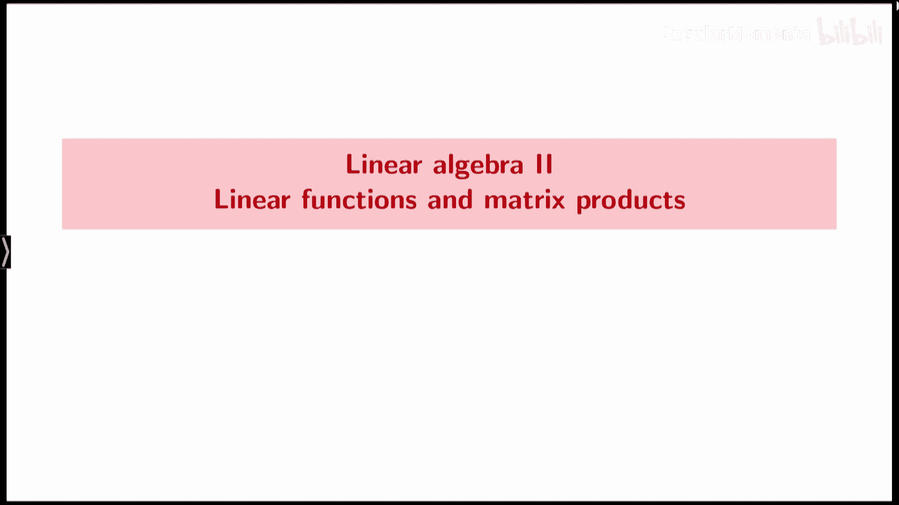


在本节课中，我们将继续回顾线性代数。我们将基于向量的点积，学习向量与矩阵、以及矩阵与矩阵之间的乘积。这些概念对于建模线性函数至关重要，而线性函数是本课程中最常用的函数类型之一。

## 线性函数与二次函数

上一节我们介绍了向量的点积，本节中我们来看看如何用矩阵和向量来描述更复杂的函数。

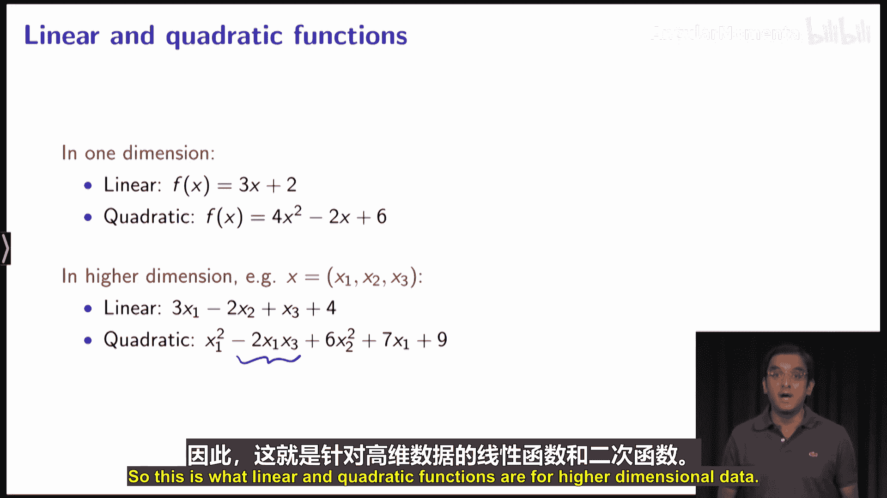

在一维空间中，一个变量的线性函数形式如 **3x + 2**。二次函数则允许包含平方项，例如 **4x² - 2x + 6**。

在更高维度（例如三维空间）中，线性函数是多个项的和。每个项要么是常数（如4），要么是某个变量的倍数。因此，其形式类似于 **3x₁ - 2x₂ + x₃ + 4**。

二次函数同样是项的和。每个项可以是常数、线性项、某个变量的平方（如 x₁² 或 6x₂²），或者是两个变量的成对乘积（如 -2x₁x₃）。

## 线性决策边界

我们将大量使用线性函数。例如，支持向量机、逻辑回归等许多方法都基于线性决策边界。

假设数据位于二维空间，线性决策边界就是一条直线，如下图所示。决策边界的一侧被分类为“+”，另一侧被分类为“-”。

这条直线的方程是 **4x₁ + 3x₂ = 12**。我们可以验证点 (3,0) 和 (0,4) 都满足此方程，因此它确实是图中的红线。

在 D 维空间中，线性边界是上述形式的直接推广。当 x 是一个具有 D 个分量的向量 (x₁, ..., x_D) 时，一个线性分隔器的形式为：
**w₁x₁ + w₂x₂ + ... + w_D x_D = c**

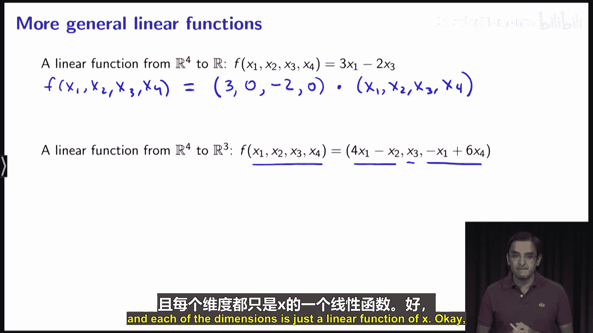

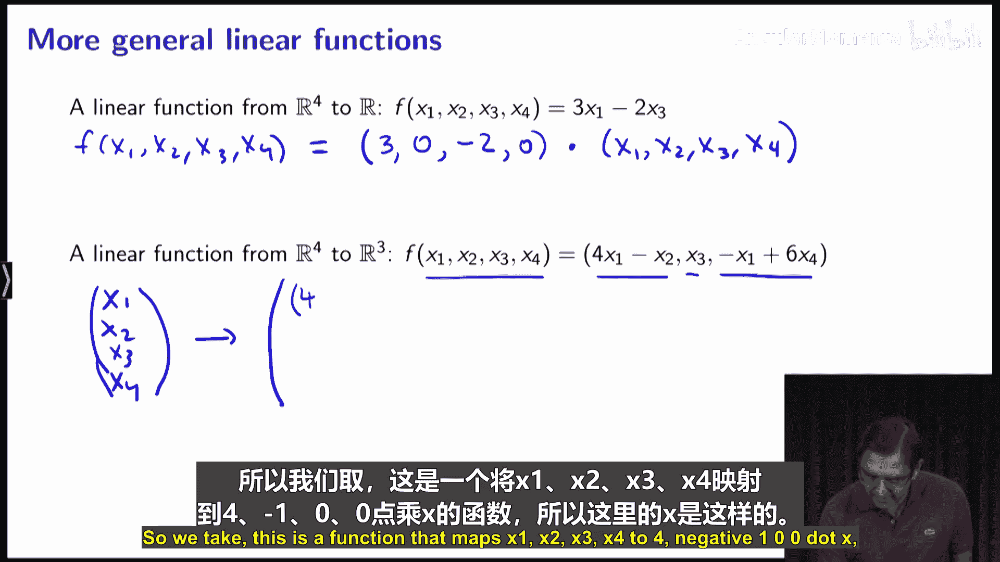

观察等式左边，它很像一个点积。事实上，它可以写成 **w · x = c**，其中 w 是系数向量 (w₁, ..., w_D)。因此，点积允许我们表达线性边界。

## 用矩阵表示线性函数

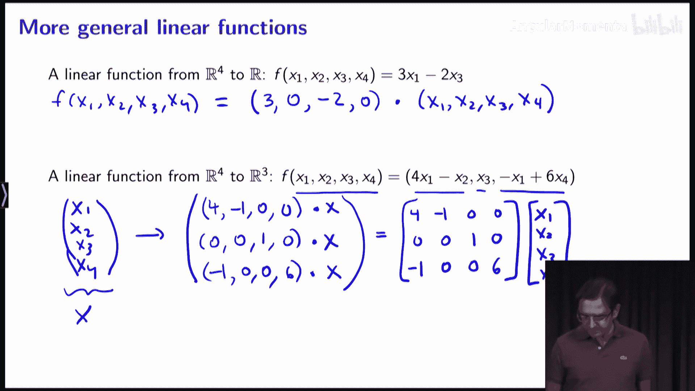

让我们看另一个例子，并进行一些推广。

首先，我们有一个函数，它接收一个四维向量 (x₁, x₂, x₃, x₄)，并返回这些特征的线性函数。我们可以将其写为点积：
**f(x) = [3, 0, -2, 0] · [x₁, x₂, x₃, x₄]**

现在看第二个例子，这是一个推广。它同样接收一个四维向量，但这次输出一个三维向量。输出的每个维度都是 x 的线性函数。

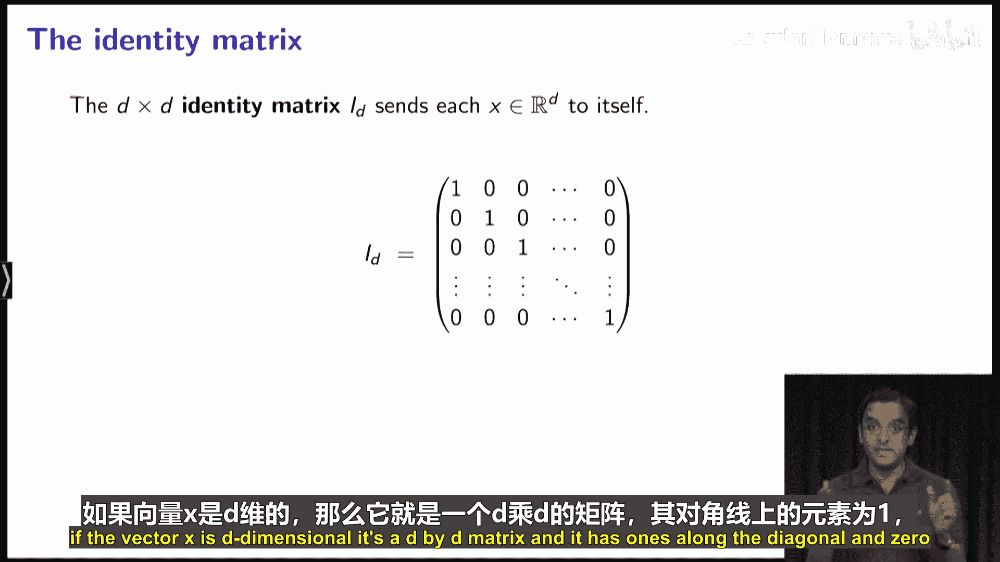

我们可以这样写：
- 第一个坐标： **[4, -1, 0, 0] · x**
- 第二个坐标： **[0, 0, 1, 0] · x**
- 第三个坐标： **[-1, 0, 0, 6] · x**

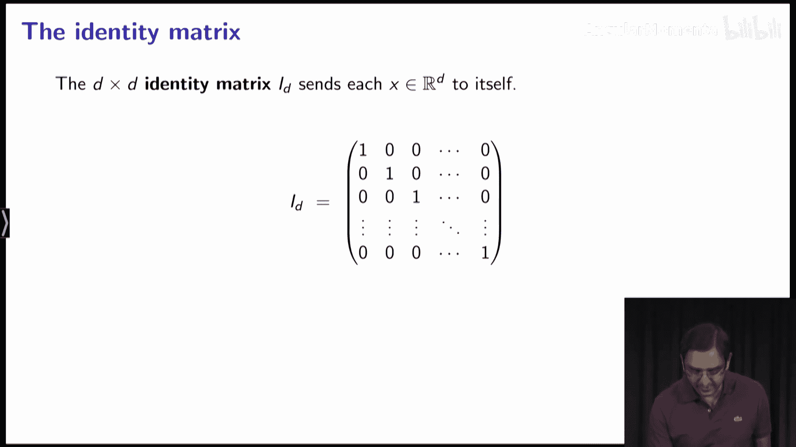

我们可以使用矩阵更简洁地表达这个函数：
```
[ 4  -1   0   0 ]   [ x₁ ]
[ 0   0   1   0 ] * [ x₂ ]
[ -1  0   0   6 ]   [ x₃ ]
                    [ x₄ ]
```
我们将其表示为矩阵乘以向量。


## 矩阵-向量乘积

现在，让我们更抽象地讨论矩阵-向量乘积。如何将一个矩阵乘以一个向量？

假设我们有一个 R × D 的矩阵 M，意味着它有 R 行和 D 列。我们可以将行表示为 m₁, m₂, ..., m_R，每行是一个 D 维向量。

我们将这个矩阵乘以一个 D × 1 的向量 x。结果是一个 R × 1 的向量，其计算方式如下：
**Mx = [ m₁·x, m₂·x, ..., m_R·x ]^T**

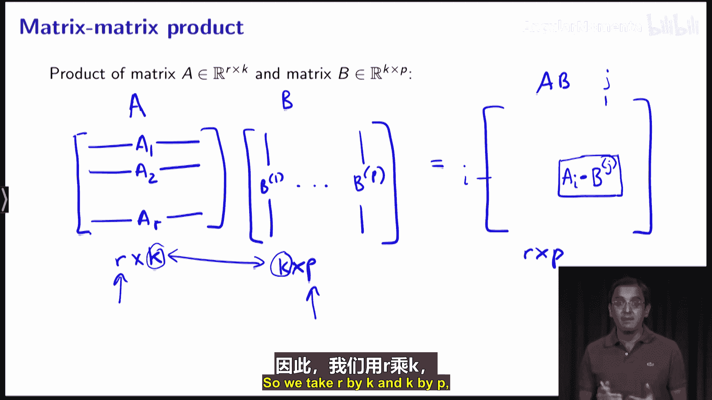


矩阵-向量乘积就是一系列点积。它捕获了一个线性函数。

最简单的线性函数是将 x 映射到自身的恒等函数。实现此功能的矩阵是单位矩阵 I。如果向量 x 是 D 维的，则单位矩阵 I_D 是一个 D × D 的矩阵，其对角线元素为 1，其他元素为 0。因此，**I_D * x = x**。

## 矩阵-矩阵乘积

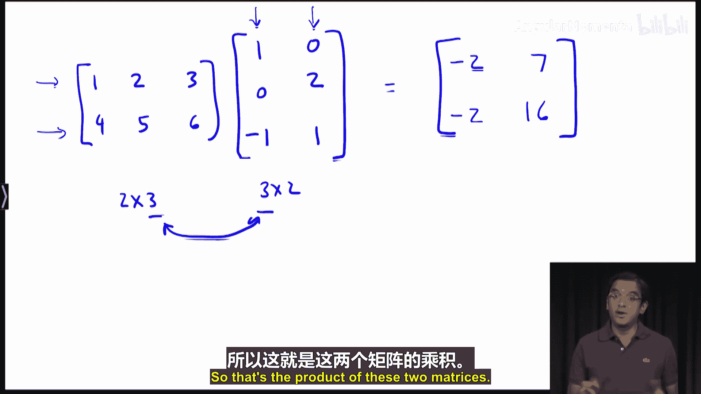

接下来，我们看看如何将一个矩阵乘以另一个矩阵。其规则同样基于点积，非常简单。

假设我们有一个 R × K 的矩阵 A，以及一个 K × P 的矩阵 B。乘积 AB 将是一个 R × P 的矩阵。

乘积矩阵中第 i 行、第 j 列的元素 (AB)_{ij} 计算如下：
**(AB)_{ij} = A的第i行 · B的第j列**

为了计算乘积，我们取 A 的每一行与 B 的每一列进行点积。这意味着，两个矩阵相乘时，**内部维度必须一致**（即 A 的列数必须等于 B 的行数，均为 K）。乘积矩阵的维度由**外部维度**给出（即 R × P）。

让我们看一个例子：
```
A = [1 2 3]   B = [1  0]
    [4 5 6]       [0  2]
                  [-1 1]
```
A 是 2×3，B 是 3×2，内部维度一致（均为3）。乘积将是 2×2 的矩阵。
计算过程如下：
- (1,1) 位置： [1,2,3]·[1,0,-1] = 1 - 3 = -2
- (1,2) 位置： [1,2,3]·[0,2,1] = 0 + 4 + 3 = 7
- (2,1) 位置： [4,5,6]·[1,0,-1] = 4 - 6 = -2
- (2,2) 位置： [4,5,6]·[0,2,1] = 0 + 10 + 6 = 16
因此，**AB = [ -2, 7; -2, 16 ]**。

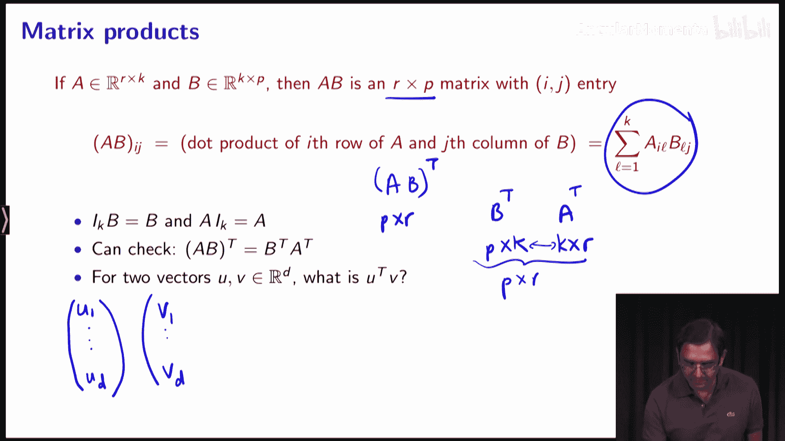

## 重要性质

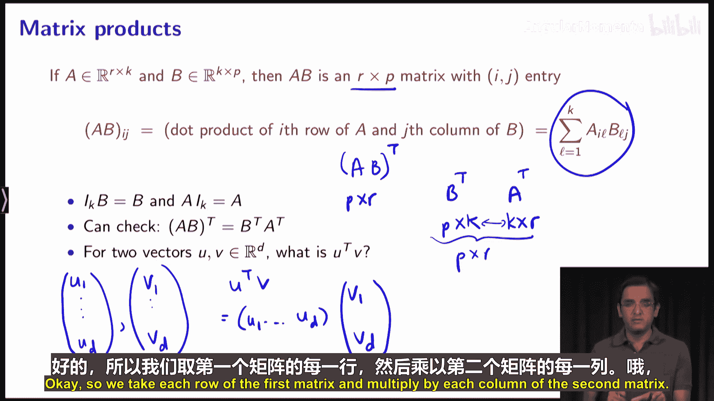

矩阵乘法有一些重要性质：

1.  **乘以单位矩阵**：任何矩阵乘以相应维度的单位矩阵，其值不变。**A * I = I * A = A**。
2.  **乘积的转置**：乘积的转置等于转置矩阵以相反顺序的乘积。**(AB)^T = B^T A^T**。
3.  **向量点积的矩阵表示**：两个向量 u 和 v 的点积可以写成矩阵形式。**u · v = u^T v**。这是一个非常有用的等式，可以简化许多计算。

让我们看几个基于此的例子：
- **x^T x**：这是向量 x 与自身的点积，结果是一个标量，等于向量长度的平方 **||x||²**。
- **x x^T**：这是一个 D × D 的矩阵，其第 (i, j) 个元素是 **x_i * x_j**，即 x 各特征的所有成对乘积。

这两个表达式看起来相似，但完全不同。一个产生标量，另一个产生矩阵。这引出了一个关键点。

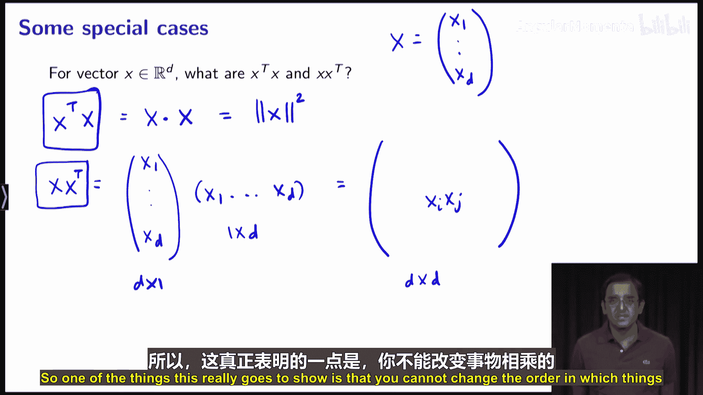

## 矩阵乘法的不可交换性

在一般情况下，矩阵乘法是**不可交换**的。**AB ≠ BA**，除非在特殊情况下。

例如：
```
A = [1 2]   B = [1 0]
    [0 0]       [0 1]
```
计算可得：
**AB = [1 2; 0 0]**，而 **BA = [1 2; 0 0]**？等等，让我们准确计算一下第二个：
BA = [1*1+0*0, 1*2+0*0; 0*1+1*0, 0*2+1*0] = [1, 2; 0, 0]。在这个特例中它们相等，但通常不相等。另一个更明显的例子：
```
A = [1 2]   B = [0 1]
    [3 4]       [1 0]
```
AB = [2, 1; 4, 3]，而 BA = [3, 4; 1, 2]，两者完全不同。

因此，不能随意交换矩阵乘法的顺序。

然而，矩阵乘法满足**结合律**。当连续乘以多个矩阵时，只要保持矩阵的原始顺序，可以任意选择先计算哪一对乘积。例如，计算 A * B * C * D 时，可以先算 (A*B)，再算 (C*D)，然后将结果相乘；或者先算 (B*C)，再左乘 A，右乘 D。

结合律在简化复杂表达式时非常有用。例如，计算包含多个 **x^T x**（这是一个标量）的复杂矩阵链式乘法时，可以优先计算这些标量乘积，从而大大简化整个表达式。

## 总结

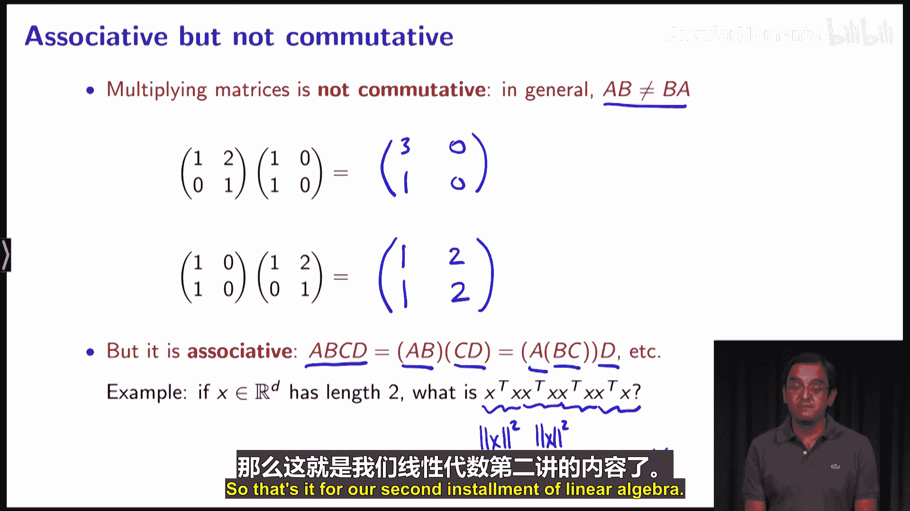

本节课中我们一起学习了线性代数的核心运算。我们了解了如何用矩阵和向量表示线性与二次函数，掌握了矩阵-向量以及矩阵-矩阵乘积的计算方法和几何意义。我们特别强调了点积与矩阵乘法的关系（**u·v = u^T v**），以及矩阵乘法不可交换但满足结合律的重要性质。这些工具和概念是后续构建和理解机器学习模型（如线性分类器）的基础。现在，我们已经具备了建模线性函数所需的所有符号和工具，这在本课程中将有大量应用。