# 【加州大学圣地亚哥分校】机器学习基础  Machine Learning Fundamentals p15 04-03-02-线性代数_III -BV1TyFSziEZb_p15-

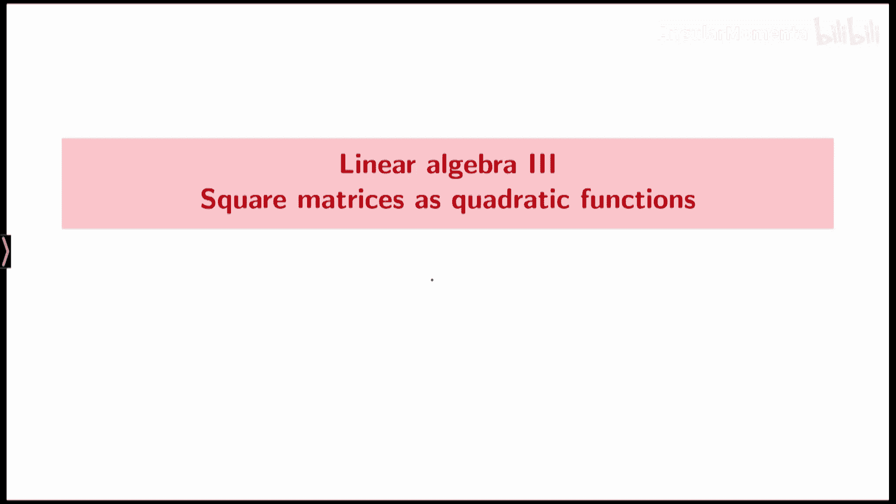

In an earlier inalment of our linear algebra primer。

 we saw that any matrix can be thought of as representing a linear function。

What we'll see today is that if the matrix is square。

So if it has the same number of rows and columns。Then it also represents a quadratic function。

So today is going to be all about square matrices and their properties。

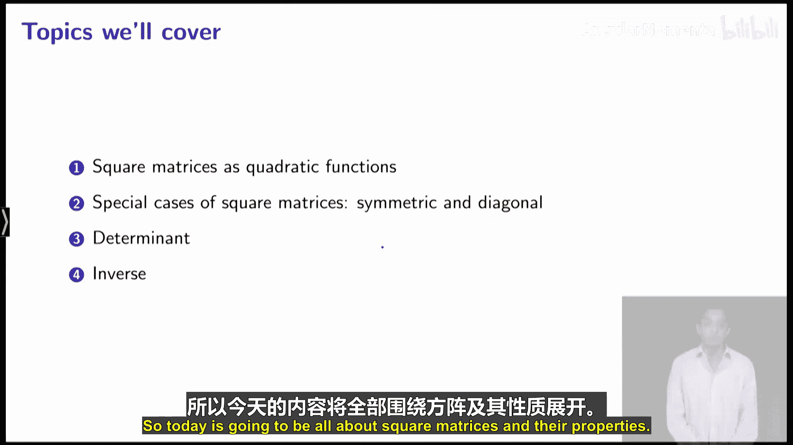

So let's start。With a special case that we saw before。So one thing we found。

Is that if you have a vector x。That x transpose x is just another way of writing the dot product of x with itself。

 which is the length of x squared。In fact， you can also think of this as being x transpose times the identity。

Times x， because the identity times x is just x。Okay。

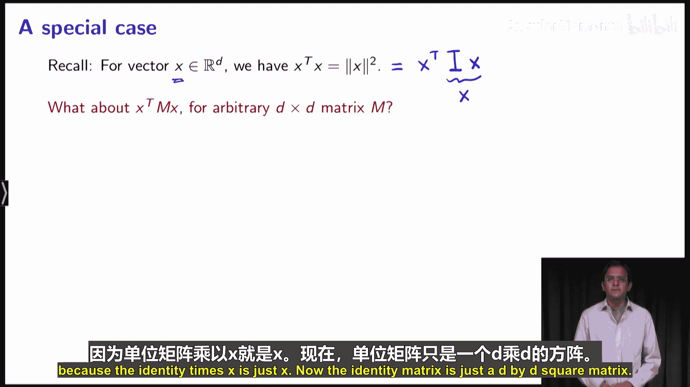

Now， the identity matrix is just a D by D square matrix。What if instead of having the identity there。

 we put some other D by D matrix in the middle。What if we use x transpose Mx。

 where M is just any any arbitrary D by D matrix， What do we get？Okay， so let's take a look。

 so we have x transpose， that means takess x and make it into a row。We have this matrix n。

 which is D by D。And then， we had。Just eggs， which they call them。So what are the sizes？

Here we have1 by D， here we have D by1。And so when we multiply things。

 we see that the inner dimensions agree。And the result is simply going to be the outer dimensions。

 which is one by one。 so the result is just going to be a single number。

 as we expected from the case of x transpo x。

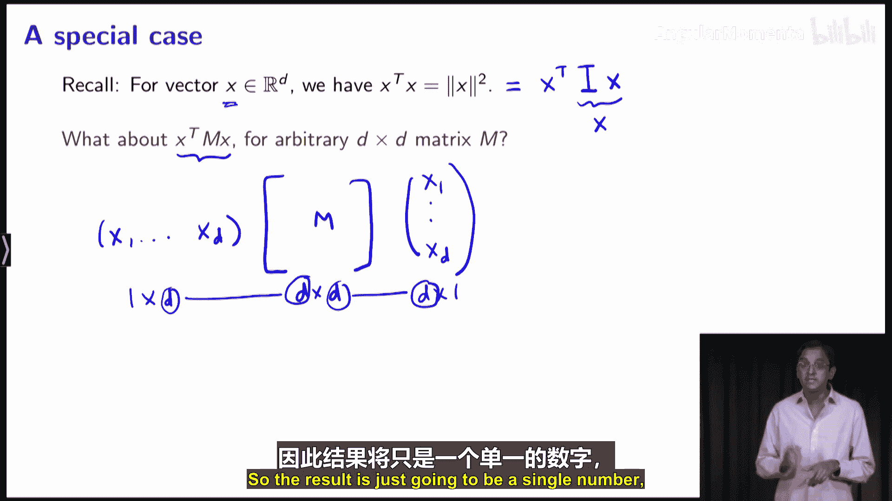

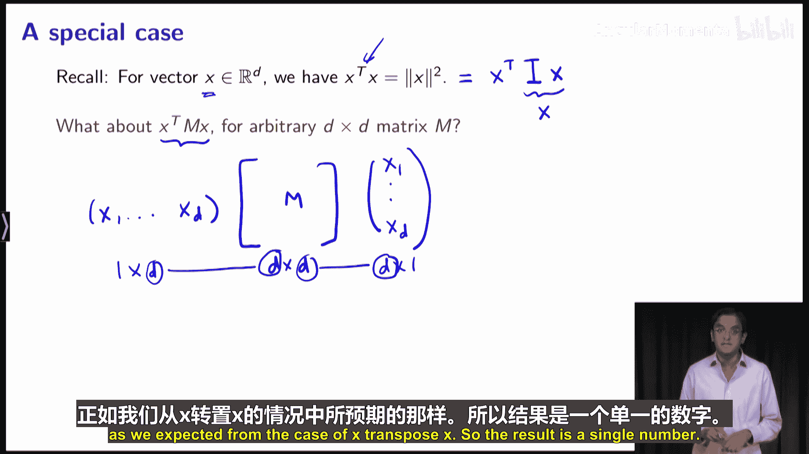

So the result is a single number。And in fact， I'll give you a formula for a number。

 it turns out that if you just expand this out， it's quite simple to do。It turns out to be the sum。

Over all I andJ。Of M I J X， I X J。And this is a quadratic function of x。 Okay。

 so each of these terms， it's the sum of a whole bunch of terms。

 Each of these terms has got some MI I J。 That's just a number from the matrix M some number like 2。

3，4， and so on。

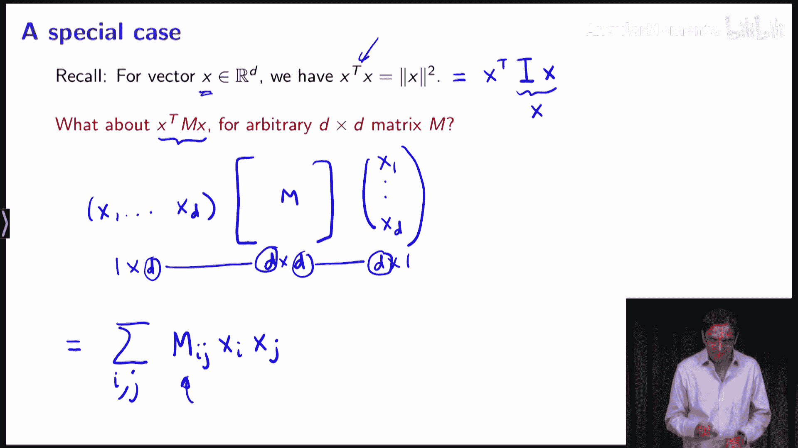

But the dependence on x is quadratic。The pairs of terms from x， X J。

 or also some terms like X squared。

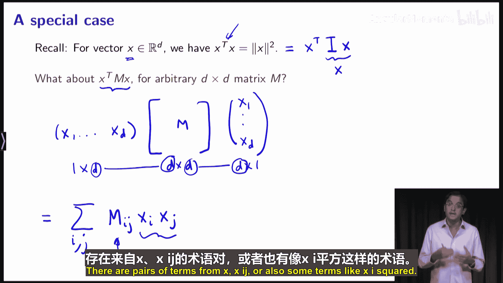

Let's see a specific example of this just to drive the point home。 Okay。

 so what if we have a matrix that's2 by two？What kind of quadratic function does this represent？Well。

 if the matrix is 2 by 2， these vectors x have to be two dimensional。

 so the function we are talking about is x1 x2。Times this matrix。Times x1 x2。

And we can just expand this out， okay， so let's start by doing this part。Okay， so we have。

 we'll copy over the x1x2， and let's just simplify the matrix times the vector what do we get？

We get x1 plus 2 x2。And 3 x2。So now we're multiplying together these two。

And this is a single dot product。 It is X1 squared。Plus2， x1， x2。Plus3 x2 squared。

And this is certainly a quadratic function。 all the terms in here are quadratic x1 squared， x1 x2。

 x2 squared。Okay。Let's actually go back and see how this squares with the formula I gave you earlier。

 This whole thing with the sum over I J of M I J。 Let's just copy that down and see that we actually get the same thing。

 Okay， so I said that it should work out to M， I J， X， I， X， J， the sum overall I J。

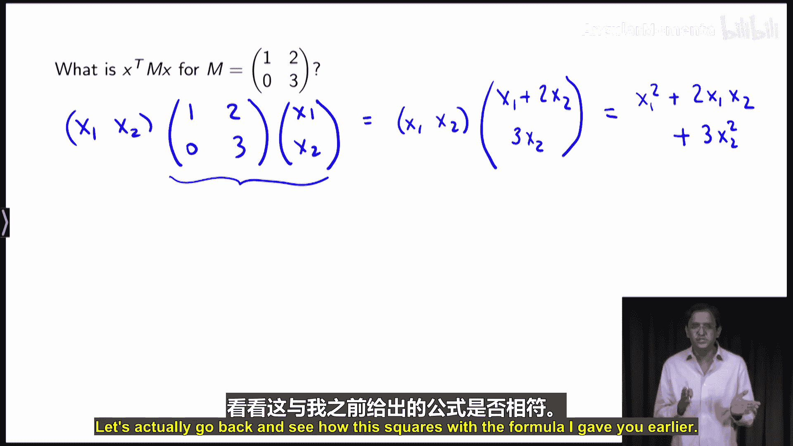

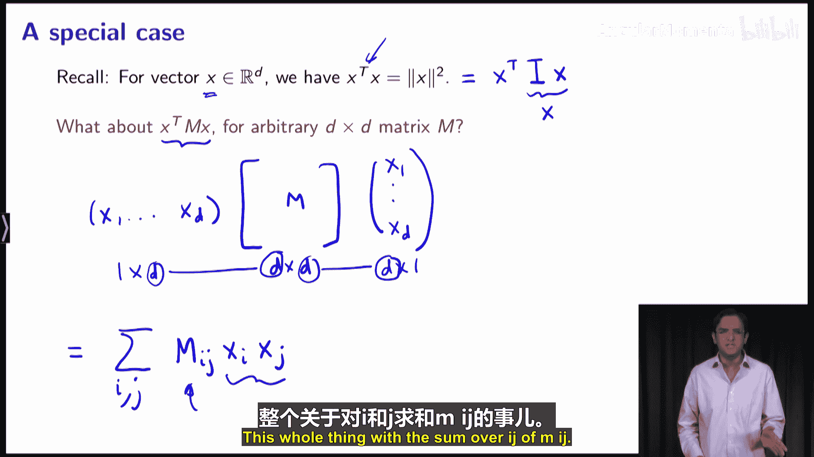

Okay， so what are I and J in this case？It's just two dimensional。

 so they're going to run over one and two。So this is equal to M1，1， x1， x1。

 Let's just write out all the terms， M1，2， x1， x2。M21， x2， x1 plus M2，2， x2， x 2。

Now we can go in and plug in the entries from the matrixtri M。Okay， so what's M11， that's 1， okay。

 so it's x1 squared。What's M12。 That's this entry over here。 It's a2。Plus 2 x1 x2。What is M21。

 that's a zero。And M22 is a3。And so you can see that it's exactly the formula we got simply by expanding out。

 And， in fact， that's how you get this summation。 If you just do what we did before。

 but in greater generality， you allow it to be de dimensional。

And you allow M to just consist of variables that haven't been defined yet。

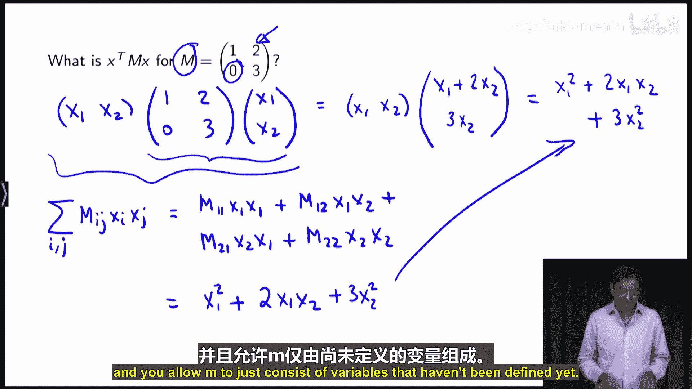

Okay。So here is a summary of the formula if you start with any square matrix n。

You can define a quadratic function by mapping x， a D dimensional vector to the number x transpose mx。

 and it works out to this summation over here。嗯。The summation actually lets us read out the quadratic function very easily。

 Okay， so for example， we have this matrix， what if the quadratic function associated with it。

It's something that sends three dimensional vectors to a single number。 So。

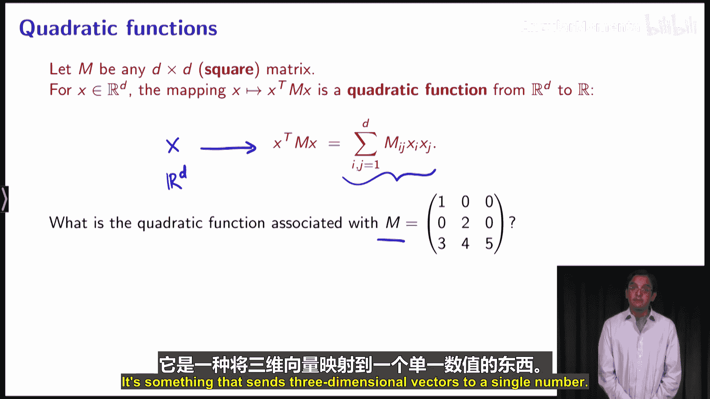

Have three dimensional vectors， x1， x2 x3。

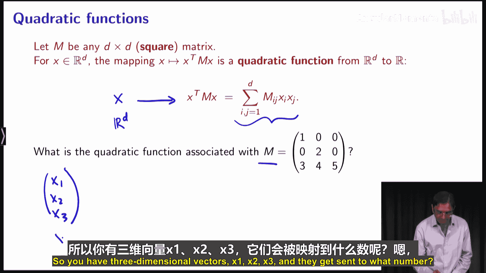

And they get sent。To what number Well， M11。Is one times。X1 squared。Then we have M22。Times x2 squared。

 then we have。M31。Times x3 x1。Then we have M32。Ts x3 x2。And then we have M33。Times x 3， x 3。

That is the quadratic function associated with this matrix。

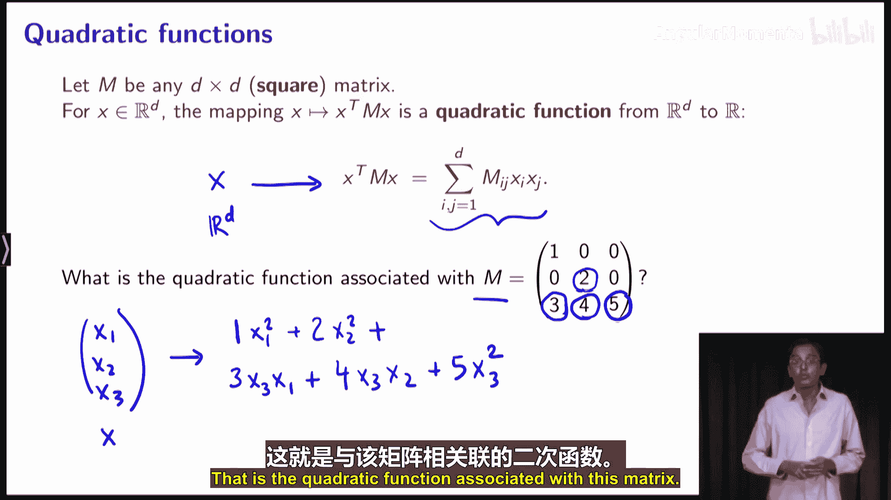

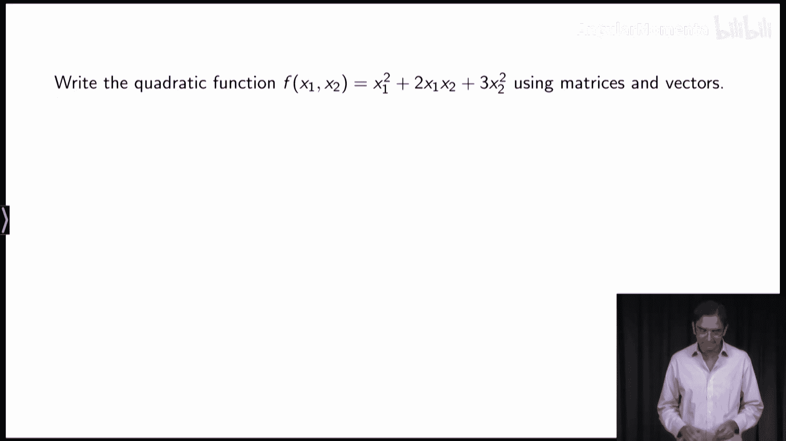

We can also try to reverse engineering things Okay， so here we have a quadratic function。

It takes a two dimensional vector and just returns a number。

How do we write this function using a matrix， What is the matrix that corresponds to this？Okay， well。

 these are two dimensional vector， so we're going to need a two by two matrix。

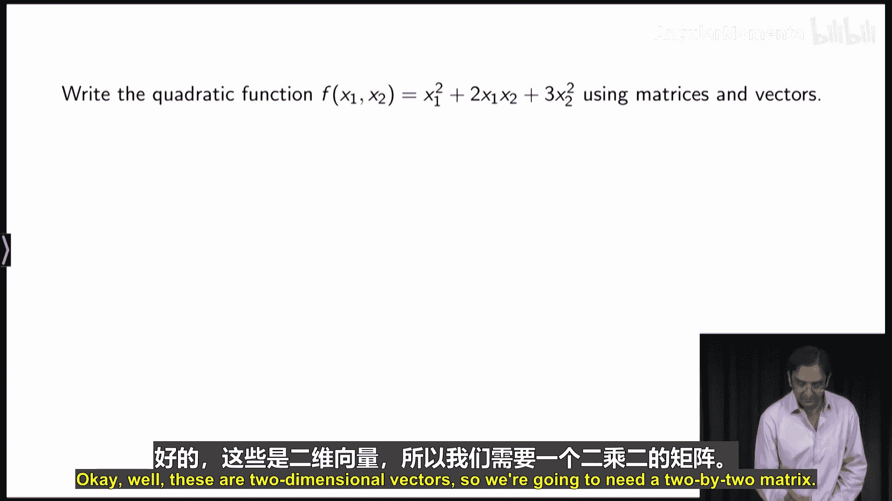

And so we had to fill in these four entries over here。Now。

 just from the fact that the leading coefficient here is a one， we know that this must be a one。

From the fact that this coefficient for x2 squared is a tree， we know that this must be a tree。

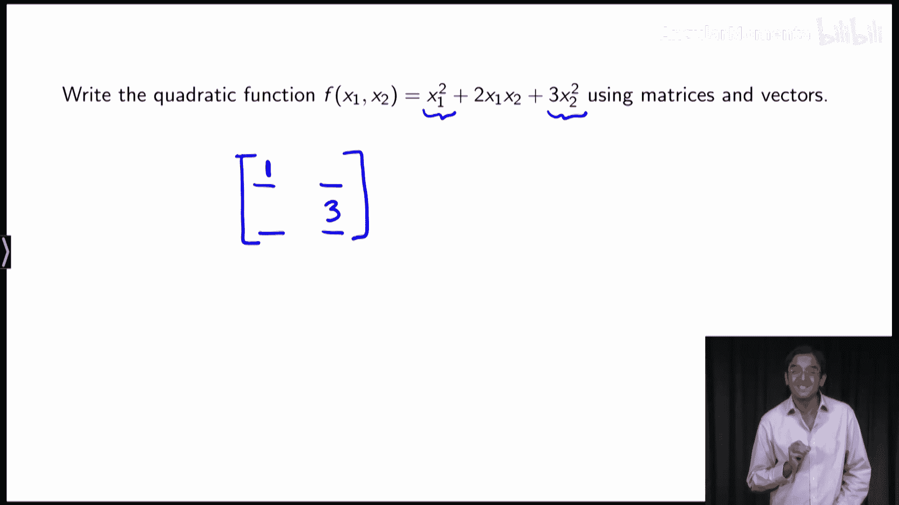

But it's not clear what these two numbers have to be。 So let's just call them A and B。

so what we know is that a plus b has to be equal to 2。

And so there are actually several ways to achieve this function。We could use a matrix like12，0，3。

Or we could use one， one。1，3。Or we could use 1，0，2，3。And so on。

 there are actually infinitely many possibilities。

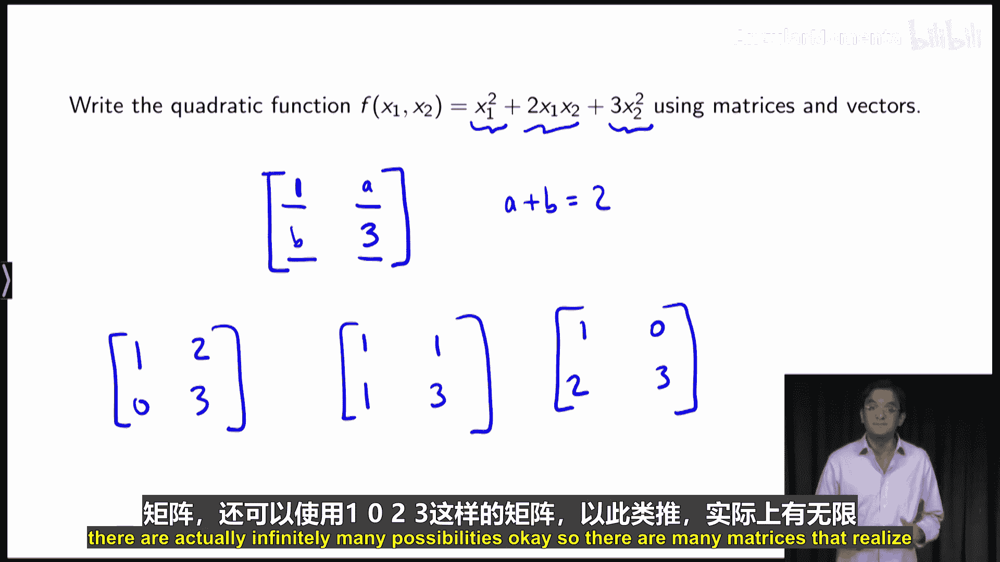

Okay， so there are many matrices that realize this particular quadratic function。😊，Okay。

So we've been talking about square matrices。A special type of square matrix is one that is symmetric。

 one that is equal to its transpose。

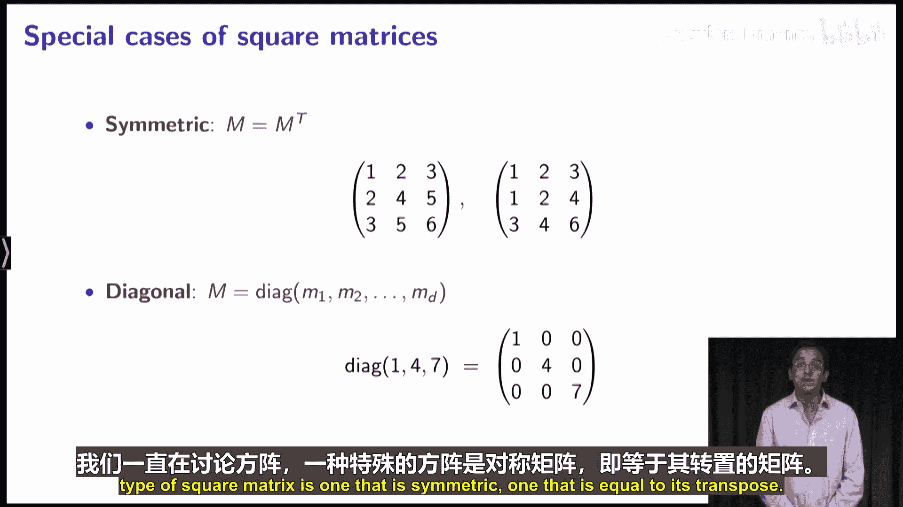

And what this means is that the matrix remains the same if you reflect it in the diagonal。

Here's an example of asymmetric matrix。Okay。

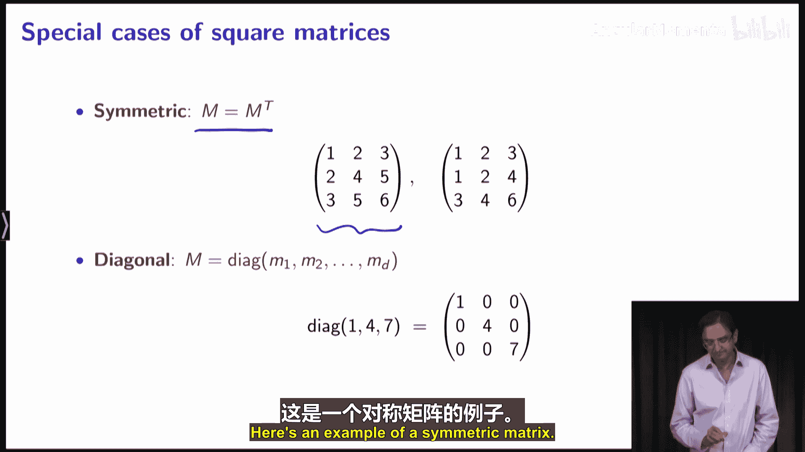

If you reflect in the diagonal。2 comes back to 2，3 comes back to 3。

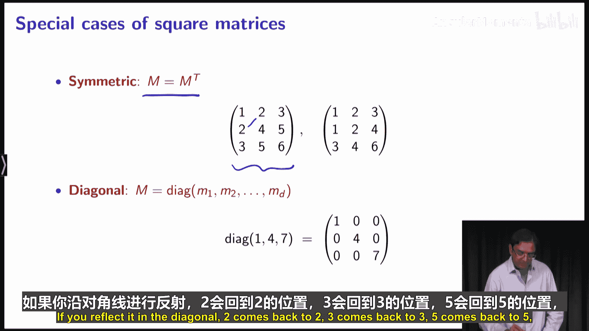

5 comes back to 5。So it's symmetric。The second matrix over here is not asymmetric。

Look at this one and two， for example， Okay， so this is a non symmetric matrix。

It turns out that many of the matrices we'll be dealing with will just automatically turn out to be symmetric。

 and this will simplify things quite a bit。

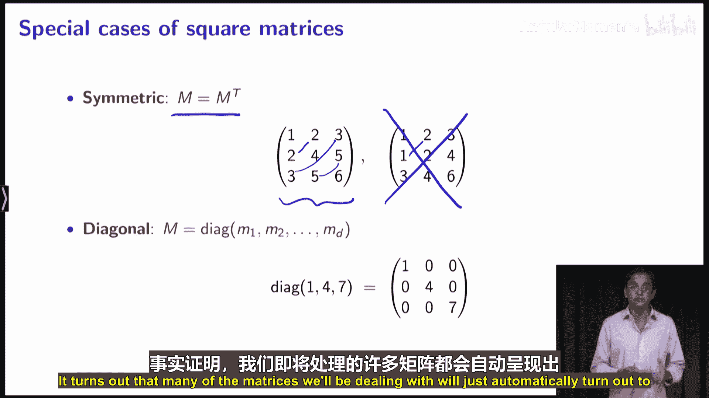

Now， an extra special case of a symmetric matrix is one that is diagonal。

A matrix whose only non zero entries are along the principal diagonal。 Okay， so one like this。

 So a diagonal matrix is 0 everywhere except along this diagonal over here。 And as a result。

 there is a very compact way of writing such matrices。

Since there's no point using d squared entries since most of them are0。

 we sometimes just use this shorthand over here。Okay。Now。

One of the key quantities associated with the square matrix is the determinant。

So if we have a matrix A。The determinant is just some number。

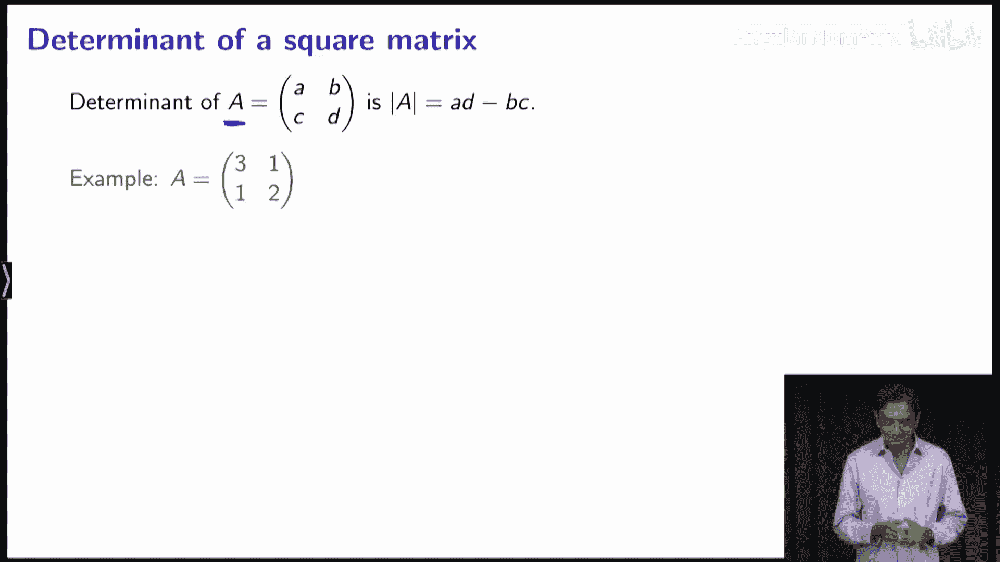

And we represent it using these bars， so we put these bars around a。

And you might remember from high school or。Early college that the determinant of a two by two matrix。

ABC D is AD D minus BC。Okay， so for example， if we have this two by2 matrix over here。

 the determinant of a。Is three times2。Minus1 times1， which is5。Okay， it seems a little bit random。

Does the determinant actually mean anything？So it turns out that it does okay。

 so let's look at this specific matrix。😊，Let's think of the rows of the matrix as being data points Okay。

 so we have these two data points。And let's just go ahead and plot these points。Okay， so we have one。

 two， three， four， five，6。1，2，3，4，5，6。Okay， the first point is31。The second point is one，2。Okay。

 so we've gone ahead and we've plotted those two points。Now。

 let's take these two points and extend them to get a full parallelogramm。 Okay。

 so we had this31 and now we take another one， too， and we come out here。

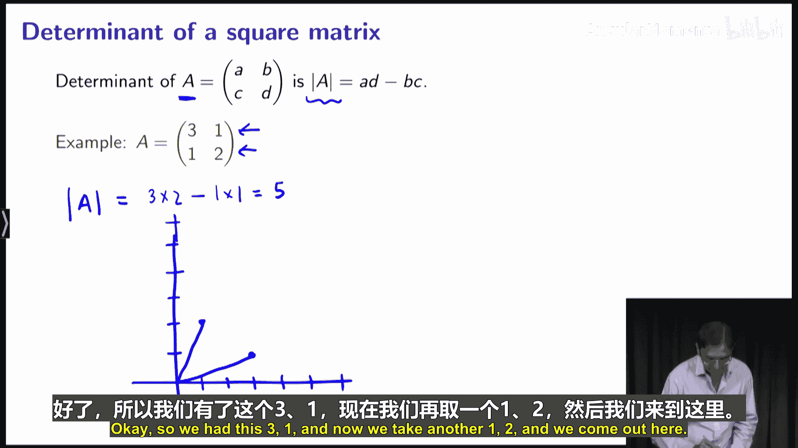

So now we have a parallelogram。What is the area of this parallelogram？ It turns out to be5。

That's what the determinant is。If you think of each row of the matrix as being a data point。

And you plot those points。And you create the parallelogram。

 The determinant is the area of the ball parallelogram。 And this works not just in two dimensions。

 It works in D dimensions as well。 If you have a D by D square matrix。

You look at the rows of that matrix。 You plot those points in de dimensional space。

 You extend them into a parallelogram when it's in higher dimension。

 instead of being called a parallelogram， it's called a parallel pipeedte。

 So extend it into a parallel pipeedte。 The volume of that object is the determinant of the matrix。

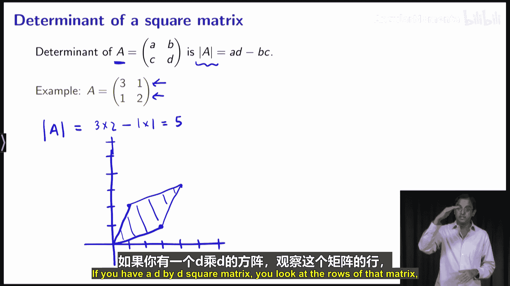

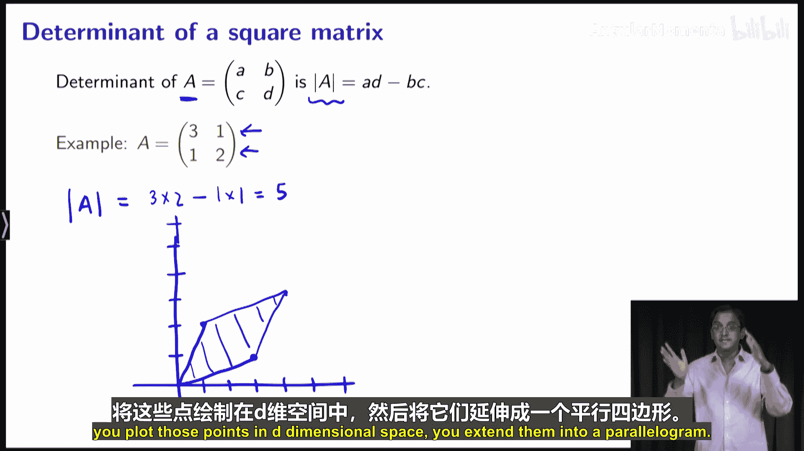

Okay， so let's actually go ahead and check that with an example we probably。

been an example that would be familiar to us， what if we take a three by three matrix， okay？

Like， let's take this matrix over here。Let's go ahead and plot these points in3D。

 let's say A B and C are positive， Okay， so we have our three axes。X1。X2。

 I'll just draw the third axis over here， x3。So along the x1 axis。

 our first point lies along the X1 axis， it's a。Our second point lies along the x2 axis。

 It's B over here。And our third point lies along the X3 axis or its's C over here。

 And now we extend this。Into a three dimensional body。Not very good artwork I confessfes， okay？

What is the volume of this thing， Well we know this the volume of this is just ABC。Okay。

 now let's go back to what we were saying about determinants。 Is the determinant of this matrix ABC。

Indeed， it is the determinant of a diagonal matrix is just the product of the diagonal elements。

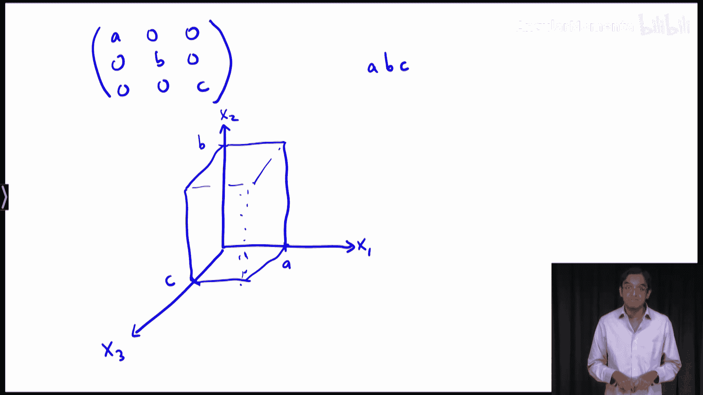

嗯。Okay， so a very important quantity associated with the square matrix is the inverse。 Okay。

 so if you have a square matrix， a D by D matrix A。😊，The inverse is some other matrix B。

Such that a times B is the identity and B times a is the identity。

 So what this means among other things， is that B has to also be a D by D matrix and the notation we'll use it that we'll call this matrix B we'll just call it a to the minus1。

 the inverse of a。

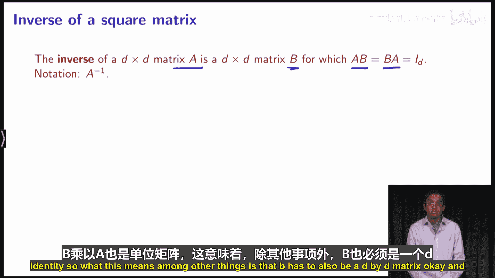

So let's do a little bit of an example。Here's the2 by two matrix A。And unclaiming。

That this particular matrix is the inverse of a。 Okay。

 so let's check and see if this is really the case。So1，2， minus2，0， that's a。

And the thing that I'm claiming is the inverse is 0 minus a half。

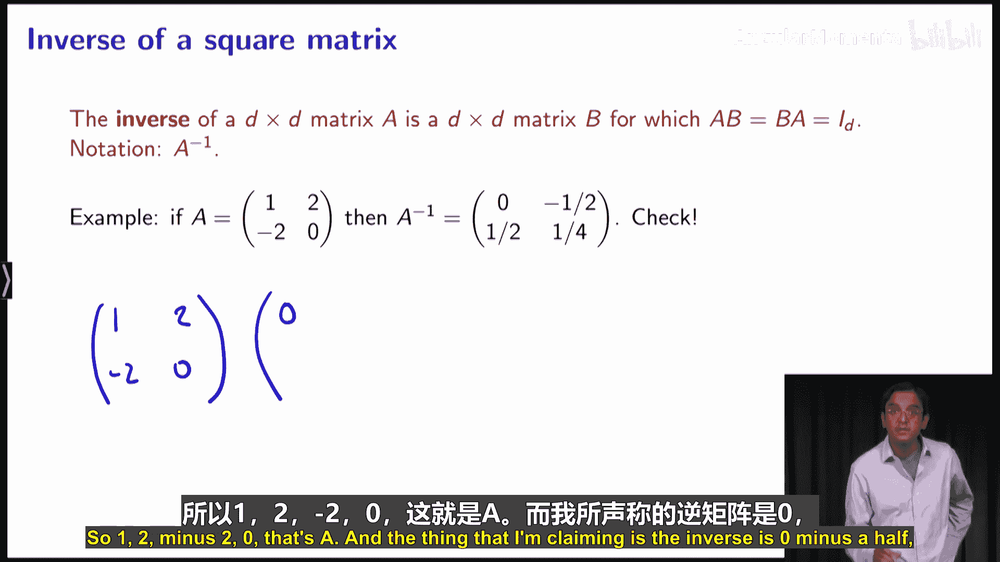

A half and a quarter。Let's see what this multiplies out to。 Okay。

 so the first row v times the first column of B， okay， so we get one。

The first row of a times the second column would be， we get negative a half plus a half that 0。

The second row A time the first column would be。We get zero。

The second rowt times the second column would B， we get。1 plus 01。

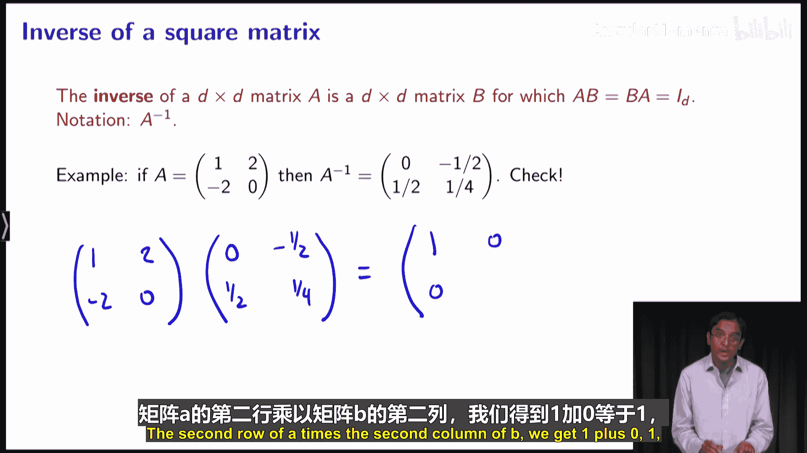

Which is indeed the identity matrix， so this is the inverse。

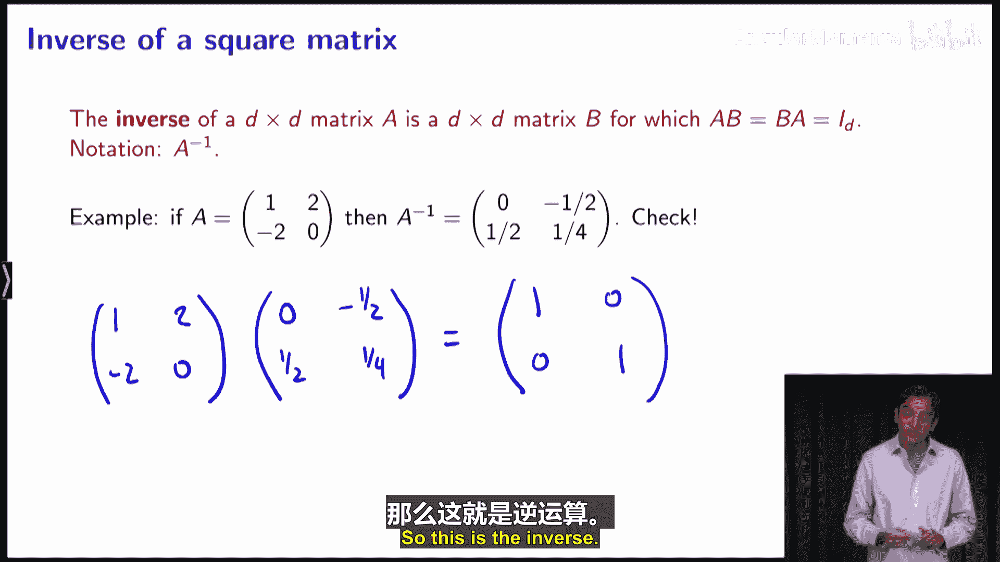

Now there are a few things about inverses that really should be emphasized， first of all。

 they don't always exist。

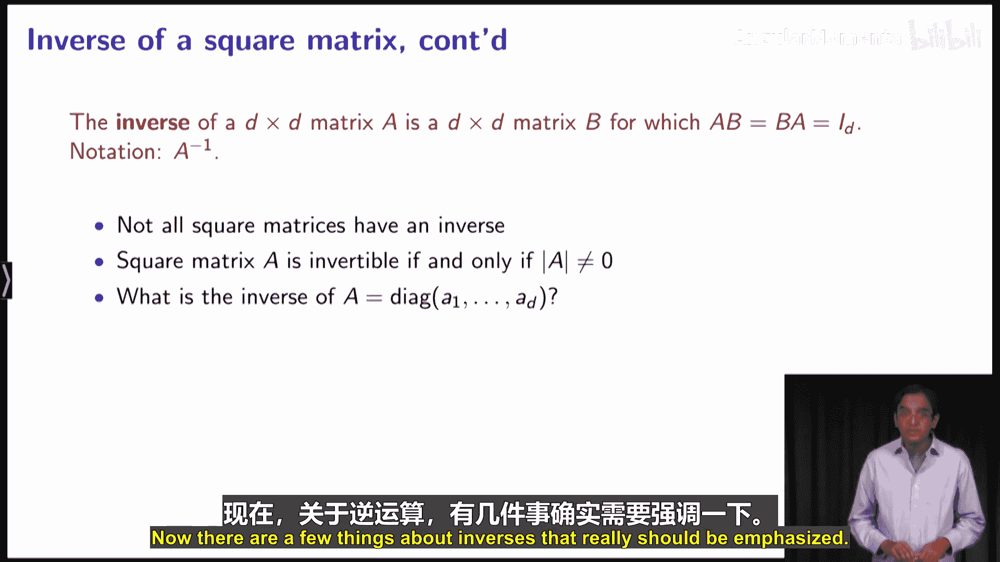

There are many square matrices that don't have it inverse， and we call those matrices singular。 Okay。

 so a matrix is singular。If it's not invertible。And it's something fairly common。Okay。

The second thing is that there's an easy way to assess singularity。

A matrix is singular if its determinant is 0。 so another way to put it is a matrix is invertible。

 if then only if its determinant is non0。Okay， and so now let's look at a special case。

 suppose we have a diagonal matrix。😊。

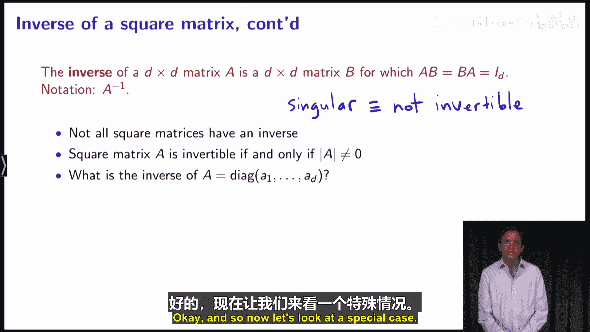

A 1 to80。What is its simple？we have a diagonal matrix， A1 to AD。If you remember the notation。

 it means that this is the matrix we're talking about all the entries off the diagonal are0。

 it's a D by D matrix。

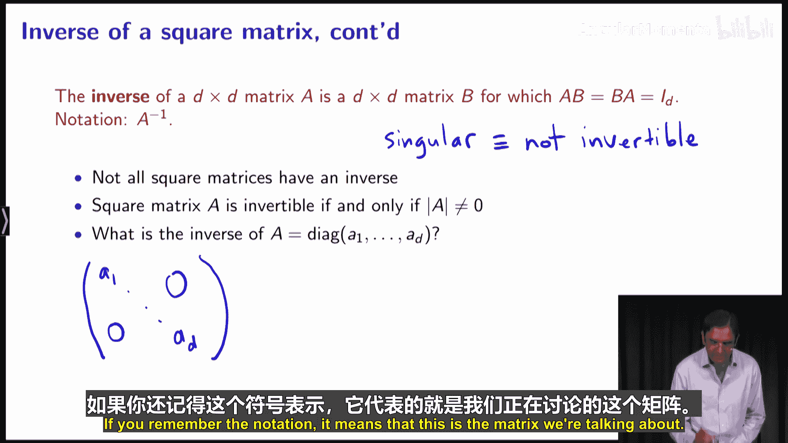

First of all。Can a matrix like this ever be singular， non invertible。 Yes， it can。

 So if you recall the determinant of a matrix like this。

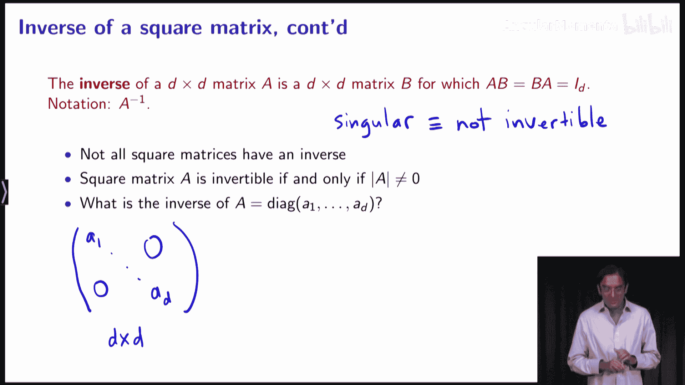

It's just the product of all the diagonal entries， so it's a1。Times a2， all the way to AD D。

And we want this product to not be zero。Okay， so we need。All the AI to be nonze。If that's the case。

 then the determinant is not0 and the matrix is invertible。And what is the inverse？Well。

 it's very simple。You just invert each of the diagonal entries。

And that's the overall inverse of the matrix。Okay， well。

 that's it for the third installment of our linear algebra primer。

 This is going to hold us for a little while， so we'll give it a week or two to sink in and then we'll come back in a little while and do a little bit more linear algebra。

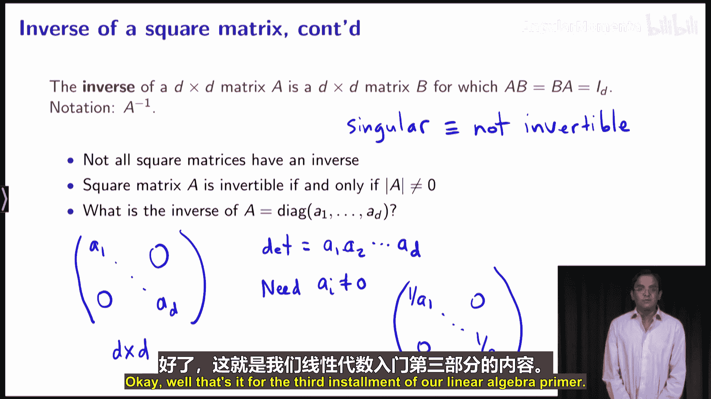