# 【加州大学圣地亚哥分校】机器学习基础  Machine Learning Fundamentals p17 04-05-02-高斯生成模型 -BV1TyFSziEZb_p17-

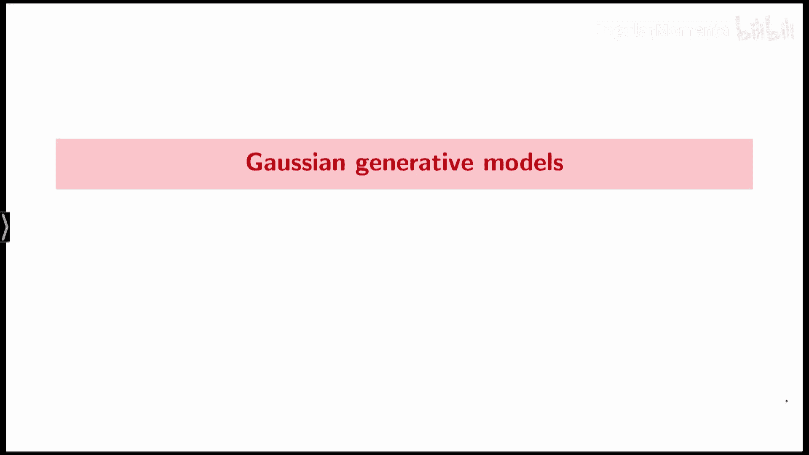

So we have just seen the multivariate Gaussian。A popular and powerful probability distribution for data of arbitrary dimension。

Today， we look at using these distributions to build classifiers。Now。

 we've gone over the generative approach to classification in which we fit a probability distribution to each class individually。

 What we'll look at today is the kinds of decision boundaries that result from doing this。

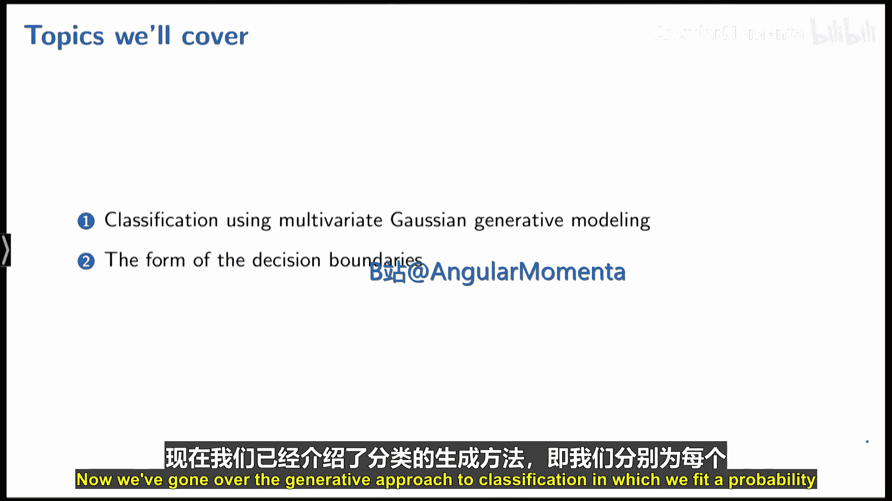

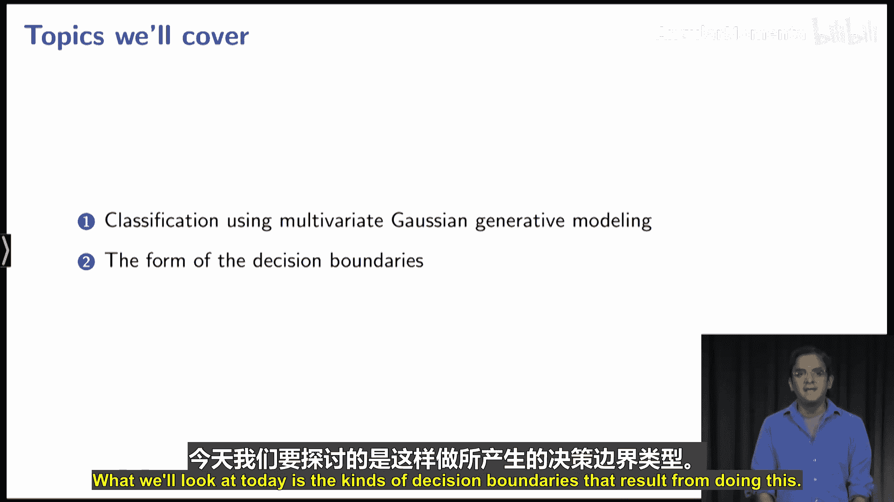

So let's start by going back to the winery data。If you remember。

 this was a data set with three classes representing three different wineries and 13 features。

We started by just picking one of the features， alcohol level。

And we fit a one dimensional Gaussian to this feature for each of the three classes。

The resulting classifier had an error rate of 29 per cent on the test set， not very good at all。

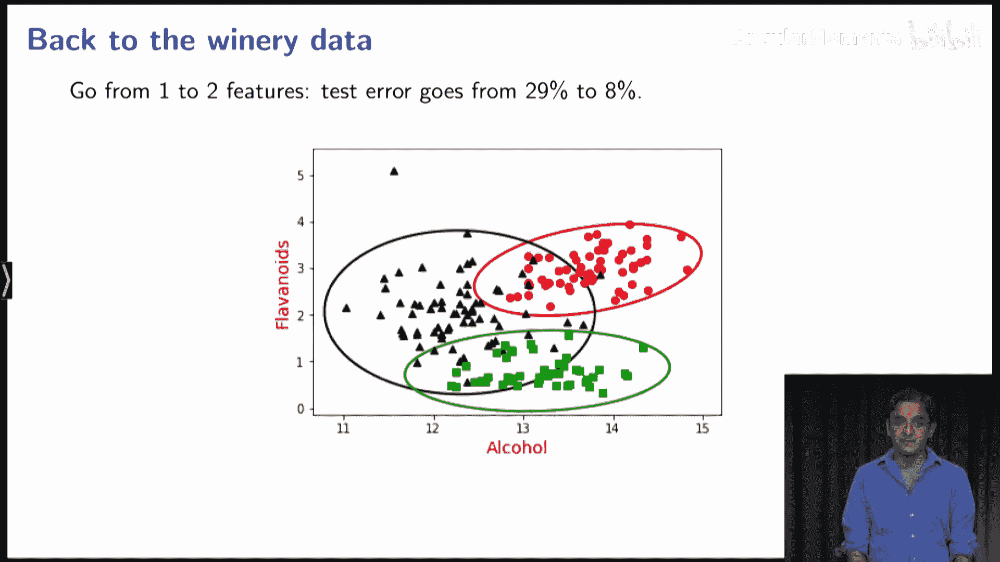

Then we added a second feature， flonoids。And we fit a bivariate Gaussian to each class。

 and that's what you see over here。

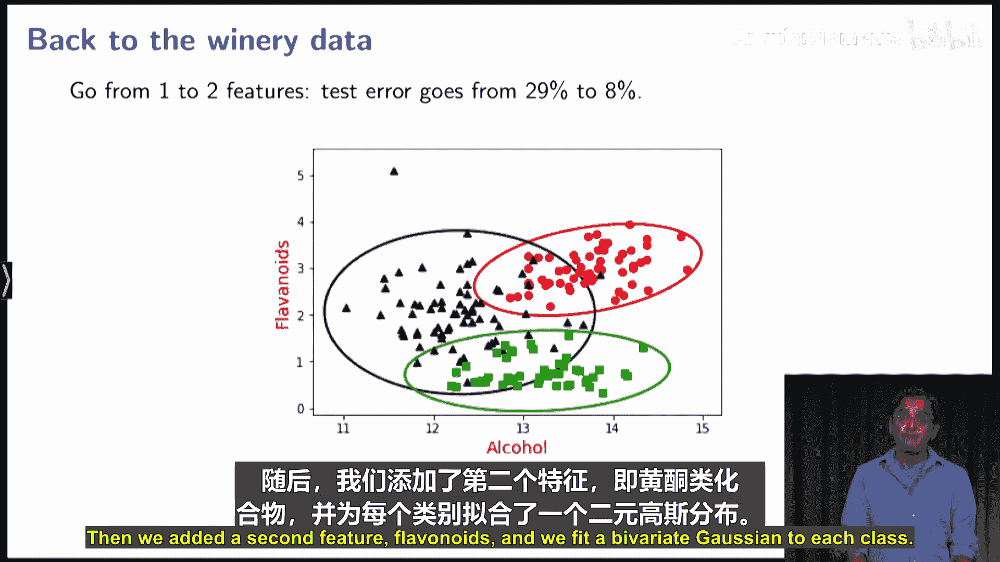

The three ellipsoids that resulted。And the classification boundary， the decision boundary。

 turned out to be this。

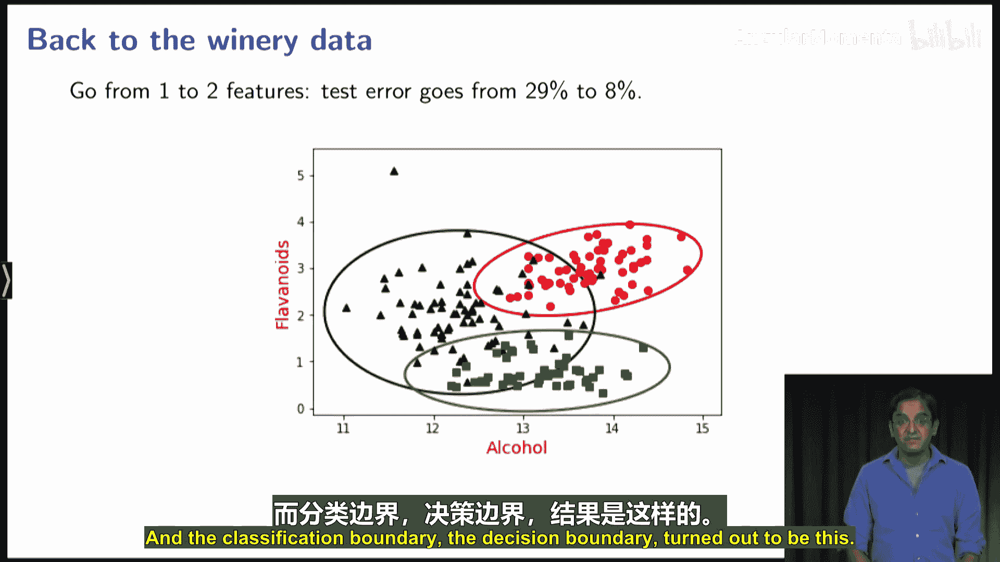

So the points over here。

Get classified as red。 The points over here， get classified as green。

 The points over here get classified as black。 And adding the second feature made the test error drop from 29 per cent to just 8 per cent。

But now that we have the multivariate Gaussian under control， we can use all 13 of the features。

So we can fit a multivariate Gaussian to the 13 features for winery1 and another one for winery 2 and another one for winery 3。

And then apply Bays rule for classification if we do that。

 we see that the test error actually goes down to zero。Does that mean that it's a perfect classifier？

No， it doesn't really mean that for one thing the Te said is not that large。

 it consists just of 48 points。But it does mean that it's a much better classifier than what we were able to obtain using just one or two features。

And it's a sign that it can be very beneficial to include multiple relevant features。Okay。

So now let's look at the decision boundaries that you get in general from Gaussian generative modeling？

😔。

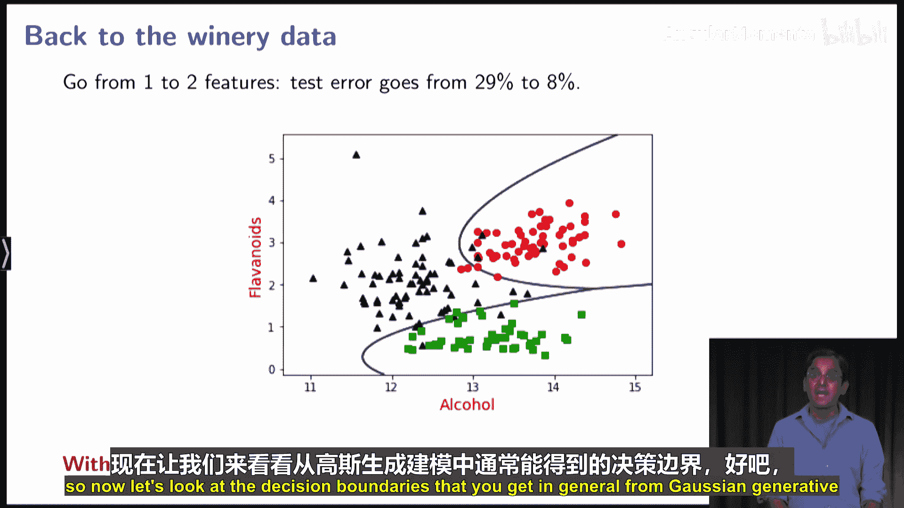

So the multivariate Gaussian has this density that we've gone over。And。

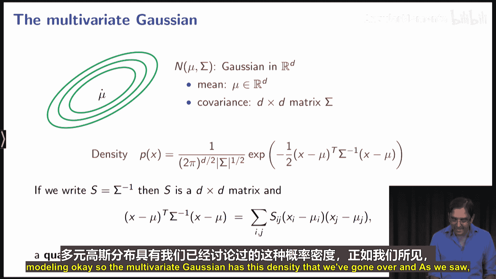

As we saw， the first part of the density is really just a normalizing factor。

The important part is the stuff inside the exponent， which is a quadratic function。

Now that quadra isn in the exponent， is there a way to bring it down？There is。

 if you want to bring it down， what you need to do is to take the logarithm of the density。

 let's see what happens if we do that， Let's take log of P of x。

So the first part just becomes some constant。And the part in the exponent then becomes negative a half。

X minus mu transpose Sigma inverse x minus mu。

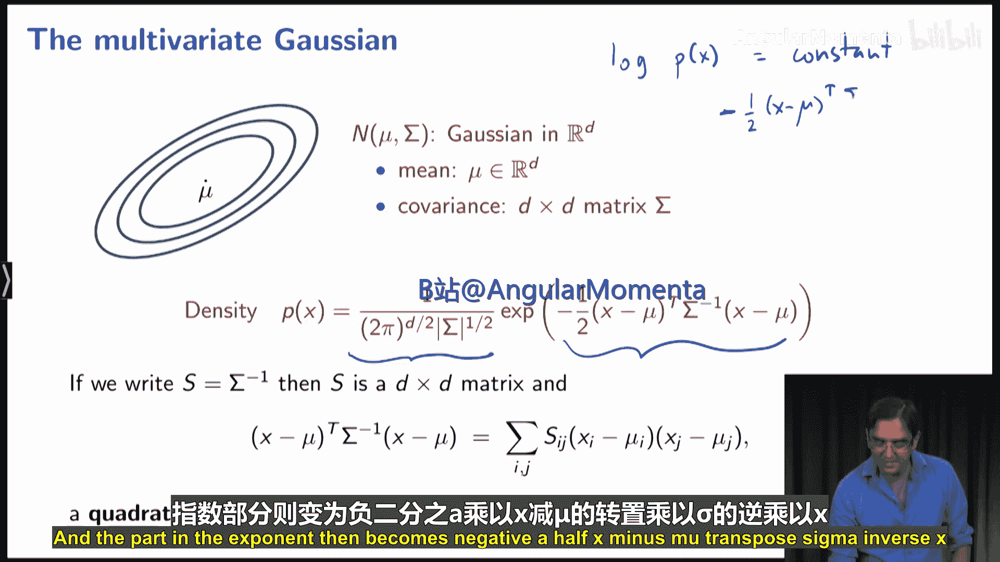

And so log of PX is a bona fide quadratic function。As we'll see。

 what this means is that if you use Gaussian distributions in the generative approach to classification。

 the decision boundaries you get will in general be quadratic Okay so let's see a little bit more closely why that's the case。

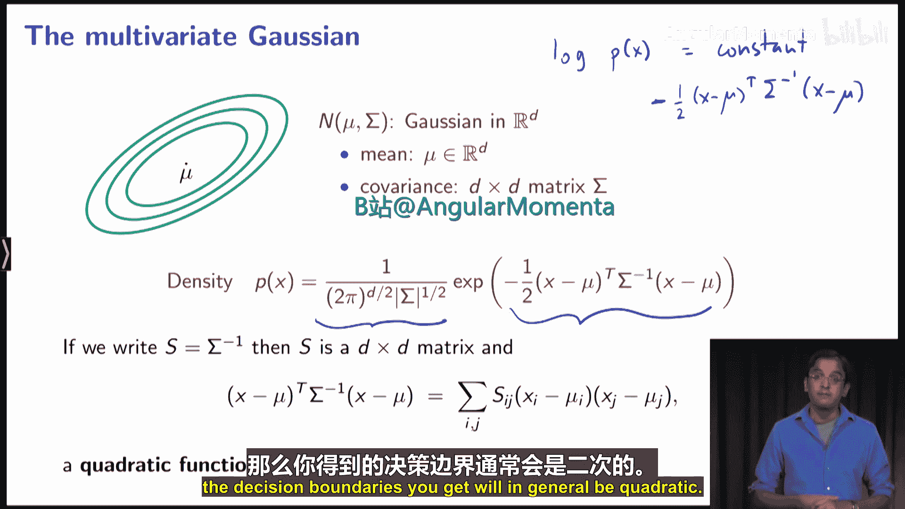

Let's look at a binary situation for simplicity so there are just two classes and the first thing we do in the generative approach is to estimate the class probabilities pi 1 and phi 2 so maybe 60% of the data is from class 1。

 so phi 1 is 0。6 and p2 is 0。4。Then we fit a Gaussian to each class， P1 and P2。

 and now we're letting them be arbitrary multivariate Gaussians so these are the parameters of the model。

Now when a new point x comes along， in order to classify x， we compute phi 1 times p1 of x。

 and we compute phi 2 times p2 of x， and we look at which of these two is larger。

So that's our classification rule。Now what we can do is we can plug in the formula for the Gaussian density into P1 and into P2。

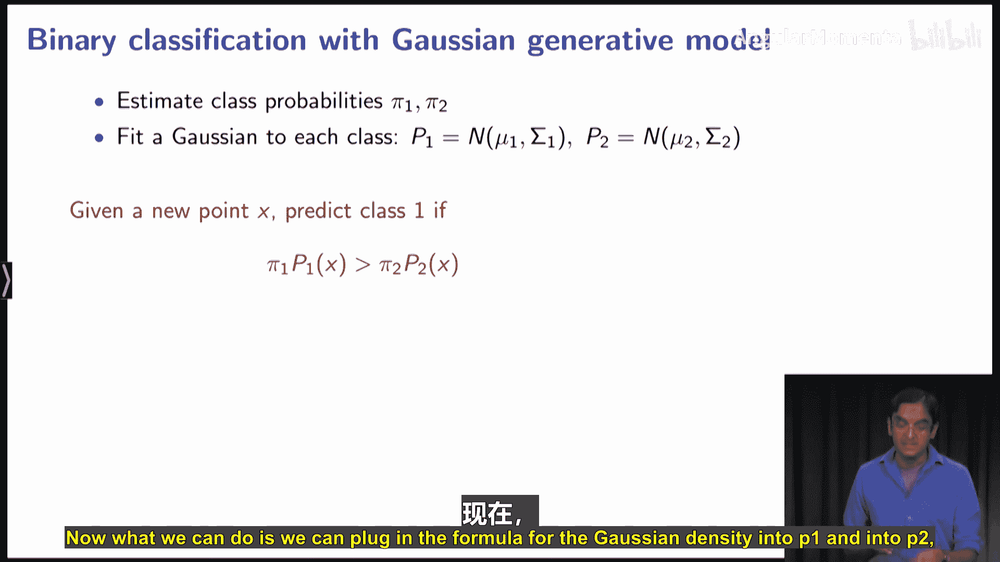

And then we can take the log of both sides， which brings the quadratic functions down。

 and if we do some algebraic simplifications。

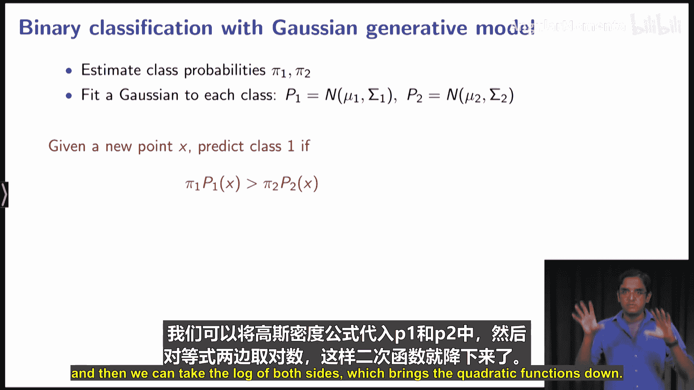

It turns out that this is what we get。This is the decision rule。

So let's see what this is so first we have x transpose Mx。And as we've seen。

 this is generically a quadratic function， so M is a matrix， and in fact。

 we can say precisely what it is。It's just the difference of the inverse covariance matrices。

The second term。Is twice W transpo x， so that's the same as w dotX。

And so that's a linear function okay and W again， can just be read off from the means and covariances。

And then there's a threshold theta， which is just a number like 0。2 or negative 0。6。And that again。

 can be read off from the parameters， including pi1 and pi 2。

So what happens is when you use this rule， some points get classified as class 1。

 some points as class 2， and the decision boundary is the separating region between these two zones。

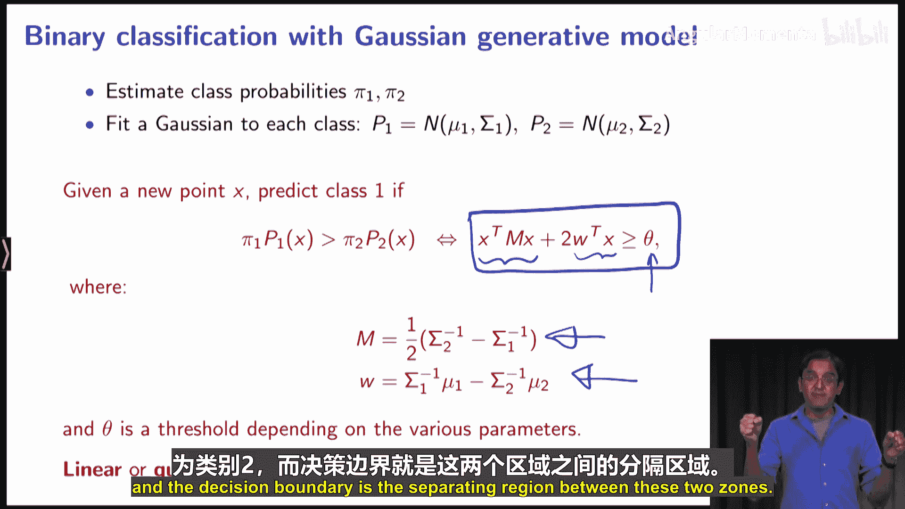

The decision boundary corresponds， exactly。2。This equation x transpose Mx plus 2 W transpose x。

Equals theta。Okay。And this is a quadratic boundary。Good。Now。

 it turns out that sometimes the matrix M is 0， When would this happen， Well。

 it would happen looking at the equation for n， it would happen if the two covariance matrices are identical。

 In that case， M drops out， the quadratic term drops out and we just get a linear decision boundary。

Now a linear boundary is a special case， a degenerate case of a quadratic boundary。

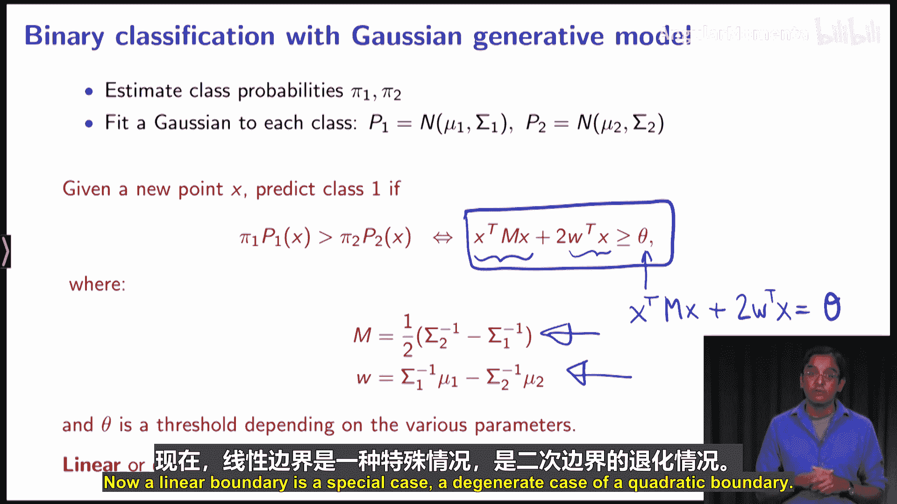

And let's start by looking at that linear case， so the linear boundary arises when the two classes have exactly the same covariance matrix Sigma 1 equals sigma 2 case let's see an example of that。

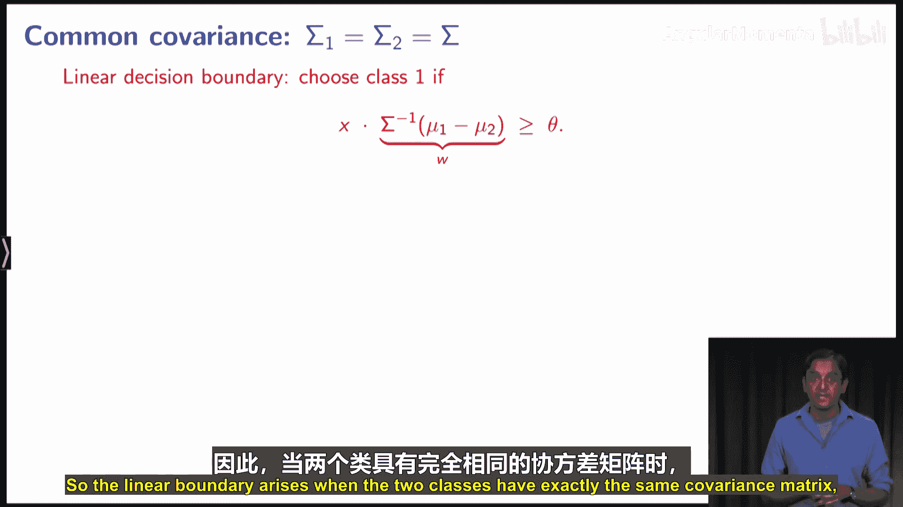

Let's say that each class is a spherical gaussian。And they had exactly the same covariance matrix。

 say the identity matrix。And to make the situation even more symmetric。

 let's say that the two classes have exactly the same class probability。 So pi 1 equals pi2 equals 0。

5。What is the decision boundary in that case？Well， it's just the perpendicular biectctor between the centers of the two classes。

 between the two Gaussian means。 So the center of class 1 is muse of one。

The center of class 2 is Muive 2， and the perpendicular bisector between them is the decision boundary。

 and this is exactly what one would expect， given the extreme symmetry of this case。

But now let's say we would have varied a little bit。Let's say that we change this one thing。

Currently， we're saying that the class probabilities are equal。 They're0。5。

 What if class 1 is actually a little bit more likely， say。Phi 1 equals 0。6 and phi 2 equals 0。4。

 What happens then？So here's what happens。 The decision boundary just moves slightly to the right。

And let's see why this is。 Okay， so if you look at the points smack between the two centers。

 this point over here。This point would now get classified as class1。

 just because class1 occurs more frequently than class2。Okay。

And so the decision boundary just gets shifted slightly to the right。

To take care of this discrepancy in prior class probabilities。

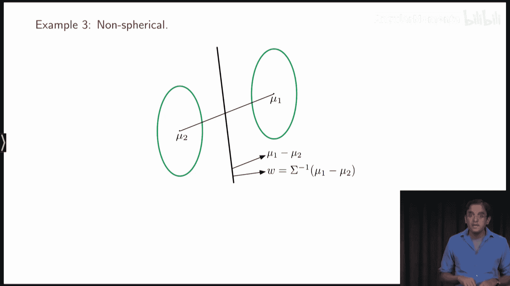

Now， what if the two classes have the same covariance matrix， but they're not spherical。

 so that's what we see in this picture here。Because the covariance matrices are the same。

 the boundary is again linear。But now it's not the perpendicular biectctor any longer。

 It's slightly skewed to accommodate。The different shape。嗯。So in all of these cases。

 the classification rule is a simple linear rule of the form w dot x greater than or equal to theta。

😊，And W， the vector W。And the number theta can just be read off from the parameters of the model。

 from the means， the covariances and the weights by one and by2。Now。

 it turns out that the way in which these models are often used is to set W in this way。

 but to then allow theta just that number， that threshold。

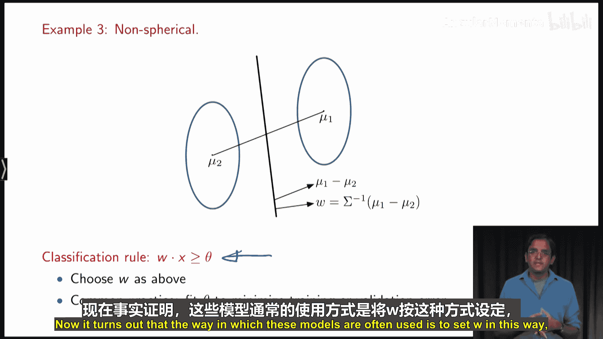

To vary a little， to tweak it a little， to maximize performance on the training set or on some validation set。

 So in other words， you choose exactly this boundary than one showed over here。

 but you allow it to shift。Parallel to itself， slightly to the left or right。

 if that helps performance。Okay， so this is the case where the covariances are equal。

 what if they aren't equal？

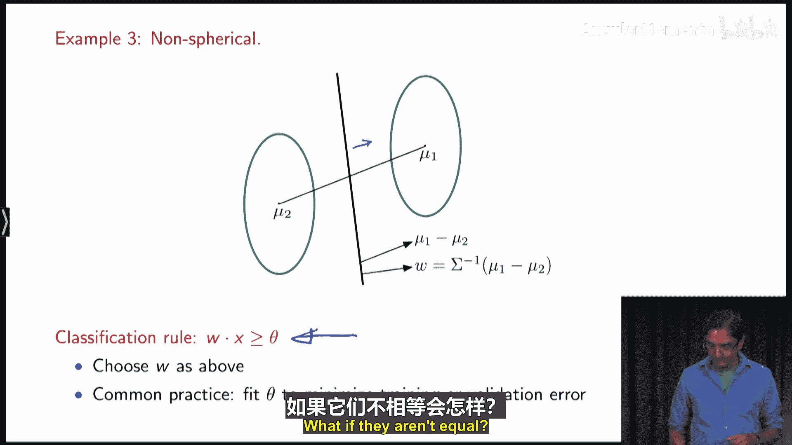

If the covariances aren't equal， then the boundary is a general putratting。

 and so let's see some examples of that。So in this first example over here。😊。

The two classes are both spherical Gaussianss， so that's nice and simple。

 but they don't have the same covariance matrix。So the one on the left has got a larger variance。

 so maybe its covariance matrix is four times the identity。

Whereas the one on the right might just be the identity。Okay， so the variance is higher on the left。

What kind of decision boundary do we get in this case？Let's take a look。So here's what results。

 the decision boundary is a sphere。Points inside the purple sphere。Get classified as being class2。

Whereas points outside this sphere are class 1。 So this gets classified as 2。

 This gets this gets classified as one。 And this point over here。Also gets classified as one。

Seems a little strange， right。Well， perhaps it'll be a little clearer if we look at a one dimensional analog of this。

 Okay， so let's look at roughly the same picture in1 D。

 So here we have two Gaussians in one dimension。

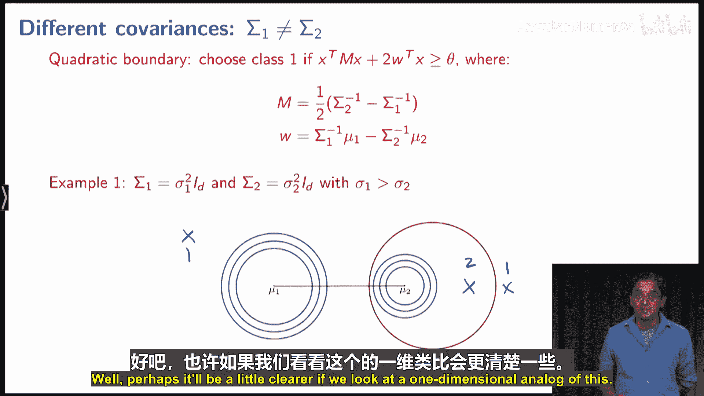

And one of them has got a very large variance， the one for class1。

 whereas the other for class2 has a very small variance。What is the decision boundaries。

 The data is one dimensional。 Okay， let's say the weights are the same by  one equals pi 2 equals 。5。

 In that case， this will be the boundary。 You look at where the densities overlap。

This is the boundary， everything over here。Is class 1。

Everything over here also gets classified as one， and the stuff in the middle over here gets classified as two。

对。Here's another example， so one of the classes is a spherical Gaussian and the other one。

Is a diagonal Gaussian， Okay， so you have an ellipsoidal shape， because it's diagonal。

 it's ellipsoidal， but parallel to the axes。And in this case。

 the decision boundary turns out to be a parabola， and there are lots other lots of other ways the decision boundary could look。

 but they're all quadratic forms of one kind or another。

So we've talked mostly about the binary case and it's the case where there are just two labels and this is because it's particularly simple to then talk about the boundary between these two regions。

 class 1 and class2。But when there are multiple labels， the overall picture is roughly the same。

 Okay， so let's say that there are K classes。 So what we do is that for each class we fit weight by sub。

 that's just a number。

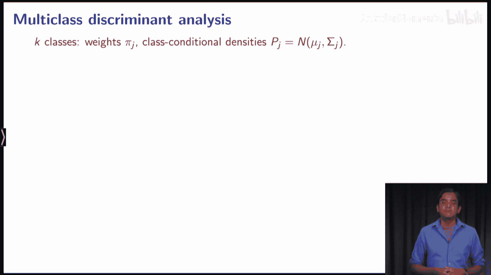

And we fit a Gaussian density piece of ja。

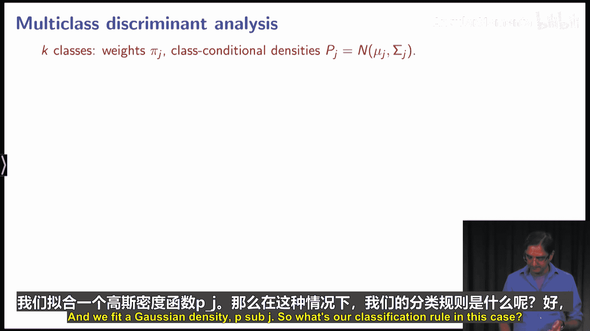

So what's our classification rule in this case， Well when a new point x comes along？

We compute phij times pj of x and we pick the class J for which this is largest。

We can equivalently pick the class J for which the log of this is the largest。

Doesn't change the outcome， and it can be a little bit easier to think of because。

 as we saw a little earlier， log of the Gaussian density is a quadratic function。

So what happens essentially is that each of the K classes has got its own quadratic function。😊。

And when a new point comes along， each class evaluates its quadratic function。

 They each get a number， and the one with the largest number is the winner。

 That's the class that gets predicted。 Okay， so that's how classification works when there a K class is with general Gaussians。

😊，Now in the situation where all the covariance matrices of the K classes are the same。

 then once again the boundaries become linear。你可。So we've talked a lot about generative modeling。

 about building a classifier by fitting a Gaussian model to each class。

This is a very simple approach to classification， and it works extremely well in many settings。

But the Gaussian isn't the only distribution that can be used。

 and next time we'll look at some other choices。

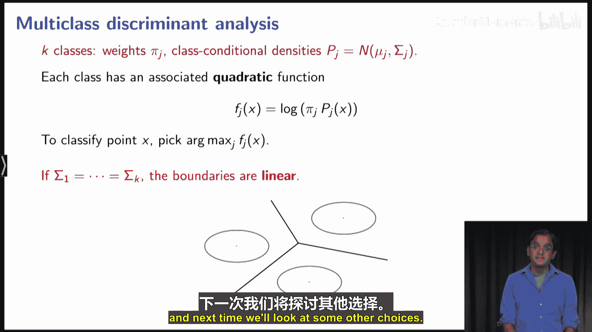