# 机器学习基础：04-05-02：高斯生成模型 🧠

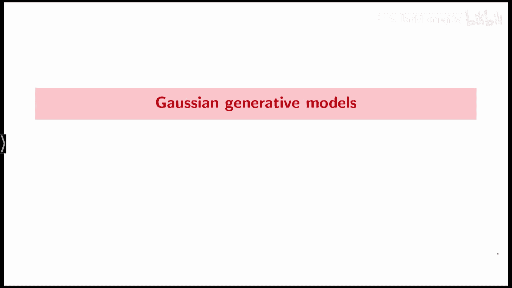

在本节课中，我们将学习如何使用多元高斯分布来构建分类器。我们将探讨生成式分类方法，特别是当为每个类别拟合高斯分布时，会形成何种决策边界。我们会从简单的例子开始，逐步深入到更一般的情况，并理解决策边界为何通常是二次的。

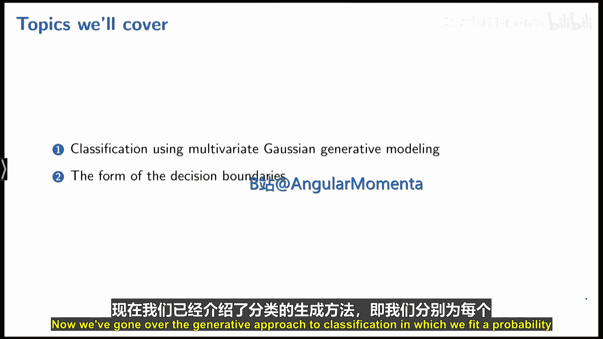

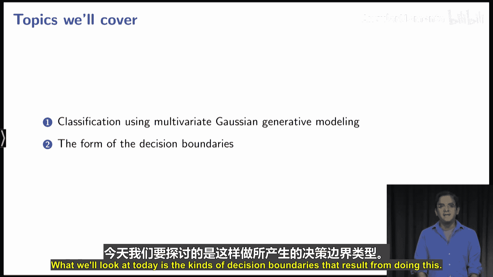

---

上一节我们介绍了多元高斯分布。本节中我们来看看如何利用这些分布来构建分类器。

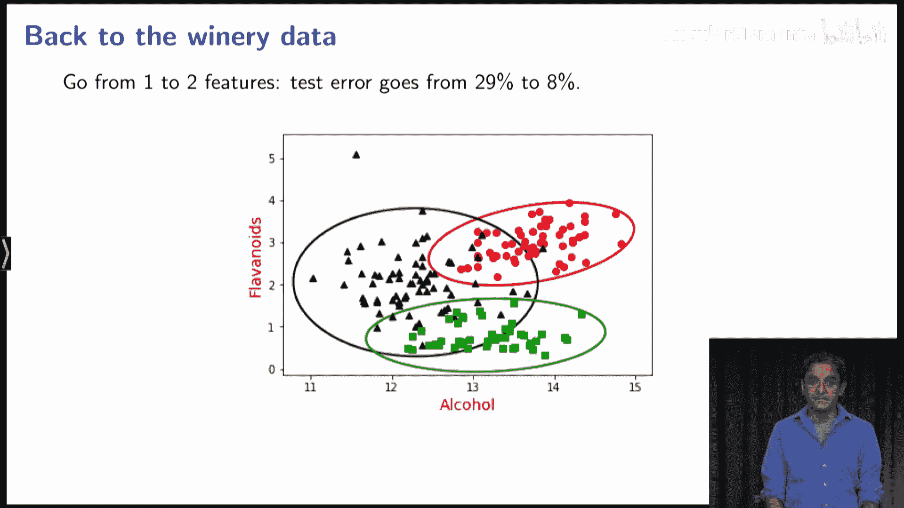

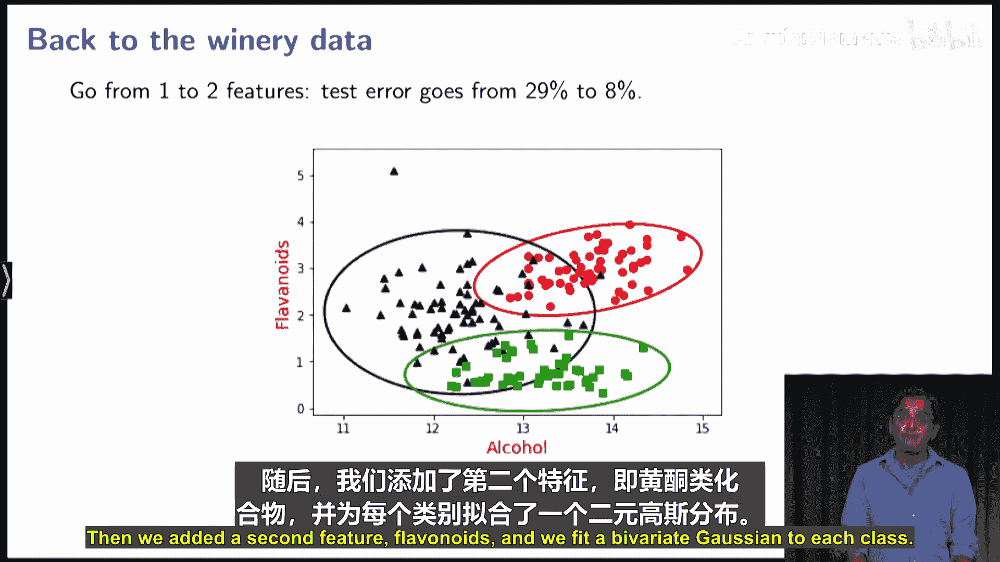

我们已经回顾了分类的生成式方法，即为每个类别单独拟合一个概率分布。今天我们将重点探讨采用这种方法时所产生的决策边界类型。

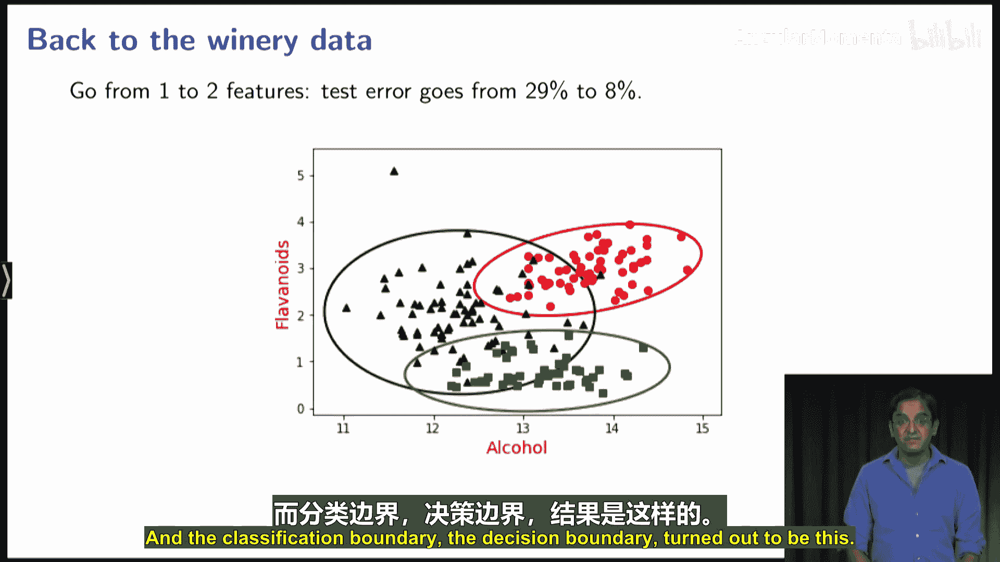

## 从葡萄酒数据开始 🍷

让我们从葡萄酒数据开始回顾。这个数据集包含三个类别（代表三个不同的酒庄）和13个特征。

我们最初只选择了一个特征——酒精含量，并为三个类别分别拟合了一个一维高斯分布。由此得到的分类器在测试集上的错误率为29%，效果并不理想。

随后，我们添加了第二个特征——类黄酮含量。我们为每个类别拟合了一个二元高斯分布，结果如图所示。

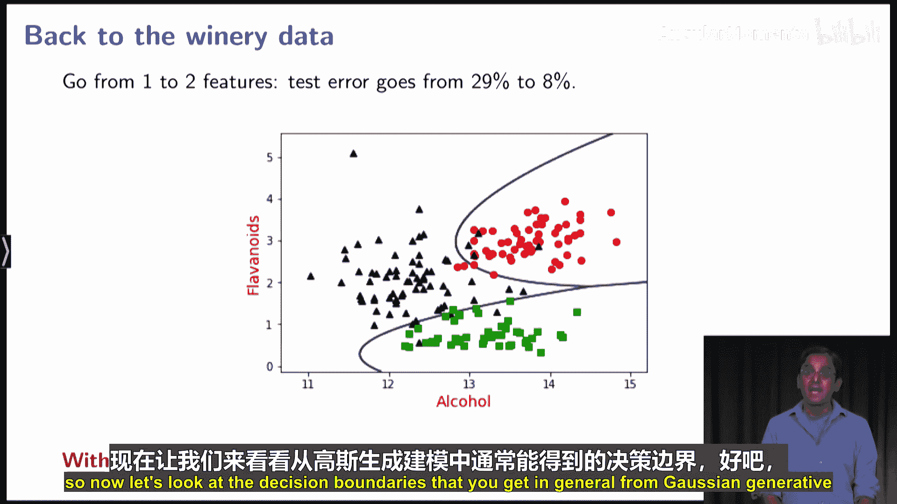

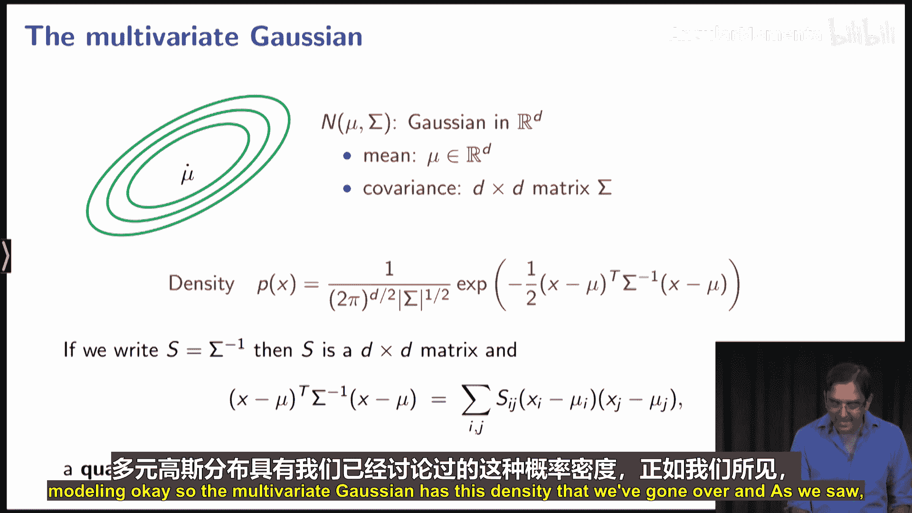

由此产生了三个椭圆区域。分类边界，即决策边界，如图所示。

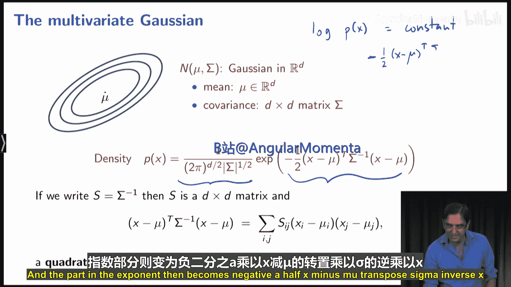

此区域的点被分类为红色类别，此区域的点被分类为绿色类别，而此区域的点被分类为黑色类别。添加第二个特征使测试错误率从29%降至8%。

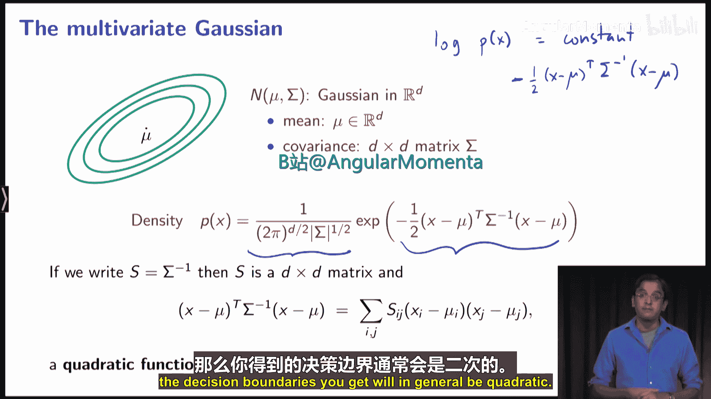

现在，既然我们已经掌握了多元高斯分布，就可以使用全部13个特征。我们可以为酒庄1的13个特征拟合一个多元高斯分布，再为酒庄2和酒庄3各拟合一个。然后应用贝叶斯规则进行分类。

如果这样做，我们会发现测试错误率实际上降到了0。这是否意味着它是一个完美的分类器？并非如此。一方面，测试集并不大，只有48个点。但这确实意味着，与仅使用一两个特征相比，这是一个好得多的分类器。这也表明，包含多个相关特征可能非常有益。

## 高斯生成模型的决策边界 📐

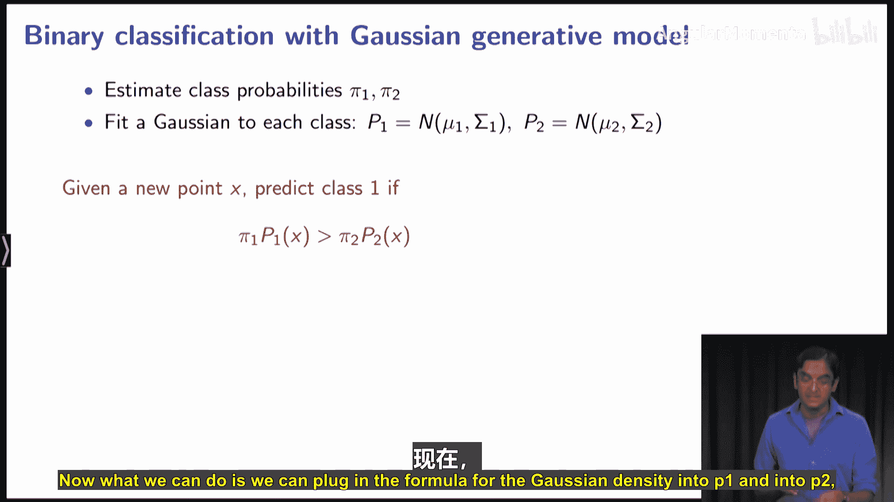

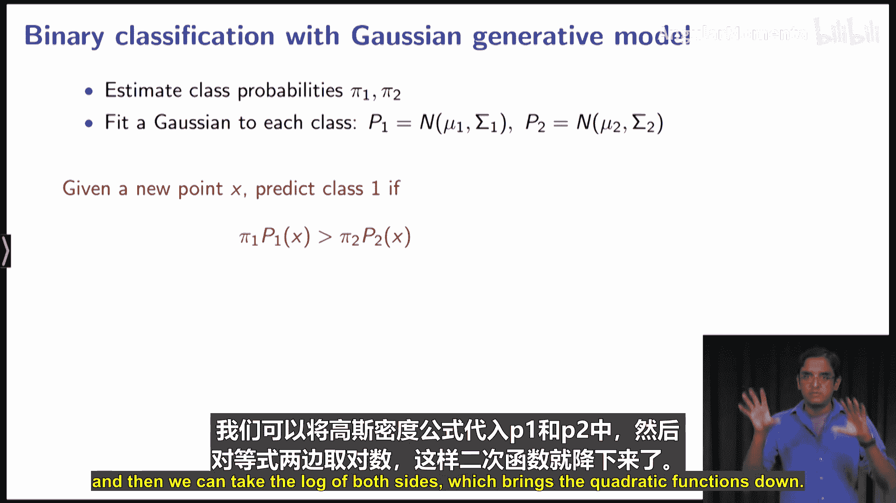

现在，让我们看看高斯生成建模通常会产生什么样的决策边界。

多元高斯分布具有我们讨论过的密度函数。正如我们所见，密度函数的第一部分实际上只是一个归一化因子。重要的部分是指数内的内容，它是一个二次函数。

如果想把指数部分“降下来”，可以对密度取对数。让我们看看这样做会发生什么。取 \( P(x) \) 的对数：

第一部分变成某个常数。指数部分则变为 \( -\frac{1}{2} (x - \mu)^T \Sigma^{-1} (x - \mu) \)。

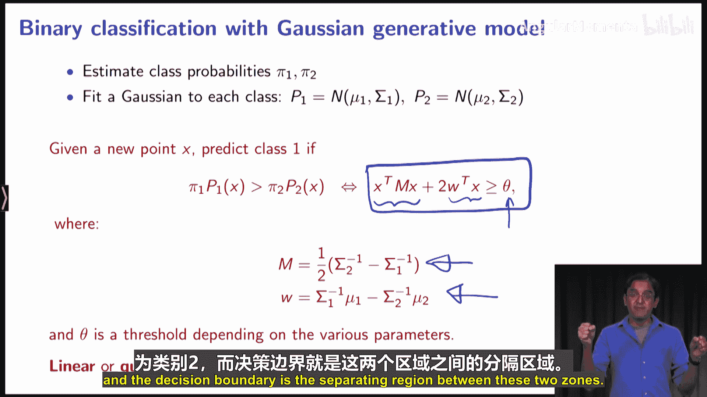

因此，\( \log P(x) \) 是一个真正的二次函数。这意味着，如果在分类的生成式方法中使用高斯分布，得到的决策边界通常将是二次的。

让我们更仔细地看看为什么是这样。

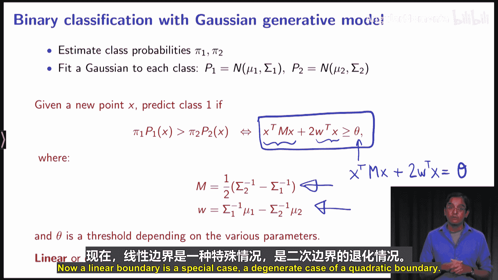

## 二元分类情况下的决策规则 ⚖️

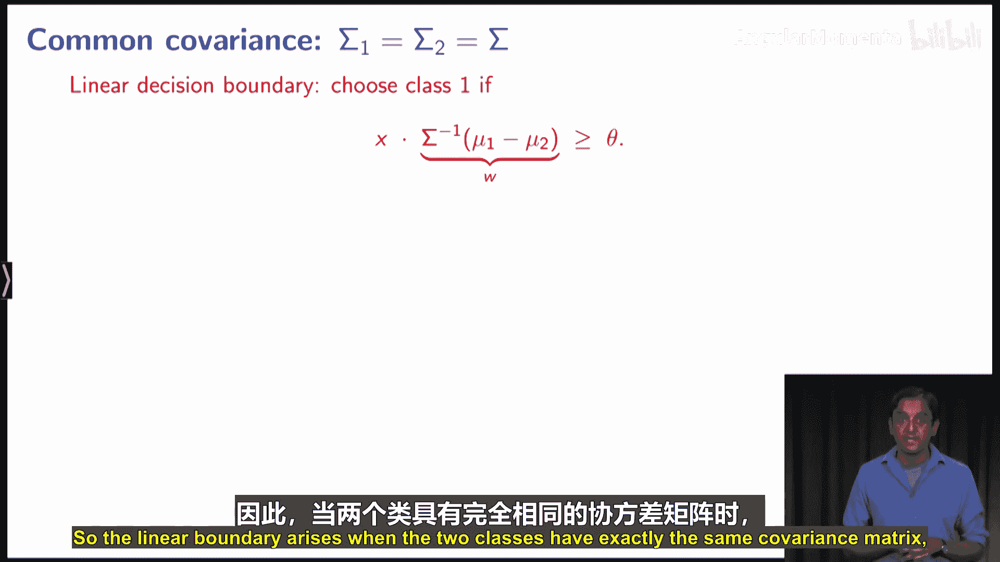

为了简化，我们看一个二元分类情况，只有两个类别。在生成式方法中，我们首先估计类别概率 \( \pi_1 \) 和 \( \pi_2 \)。然后，为每个类别拟合一个高斯分布 \( P_1 \) 和 \( P_2 \)，我们允许它们是任意的多元高斯分布。这些是模型的参数。

当一个新的数据点 \( x \) 到来时，为了对其分类，我们计算 \( \pi_1 \times P_1(x) \) 和 \( \pi_2 \times P_2(x) \)，并看哪个值更大。这就是我们的分类规则。

我们可以将高斯密度公式代入 \( P_1 \) 和 \( P_2 \)，然后对两边取对数，这将二次函数“降”下来。经过一些代数简化后，我们得到决策规则：

\[
x^T M x + 2 w^T x \ge \theta
\]

其中：
*   \( M = \frac{1}{2}(\Sigma_2^{-1} - \Sigma_1^{-1}) \) 是一个矩阵，使得 \( x^T M x \) 是一个通用的二次函数。
*   \( w \) 是一个向量，\( 2w^T x \) 是一个线性函数。
*   \( \theta \) 是一个阈值常数。

这些都可以从模型参数（均值、协方差矩阵、先验概率）中推导出来。

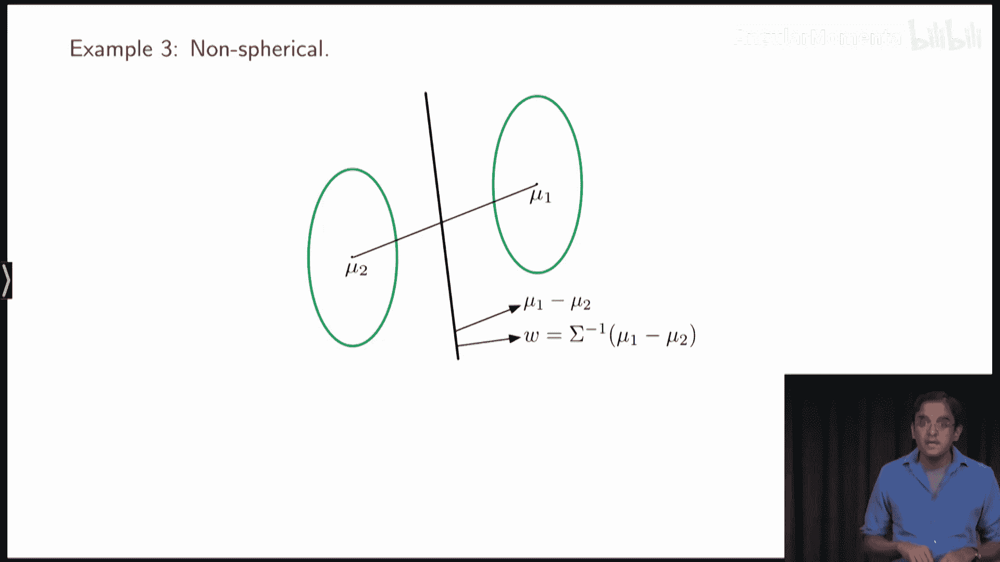

使用此规则时，一些点被分类为类别1，一些点被分类为类别2。决策边界就是这两个区域之间的分隔区域，它精确地对应于方程 \( x^T M x + 2 w^T x = \theta \)。这是一个二次边界。

## 特殊情况：线性决策边界 📈

有时矩阵 \( M \) 可能为零。从 \( M \) 的方程看，当两个类别的协方差矩阵相同时会发生这种情况。此时，二次项消失，我们得到一个线性决策边界。线性边界是二次边界的一个特例（退化情况）。

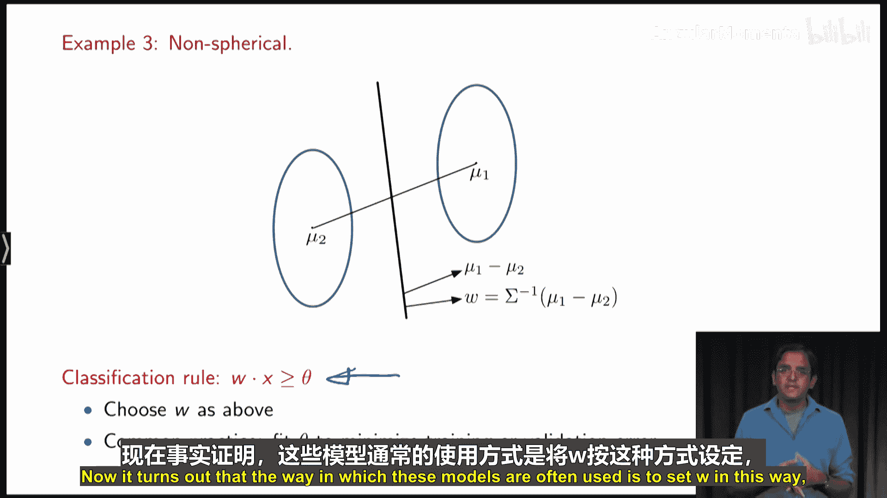

让我们从线性情况开始看起。当两个类别具有完全相同的协方差矩阵 \( \Sigma_1 = \Sigma_2 \) 时，会出现线性边界。

**示例1：球形高斯，相同协方差与先验**
假设每个类别都是一个球形高斯分布，具有相同的协方差矩阵（例如单位矩阵）。同时，假设两个类别的先验概率相同，即 \( \pi_1 = \pi_2 = 0.5 \)。在这种情况下，决策边界只是两个类别中心（两个高斯均值 \( \mu_1 \) 和 \( \mu_2 \)）之间的垂直平分线。考虑到这种情况的极端对称性，这正是我们所期望的。

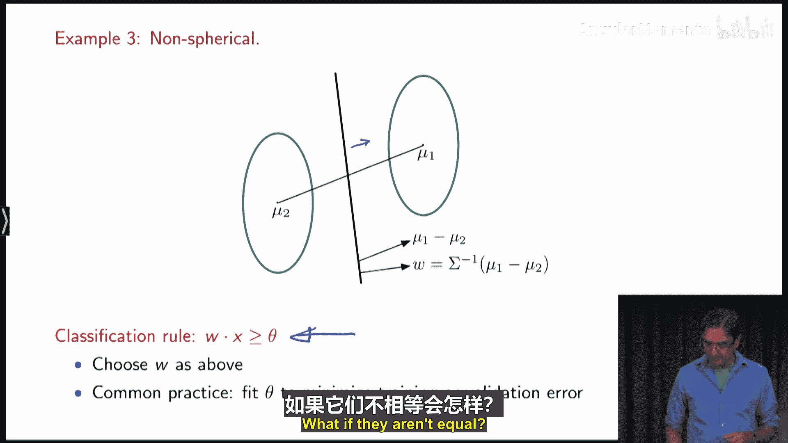

**示例2：相同协方差，不同先验**
如果类别1出现的可能性稍大一些，例如 \( \pi_1 = 0.6, \pi_2 = 0.4 \)，会发生什么？决策边界会略微向右移动。因为类别1比类别2更频繁，所以两个中心正中间的点现在会被分类为类别1。决策边界的移动是为了考虑先验类别概率的差异。

**示例3：相同但非球形的协方差**
如果两个类别具有相同的协方差矩阵，但矩阵不是球形的（即椭圆形状相同），边界仍然是线性的，但它不再是垂直平分线，而是会有所倾斜以适应不同的形状。

在所有这些情况下，分类规则都是 \( w \cdot x \ge \theta \) 形式的简单线性规则。向量 \( w \) 和数值 \( \theta \) 可以从模型参数中得出。在实践中，通常按此方式设置 \( w \)，但允许阈值 \( \theta \) 略有变化（例如在训练集或验证集上进行微调以最大化性能），这相当于允许决策边界平行于自身略微左右移动。

## 一般情况：二次决策边界 🧮

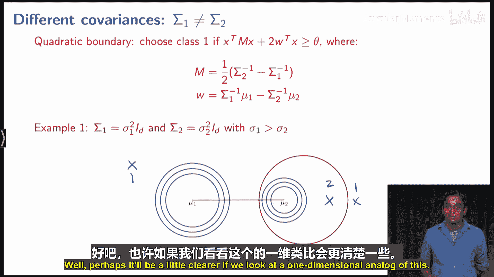

如果协方差矩阵不相等，那么边界就是一个一般的二次曲线。

**示例1：球形高斯，不同方差**
两个类别都是球形高斯，但协方差矩阵不同。例如，左侧类别的方差较大（协方差矩阵为 \( 4I \)），右侧类别的方差较小（协方差矩阵为 \( I \)）。在这种情况下，决策边界是一个球体（或圆）。在紫色球体内的点被分类为类别2，球体外的点被分类为类别1。这在一维类比中更清晰：一个大方差高斯和一个小方差高斯，决策边界可能是两个区间，中间区域属于小方差类别，两侧区域属于大方差类别。

**示例2：球形 vs 对角高斯**
一个类别是球形高斯，另一个是对角高斯（即椭球形状，但主轴与坐标轴平行）。在这种情况下，决策边界是一条抛物线。

决策边界可能呈现许多其他形状，但它们都属于某种二次形式。

## 扩展到多类别分类 🔢

我们主要讨论了二元情况，因为只有两个标签时，谈论两个区域（类别1和类别2）之间的边界特别简单。但当存在多个标签时，整体情况大致相同。

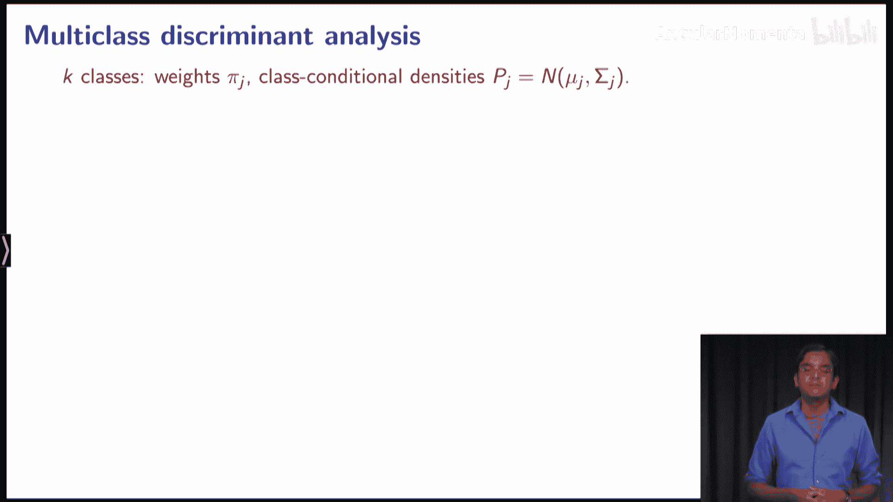

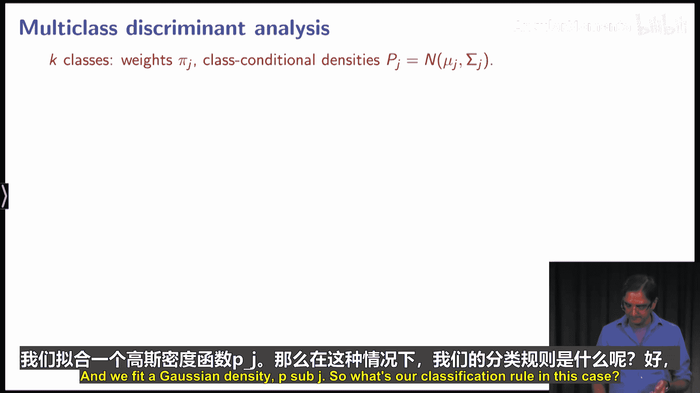

假设有 \( K \) 个类别。我们为每个类别 \( j \) 拟合一个权重 \( \pi_j \)（一个数字）和一个高斯密度 \( P_j \)。

分类规则是：当新点 \( x \) 到来时，我们计算 \( \pi_j \times P_j(x) \)，并选择使该值最大的类别 \( j \)。等价地，我们可以选择使该值对数最大的类别 \( j \)，因为高斯密度的对数是一个二次函数。

本质上，\( K \) 个类别中的每一个都有其自己的二次函数。当新点到来时，每个类别评估其二次函数，得到一个数值，数值最大的类别胜出，即被预测的类别。

当所有 \( K \) 个类别的协方差矩阵都相同时，边界再次变为线性。

---

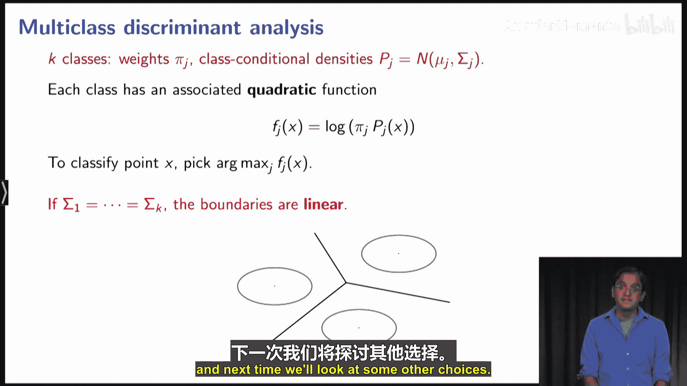

本节课中我们一起学习了高斯生成模型。我们了解到，通过为每个类别拟合高斯分布来构建分类器是一种简单而强大的方法。决策边界的形式取决于类别间协方差矩阵的关系：相同时为线性边界，不同时为二次边界。我们还探讨了从二元到多类别的扩展。高斯分布并非唯一可用的分布，下次我们将看看其他一些选择。