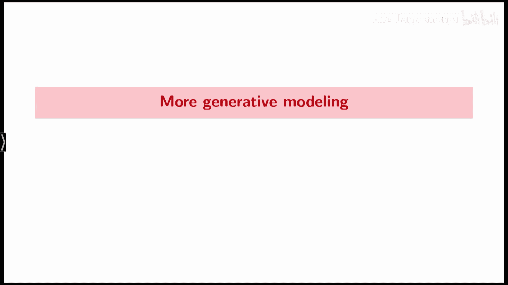
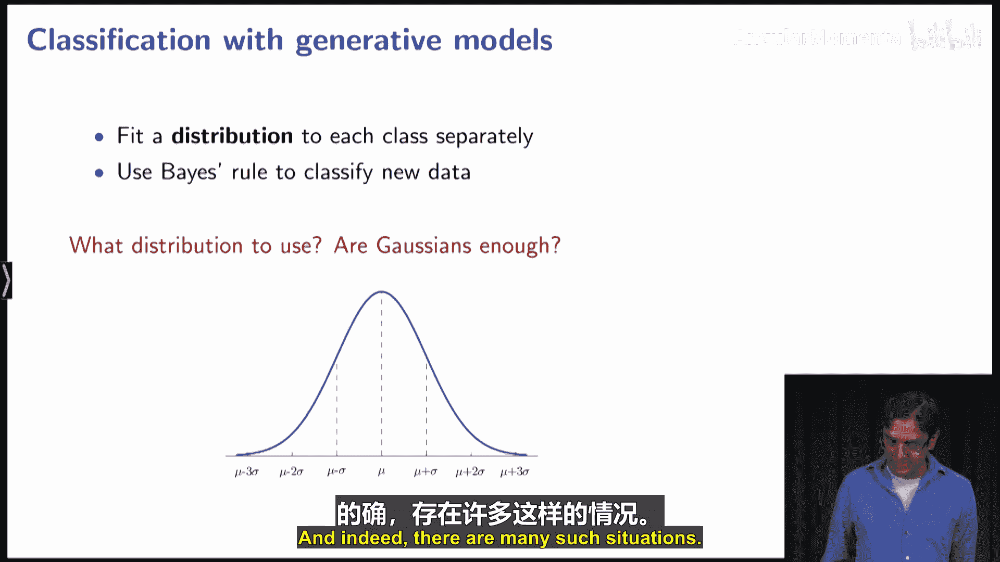
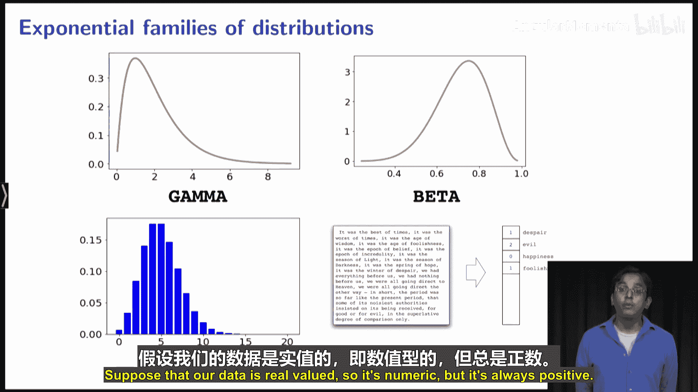
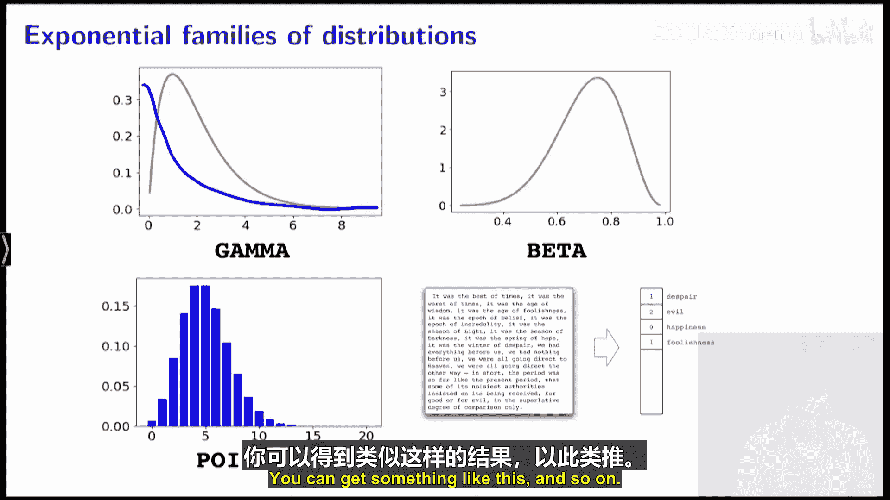
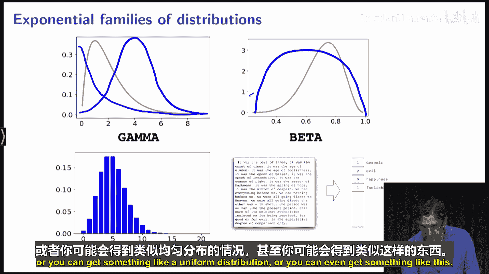
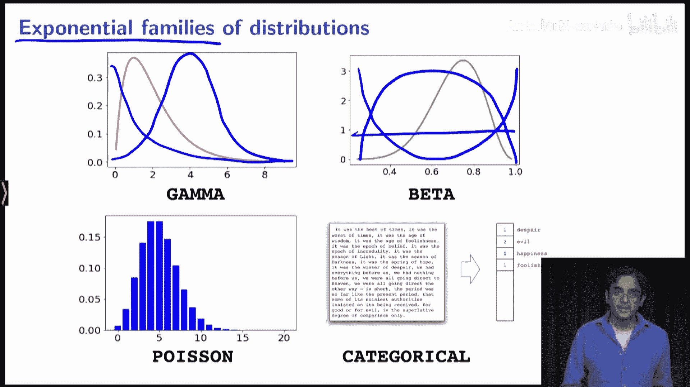
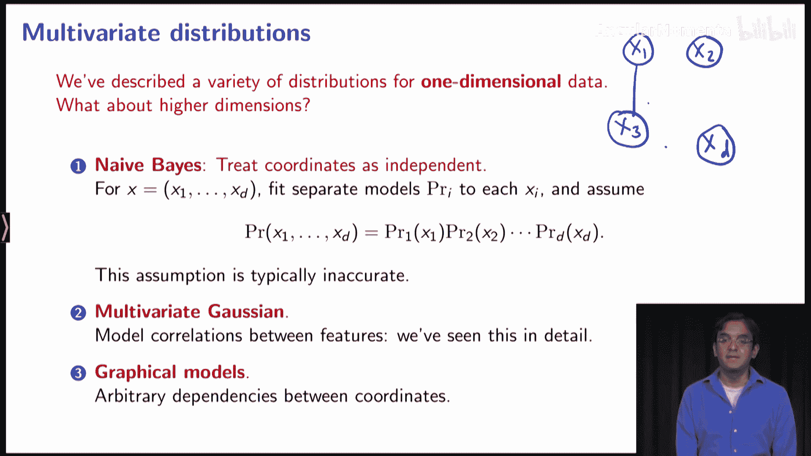

# 【加州大学圣地亚哥分校】机器学习基础  Machine Learning Fundamentals p18 04-06-02-生成式建模进阶 -BV1TyFSziEZb_p18-

We've been talking a lot about building classifiers by fitting a Gaussian distribution to each class。

What we'll do today is to look beyond Gaussians at more general kinds of generative modeling。

We'll start by looking at a variety of other popular one dimensional distributions and then we'll see how we can combine these to deal with higher dimensional data。

In the generative approach to classification。The main idea is to fit a distribution to each class separately。

When a new data point arises， we classify it by just using Bayes rule。Now， so far。

 weve focused exclusively on using Gaussian distributions for each class。Indeed。

 this is the single most important case。But are there situations in which a Gaussian distribution would not be suitable。

And indeed， there are many such situations。

Suppose that our data。Is real valued。 So it's numeric。But， it's always positive。

In such situations， it can sometimes be a little bit strange to use a Gaussian just because a Gaussian is a distribution over the entire real line。

Positive and negative。Are there distributions that are just over the positive reels？

There are a prime example is the gamma distribution， which is shown over here on the upper left。

So the gamma is specified by two parameters， just like the Gaussian。And as you vary the parameters。

 you can get a lot of different shapes。 You can get something like the red curve shown over here。

Or you can get something like this。You can get something like this。

And so on。You might have heard of the exponential distribution or the Kais square distribution。

 These are all just special cases of the gamma。Now here's another situation。

What if the data is real valued？But it always lies in a specific interval， like between zero and1。

In this case， it would again be a little strange to use the Gaussian because that's a distribution over all the reels。

And it would also be strange to use the gamma distribution because that's over all positive reels。

 is there a distribution just over an interval？In this case。

 a very common choice would be the beta distribution， which is shown over here on the upper right。

Like the Gaussian and the gamma， it's specified by two parameters。

 and it also takes on a variety of different shapes so it can look like this。

Or it can look like an upside down bull。Or you can get something like a uniform distribution。

Or you can even get something like this。Okay， very useful。Here's yet another situation。 Okay。

 so suppose you have data。That's real value。 It's numeric。

But all the data points turn out to be integers。This would happen， for instance。

 if the data consists of counts。How many people went to the emergency room at night。

How many earthquakes struck this particular region of California？

So if the data are positive integers， then。The Gaussian， the gamma， the beta。

 are all not entirely suitable。 They distributions of arbitrary real numbers。In this case。

 the most common choice would be the Poisin distribution， which is shown over here on the lower left。

It's specified by a single parameter， the mean of the distribution。

 and it assign a probability to every non negative integer， 0，1， 2， 3， and so on。

This distribution turns out to be a good fit to all sorts of data。Finally。

 what if we have data that isn't even numeric， but there are finitely many possible outcomes？

For instance， suppose we want to fit a distribution to the words that appear in a particular corpus of documents。

 Okay， so we want the probability of each word。So here there are finitely many possibilities。

 finitely many words， and the distribution we would use is the categorical distribution。

 It's very simple。 It just assigns a probability for each specific outcome， for each specific word。

So all these distributions， the gamma， the beta， the puisson， the categorical。

These all are useful in situations where the Gaussian would not be entirely appropriate。

 and the four of these distributions。Along with the Gaussian。

Turn out to actually be part of a broader class of probability distributions called exponential F。

The gammas are a particular exponential family。 The Baers are another exponential family。

 The Gaussians are an exponential family。😊，So what are these exponential families。 Now， sadly。

 this is not something that we're going to have time to really go into。But briefly。

 exponential families are distributions that have a particular functional form。

And this form makes them easy to work with。Quite simple to estimate， for example。

Okay， so we've talked about a variety of distributions for one dimensional data， the gamma， the beta。

 and so on。How do we deal with higher dimensional data。

 I there a way to combine these distributions somehow？

So it turns out that there are basically three standard options。

The first is to pretend that the different coordinates are independent。This is called naive bees。

So let's say you have D dimensional data， Okay， so with coordinates x1， x2 all the way to Xd。

If x1 is arbitrary real values， we can fit a Gaussian into it。If x2 consists of integer counts。

 we can fit a Poisson to it。If x3 happens to lie in a fixed interval。

 we can fit be a distribution to it。So in this way。

 we fit a distribution to each individual coordinate。

 and now when we want the probability of the entire vector x。

We just take the one dimensional probability of x1 times the one dimensional probability of x2 times the one dimensional probability of x3 all the way to the one dimensional probability of the last coordinate x of d。

Now what this is assuming is that these coordinate x1 through xd are all independent of each other。

 and that is something that is rarely true。However， despite this false assumption。

 this particular methodology turns out to often be quite effective in practice， so that's naive base。

Option number two is to use the multivariate Gaussian， which we've talked about a lot。

Now the multivariate Gaussian does not pretend that the coordinates are independent。

 it allows us to model fairwise correlations between the coordinates。

 and as we've seen it's really quite simple to use。

The third option is to use a general graphical model。Now。

 this is sadly outside the scope of this class， but briefly。

 a graphical model represents a probability distribution over many coordinates。Using a graph。

So if they're deco coordinates， there is a node for each coordinate， so a node for x1。

 a node for x2 all the way to a node for xd。And the graph has edges between two nodes。

If those two coordinates have some sort of dependence between them。Now in full generality。

 a graphical model allows us to use any distribution for the individual coordinates x1， x2， etc。

 and it also allows us to model arbitrary dependencies between these coordinates。

 it's a very powerful methodology。So that's it for generative modeling。

This is a very popular approach to classification。 It's simple， efficient。

 and very easy to understand。