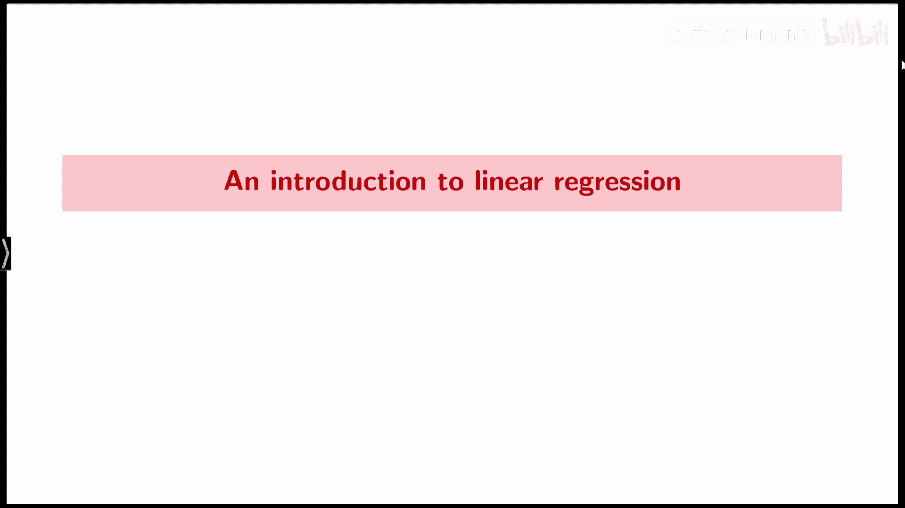
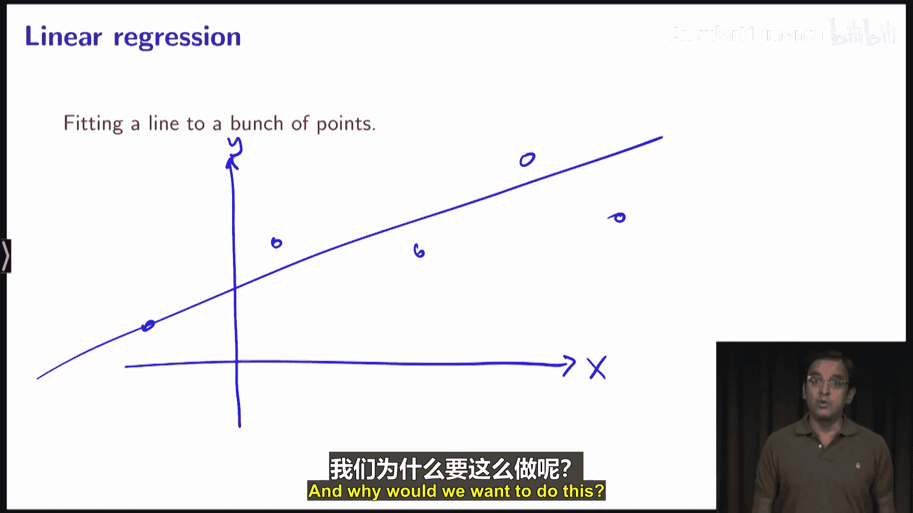
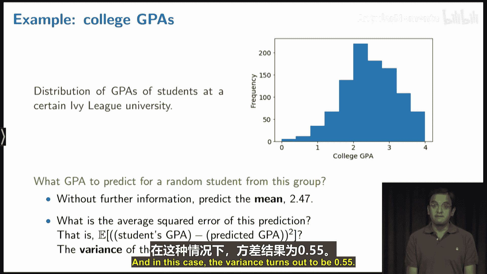
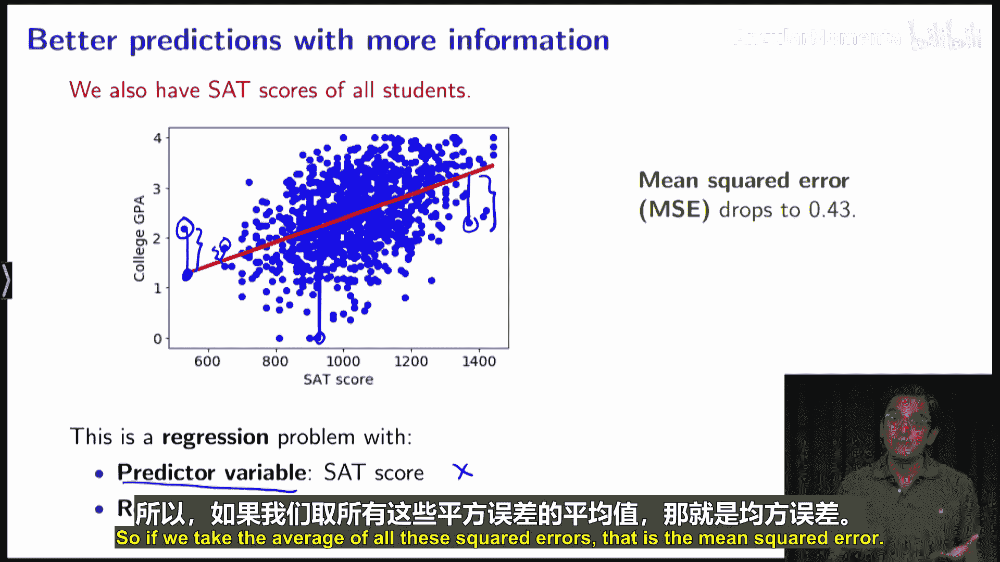
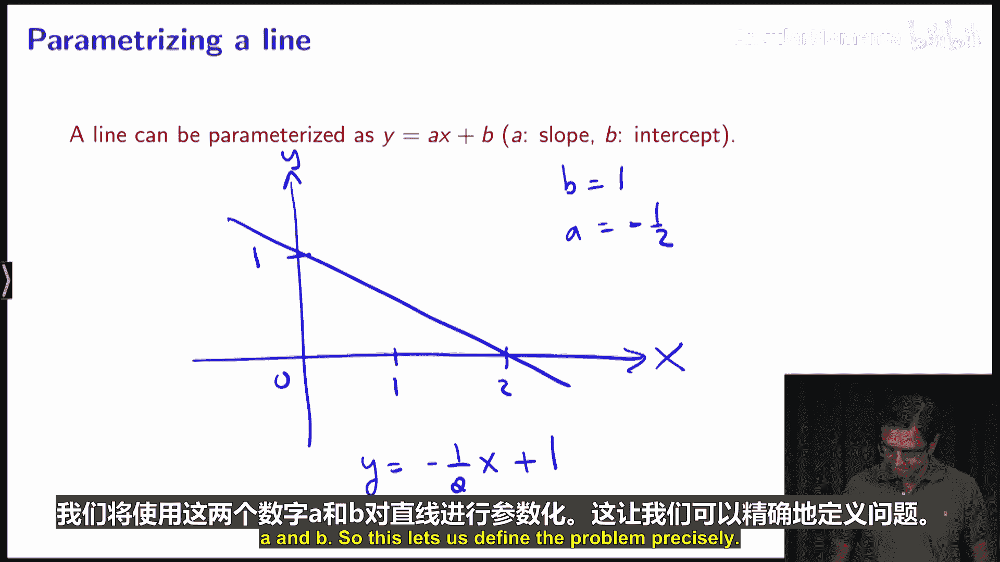
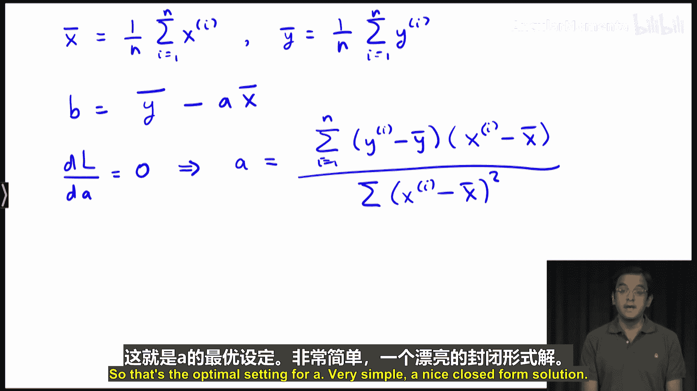

# 【加州大学圣地亚哥分校】机器学习基础  Machine Learning Fundamentals p19 05-01-02-线性回归导论 -BV1TyFSziEZb_p19-

For the past few weeks， we've been focusing on classification problems。

What we'll do today is to switch gears a little bit and look at regression。

So today we'll look at a one dimensional version of the problem as an introduction。

 and this will allow us to define some basic concepts like predictor and response variables。

We'll see how this problem can be formulated as an optimization task and how it can be solved using elementary calculus。

So in one dimension， regression is simply the business of fitting a line to a bunch of points。

This is something we've all seen before。We have a。X axis and a Y axis。We have a set of points。

And we want to fit a line to them。And there's no line that goes exactly through the points。

 And so we just want something that kind of goes through the middle of them somehow。

 How exactly do we do this and why would we want to do this？

So let's look at a little example over here， a certain Ivy League university collected data on its entering freshman class so at the end of freshman year。

They noted down everybody's GP8。And that's the histogram you see over here so the GPA the grade point average is a number between0 and 4。

 that's what's shown on the horizontal axis and on the vertical axis is the frequency。

 the number of people who got that grade okay so in this case it looks like the most frequent grade was somewhere over here。

So something like 2。25， which is a C+。く。So here's a question。Suppose a random student shows up。

And we want to predict his or her GPA。What score would we predict？Well， given this information。

 a reasonable thing to do would be to simply predict the mean of this distribution。

That's easy enough to compute。And if we do that， it turns out that in this case， it is 2。47。嗯。

So how good is this prediction？One way to sort of assess its quality。

Is to say what is its average squared arrow so a student has shown up at random okay。

 so this is their actual GPA and we've predicted this particular value 2。47。

If we look at the difference between these two and square it， what's the expected value of that？Well。

 if you look at this closely， this is exactly the formula for variant。

 it is the variance of this distribution。😊，And in this case， the variance turns out to be 0。55。

Now， it turns out that at this university， they had also collected some other information。

In addition to having everybody's freshman year GPA， they also had the SAT score from high school。

And this is a scatter plot of the two against each other。

 so on the horizontal axis are the SAT scores and on the vertical axis are the college GPAs。

You can see that the data is tilted slightly upwards， which indicates a positive correlation。

So what we can do in this case is to see whether the SAT score helps us to predict the college GPA so we go ahead。

And we fit a line like this。Now we'll get to the business of exactly how we fit this line。

 but for the time being， let's just see how we would use it okay。

 so let's say a random student shows up。And we want to predict his or health GPA。

 Well now we find out what the SAT score is， and let's say it's 120 rate。The SAT score is 1，200。

 we just go up to this line。We go across and we our prediction is3， we predict a GPA of three。Okay。

Now， when we use this additional piece of information to make predictions。

 it turns out that the mean squared error drops， it drops to about 0。

43 so that additional piece of information was actually quite helpful。

This is a classic regression problem。There's something we want to predict。

 which is called a response variable。That's the college GP。

 and then there's information that helps us make this prediction。

Those are the predictive variables and in this case there's just one predictive variable。

 the SAT score， so this is the x。The thing that helps us make predictions。

 and then there's the value we actually want to guess， which is the Y， the college GPA。

So what is the mean squared error though？Well， let's look at this data， okay。

 so look at this person over here。😊，Using our line。

 the prediction we would make for that person would actually be oh down here Okay so there's a certain amount of error。

There's this much error and we can square that， let's look at that squared error， okay。

Let's look at this person over here。The squared error on that person is this distance squared。

Let's look at this one over here。The squared error on that person is this distance squared。

 it's much smaller。Let's look at this person， the square error on their square error is actually pretty large。

Okay。So if we take the average of all these squared errors， that is the mean squared error。

Okay。So how do we go about fitting a line of this form？Well。

 the first thing is to figure out how even to parameterize a line and one convenient way of doing this is to write down a line as y equals a x plus B。

 where a is the slope of the line and B is the y into cell。 Okay， so for example。

 let's say that we have our x axis and our y axis。And we had a line like this， maybe this is two。

And this is one。So the y intercept is where the line crosses the y axis， that's one。

And the slope in this case will it's sloped downward， so it's going to be negative。

 and the slope in this case is negative half。And so the equation of this line is y equals negative a half x plus1。

Okay so we will parameterize a line using these two numbers， A and B。

Okay， so this lets us define the problem precisely。We're given a set of data points。

 these are XY pairs。X and Y are both real numbers。The X are the predictive variables， in our case。

 the SAT scores， the Y's are the things we want to guess。The response variables， in our case。

 the GPAs。Okay， so we have n data points of this form。We want to find a line。

 in other words we want to find parameters A and B that define a line and what we want is to find the line that incurs the least mean squared squared error。

 so what is that okay that's what's given by this formula over here。If we look at the IT data point。

 x of I。Then using this line AB， our prediction on x sub I would be this。

 that would be the value we would guess。The correct value is y sub。

So the squared error incurred on the ItT data point is this term over here。

And now we take that and we average over all the data points， this is the mean squared error。

 and this is the loss function that we are trying to minimize。

So there's something interesting going on over here。

 we are taking a learning task and formulating it as an optimization problem as the problem of finding parameters that minimize some kind of loss function。

This optimization approach has proved to be extremely fruitful in machine learning。

 and we be seeing a whole lot more of it。嗯。So let's go ahead and see how we can minimize this loss function。

 so we want to minimize this function L， which has two parameters A and V。Well。

 we can just take the derivative and set it to zero。Usual calculus weight， okay。

 so since the two parameters， we need to take the derivative with respect to each of them。

So to minimize。What we will do is we'll simply set。

The derivative with respect to A and the derivative with respect to B to be0。Okay。

 so let's go ahead and compute these derivatives。I think the one with respect to B is going to be a little bit simpler。

 so let's start with that。What is the derivative of L with respect to be？Okay。

 so L is a big summation， the derivative of the sum is the sum of the derivatives。

 so we'll start by writing that down。Now， how do we take a derivative of that？

We have the squared term over there。Okay， so there's this general rule which says。

 okay so we're taking the derivative with respect to B。

 if you're taking the derivative of something squared， U squared， that turns out to be2 U D U。

 so it's2 U times the derivative of U with respect to B， and for us U is this thing over here。Okay。

 that is the u， we want to take the derivative of that， so let's write down to U first of all。

 so two， we just copy down u。Okay。And now we take the derivative of you with respect to be。

Which is actually just negative one。 Okay， so times negative  one。Good。

 so that's the entire derivative， and we want to set that to zero。Now。

 since we're setting it to zero， we can just divide out the negative one and we can divide out the two。

And let's see what we get。So we get the summation。Of the Y eyes。Equals。

A times the summation of the X size。Plus， n times speed。

 because we're summing B from i equals 1 to n， so that's n times B。

And let's go ahead and solve the B。So that tells us that B。Is equal to we can divide both sides by n。

1 over M。Times the summation of the Y eyes。Minus a times 1 over m times the summation of the Xise。

That's the optimal setting for B。So what are these things over here， what is this term over here？

Well， that's just the average y value， the average response value。And what is this thing over there。

 well that's just the average x value， okay in our case that would be the average SAT score。Okay。

 so let's write that down in a slightly more compact form。Okay， so we'll just remember this equation。

And what we said is， let's look at the average x value， I'm just going to call that x bar Okay。

 so we take the average of all the xs。And this look at the average of all the Ys。

And it turned out that the optimal setting for B is the average y value minus a times the average x value。

 and this makes perfect sense we want y to be equal to ax plus B。

 Now of course we aren't going to be able to get that exactly。

 but it makes perfect sense that B would be the average y value minus a times the average x value。

Okay， so we still have to solve for a， and the way we do that is we set the derivative of L with respect to a to0。

And then we go through the calculation， and this time the algebra is a little bit more involved。

But I can just tell you what the final answer is going to be。Okay， and if you like。

 you can try out the steps at home， it's just a little bit messier。

And it turns out that what the optimal setting for a is。

It's simply the covariance of x and y divided by the variance of x。Okay， so it's。

Something of this form。You take all the Ys， you subtract off there the average y。

And you look at the covariance with x。And then， you divide by。The X is minus the average x squared。

So that's the optimal setting for8。Very simple， a nice closed form solution。

Well， that concludes our little introduction to regression Today we just talked about the one dimensional setting where there's a single predictive variable。

 what we'll do next time is to generalize this methodology to multiple predictive variables。

See you then。