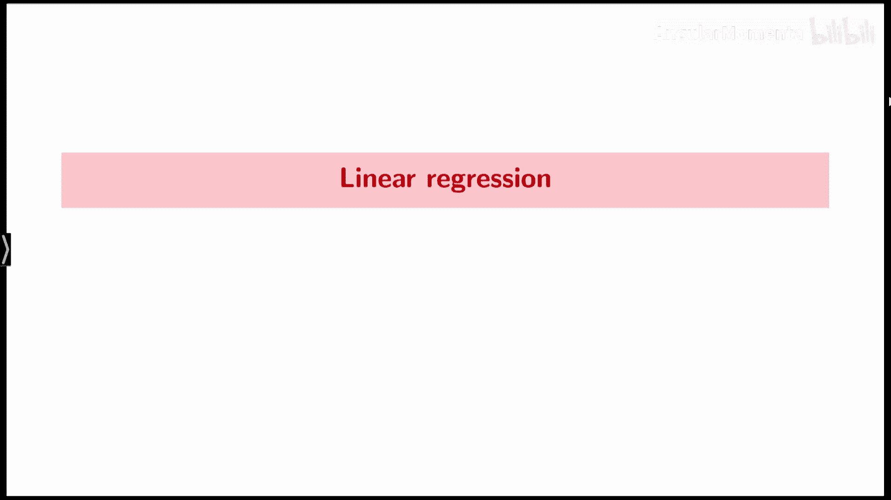
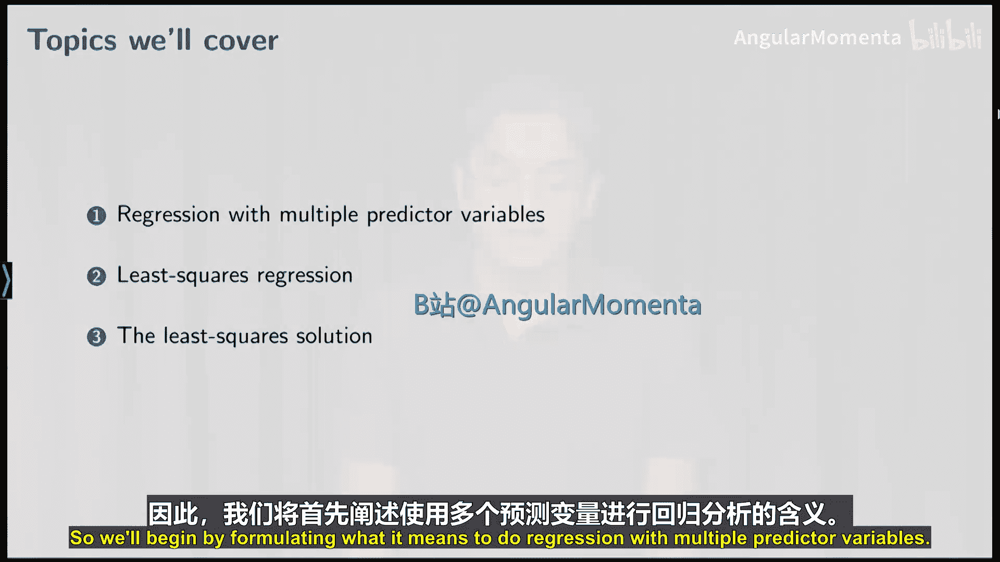
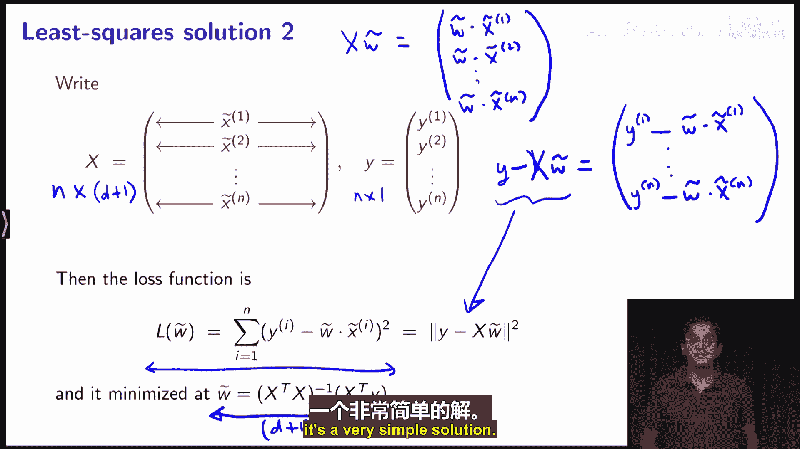

# 【加州大学圣地亚哥分校】机器学习基础  Machine Learning Fundamentals p20 05-02-02-线性回归 -BV1TyFSziEZb_p20-

Last time we got a little taste of linear regression by looking at the case of one dimensional data。

Today we'll move on to full fledged least squares regression。

This is a very simple and powerful method and one of the cornereststones of statistics。😊。

So we'll begin by formulating what it means to do regression with multiple predictive variables。

We will phrase the learning problem as an optimization task with an explicit loss function。

 and then we'll see that this optimization task is actually quite easy to solve。

So as our running example， we will use data from a diabetes study。

So the goal of this study was to assess what features might impact the progression of the disease。

 how much worse it gets over the course of a fixed period of time， for example。😔。

So data was collected from 442 diabetes patients。For each patient，10 features were measured。

 features that could plausibly impact the progression of the disease， so they were age。six。

Body mass index， which is a measure of how overweight somebody is。

Average blood pressure and various blood serum measurements。

So these 10 features were measured for each of the patients and then the patient came back a year later and a value was measured which indicated how much the disease had progressed over the course of the year okay and that value was called Y。

This is a classic regression problem， we have a response value y。

And we want to be able to predict this response in terms of a bunch of predictive variables。

 and we have 10 of these x1 through x10， which we can package together into a 10 dimensional vector。

So we'd like to model y as a linear function of the x's。So let's see what this means。

So when we had just one variable， x， let's say。A linear function of the x' is。

A linear function of x would be something like this。

Y equals wx plus b where w is the slope and b is the intercept。When we have 10 variables。

 a linear function looks like this。We have w1x1 plus W2x2 all the way to W10 x10。

 and then again we have the intercept term at the end。

Now we can write this a little bit more simply as w dotX+ B。

Where what we've done is to package together the coefficients W1 through W10 into a single vector W okay。

 so this is a nice compact form of the linear function。Okay。

 so that's the sort of model that we're going to fit to the data。Now on any given point x。

Our prediction is going to be w dot x plus B， and the correct value is y。So the error。

 we have to figure out some way to penalize it。And we're going to use squared loss。

 so the squared difference between the value we predict and the actual value。Okay。

And this leads immediately to the least squares regression problem。So we have n data points。

 in our case there are 442 patients， so n equals 442。The points x1 through xn。

Our D dimensional vectors for us， there are 10 features， so d equals 10。

And then we also have the response values y1 through YN。

Now based on this data we want to learn a linear function， in other words。

 we want to learn parameters W and B。And we want to pick the linear function that minimizes the total squared error so that minimizes the sum over all the data points of the squared error on the Ih data point。

Okay，So a very simple loss function。We want to find the vector W and the value B that minimize this loss function。

Now it will turn out that there is a nice closed form for the optimal WNB。

 and we'll see that very soon， but first let's just see what happens on the diabetes data。

So suppose we had no predictiveor variables at all， we just had to predict why。

 what value of why would we predict？Well， we predict the average value of y， the mean value。

 and in this case， the mean squared error would simply be the variance in y。😊。

So in the diabetes example， this variance turns out to be 5，930。

OkayNow this might seem a little large， but actually turns out these y values。

 the progression of the disease are numbers like 100， 200， 300， so when y is 200 y squared is 40。

000 okay so relative to that a variance of about 6，000 seems plausible。

Now let's say we throw in one predictive feature， okay， let's say we use body mass index。

 for example， so what I've shown over here is a scatter plot。

Body mass index on the x axis and the y value， the progression of the disease on the Y axis。Okay。

 so this is a scatter plot of the 442 data points。And I've also shown the line that is obtained by least squares regression。

Now using this line， the mean squared error drops significantly down to 3，890。

Then we can throw in a second predictive variable， let's say we use one of the serum measurements。

 the mean squared error drops further。And then we can go ahead and use all 10 variables to make the mean squared error the smallest of all。

 2，860。Now， computationally， all of these different calculations are very simple。

Because there is a nice closed form formula for W。 Okay， and in fact， this is one of the。

Few cases in this entire course where there's such a simple solution for the optimization test that we're dealing with。

So let's see how it works out。So once again， we are fitting a linear function to the data and the linear function is something of this form okay if we have D features。

Now this term over here。The intercept term。Its important。But it sticks out a little bit。

 It's a little bit inconvenient because it looks a little different from everything else。

And when we're doing the optimization， for example， we have to treat it separately as a result。

Luckily， it turns out that there's a way to make it disappear。Basically by assimilating it into W。

So let's see how we do this。So here's the trick for assimilating B into the W of vector。

The first thing we do is to add an extra feature to the data X。

By just sticking a one in front of all the data points。So if， for example。

 we have a data point that looks like this。We write down the same thing。

 but with a one in front of it。So each point x now becomes a new point， which we'll call x twiddle。

 which is just one followed by whatever x was before Okay so these new points x twiddle are now d plus one dimensional。

The next thing we do is to stick B and W together， and we call that vector W twiddle。

So now let's see what happens to our linear function， so our linear function was w。 x plus B。

But this is exactly the same as wtwiddle。x twil， y because w twiddle is B common W。

And x t is1 comm x， so it's exactly b plus w dot x。

So we've managed to rewrite the linear function without B。

By adding an extra feature to the data points and also to the W vector。

So now we know you need only optimized for W Twiddle。And here's the new loss function。

We want to find the W Twiddle。That leads once again to the least squared error on the data set。嗯。

And as we'll see， there's a nice formula for W Twiddle。

So the first step in derividing the formula will actually be to rewrite this loss function purely as a matrix vector product okay？

Why would we do this？Well， it turns out that it leads to a nice。Simple expression for W twiddle。

 And so let's see what happens。Okay。So this is our loss function。

We're going to rewrite it in terms of matrices and vectors。

And actually this is something that is often very useful to do。😊，Part of the reason for this is that。

Standard platforms like Bython。Have highly optimized routines for matrix math。

 for matrix and vector multiplies。At the same time。

 they can be extremely slow on things like for loops。

So if you can somehow take your full loop and rewrite it as a matrix vector product or as a matrix matrix product。

 your code could potentially speed up dramatically。Okay。But how do we rewrite things in this way。

 well let's take a look at this loss function， so we have a loss function that contains a summation now normally if we have a summation that would make us think of a for loop okay？

But we can rewrite it and let's see how so first。We create a matrix with one data point per row。

 so we have N rows。Okay。And of course， we have augmented our data now we've added this extra feature。

 we've stuck ones in the front of each vector。So we have D plus one columns。Okay。

 so that's the matrix X。And let's create a vector with all the response values， so y is n by one。

Now let's see what is x times W twiddle。Well， it's the first row of x dot product with W twiddle。

 the second row of x dot product with W twiddle and so on， it's exactly the predicted values Okay。

 so this is exactly w twiddle。 x1。W twiddle。x2 and so on all the way to wtwiddle。x in。Okay。

And likewise， if we look at y minus xw twiddle。What does that work out to？

It's simply the vector of errors。It's the error on the first point， y1 minus w twiddle dot x1。

All the way to the error on the last point， YN。Minus w twiddle。xam。So in particular。😊。

The squared norm of this vector， which is this quantity over here。

Is exactly the sum of all the squared errors， it's exactly a loss function。

So we've rewritten our loss function without any summation at all， okay。

 purely in terms of vectors and matrices。At this point。

 we can take the derivative and set it to zero and it turns out that the solution is the following。

We set W twiddle to x transpose x inverse， that's a d plus 1 by d plus 1 matrix times x transpose y。

 which is a d plus 1 times y vector。And the result is d plus1 times1。And of course。

 the very first term in that answer is the intercept term that we were previously calling B。

So it's a very simple solution。

And that concludes our treatment of least squares regression。It's a very easy method。

 and it's a very powerful method as well that's useful in a wide range of applications。😊。

This is the bread and butter of much of statistics。Okay， see you next time。

