# 【加州大学圣地亚哥分校】机器学习基础  Machine Learning Fundamentals p21 05-03-02-正则化线性回归 -BV1TyFSziEZb_p21-

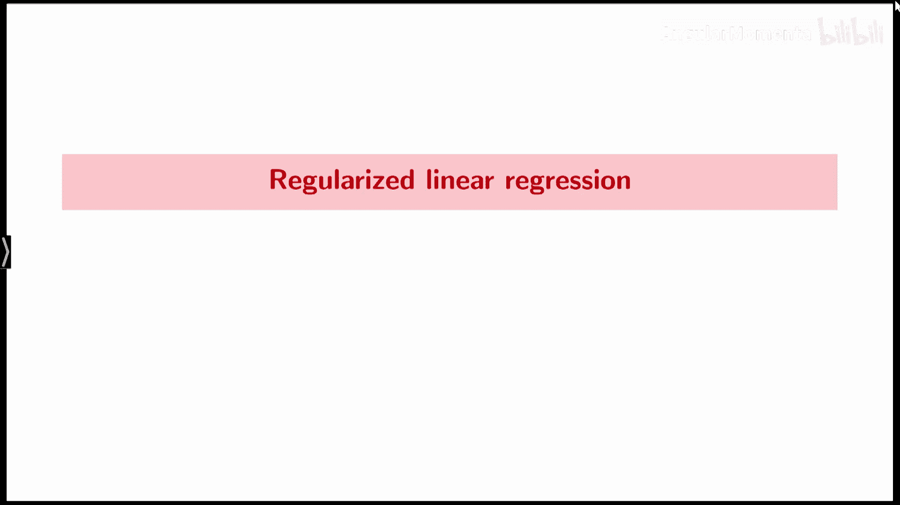

Today we will look at some popular variants of least squares regression。

So we'll begin by considering questions of generalization。

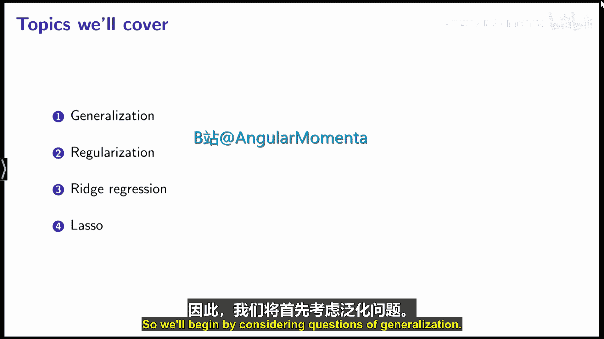

Does doing well on the training set mean that you will necessarily do well on future test data？

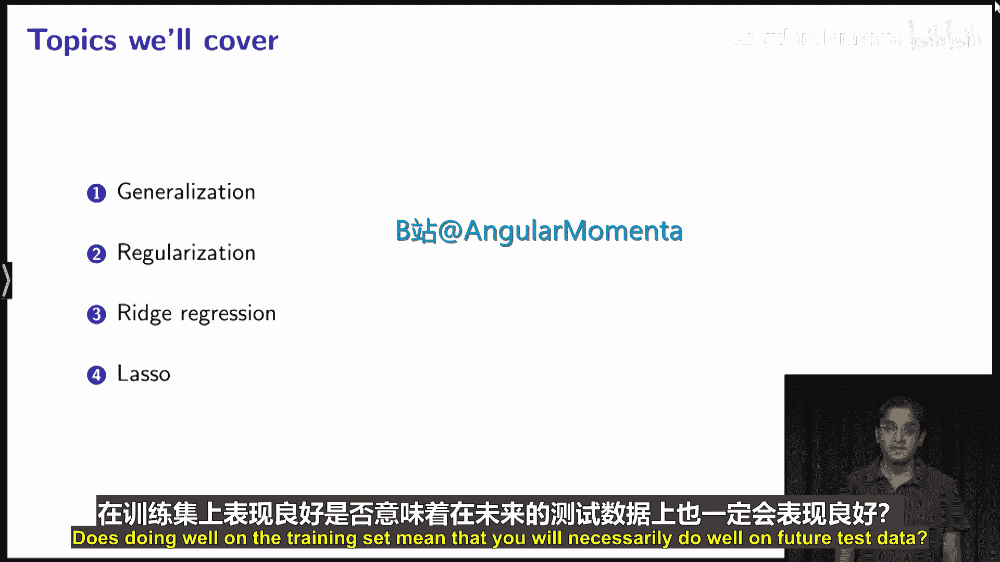

And if not， are there loss functions that aren't exclusively geared towards performance on the training set？

This will lead to the powerful notion of regularization。

And we'll see two regularized forms of least squares regression that are called ridge regression and the lassso。

Okay。So least squares regression。Involves finding a linear function that minimizes the squared loss on the training set。

Does this mean？Good performance in terms of low squared loss on future data as well。Well。

 not necessarily， so there are two regimes that are useful to consider。If n is large， that is。

 if we have a lot of training data。😊，Then good performance on the training set。

Might reasonably indicate fairly good performance in future as well。But if n is small。

 then performance on the training set is probably a gross underestimate of future error。嗯。

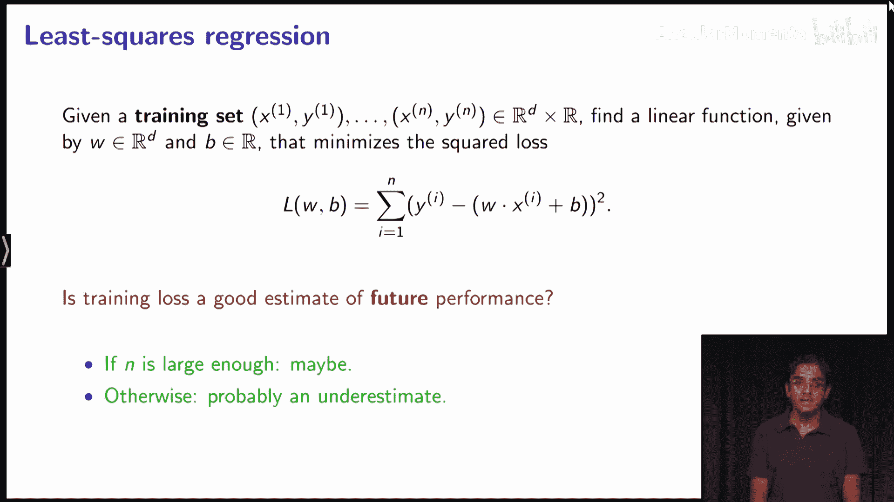

And let's see this by means of concrete example。嗯。So here's a data set in which there's just one feature x and a response value y on the Y axis。

If we were to fit a line to this data。It would look something like this。And in this case。

 the line is just given by two parameters， it's just a one dimensional setting okay。

So we have two parameters and we have something like 100 data points。

 so this is a generous amount of data given how few parameters we need to fit。And in this case。

 it's quite plausible that the training error。😊，Iives a reasonable estimate of the kinds of error rates that。

That will appear on future data as well。嗯。But suppose we didn't have this much training data。

 suppose that instead of these 100 points， we just had， say， one of them。

 what line would we fit to this one data point？Well。

 there are lots of possibilities we could fit this line。Or this line， or this line。😔。

And they all had zero training error。Does this mean zero error on future test points， no。

 certainly not。ok。So that's an extreme case， let's say that instead of one training point。

 we had two training points， okay。In this case， the line we would fit would be something like this。😊。

Again， this is zero training error。How would this line do on future test points？Well。

 let's go back and see what the distribution looked like。

This is the overall distribution of the data。This slide would perform very poorly on it。Okay。

 so all of this raises some big questions。嗯。The first big question is。If training error。

Is not a good measure of future test error。How do we get a good estimate of future error？

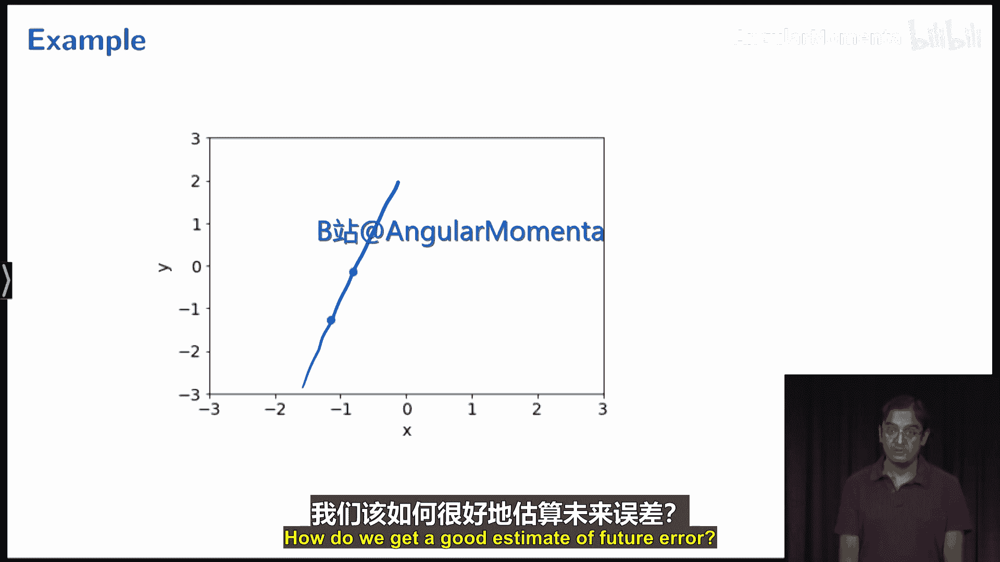

And the usual way to do this， one simple way of doing this is by cross validation。

Now we talked about this when we were doing nearest neighbor。

But let me just quickly go over it again since it's really a very important technique。

So in K fold cross validation， what we would do is to take our training set and divide it into K chunks of equal size。

Okay， so if we have n pointss， we divide them into K groups of n over K points。

Then we take the first chunk and think of it as a test set。

We would train on the remaining k minus1 chunks。That would yield some linear function。

And then we would evaluate the function on chunk number one。This would give us some error rate。

Then we think of chunk 2 as the test set。And we train on the remaining k minus1 chunks。

We get some linear function and evaluate it on chunk 2 and so on。

 we then think of chunk 3 as the test set。So in this way we get k different error estimates。

 E1 through EK， and we just return their average， and this is a much more reasonable estimate of future error。

Okay， so that resolves that question。The second question is。😔，If it is the case。

That training error is really not a very good measure of future error。

Then why are we using an optimization criterion that's based exclusively on training error？

Is there something else we could be optimizing？Something that would likely lead to better future performance。

And indeed， there are other optimization criteria of this type。

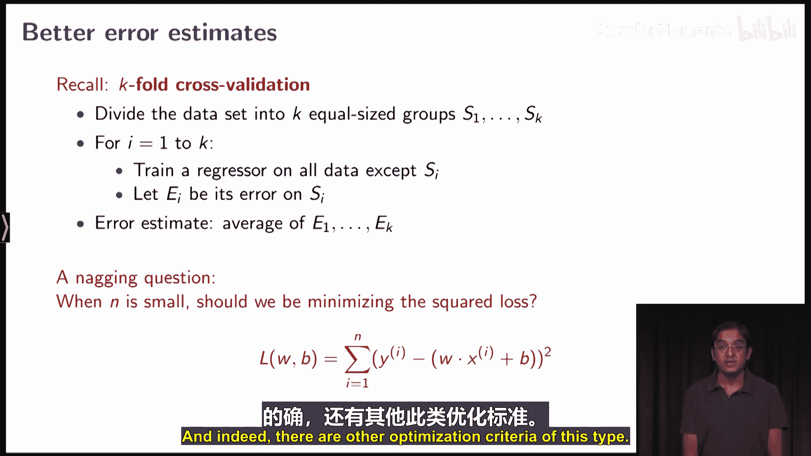

So let's look at an example。In rich regression， the goal is as before to learn a linear function。

So given by W and B， but the loss function is a little bit different。So。

There is the least squares loss， as before。But there's also an additional term called a regularizer。

In this case， it's just the squared L2 norm of w times some constant lambda。

So what is the effect of this？What is this regularizer going to do？

Let's look at two extreme extremes， suppose we set lambda equal to zero。In this case。

 the second term just falls away， it doesn't matter。

 and we just get regular least squares regression， so in this case W would be the least squares solution。

This is a reasonable solution。If we have a lot of data。

Now let's say we set Lambda to be something large， in fact， let's let Lambda go to infinity。

What happens then， Well， if lambmbda goes to infinity。

 the only thing that matters is the second term？😊，And so we will at all cost。Make W。

As small as possible， we will try to shrink its norm as much as we can， and in fact。

 we'll just set w to zero。This is a reasonable solution if we have no data at all。Now， in practice。

 what we'll be doing is to choose some value of lambda that's between these two extremes。

And so what it'll do is to do something like least squares。But to move that solution closer to zero。

 to shrink it towards zero in a sense， and for this reason。

 it is sometimes called a shrinkage estimator。In fact。

 for rid regression we have a nice closed form equation for the optimal W。

 let me show you what it is。

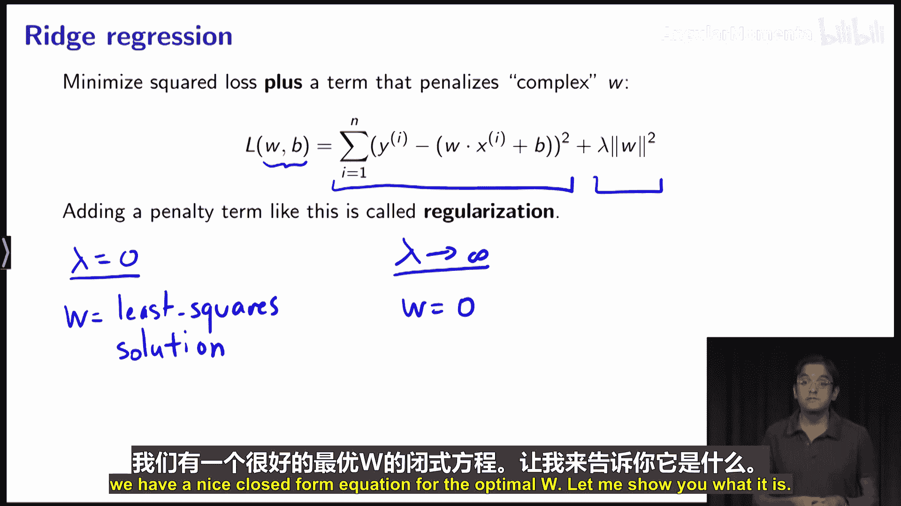

This is the formula for W Now if we set lambda to zero。

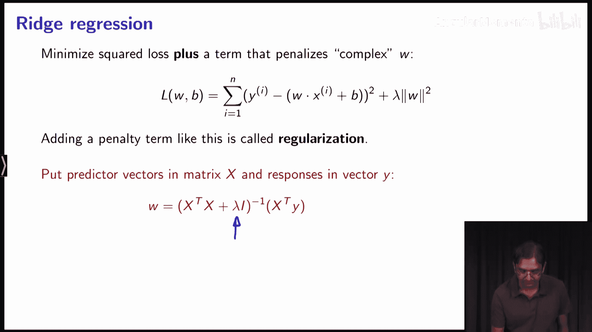

The Lambda at times identity term drops out。And we just get the least square solution that we saw last time。

But as we grow lambda。This first term over here becomes larger。And so the inverse of it。

Puts it in the denominator， it means that we have a larger and larger denominator。

 and so we shrink the resulting W。Okay。

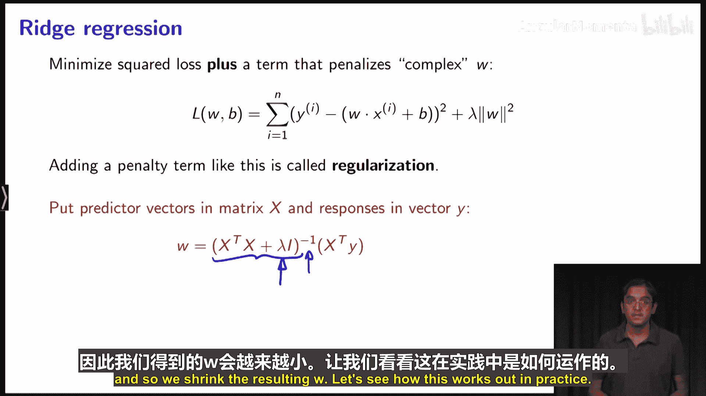

Let's see how this works out in practice。So over here， I've created a toy dataset。

In which there are 100 features， x1 to x100， each of which has a Gaussian distribution。

And there's also response value y， and the interesting thing here is that the response depends on only 10 of the features okay。

 it only depends on features x1 through x10。And the remaining features， the remaining 90 features。

 are pure noise。嗯。Now， the training set and test set each consists of 100 points。

100 training points in 100 dimensions I that a lot of data？No， it certainly is not。In fact。

 you can pretty much always fit 100 points in 100 dimensions。

 it's like having 100 linear equations in 100 unknowns。Okay。

 so there isn't much data and let's see what ridge regression would do in this case。

So lambmbda is something that we need to sit。So let's look at a wide range of different values of Lambda。

When lando is very small。😊，Like in this line over here。As we saw。

 we are essentially getting the least square solution。

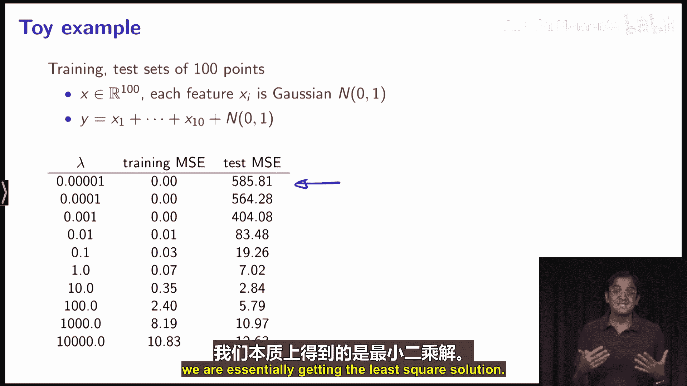

The regularization term doesn't matter in this case。So it's the least square solution。

 it has zero training error， y， because as I said， you can pretty much always fit 100 points in 100 dimensions。

But the test error is very high。 so these squares is not doing very well in this case。

Now let's look at the other extreme when Lambda is very large。😊。

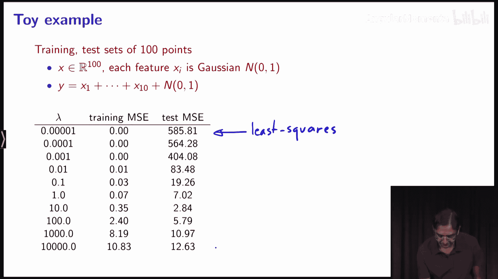

In this case， as we saw， what's happening is that we are going to get a minuscule w。

 something that's pretty close to zero。So this is interesting when w is essentially zero。

 the training error is 12。6。This emphasizes just how bad the least squares estimator is。

 it's getting a training error of 585， so it's really doing very， very poorly in this case。

Now as we grow lambmbda。What's happening is that we are gradually reducing the emphasis on the training set。

 and we're gradually increasing the emphasis on having a small W。😊，Okay。

So since we're reducing the emphasis on the training set。

 the training error is gradually creeping up， as you can see。Okay。But the test errorer。

Goes down for quite a pile。And in fact， it bottoms out over here。At that point。

 it starts to increase again。Because what's happening then is essentially we're not paying enough attention to the training set。

Okay， so the optimal value of lambda in this case would be somewhere around here。😊。

How would we choose the optimal Lada in practice？Well quite simply by cross validation。Okay。

So we've talked about one shrinkage estimator， Rige regression。In which the irregularization term。

Was simply the squared L2 norm of W。But what if we use a different norm。

 what would happen in that case？Well， one very popular choice is to use the L1 norm。And in that case。

 the estimator is called the Laso。So， it has。Roughly the same good generalization behavior as a rigid regression。

But it has one additional big added benefit， which is that it tends to produce。Sparrse solutions W。

 that is to say it produces vectors W that tend to have a lot of zeros in it。

Just a few non zeroro entries。So for example， if you were to go back。

To our little toy data set over here。And run the laso on it。

The W it would find would only have a few non zero features。

 it would identify the 10 relevant features。

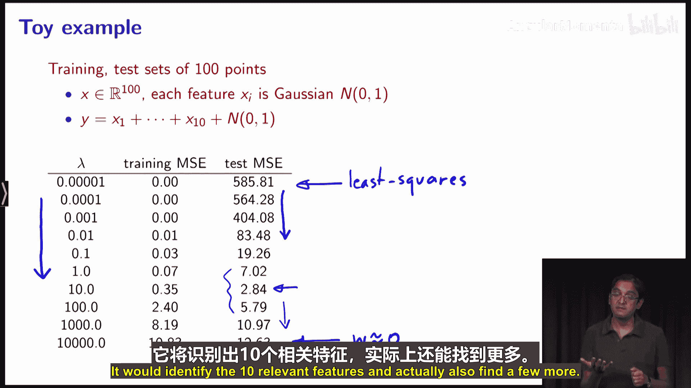

And actually also find a few more。Okay。This is pretty impressive。Now in general。

 why would we want sparse solutions， why is it attractive to have a W that is sparse？

Well theres certainly some computational benefits， if we are only using a few features。

 then that means there's much less data we need to store。And the computation is also more quick。

But most of all， the benefit of having a sparse W is that the resulting linear model is easier to understand and to interpret。

😊，And humans are much more likely to appreciate and use a model that they actually understand。Okay。

 so that concludes our treatment of regression。

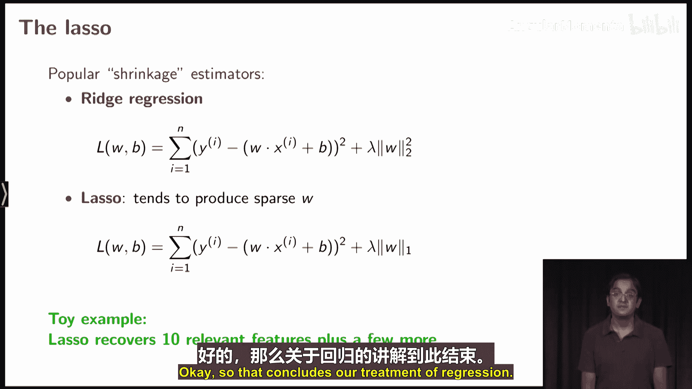

One thing we haven't talked about is going beyond linear regression to regression that for example。

 uses polynomial functions。But a little bit later in the class。

 we will develop some methods that show how this can be managed quite easily。😔，See you next time。

