# 机器学习基础：05-03-02：正则化线性回归 🧠

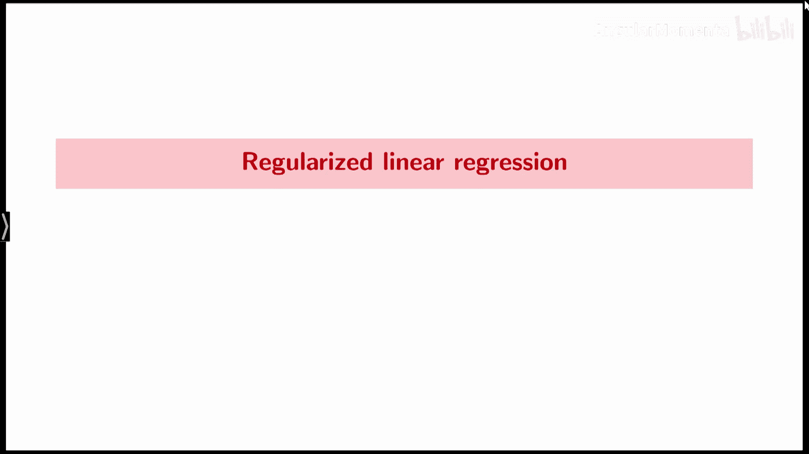

在本节课中，我们将学习最小二乘回归的一些流行变体。我们将从泛化问题开始讨论，并引出正则化的强大概念。我们将看到两种正则化的最小二乘回归形式：岭回归和套索回归。

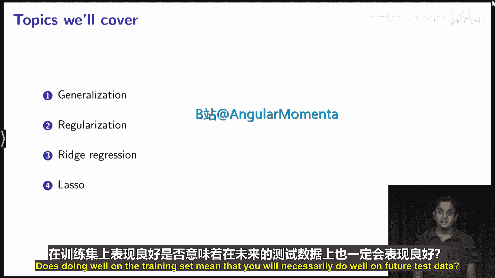

---

上一节我们介绍了最小二乘回归的基本概念。本节中我们来看看泛化问题。

在训练集上表现良好，是否意味着在未来的测试数据上也必然表现良好？

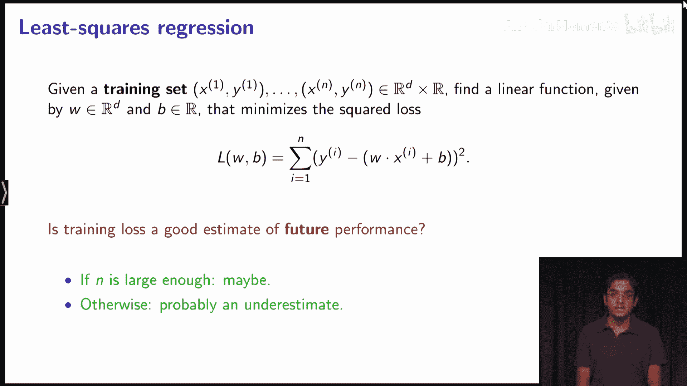

如果不是，是否存在不专门针对训练集性能的损失函数？这将引出强大的正则化概念。

---

最小二乘回归涉及寻找一个线性函数，以最小化训练集上的平方损失。这是否意味着在未来的数据上也能获得较低的平方损失和良好性能？不一定。有两种情况需要考虑。

如果训练数据量 `n` 很大，那么训练集上的良好性能可能合理地预示着未来也会有相当好的性能。但如果 `n` 很小，那么训练集上的性能很可能严重低估了未来的误差。

让我们通过一个具体例子来看。这是一个数据集，只有一个特征 `x` 和响应值 `y`。如果我们用一条线拟合这些数据，它看起来像这样。在这种情况下，这条线只由两个参数决定，这是一个一维设置。我们有两个参数和大约100个数据点，相对于需要拟合的参数数量来说，这是充足的数据。在这种情况下，训练误差很可能对未来数据上的误差率给出合理的估计。

但假设我们没有这么多训练数据。假设我们只有其中一个点，而不是这100个点。我们会用哪条线来拟合这个数据点？有很多可能性，我们可以拟合这条线、那条线或另一条线。它们都有零训练误差。这是否意味着未来测试点上的误差也为零？当然不是。这是一个极端情况。假设我们有两个训练点。在这种情况下，我们拟合的线会是这样的。同样，这是零训练误差。这条线在未来测试点上表现如何？让我们回头看看数据的整体分布。这条线在上面会表现得很差。

所有这些都引发了一些重大问题。

第一个大问题是：如果训练误差不是未来测试误差的良好度量，我们如何获得未来误差的良好估计？

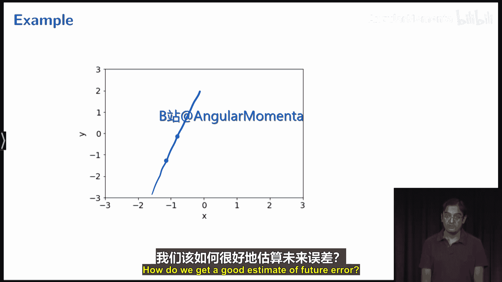

通常的做法，一种简单的方法是使用交叉验证。我们在讨论最近邻时提到过这一点，但让我再快速回顾一下，因为它确实是一项非常重要的技术。

在K折交叉验证中，我们将训练集分成K个大小相等的块。如果我们有 `n` 个点，我们将它们分成K组，每组 `n/K` 个点。然后，我们将第一块视为测试集，在剩余的 `K-1` 块上进行训练。这将产生某个线性函数，然后我们在第一块上评估该函数。这将给出某个误差率。接着，我们将第二块视为测试集，在剩余的 `K-1` 块上训练，得到某个线性函数并在第二块上评估，依此类推。这样，我们得到K个不同的误差估计 `E1` 到 `EK`，我们只需返回它们的平均值，这是对未来误差更合理的估计。

这解决了第一个问题。

第二个问题是：如果训练误差确实不是未来误差的良好度量，那么我们为什么要使用完全基于训练误差的优化准则？我们是否可以优化其他东西？是否有什么东西可能带来更好的未来性能？

确实，存在其他类型的优化准则。

---

上一节我们提出了关于优化准则的问题。本节中我们来看一个具体的例子：岭回归。

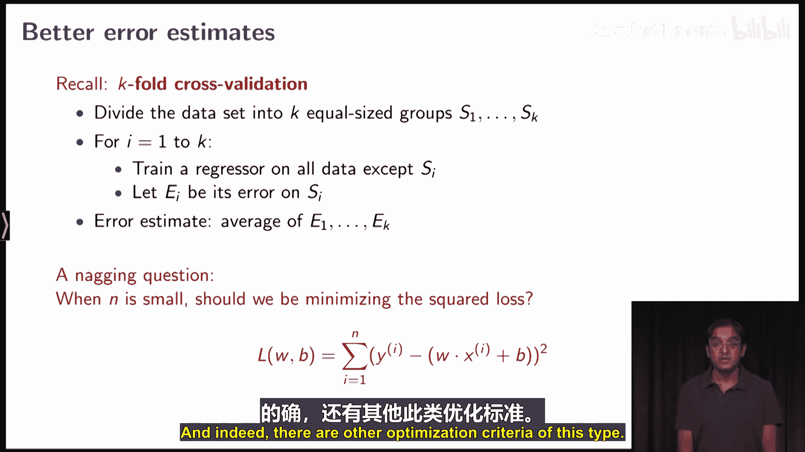

在岭回归中，目标与之前一样，是学习一个由 `w` 和 `b` 给出的线性函数，但损失函数略有不同。除了之前的平方损失外，还有一个额外的项，称为正则化项。在这种情况下，它就是 `w` 的L2范数的平方乘以某个常数 `λ`。

这个正则化项有什么作用？让我们看两个极端情况。

假设我们将 `λ` 设为零。在这种情况下，第二项消失，无关紧要，我们就得到了常规的最小二乘回归。此时 `w` 将是最小二乘解。如果我们有很多数据，这是一个合理的解。

现在，假设我们将 `λ` 设为一个很大的值，甚至让 `λ` 趋于无穷大。会发生什么？如果 `λ` 趋于无穷大，唯一重要的是第二项。我们将不惜一切代价使 `w` 尽可能小，我们会尽力缩小其范数。实际上，我们会直接将 `w` 设为零。如果我们完全没有数据，这是一个合理的解。

在实践中，我们会选择介于这两个极端之间的某个 `λ` 值。因此，它的作用是执行类似最小二乘的操作，但将该解向零移动，在某种意义上将其向零收缩。因此，它有时被称为收缩估计量。

实际上，对于岭回归，最优 `w` 有一个很好的闭式方程。让我展示给你看。

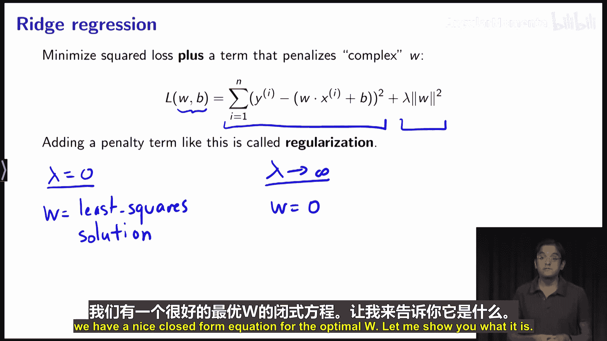

这是 `w` 的公式。如果我们设 `λ` 为零。

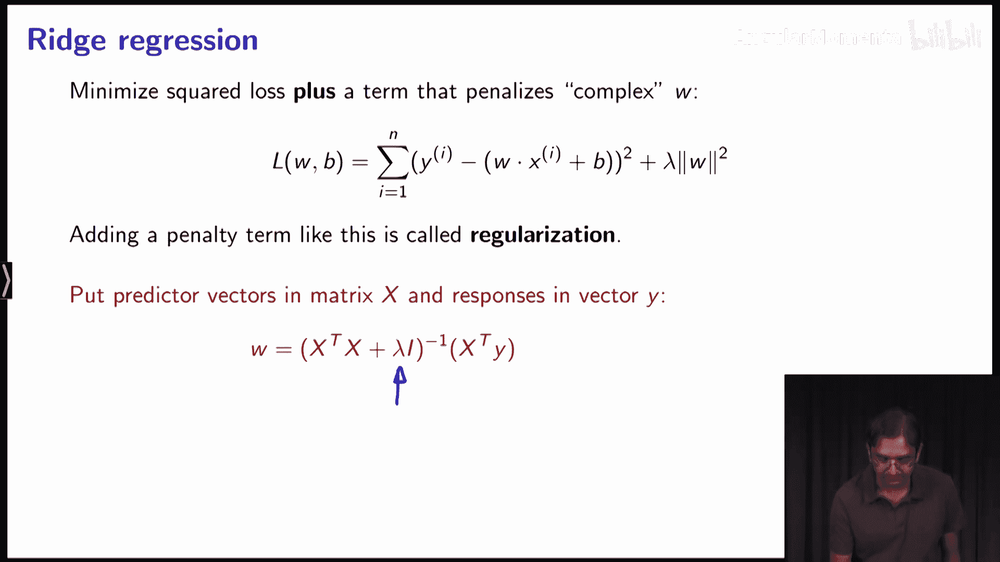

`λ` 乘以单位矩阵的项就消失了，我们得到了上次看到的最小二乘解。但随着我们增大 `λ`，这里的第一项变得更大。因此，它的逆在分母中，意味着分母越来越大，从而我们收缩了得到的 `w`。

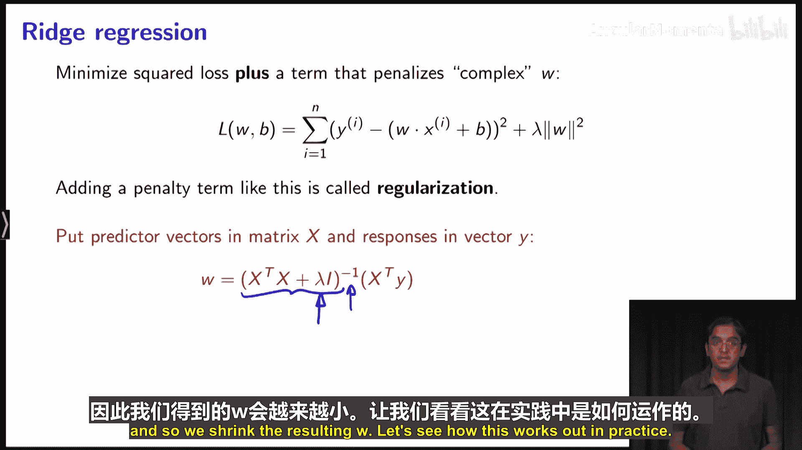

---

了解了岭回归的原理后，让我们看看它在实践中如何运作。

这里，我创建了一个玩具数据集。其中有100个特征 `x1` 到 `x100`，每个都服从高斯分布。还有一个响应值 `y`。有趣的是，响应仅依赖于其中10个特征，即仅依赖于特征 `x1` 到 `x10`。其余90个特征是纯噪声。

训练集和测试集各包含100个点。100维空间中的100个训练点，数据量多吗？不，当然不多。实际上，你几乎总是可以拟合100维空间中的100个点，就像解100个线性方程求100个未知数。数据量不大，让我们看看岭回归在这种情况下会怎么做。

`λ` 是我们需要设定的参数。让我们看看一系列不同的 `λ` 值。

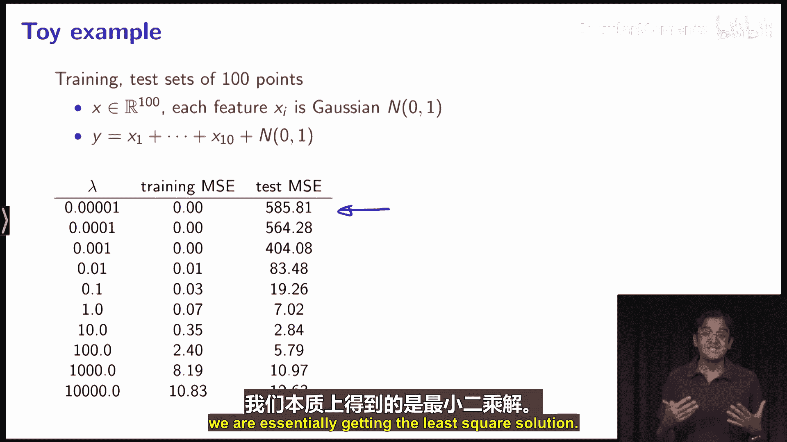

当 `λ` 非常小时，就像这里的这条线所示，我们基本上得到了最小二乘解。

在这种情况下，正则化项无关紧要。所以它是最小二乘解，具有零训练误差，因为如前所述，你几乎总是可以拟合100维空间中的100个点。但测试误差非常高，所以在这种情况下最小二乘表现不佳。

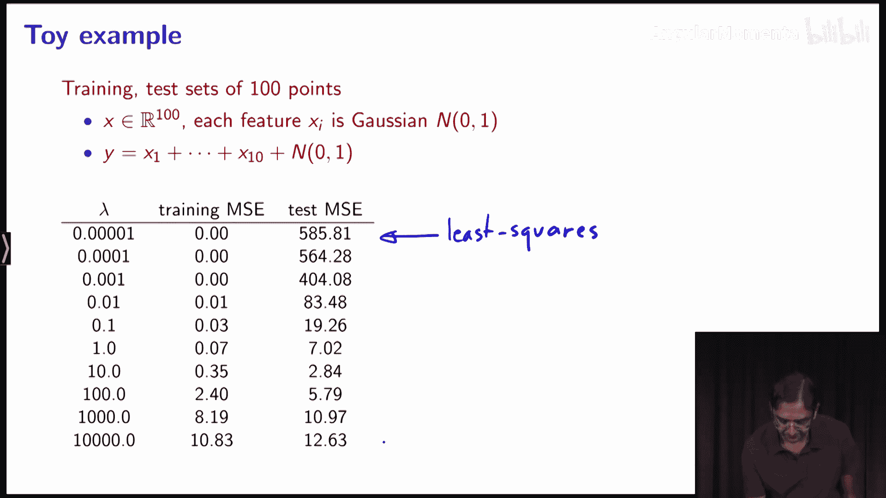

现在看看另一个极端，当 `λ` 非常大时。

在这种情况下，正如我们所见，我们将得到一个极小的 `w`，接近于零。有趣的是，当 `w` 基本为零时，训练误差是12.6。这强调了最小二乘估计量有多差，它的训练误差是585，所以在这种情况下确实表现得非常非常差。

随着我们增大 `λ`，我们逐渐减少对训练集的重视，逐渐增加对拥有小 `w` 的重视。由于我们减少了对训练集的重视，训练误差逐渐上升，正如你所见。但测试误差下降了很多。实际上，它在这里触底。在那之后，它又开始上升，因为那时我们基本上没有给予训练集足够的关注。

因此，在这种情况下，`λ` 的最优值大约在这里。在实践中，我们如何选择最优的 `λ`？很简单，通过交叉验证。

---

我们讨论了一种收缩估计量：岭回归，其正则化项是 `w` 的L2范数的平方。但如果我们使用不同的范数会发生什么？一个非常流行的选择是使用L1范数。在这种情况下，估计量被称为套索回归。

它大致具有与岭回归相同的良好泛化行为，但有一个额外的重要好处：它倾向于产生稀疏解 `w`。也就是说，它产生的向量 `w` 往往有很多零，只有少数非零项。

例如，如果你回到我们的小玩具数据集，并在其上运行套索回归，它找到的 `w` 将只有少数非零特征，它会识别出10个相关特征。

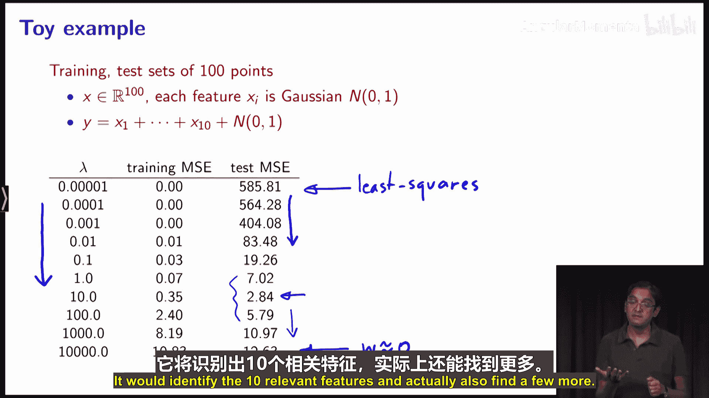

实际上还会多找出几个。这令人印象深刻。

一般来说，为什么我们需要稀疏解？为什么拥有稀疏的 `w` 有吸引力？当然有一些计算上的好处。如果我们只使用几个特征，那就意味着我们需要存储的数据少得多，计算也更快。但最重要的是，拥有稀疏 `w` 的好处在于，得到的线性模型更容易理解和解释。人类更可能欣赏和使用他们真正理解的模型。

---

本节课中我们一起学习了正则化线性回归。我们探讨了训练误差与泛化误差的区别，并介绍了交叉验证作为评估未来性能的方法。我们深入研究了两种正则化方法：岭回归（使用L2正则化）和套索回归（使用L1正则化）。岭回归通过收缩系数向零来控制模型复杂度，而套索回归除了收缩外，还能产生稀疏模型，有助于特征选择。

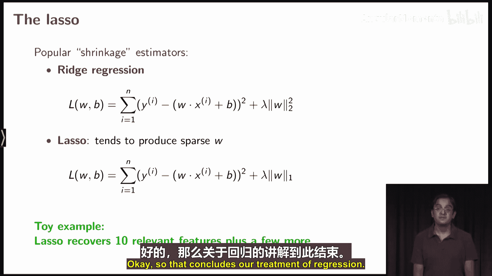

我们尚未讨论的是超越线性回归，例如使用多项式函数的回归。但在课程稍后部分，我们将开发一些方法来展示如何轻松地处理这个问题。下次见。