# 【加州大学圣地亚哥分校】机器学习基础  Machine Learning Fundamentals p22 05-04-02-条件概率估计的线性模型 -BV1TyFSziEZb_p22-

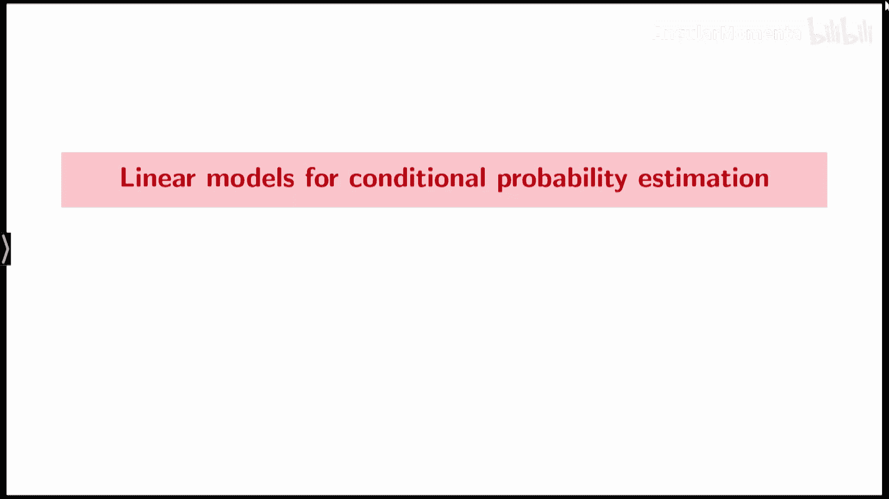

So in the beginning of this class， we spent a lot of time on classification problems。

 and recently we've been talking quite a bit about regression。

What we're going to do today is to move on to another type of prediction problem。

Conditional probability estimation。So we'll start by looking at sources of uncertainty in prediction problems。

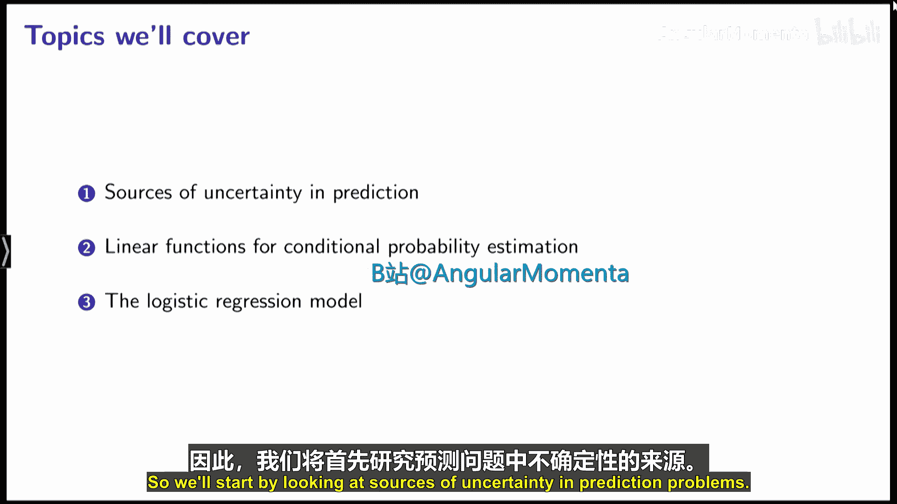

And then we'll see how this uncertainty can be captured by linear functions。

 and eventually this will lead to the logistic regression formulation。So here's a basic question。

Suppose you want to build a classifier。And let's say you have all the training data you could possibly want。

 okay， as much data as you like。Can you in general hope to get a perfect classifier。The answer。

 sadly， is， in general， no。And there are two big reasons for this。

The first reason is that the features you have， the X。

May simply not contain enough information to perfectly predict why。 Okay， so， for example。

 let's say that the data， the X are medical records for patients who are at risk for a certain disease。

And let's say why is whether the patient actually does get that disease over the。

 say next five years。So even with all this information， even with the complete medical record。

 it's still not possible to predict with complete certainty whether or not somebody is going to fall sick。

There's so much that depends on chance。So this is a situation in which we would like to be able to make a prediction。

But it would also be useful if we could accompany that prediction with some sort of quantification of the uncertainty。

 if we could say something like there is an 80% chance that this person will fall sick。

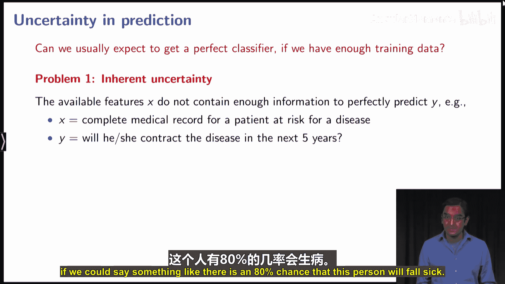

Now this the second big reason why in general we can't hope for a best perfect classifier。

Is that very often the kind of classifier that we are using is simply not capable of perfectly capturing the true decision boundary Okay。

 so let's look at this picture over here， we have a two dimensional situation there are two classes。

 purple and green and there is some true decision boundary between the two classes。😊。

But let's say we're using linear classifiers。 There's no way to perfectly capture this boundary。

 The best we could do would probably be something like this。Okay。So in this case。

 we would still be able to make predictions， but it would be nice if we could also quantify the uncertainty。

 you know， if we could say something like there is a 70% chance that the label is green。😊。

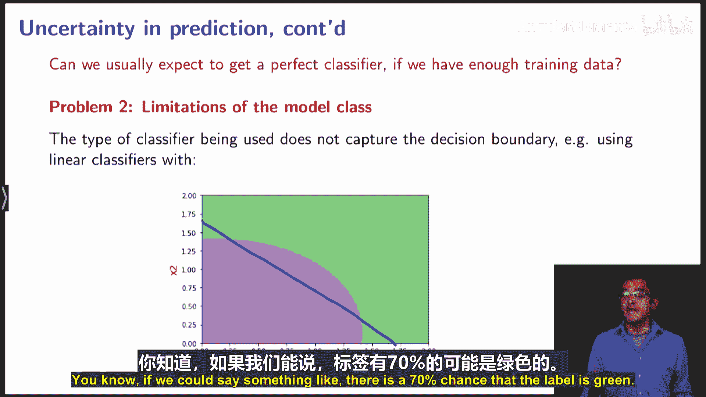

，So we're talking about situations in which we want to classify， but in addition。

 we also want to output a probability， we want to output the probabilities of the different labels。

Now for simplicity， we're going to be looking at the case where there are just two possible labels plus and minus plus 1 and minus1 okay。

 this is the binary case。The methods that we develop， the logistic regression method。

Applies also in the multiclass setting and we'll see how this generalization works。

 It's very easy but we we won't see it for another week or two。 Okay， so for the time being。

 we're looking at binary problems。And we have points x。

 and we want to be able to predict the probability that y equals1 at x。Now， of course。

 the probability that y equals minus1 is just one minus。

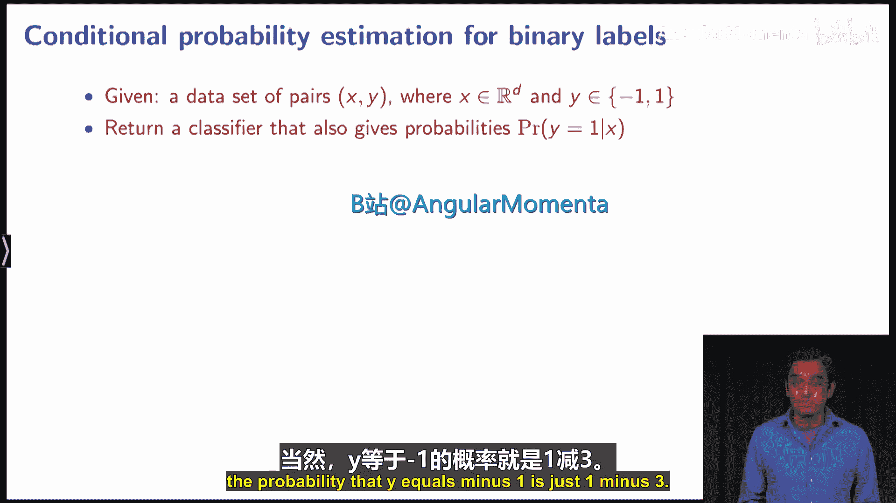

Yeah。Now let's see what happens in the picture we looked at before Okay and let's say that we want to use a linear function case we have a boundary like this。

Okay。And along the boundary， there is a 50% chance that y is1。 Okay， let's say in this case。

 that green is plus 1 and purple is -1。 So along that line， there's a 50% chance say that y equals 1。

And then we'll look at parallel lines。 So along this line。The chance would be slightly higher。

 let's say 60%。And along this line。The chance would be slightly lower。

 The probability of y equals1 might be something like 40% along that line。Okay。

 so this is the kind of model that we'll be coming up with， we'll have a linear decision boundary。😊。

On one side of the boundary we willll predict plus， on the other side we'll predict minus。

And in terms of the probabilities， it really depends on the distance to the boundary。

 the closer to the boundary， the closer the probability is to a half。Now。

 let's see how this would work out mathematically。

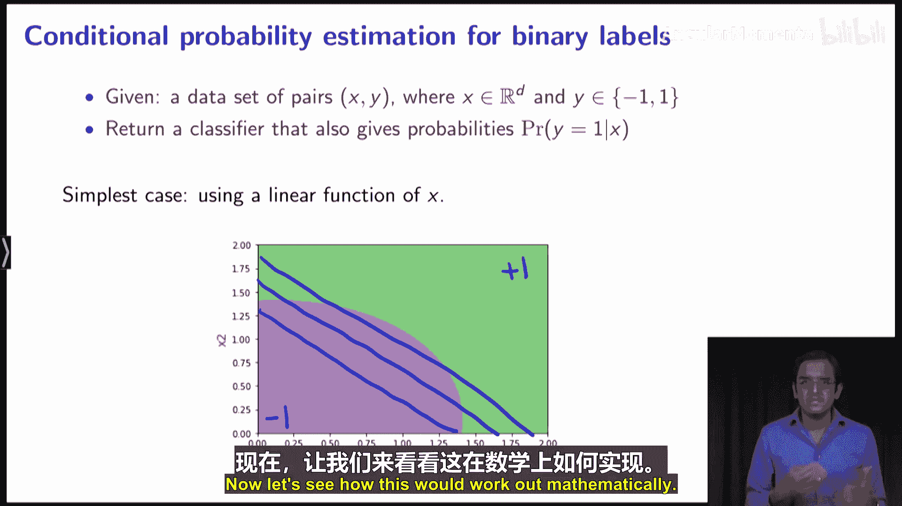

Let me go ahead and draw a 2D。Grid。Okay， so let's say we have two dimensions like this。Okay。

 this is zero， one， two， three， four，5。And along the x so is the x1 direction。

 And then we have the x2 direction。 and along this direction， we have1。2。😔，3e。4 and 5。Okay。

 so we have two dimensional data。 Okay， and let me draw a linear boundary。

 What about this boundary over here。Okay。What is the equation of this line？Well。

 let'sy the equation of the line is basically x1 plus x2 equals 2。Okay。

 that's the equation of that line over there。Let's write it in a slightly different way Okay。

 let's write it as x1。😊，Plus， x2 minus-2 equals 0。Okay， and in general。

 we're going to be writing our linear boundaries like this as some linear function equals 0。 Okay。

 so this is the linear function in our case。And the boundary is when this linear function equals zero。

Now on one side of the boundary we'll predict plus。On the other side of the boundary。

 we will predict minus。What is the set of points along which we are going to predict， say。

 a 60% chance of plus？Okay。It might be something like this。Okay， what is the equation of that line。

Well， let's see。That line is x。X1 plus x2 equals 3。

 and another way to write it is that x1 plus x2 minus2， which is our linear function。

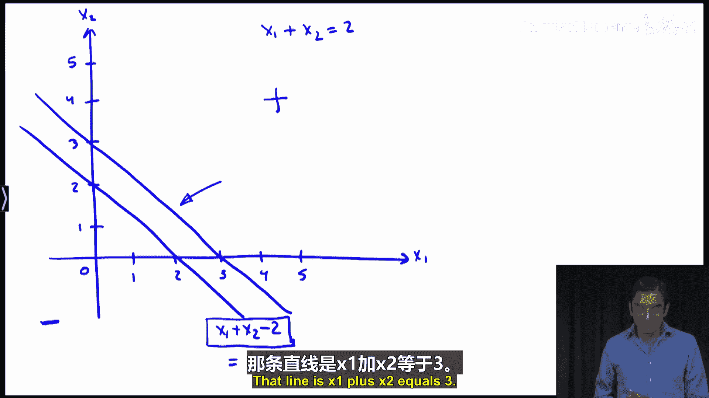

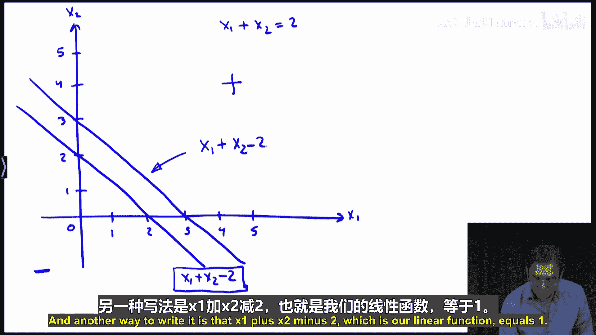

Equals one。Okay。And now let's look at a line on the other side， maybe something like this。

If these are the 50% points。Where there's a 50，50 chance of the two labels。

 and these are the 60% points where the probability of y equals 1 is 60%。

Then the symmetric line on the other side will be the 40% points where the probability that y equals 1 is 40% and conversely。

 the probability that y equals -1 is 60%。 And what's the equation of this line well。

This is x1 plus x2 minus2 equals negative 1。So do you see the general pattern over here？

In order to classify a point and in order to determine the probability that y equals 1。

 all we're going to do is to compute this linear function， in this case， x1 plus x2 minus2。

If it works out to zero， there's a 5050 chance if it's positive。

Then the chance is greater than a half， if it's negative。

 the chance is less than a half and the larger this value， the larger the probability the y equals 1。

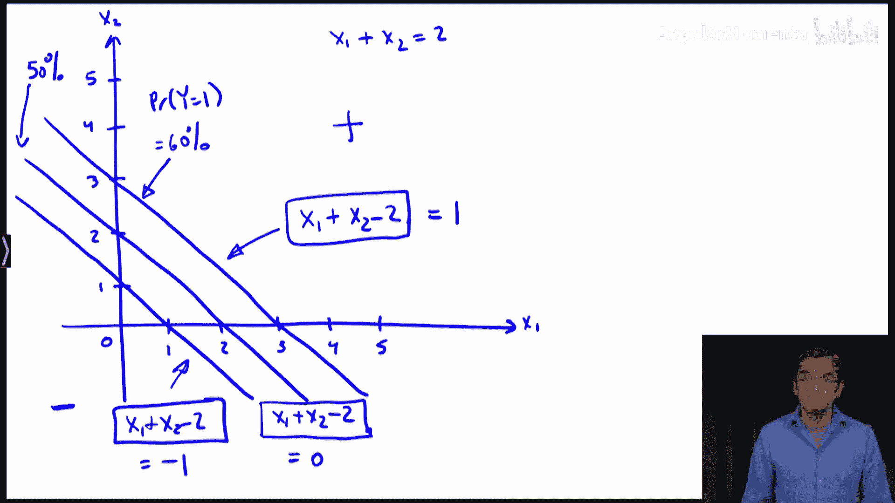

Okay。So now let's move to a more general setting where we have D dimensionsal data。And again。

 we're going to be computing some linear function of this data。 Okay。

 so we have data points x in R D， What is a general linear function in D dimensions， Well。

 it's something of this form， W1 x1 plus w2 x2 all the way to W2 X D。Plus。

 this extra intercept term B。 Okay， so this is a general linear function。

And we can rewrite it a little bit more compactly as w dot x plus B。

 where w is just a vector of all the coefficients W1 through WD Okay， so that's all linear function。

So we get a point x， we compute this linear function。If it turns out to zero。

 that means that this point is right on the boundary between the two classes。

 there's a 5050 chance that y equals1， and the larger this function is。

 the larger the probability the y equals1。But how do we get an actual probability out of this？

After all， this function， w dot x plus B。This returns an arbitrary real value。

 It could be anywhere from minus infinity to plus infinity。

 How do we convert this into a probability， how do we take a number from minus infinity to plus infinity and get a number in the range0 to1。

The way we do that is by using the squashing function， okay。

 so the squashing function takes a real value。

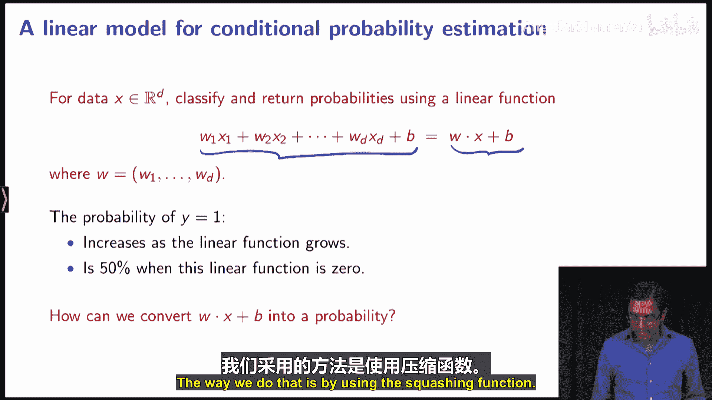

子。😊，And it outputs1 over1 plus e to the minus C， and this is something that's always in the range0 to 1。

Okay， so in this graph， this is the Z over here。And on this axis， you have S sub Z。

So when you plug in z equals zero， for instance， into that formula， you get back a half。

So you get that point over there。And as Z gets larger， the numbers get larger as well。

And as Z goes to infinity， they asymptotically reach one。 That's what you're seeing up here。

And when Z goes to negative infinity， they asymptotically reach0。So this takes a real number。

 turns it into a probability， and when you plug into the value0， you get a half。

 so this is really exactly what we need。Okay。So。When we have a point x。

 the probability that y equals1 is going to be the following first we compute the linear function。

 w dot x plus B。And then we put it through the squashing function。

 and this gives us a probability in the range zero to1。

Now this is the probability that y equals one for that specific point x。

What is the probability that y equals minus1？Well， it's just  one minus this。 Okay。

 so let's write that down。 The probability the white was -1 is 1 whatever we have up there。

 which is 11 over。1 plus E to the negative W dot x plus B。Okay。Let's simplify it a little bit。 Okay。

 so we get E to the negative W。Dot x plus B。Over 1 plus e to the negative W dot x plus B。

And you know what， let's multiply the numerator and denominator by exactly the same quantity。

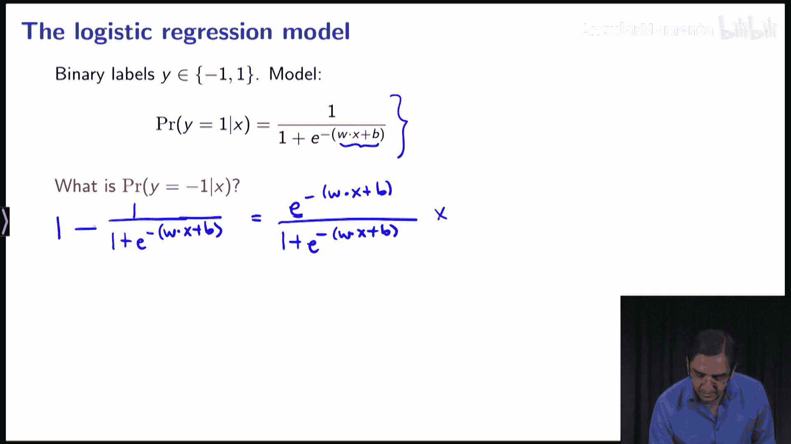

Which is E to the W dot x plus B， so let's multiply top and bottom by the same thing。

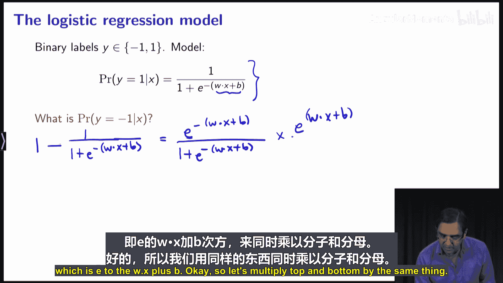

And what do we get， Well， the do just becomes one。And the bottom becomes1 plus E to the W dot x plus B。

好。Okay， so we've simplified it a little bit。But now if you look at the two formulas， okay。

 so the one at the bottom is the probability。That y equals -1， given x。If you look at this formula。

And you look at the one up there。You see that they're actually very similar。 and， in fact。

 we can put them together and just have a single unified formula。 Okay， what is that。

 It's the following。 The probability of any y given x， where y is either the plus1 or -1。

Is simply1 over1 plus e to the negative y times w dot x plus B。So if you plug in y equals 1。

 you get the formula on the top， if you plug in y equals negative one。

 you get this formula over here， and so now we have a single formula that covers both cases。

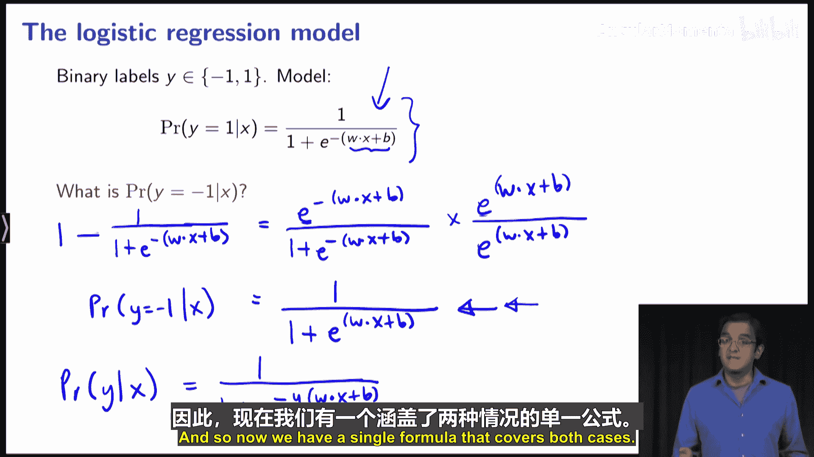

This is the logistic regression model。So here's a summary of what we had。

We have data in de dimensional space， there are two possible labels。And in addition to classifying。

 we're going to output probabilities， and this is the form of the probability function。😊。

Now it's based on two parameters， W and V， that define a linear function。What are these parameters。

 how do we set then， well， this is what we have to learn from data。

 and we'll see how to do that next up。So that's it for today。

 We've talked a little bit about quantifying the uncertainty and prediction。

 and we've seen that this can be done quite easily using linear functions。 Next time。

 we'll see how to learn this linear function。 So see you then。😊。

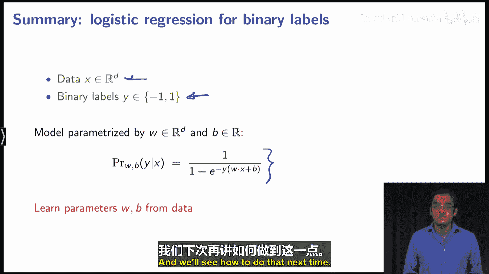