# 机器学习基础：05-04-02：条件概率估计的线性模型 📈

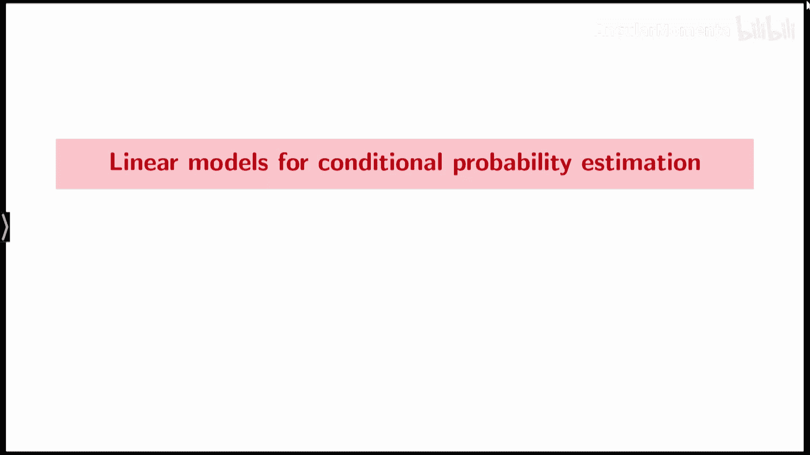

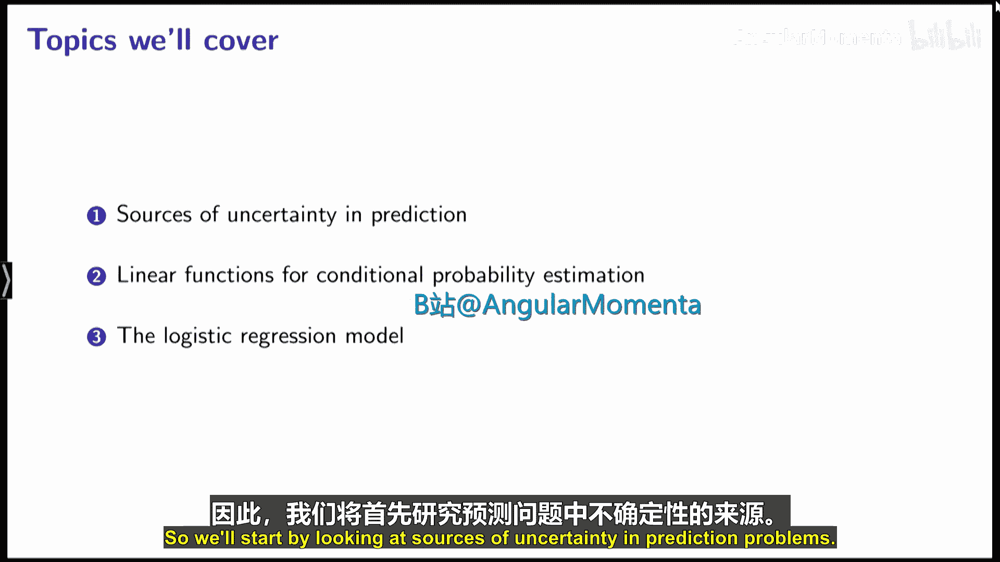

在本节课中，我们将学习一种新的预测问题类型：条件概率估计。我们将从探讨预测问题中的不确定性来源开始，然后了解如何用线性函数来捕捉这种不确定性，最终引出逻辑回归的公式。

## 预测中的不确定性来源

上一节我们介绍了分类和回归问题，本节中我们来看看为什么完美的分类器通常无法实现。主要有两个原因。

第一个原因是，我们拥有的特征 `X` 可能本身就不包含足够的信息来完美预测标签 `y`。例如，即使拥有患者完整的医疗记录，也无法完全确定地预测某人未来是否会患病，因为其中存在大量偶然因素。在这种情况下，我们不仅希望做出预测，还希望能对预测的不确定性进行量化，例如说“此人有80%的概率会患病”。

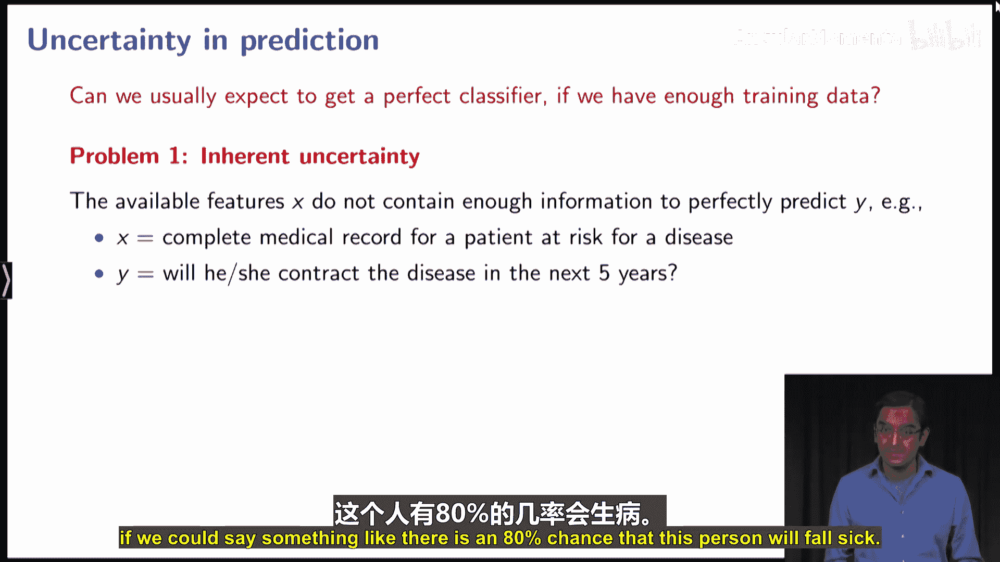

第二个原因是，我们使用的分类器类型可能无法完美捕捉真实的决策边界。例如，如果我们使用线性分类器，而真实边界是非线性的，那么最好的线性分类器也无法做到完美分类。此时，我们同样希望能输出一个概率，例如“该样本标签为绿色的概率是70%”。

## 从线性边界到概率

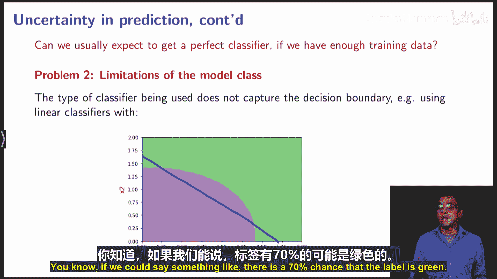

我们主要讨论二分类问题，标签为 `+1` 和 `-1`。我们的目标是，对于给定的数据点 `x`，预测 `y = +1` 的概率 `P(y=+1 | x)`。当然，`P(y=-1 | x) = 1 - P(y=+1 | x)`。

假设我们使用一个线性决策边界。在边界上，`y = +1` 的概率是50%。在边界的一侧，概率会高于50%，并随着距离边界越远而越高；在另一侧，概率则低于50%，并随着距离边界越远而越低。因此，概率的大小取决于数据点到决策边界的距离。

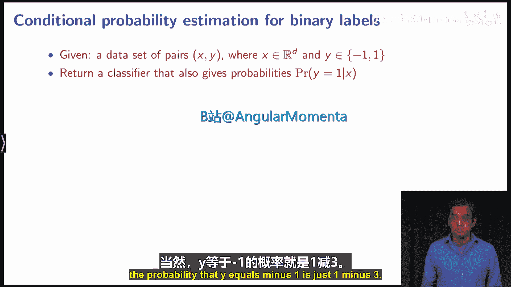

让我们通过一个二维例子来具体说明。

## 一个二维示例

假设我们有一个二维空间，决策边界是直线 `x1 + x2 - 2 = 0`。这条线就是 `P(y=+1 | x) = 0.5` 的等概率线。

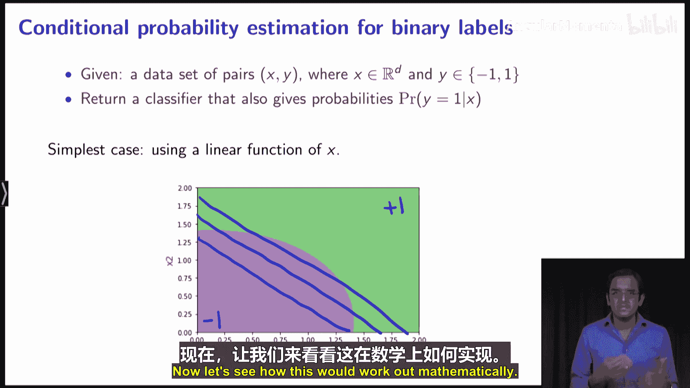

以下是不同概率对应的等值线：
*   在直线 `x1 + x2 - 2 = 1` 上，`P(y=+1 | x) = 0.6`。
*   在直线 `x1 + x2 - 2 = -1` 上，`P(y=+1 | x) = 0.4`。

可以看到，我们只需计算线性函数 `f(x) = x1 + x2 - 2` 的值。这个值 `f(x)` 决定了概率：
*   若 `f(x) = 0`，概率为 0.5。
*   若 `f(x) > 0`，概率大于 0.5，且值越大，概率越高。
*   若 `f(x) < 0`，概率小于 0.5，且值越小，概率越低。

## 推广到一般情况

现在我们将这个概念推广到 `D` 维数据。对于一个数据点 `x ∈ R^D`，我们计算一个通用的线性函数：

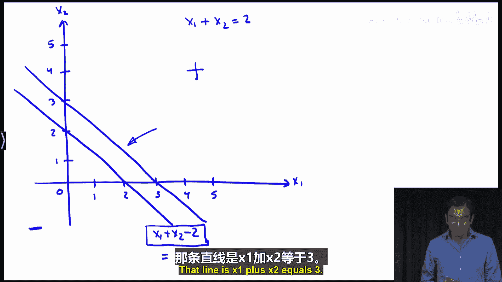

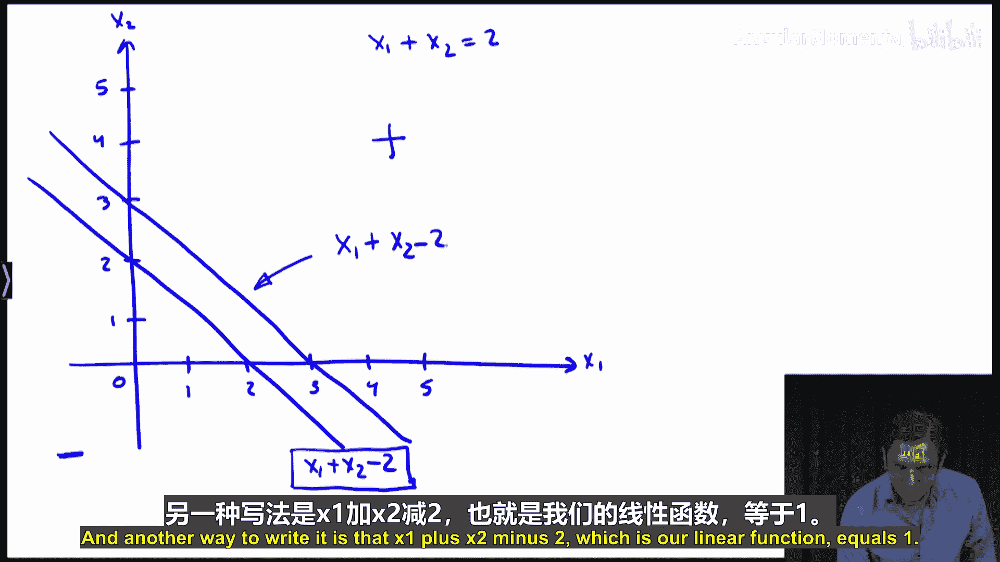

`f(x) = w · x + b`

其中 `w` 是权重向量，`b` 是偏置项。这个函数 `f(x)` 的值域是 `(-∞, +∞)`。

为了将 `f(x)` 映射到 `[0, 1]` 的概率区间，我们需要一个“压缩函数”。这里我们使用 **Sigmoid 函数**（或称逻辑函数）：

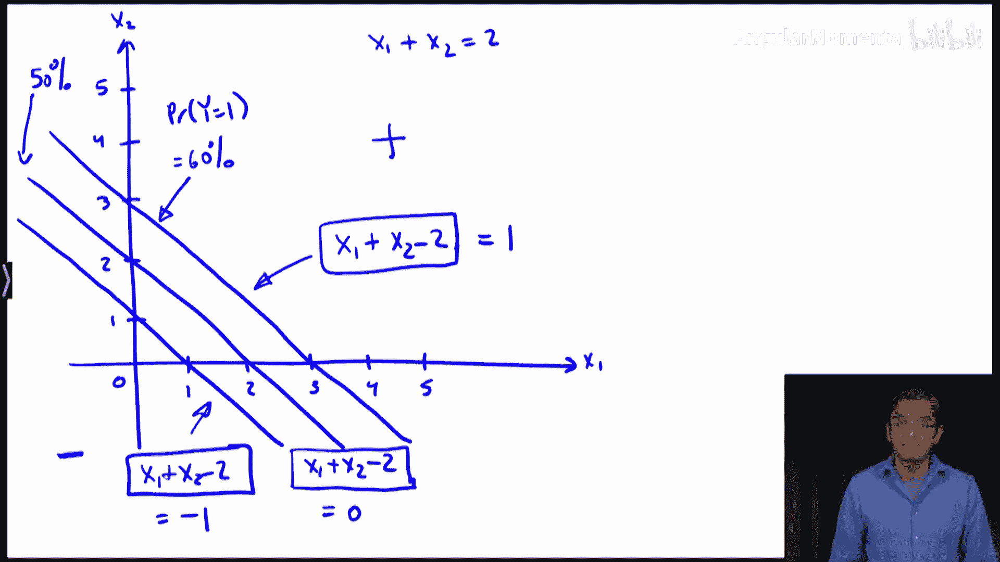

`σ(z) = 1 / (1 + e^{-z})`

这个函数的特性是：
*   当 `z = 0` 时，`σ(z) = 0.5`。
*   当 `z → +∞` 时，`σ(z) → 1`。
*   当 `z → -∞` 时，`σ(z) → 0`。

## 逻辑回归模型

结合线性函数和Sigmoid函数，我们得到逻辑回归模型。对于点 `x`，`y = +1` 的概率为：

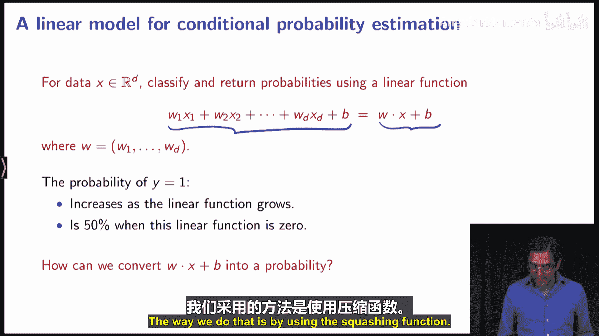

`P(y = +1 | x) = σ(w · x + b) = 1 / (1 + e^{-(w·x + b)})`

相应地，`y = -1` 的概率为：

`P(y = -1 | x) = 1 - P(y = +1 | x) = e^{-(w·x + b)} / (1 + e^{-(w·x + b)})`

我们可以将这两个公式统一为一个简洁的表达式。对于任意标签 `y ∈ {+1, -1}`，其条件概率为：

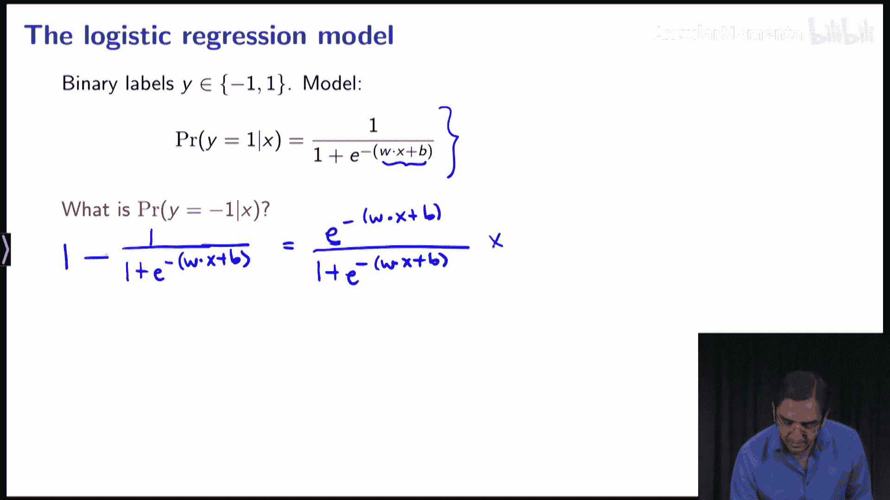

`P(y | x) = 1 / (1 + e^{-y (w·x + b)})`

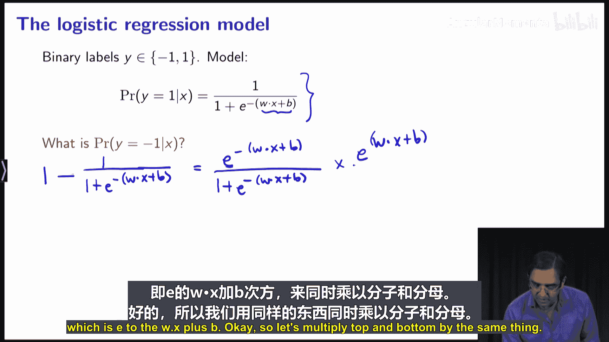

**验证**：
*   当 `y = +1` 时，公式变为 `1 / (1 + e^{-(w·x + b)})`，即 `P(y=+1 | x)`。
*   当 `y = -1` 时，公式变为 `1 / (1 + e^{+(w·x + b)})`，经过简单代数变换（分子分母同乘 `e^{-(w·x + b)}`）即可得到上面的 `P(y=-1 | x)` 公式。

## 总结

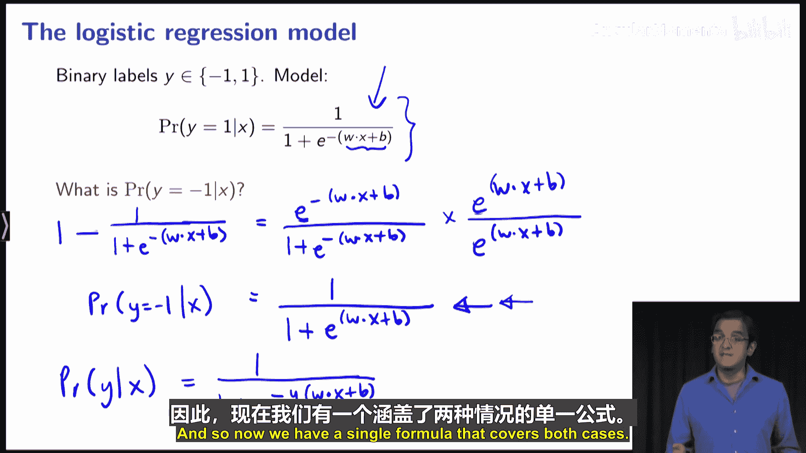

本节课中我们一起学习了条件概率估计的线性模型——逻辑回归。我们首先探讨了预测中不确定性的两个主要来源：特征信息不足和模型表达能力有限。接着，我们看到了如何利用线性函数结合Sigmoid压缩函数，将任意实数值转化为 `[0, 1]` 区间内的概率，从而构建出逻辑回归模型。该模型的核心公式是：

`P(y | x) = 1 / (1 + e^{-y (w·x + b)})`

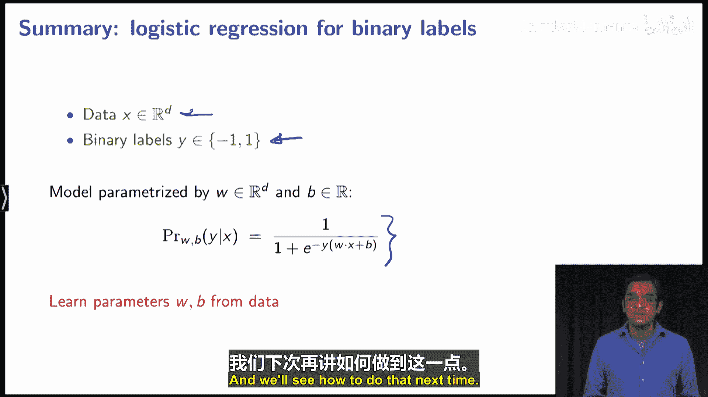

这个模型基于参数 `w` 和 `b`。在下节课中，我们将学习如何从数据中学习（训练）出这些参数。