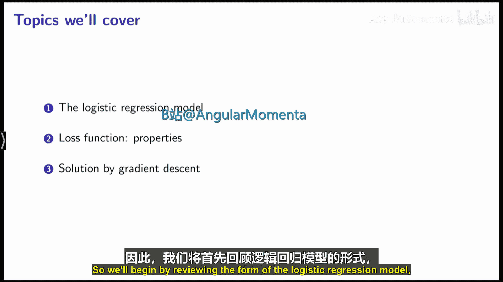
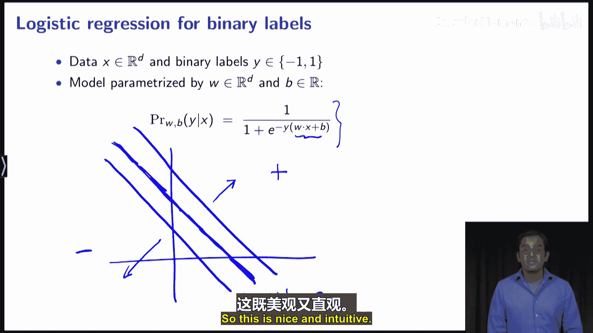
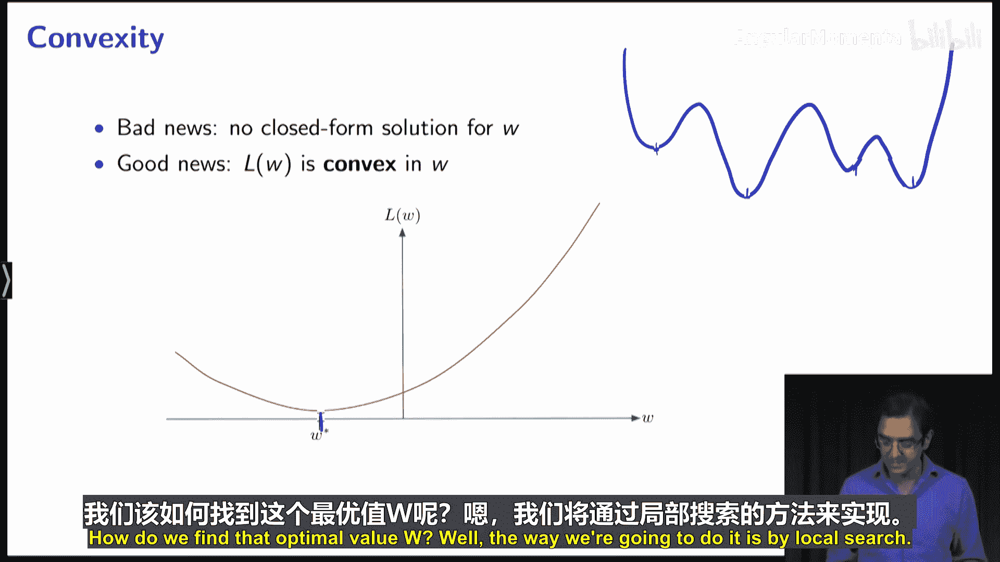
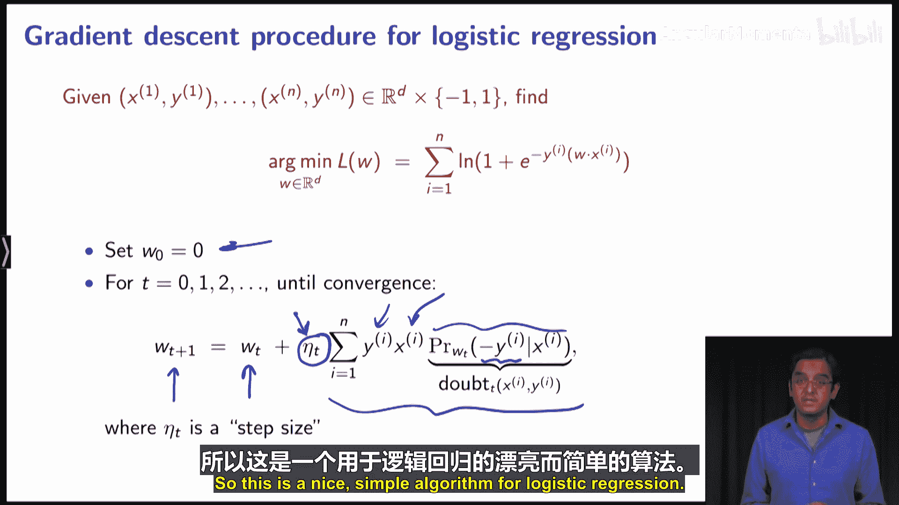
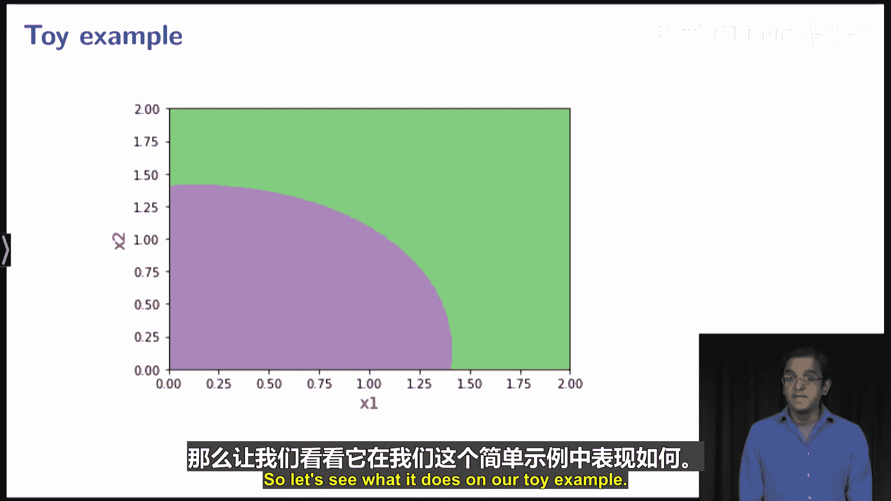
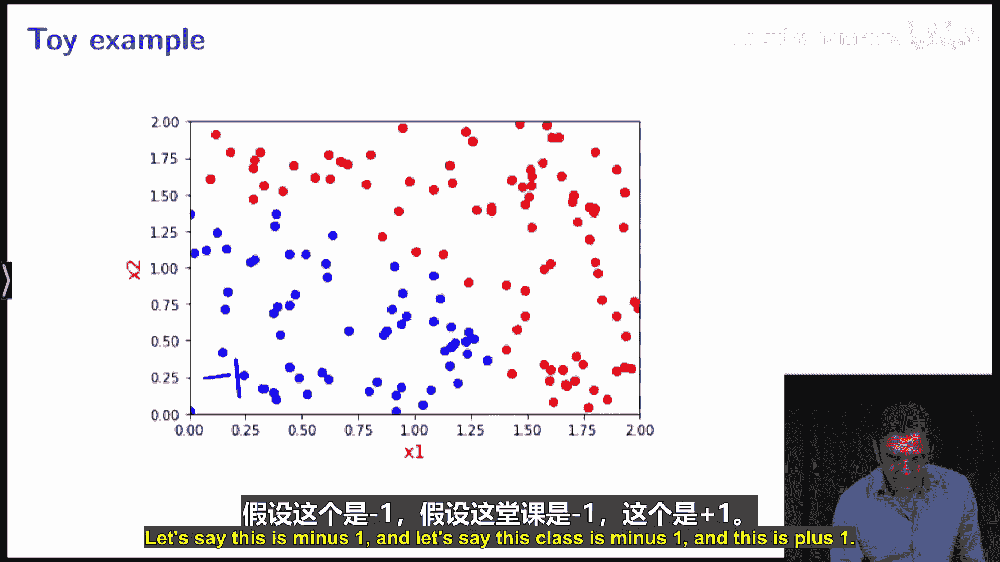
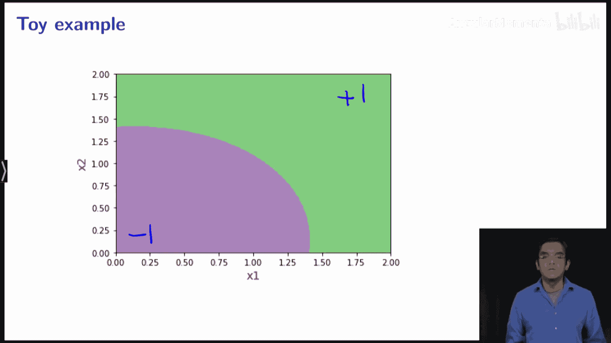
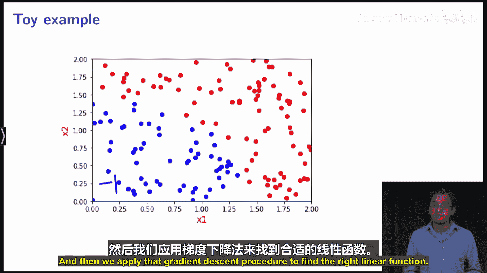
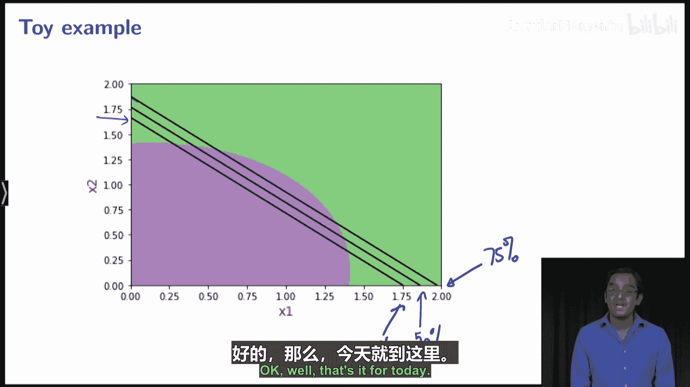

# 【加州大学圣地亚哥分校】机器学习基础  Machine Learning Fundamentals p23 05-05-02-逻辑回归 -BV1TyFSziEZb_p23-

Today we'll look at how to learn a logistic regression model from data。

So we'll begin by reviewing the form of the logistic regression model。

And then we'll phrase the learning problem as an optimization task in which the goal is to minimize a suitable loss function。

It'll turn out that this is a very nice loss function， in particular it is convex。

We'll then see how this function can be minimized using gradient descent。

So here again is the logistic regression model。We were looking at the case of binary labels。

 where y can only take on two possible values， minus1 and plus  one。

The data points x lie in say D dimensional space。And for any given point X。The probability of why。

Where wise either minus1 or plus1 is given by this formula over here。

We first compute a linear function of x。W dot x plus B。

And then we take1 over1 plus e to the minus y times that linear function。

This is the logistic regression model， and it has two parameters W and B that we need to set。

So what does this look like geometrically？😊，If we look， for example at。The boundary， okay。

 so we we have the plus side， we have the minus side， what is the decision boundary？Well。

 it's the set of points for which this probability is exactly a half。

And those are the points for which w dot x plus b equals0。 Okay。

 so we have some set of points for which W dot x plus B equals 0。And this is the decision boundary。

Plus on this side and minus on this side。Now in two dimensions， this boundary is a line。

In three dimensions， it's a plane。And in higher dimension， it's a hyperplane。Now。

 what are the points for which the probability of y being one is 60%？Well。

 it's a parallel hyperplane on this side， it's something like this。

And what are the points for which the probability of Y being one is 40%。 Well。

 it's another parallel hyperplane。On the other side。Okay。And so as one moves away。

 so the central hyperplane over here， W dot x plus b equals0 is the decision boundary。

 and as one moves further in this direction， the probability of y being 1 increases and in this direction。

 it decreases。Okay。😊，So this is nice and intuitive。

 and the remaining question now is how do we learn this linear function， this W andB from data。

 so let's see how we do that。😊。

So we have a set of data points x1 through Xn， along with their labels， y1 through yn。

What we're going to do is to use the maximum likelihood principle。

 and we're going to pick the linear function， the W and B。

 that maximizes the probability of the data。Okay， so what we want to maximize is the probability of y1 given x1 times the probability of y2 given x2 times the probability of y3 given x3 all the way to the probability of yn given x in。

So we have a concrete optimization criterion， so we're in good shape。Now。

 one little problem over here is that this function we're trying to optimize has has got this big product in the front。

 and this can be a little bit inconvenient。 It would be simpler if we were instead。

Dealing with a sum。So how do we go from a product to a sum Well， we just take the logarithm Okay。

 so if you remember the logarithm of a plus B of a times speed。Is the log of a。Plus， the log of be。

So instead of maximizing this function。We can just go ahead and maximize its log。

 which leads to the same answer。And then what we get is this sum over here。

Now we're also going to stick a minus in front。So that instead of maximizing。

 we actually want to minimize， so this then is our final loss function。This function over here。

We want to find the W and B that minimize this function。How do we do that？Well。

 if you remember when we were talking about least squares regression。

We were in a little bit of a similar situation。 We also wanted to find some W and B。

 and we also had a loss function that we were trying to minimize。

 So what was it that we did back then。Well， the first thing we did was that we tried to get rid of B。

 because it's a little bit of a nuisance。 So how do we do that。 Oh， well。

 what we said is that if you add a feature to x， if you take your data vectors X。

 and you add an extra feature that's identically equal to1。 Then you can just assimilate B into W。

 B just becomes another coordinate of W。 Okay， so let's just start by doing that。😊。

And then we can forget about B， and we just have a loss function that's in terms of the W。Okay。

So that's a help。But still， what is the optimal W， What is the solution。

And there's good news and bad news。The bad news is that there's no closed form equation for W。

In when we were doing least squares regression， we had this nice formula。

 W equals something nice and simple。But that's rare。 That almost never happens。

 and that does not happen in this case。 Okay， so that's the bad news。

The good news is that the loss function is very well behaved， it is convex。😊，What does that mean。

 Well， it's a very important concept。 It's something that plays a central role in machine learning。

 and we'll be spending more time on it later on。But we won't get into it right now for the time being。

 what it means is that the loss function basically looks like a bowl。

And we want to get to the bottom of the bowl， okay？No， but what's so great about that？

Well what's great about it is that the loss function does not look like this。嗯。Now。

 loss functions like that also arise very frequently in machine learning。

 and they are much more troublesome because they have all these local optima。

In which we can get stuck。The convex situation is much nicer。

 There's just one local optimum over here， and it's also the global optimum。

So how do we find that point， how do we find that optimal value double？

Well， the way we're going to do it is by local search。 Okay。

 what that means is you start off at any point。 let's say you start off by guessing that as being the right W。

 And then you just tweak it to make it a little bit better and you tweak it a little bit more to make it better。

 And then you keep doing these little tweaks。 until finally， you end up somewhere around here。

And you find that none of the tweaks are really helping any more。

 And so you decide that you've converged and that that's the answer。 Okay， so that's local search。

 In a sense， you're starting over here and gradually rolling down the hill。嗯。

So when you're at a particular value of w， let's say this is what your current guess at W is。

 how do you know which way to go？Well， there are many ways to decide this。

 but one rather simple way is by looking at the slope of the function Okay， so at this point。

 for example， the function slope is positive。What does that mean。

 will it means that if you go this way？The loss function will increase， and if you go that way。

It'll decrease。 what do we want， Do we want to increase it or decrease it。

 We want to decrease it because we are trying to minimize it so we know we have to move to the left。

Likewise， over here， the slope is negative。 So we know that if you go that way， it goes down。

 the function goes down。 and if you go that way， the function goes up。

 So we have to move to the right。Okay， so in this way。

 the gradient or slope of the function can really serve as our guide。

 we just have to move in the opposite direction to the gradient。😊。

And doing that is called gradient descent。Now we're going to be talkingking about optimization in more detail later on。

And we'll also be spending quite a bit of time on gradient descent。

So I'm not going to explain exactly how the gradient descent procedure of the logistic regression comes about right now。

But I just want to show you what the procedure looks like because it's extremely simple。

So we begin by setting w to some value， say the all zeros vector， that's our initial guess for w。

 w sub0。At time T， our guess for W is W T。And then we're going to tweak it a little bit and we get our updated guess。

 WT plus1。So what is this tweak that we do Well， we take W。And we look at the negative gradient。

And we move in that direction times a small step size。Okay， so what are these two things。

 Well let's look at the sumation first， the y's， well the y's are just plus one or minus1。

This is some probability， some number， and these are the data vectors。

So it looks like we're doing some sort of weighted average of the data points， okay？

Where the weight for a particular X。Depends on how well we classified it。

So suppose that the current guess W sub T。Assigns high probability to the wrong label for Xi。 Okay。

 so let's say it assigns high probability to the opposite label negative Yi。

That means we're doing pretty badly on that point。And in this case。

 we'll increase the weight on it so we emphasize that point a little bit more。

 We know that it's a point we really need to work on。So we compute a weighted average of this kind。

 which is quite intuitive。And then， so that gives us a direction in which to move。

 but we also have to decide how far we want to move in that direction。

 and for that we use the step size over here。Now this is again something we'll be talking about more later on。

 for the time being you can just pretend that it's a constant， something like point1。

 although as we will see later， it often makes sense to reduce it as time goes on。Okay。

 so this is a nice simple algorithm for logistic regression。

So let's see what it does on our toy example， so again we have these two classes。

 let's say this is minus1 and let's say this class is minus1 and this is plus1。

We go ahead and sample some points。And assign them their correct labeled。

And then we apply that gradient descent procedure to find the right linear function。

And this is what it ends up finding， okay， so what are these three lines？

This line over here is the decision boundary， the 50%。This line over here is the 25% line。

And this line on this side is the 75% line。Okay， so what it's saying is that if you look at this line on the top。

If you look at the x's that lie along that line， there is a 75% probability that the label is green。

And if you look at this line over here， it says that for the x's along that line。

 there is a 25% probability that the label is green， in other words。

 a 75% probability that the label is purple。Is that reasonable？Well， maybe。In general。

 when you're using the conditional probabilities from a logistic regression model。

 you do have to take them with a little grain of salt。Okay， well， that's it for today。

 We've seen how a logistic regression model can be learned from data。

 and we've tried it out on a toy data set。

Next time we'll try it out on a more substantial learning problem， a text classification task。

 See you then。