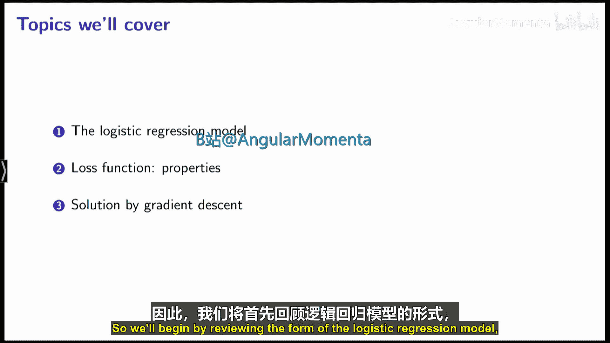
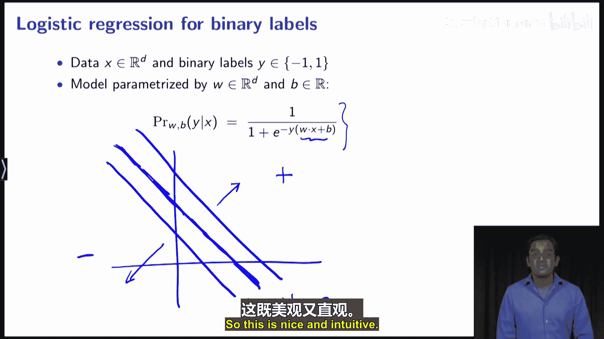
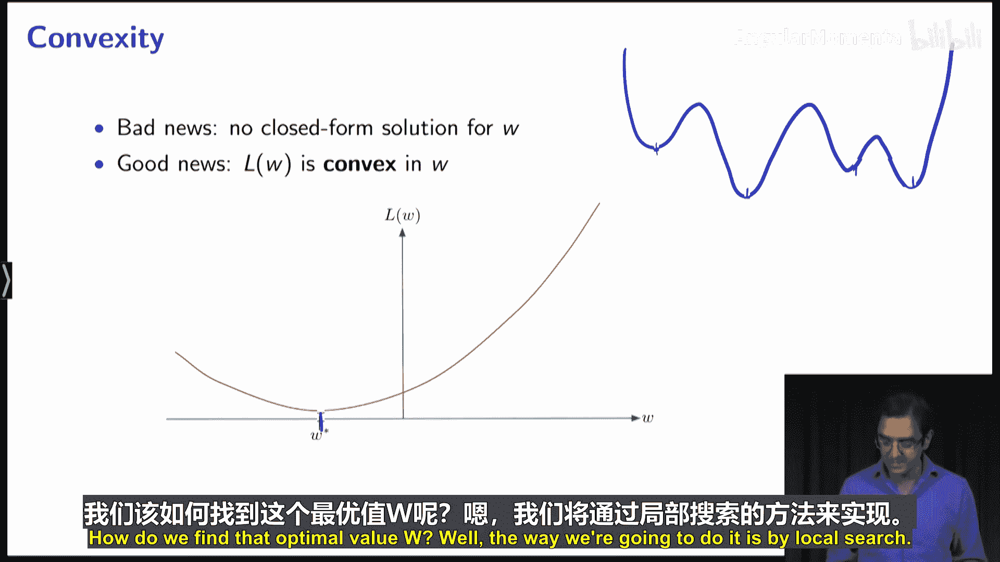
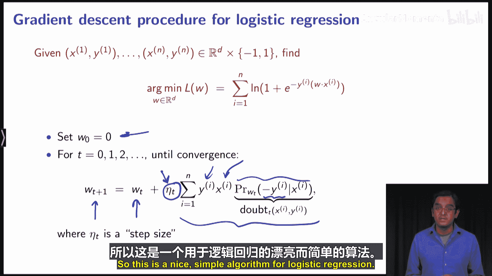
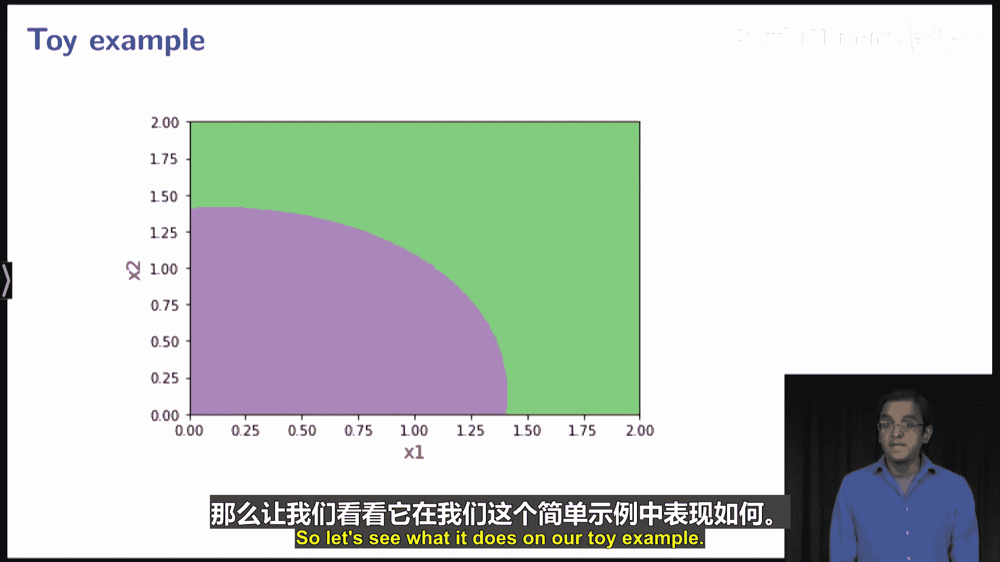
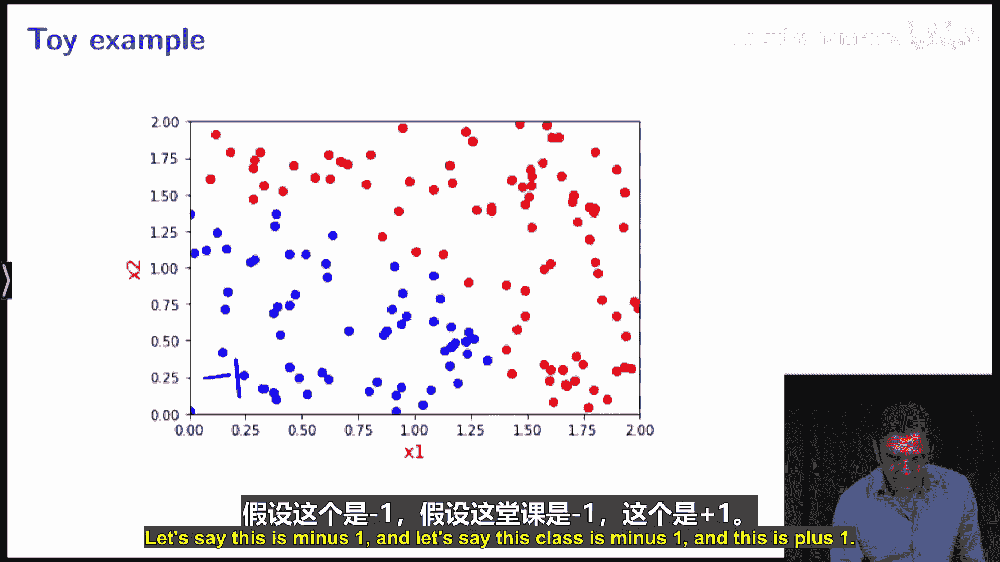
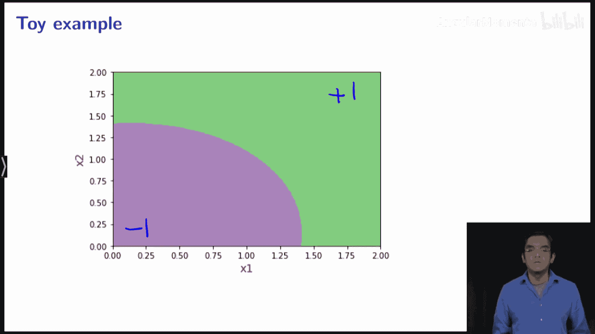
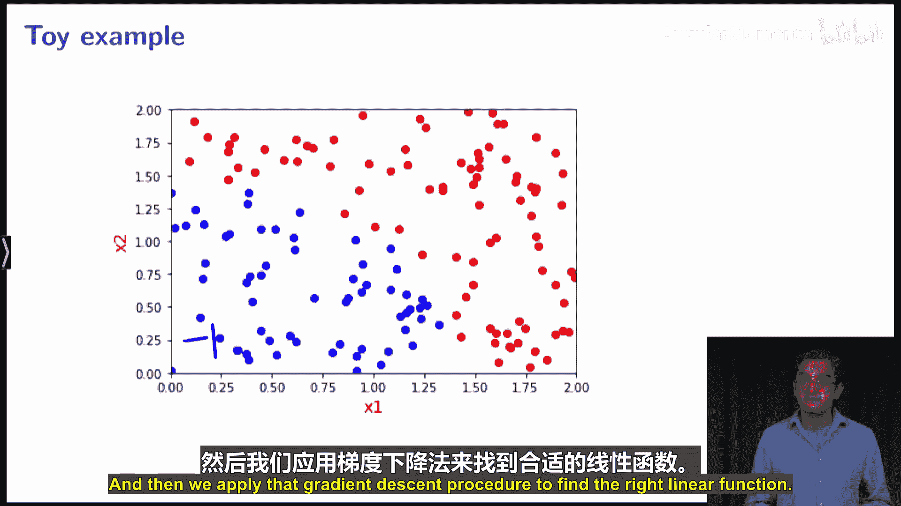
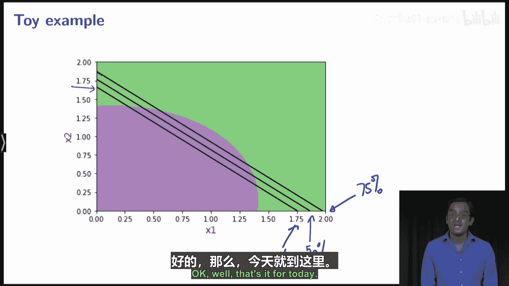

# 机器学习基础：05-05-02：逻辑回归模型学习 🧠

在本节课中，我们将学习如何从数据中学习一个逻辑回归模型。我们将从回顾模型的基本形式开始，然后将其学习问题表述为一个优化任务，目标是**最小化一个合适的损失函数**。这个损失函数具有良好的性质，特别是它是**凸函数**。最后，我们将看到如何使用**梯度下降**来最小化这个函数。

---

## 模型回顾

上一节我们介绍了逻辑回归模型。它适用于二元标签分类问题，其中标签 `y` 只能取两个值：`-1` 和 `+1`。数据点 `x` 位于 `D` 维空间中。对于任意给定的点 `x`，标签 `y` 的概率由以下公式给出：

$$
P(y|x) = \frac{1}{1 + e^{-y(w \cdot x + b)}}
$$

我们首先计算 `x` 的线性函数 `w \cdot x + b`，然后将其代入逻辑函数。这个模型有两个需要设定的参数：权重向量 `w` 和偏置 `b`。

从几何上看，决策边界是使得概率恰好为 `0.5` 的点集，即满足 `w \cdot x + b = 0` 的点。在二维空间中，这是一条直线；在三维空间中，是一个平面；更高维度中，则是一个超平面。当我们沿着垂直于边界的方向移动时，`y=+1` 的概率会相应增加或减少。

---

## 学习问题：最大似然估计

本节中，我们来看看如何从数据中学习这个线性函数。我们有一个包含 `n` 个数据点的数据集：`(x1, y1), (x2, y2), ..., (xn, yn)`。

我们将采用**最大似然估计**原则，即选择能使数据概率最大化的参数 `w` 和 `b`。具体来说，我们希望最大化以下联合概率：

$$
\prod_{i=1}^{n} P(y_i | x_i)
$$

为了计算方便，我们通常取对数，将乘积转化为求和。同时，为了将其转化为最小化问题，我们在前面加上负号。这样，我们就得到了最终的损失函数：

$$
L(w, b) = -\sum_{i=1}^{n} \log P(y_i | x_i)
$$

我们的目标是找到最小化该损失函数的 `w` 和 `b`。

---

## 简化与优化

为了简化问题，我们可以像在线性回归中那样，通过添加一个恒为 `1` 的特征将偏置 `b` 吸收到权重向量 `w` 中。这样，我们只需优化一个参数 `w`。

关于最优解 `w`，有一个坏消息和一个好消息。
*   **坏消息**是，与最小二乘回归不同，逻辑回归没有**闭式解**（即一个简单的公式可以直接计算出 `w`）。
*   **好消息**是，这个损失函数是**凸函数**。这意味着它的形状像一个碗，只有一个全局最小值，没有令人困扰的局部最小值。这使得优化过程更加可靠。

---

## 梯度下降法

既然没有直接公式，我们如何找到这个最小值点呢？我们将使用**局部搜索**的方法，也就是**梯度下降法**。

其核心思想是：从一个初始猜测（例如 `w` 为零向量）开始，然后反复朝着能降低损失函数值的方向微调 `w`，直到收敛。

具体如何决定调整方向呢？答案是使用**梯度**（即函数在某点的斜率）。在最小化问题中，我们应朝着**负梯度**方向移动。梯度下降的更新规则如下：

$$
w_{t+1} = w_t - \eta \sum_{i=1}^{n} \left[ \frac{y_i x_i}{1 + e^{y_i (w_t \cdot x_i)}} \right]
$$

以下是该更新规则中关键部分的解释：

*   `w_t`：第 `t` 次迭代时的权重向量。
*   `\eta`：**学习率**（步长），控制每次更新的幅度。初期可以设为一个小常数（如 `0.1`），后续可以逐渐减小。
*   求和项：计算的是一个**加权平均**的数据点方向。每个数据点 `x_i` 的权重取决于当前模型对其分类的好坏。如果模型对某个点 `(x_i, y_i)` 的分类概率很低（即分类错误），那么这个点在更新中会获得更高的权重，促使模型更多地关注它。

---

## 示例演示

让我们在一个简单的二维示例上看一下效果。假设我们有两类数据点，分别标记为 `-1`（紫色）和 `+1`（绿色）。

我们采样一些数据点，并应用上述梯度下降算法来寻找最优的线性函数。

最终，算法找到了三条重要的线：
1.  **中间的实线**：决策边界（`P(y=+1) = 0.5`）。
2.  **上方的虚线**：对应 `P(y=+1) = 0.75` 的等高线。
3.  **下方的虚线**：对应 `P(y=+1) = 0.25`（即 `P(y=-1) = 0.75`）的等高线。

这意味着，位于上方虚线处的点，模型认为其属于绿色类别的概率是 `75%`；位于下方虚线处的点，模型认为其属于紫色类别的概率是 `75%`。这为我们提供了分类的置信度信息，尽管在实际解读这些概率时需要谨慎。

---

## 总结

本节课中，我们一起学习了如何从数据中学习逻辑回归模型。我们首先将学习问题形式化为**最大似然估计**，并推导出**凸的**损失函数。由于没有闭式解，我们介绍了使用**梯度下降法**进行优化的过程，并解释了其更新公式的直观含义。最后，我们通过一个简单示例观察了模型学习到的决策边界和概率等高线。

下次课，我们将把逻辑回归应用到一个更实际的学习问题——文本分类任务上。