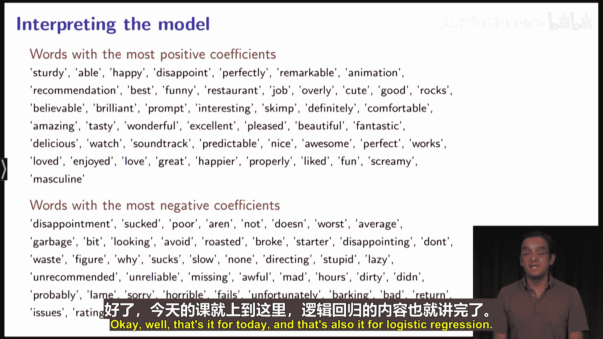

# 【加州大学圣地亚哥分校】机器学习基础  Machine Learning Fundamentals p24 05-06-02-逻辑回归的应用 -BV1TyFSziEZb_p24-

Today， we will look at a small case study of logistic regression in use。

The problem we'll be solving is a text classification problem。

 so first we' will see how a text document can be converted into a vector of fixed length so that methods like logistic regression can be run on it。

Then we'll start the learning process and interpret the results that we get along the way。

So here's the problem we want to solve。We get a review of a product or movie or restaurant。

 and we want to figure out if it's a positive review or a negative review。

The data we have is collected from various websites like Amazon and Yelp。

 and from each review just a single sentence has been extracted and it's been labeled as plus or minus。

 positive or negative。 Okay let's look at some of these examples。So the first one。

 needless to say I wasted my money， Okay so clearly that's a negative review。

 and the word that really tips you off over there is wasted okay so that's negative。The second one。

 he was very impressed when going from the original battery to the extended battery， okay。

 so that's positive。And what is the key word over that impressed？Okay。Okay， the third one。

 I have to jiggle the plug in order to get it to line up right to get decent volume。

So that's negative。And in terms of words that really stick up。There isn't really anything。

 There's no word。 There's no single word in there that's。Completely negative。Okay。

 so that one's a little bit tricky and let's look at the last one。We'll order from them again。 Okay。

 so that's positive。And again， there's no single word that really indicates that。Again， not really。

 there are probably lots of reviews that say things like， we'll never order from them again。Okay。

 so that's also a tricky one。Okay， so this is going to be a non trivial task。And you know。

 because it's a little bit difficult， logistic regression will help us quantify the uncertainty in some of the predictions since it outputs not just a prediction plus or minus。

 but also gives an accompanying probability。Now how much data do we have about 2。

500 training sentences， which is not very much at all。

 and then there's a separate test set of 500 sentences。Now， in order to run logistic regression。

 we need the data to be vectors of somefl length。How do we convert sentences into vectors？Now。

 there's actually a very standard way of making documents into vectors。

 and this is called the bag of words representation。NowIn our case。

 you can think of each sentence as being a mini document of some kind。So here's how it works。

You start by fixing some vocabulary， okay， for instance。

 all the words in the documents or maybe the 5，000 most common words or in some other way you choose a list of words。

For concreteness， let's say that we choose the 5000 most common words。Okay。

Then each document is represented as a 5000 dimensional vector。

 So we have 5000 dimensions with one entry for each of the words in the vocabulary。Okay。

And that entry。Is literally how many times that word occurs in the document。 Okay， so， for example。

 let's say that the first word in the vocabulary is despair。

So we have a document and what we do is we go through it and we count how many times despair occurs in the document。

 or it occurs once， so the entry for that is one。Let's say the next word is evil。

 So we go through the document and see how many times evil occurs in the document。 Oh two times。

 So the entry is two。 The third word is happiness。 That doesn't occur。 So 0 and so on。

 And in this way， we convert this document into a 5000 dimensional vector。嗯。Now。

 one thing does worth pointing out is that this representation is extremely sparse case if we applying this to sentences and we have a sentence of just 10 words。

Then out of those 5，000 entries at most 10 of them are going to be non zero。

 so it's a peculiarity of this particular way of representing documents。Okay。

 so now we are ready to apply logistic regression， we have two classes， positive and negative。

 let's code positive as plus1 and negative is minus1。We have our 2，500 data points。

 each of which is now a 5000 dimensional vector。And we need to find the linear function given by W and B。

That minimizes the logistic regression loss function。As we saw last time。

 this is a nice loss function。 It is convex。And it can be optimized quite easily using local search methods。

 There are many choices， gradient descent， stochastic gradient descent。

 Newton Raftson and so on and so forth。 They all return the right answer。

So what we'll do today is use one of these stochastic gradient descent。

 this is a very important method and this is something that we'll cover in more detail next week。

But for the time being， it's a local search method， it starts with some solution。

 some guess at W andB， and then it tweaks it a little bit。

 and it keeps tweaking it and eventually it converges to the right answer。

So let's see what happens over training iterations。

Now it turns out that for this particular data set。300 iterations are needed before。

The linear function WB converges。 Okay， each iteration involves a pass through the entire data set。

And as these iterations proceed， the laws function on the training set。

 the training loss keeps going down。And in fact， during the first 50 or so iterations。

 the loss function just plunges okay， and after that。

 it just tappleers off gradually until it finally grinds to a hold。So that's how training goes。

And at the end， we're left with our final classifier， W&B。How does it do。

 what is its performance on the test cell？So it turns out that the test error is 21%。

That's not great， but it's also not bad considering the ambiguity and difficulty of these sentences。

 So let's go ahead and look at some of the mistakes。So let's see the first one， not much dialogue。

 not much music， the whole film was shot as elaborately anestheically like a sculpture。

And that's positive。Okay， so you know this it starts off sounding a little bit negative and there's really no word in there which indicates that it would be a positive review's it's not an easy one okay and okay so that's one of the mistakes it made let's look at this one。

The last 15 minutes of movie are also not bad as well。 Okay， so it's got the double negative。

 not bad， which is a little bit confusing。 and so the review is actually positive。

 but the logistic regression model thought it was negative。How about this one。

 if you look for authentic Thai food， go elsewhere。Okay， that's a difficult one。

 it's got authentic Tha food in there， which sounds good， but then it says go elsewhere， Okay。

 so that's difficult。And the last one， waste your money on this game， okay。

 you know how are we supposed to get that right， that's a very difficult one。Okay， so I mean。

 we've been talking about using logistic regression for classification。

But actually it also outputs a probability value， which we can think of as a kind of level of confidence。

What did these probabilities， what do these confidence levels look like in this case for this data set？

So on any given sentence， X。We get a probability between 0 and 1。

And if the probability is above a half。Then we end up predicting plus。

 And if the probability is less than a half， we end up predicting minus。 Now。

 when the probability is close to a half， it means that we are really very uncertain。 You know。

 predicting one way， we're saying plus or minus because were forced to。 But actually。

 there's a lot of uncertainty in there。 Okay， the more confident predictions are the ones that are closer to 0 or1。

 Okay， so， for example， suppose we look at the cases where it is。Above 08 or below 02。

You can think of this as a sort of 80% confidence。So we will call this。

 we'll describe this as having a margin of 03。What that means is that it's at least 0。

3 away from a half。Okay。And this is the formula for margin over here。

 it's how far the probability is from a half。Or we could look at 90% confidence where the probabilities are between 01。

0 and 。1 or between 0。9 and 1。So this is a margin of 0。4。Or we could look at even。Larger margin。

 like a margin of 0。49， which would be 99% confidence。Okay。

 so for what fraction of points was the margin say point4 for what fraction of these test points was their 90% confidence Well that's what this graph shows over here Okay so if we want a margin of  point4 we just go up over here and we see。

That， oh， roughly75% of the points had a margin of 0。4。

So three quarters of the test points had 90% confidence or more。Okay。

Let's look at 99% confidence that somewhere here。It looks like roughly 55% of the data had 99% confidence。

That is a lot of confidence okay so this logistic regression model is making very confident predictions。

 even though it did not get a whole lot of training data。😊。

That's a little suspicious in and of itself， and so it would be interesting to see whether this confidence is at all warranted。

We know that the overall error rate was 21%。But what if we just look at the points on which it was confident。

 let's say the points on which it was 90% confident， what was the error rate on those points？

And that's what this graph over here shows Okay， so 90% confidence。

 that's when the probability is either greater than 0。9 or less than 0。1， and that's a margin of 0。4。

So that's the signal over here。And if we look at those points， the error rate was something like 13%。

Much less than 21%。And if we look at the 99% confidence points。

The error rate there is just a little above 10%。Okay， so on the test set as a whole。

 the error rate was 21%。But more than half the points had a 99 per cent confidence。

 And on those points， the error rate was much smaller。 It was just a little over 10% cent。滚。

So this shows， first of all， that this shows two things， Okay。

 so the first thing is that these confidence levels have to be taken with a grain of salt okay。

 when it's 99% confident that doesn't mean that it's going to be correct 99% of the time。

But the second thing is that these confidence values are really informative by focusing on high confidence predictions。

 we really can decrease the error rate。😊，Okay， now let's try and get some other information about the model that we learned。

What is the basis for its predictions， what words is it placing the greatest emphasis on。

 how do we determine this？Well， at the end we have this vector W， which is 5000 dimensional。

And there's an entry for each word。So the most significant words。

 the ones that have the greatest role in prediction are the ones with the largest coefficients。

 either the most positive coefficients or the most negative coefficients。What are these words。

 let's take a look。So here they are on top are the words with the largest positive coefficients。

And the bottom are the ones with the largest negative coefficients。 Okay。

 so what are the positive words， beautiful， fantastic， excellent， wonderful， nice， awesome。

 perfect and so on。😊，And the negative words， disappointing， stupid， lazy， dirty， bad， fails。

 unfortunately， and so on。Do they seem like words that are reasonable indicators of positive or negative reviews？

They do， it all seems quite reasonable。Okay， well， that's it for today and that's also it for logistic regression。

One of the things that one of the discussions that we've been putting off a little bit is how you actually optimize all of these loss functions。

What are the techniques involved and the technology involved in this。

 things like convexity and stochastic gradient descent。

 these really lie at the heart of modern machine learning。😊。

So what we're going to do next is to take a little bit of time and to study these slowly and carefully。

See you next time。