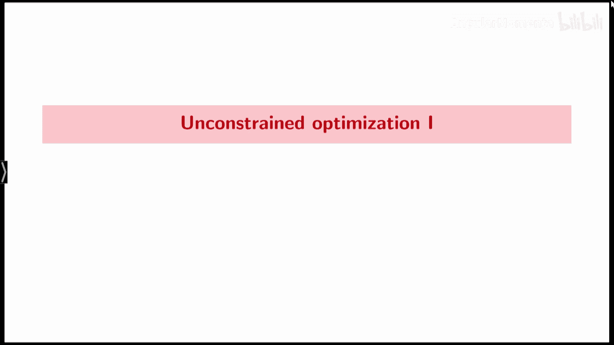
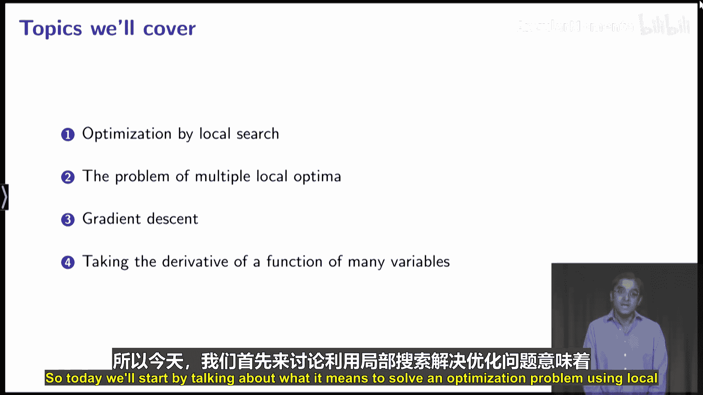
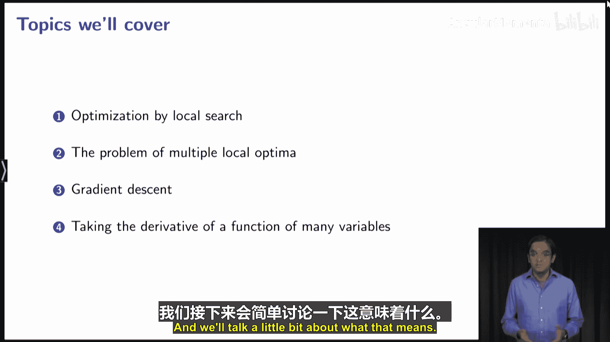
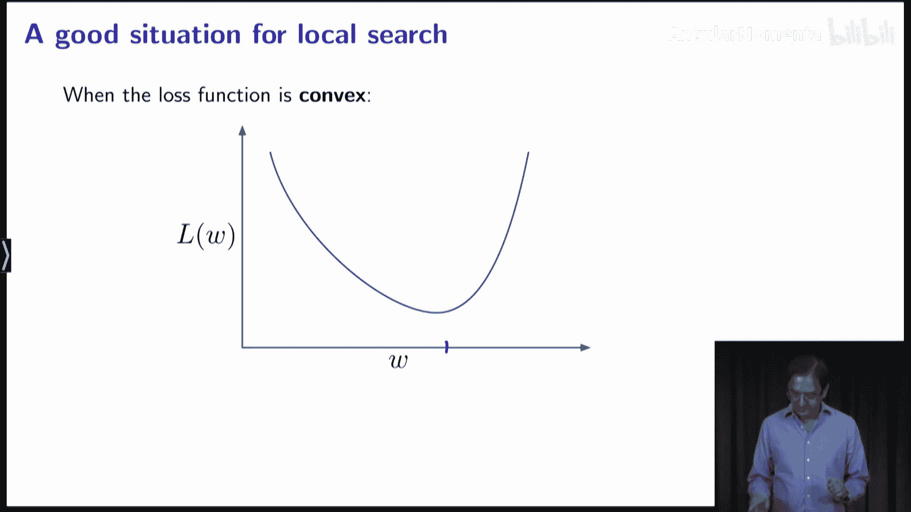
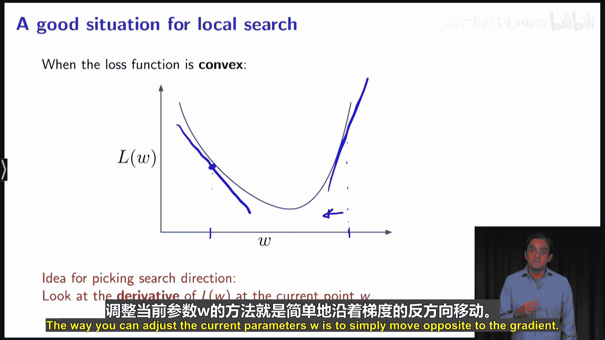
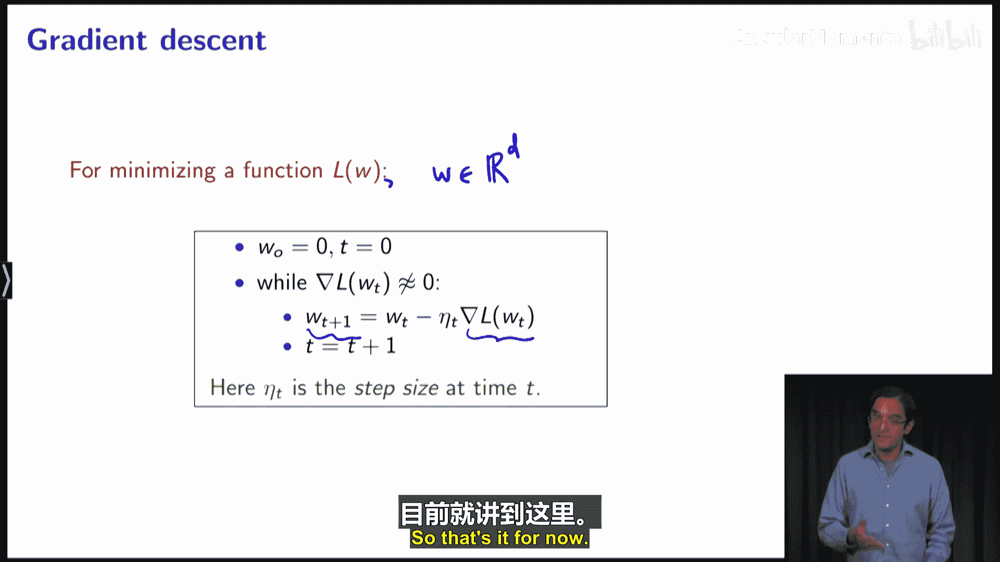

# 【加州大学圣地亚哥分校】机器学习基础  Machine Learning Fundamentals p25 06-01-02-无约束最优化 I -BV1TyFSziEZb_p25-

Over the past few lectures。We have been using optimization to solve prediction problems。

What we do basically is to define a suitable loss function and then learn our parameters by minimizing that function。

That's what we did for least squares regression and for logistic regression。

And we'll be doing a whole lot more of that in the upcoming weeks。Indeed。

 optimization lies at the heart of modern machine learning。Now。

 sometimes the problem that you need to solve falls neatly into some predefined category。

And then you're in luck， you can just use existing software for logistic regression or Laso or support vector machines。

But other times you find that in order to get a really good solution。

 you have to come up with a customized loss function。

 something that's really tailor made to the domain。What do you do in those cases， In those cases。

 you can no longer fall back upon existing code。Well。

 it turns out that there are some relatively straightforward ways of coming up with minimization algorithms for essentially any loss function。

 And today， we'll look at one of those methods called gradient descent。😊。

Becoming familiar with this is really a source of power because it liberates you from having to use canned solutions。

So today we'll start。By talking about what it means to solve an optimization problem using local search and about the problem of having multiple local optima。

We'll then look at the algorithm， gradient descent。

All that's needed in order to use it is to be able to compute the derivative of the loss function and we'll talk a little bit about what that means。

Okay， so for much of machine learning， the way we learn is by defining a suitable loss function and then minimizing it。

 So these examples， for example， these are the loss functions for least squares regression and for logistic regression。

How do we minimize loss functions like this， how do we find the minimizing parameters W？

And for the most part， we do this by local search Okay， so we start with some guess for W。

And then we tweak it a little bit to make it better to reduce the loss。

 and then we tweak it some more and then we keep going until this whole process converges。

So pictorially， this is what it looks like Okay so along the horizontal axis。

 I have the parameters W。And along the vertical axis is the loss function， L ofW。

 and the thing we are looking for is the minimizer of this loss function。

 So this is the point we want。Let's call that W star。What does local search do。

 Well local st search starts with any old solution， So let's say it starts over here。

At this loss value。And then it tweaks it to make it a little bit better。

 so maybe jumps a little bit like that to this point。Okay， and then it tweaks it some more。And so on。

 And it keeps going until it finally gets to a place where there's no longer any little tweak that's going to help。

 And then it stops。 And in this case， it ends up finding the correct answer。Now。

 a lot hinges upon where you start。 Okay， so if your initial guess at the parameters， for example。

 was over here。Okay， so some point like this。Then local search might simply wind you up over here。

Which is a local optimum， but it's not the right solution。

 it could be something that's much worse than W star。

So the problem is that this particular loss function has a lot of local optima。

 There are all these different places where a local search algorithm can get trapped。😊，Unfortunately。

 this kind of loss function arises all the time in machine learning， and by and large。

 we are resigned to this， but we really love the situations where the loss function is a little bit better behaved。

 and we actively seek them out。😊，So what kind of loss functions do we want。Well。

 we want loss functions like this， loss functions that are convex okay so very soon we'll be defining exactly what this means。

 but for the time being the way you can think of it is that the loss function looks like a bowl and we just want to get to the bottom of the bowl so there's only one local optimum and that's also the global optimum。

And as a result， functions like this are pretty easy to minimize。六？

So how exactly do we do this though， suppose we're at a particular value of w。

 How do we know which way to move， So this picture， for example， has a one dimensional W。

 How do we know whether to go left or right。So one。

 one easy way to do this is by looking at the slope or derivative of the function。 Okay。

 and so let's see what， what exactly that means。 Let's say， for example。

 that my current guess of W is over there。 Okay， so let's look at the slope over there。

This is the slope。And the slope is positive。 Now， what that means is that if you increase W。

 the function goes up。And if you decrease W， the function goes down。What do we want to do。

 do we want the function to go up or down where we are trying to minimize the function。

 so we want it to go down， so that means we have to move to the left。

So the slope tells us that we have to move to the left， the slope is positive。

 so we want to go the other way to the left。Now suppose our parameter estimate was somewhere there。

 so the slope poca therere looks like this。And in that case， the slope is negative。

So if we want to decrease the function， we have to move to the right。Again， the slope is negative。

 so we increased W， we move in the opposite direction to the slope。

And this is a rule that can be used in general。The way you can adjust the current parameters W is to simply move opposite to the gradient。

And that gives us the gradient descent algorithm。 Okay。

 so let's say there's this function we want to minimize L of w and W might say consist of D parameters。

 so W might be a D dimensional vector。We start by initializing W to anything。

 so our initial setting for w might， for example， just be0。And then we keep tweaking W。At time T。

 our current setting for W， our current guess at W is W sub T。

And then we tweak it a little bit and we get w subT+1。Okay。So what is exactly is this tweak？Well。

 what we do is we compute the derivative。Of the loss function at WCT， the derivative。

 and then we want to move in the opposite direction so we take the negative of that。

So that tells us the direction in which we want to move。

 but we also have to decide how far we go in that direction。And that is the step size， aus of T。Okay。

Now that thing that looks like an n is actually the Greek letter ada okay and that's a step size but now you can think of it as a small constant if you like。

 we'll talk about it in more detail later on and that tells us how far we go in that direction so we have a current estimate w sub T We tweak it a little bit we get w sub t plus1 and we keep going in this way until we finally converge and that's it that's the answer。

An extremely simple algorithm， it's just four lines of code。

And it can be used to solve a huge variety of different problems。

So what do we need to do in order to use this algorithm， Well。

 there's really just one thing we need to do， and that is to compute this derivative over here。

The derivative of the loss function。And let's see exactly what that entails。

So one thing that I think we're all pretty familiar with。

Is finding the derivative of a function of one variable Okay， so if you have， for example。

 y equals 3 x squared。What is the derivative of y， what is DY Dx？It's just 6 x。Okay。

 so we know how to do that。But what happens when you have a function of multiple variables。

 okay so there's a function over here， which is the function of three variables？😊。

It's a function of3 variables W1， W2 and W3。What does it mean to do the derivative in that case。

 Well， now you can take the derivative with respect to three different things。

 and the first step is to take these three derivatives separately。Okay。

 so let's start with the derivative。With respect to W。1。When we are computing this derivative。

 what we do is we treat the other variables， W2 and W3 essentially is constants。 Okay。

 so what do we get， What is the derivative of this expression over here。With respect to W1。

 it's just 3W2。Okay。Now let's take the derivative。With respect to W2。Okay， what do we get 3W1？

And finally， let's take the derivative with respect to W3。

And there's only one term that involves W3 the last term， the derivative is one。Okay。

 so those are the three separate derivatives。 the overall derivative of F， which we denote like this。

Is obtained by just stacking together these three derivatives with respect to a single variable。

 Okay， so it's a vector where we start by taking the derivative with respect to the first variable。

 then the derivative with respect to the second variable。 and finally。

 the derivative with respect to the third variable。So it's the vector 3， W2， 3， W1， and 1。

It's a three dimensional vector。 That's the derivative of F at any value W。嗯。Okay。

Let's do another example。So this time we have a function of D variables。Okay。

 so we have a function of D variables， W1， W2， all the way to WD。

And what is the function is's just the dot product of W and X。

 So it's W1 x1 plus W2 x2 all the way to W D X D。So now we compute derivatives with respect to each of these D variables separately。

So what is the derivative with respect to WJ？Well， in that big summation。

 there's only one term that involves WJ， Wj Xj， so the derivative is just Xj。

Now let's stack these together in a vector。So the derivative of F at W is the derivative with respect to W1。

 which is x1， the derivative with respect to W2， which is x2 all the way to the derivative with respect to WD。

 which is x D。And what is this vector， It's just x。

So the derivative of this function is just the D dimensional vector x。你。Okay， one more。Again。

 we have a function of D variables。 Okay， let's let's go ahead and write it out in full。

 So we have these D variables， W1， W2 old the way to W D。

And what is the function is' the squared norm of w。

 so it's w1 squared plus W2 squared all the way to WD squared。Okay。And now again。

 we have to compute the derivative with respect to each of the D things individually。

 So what is the derivative with respect to WJ。Well， W J'st only one of those terms。

 and that's W J squared。 So the derivative is2 W J。And putting these together in a vector。

We find that the derivative at W is 2 W1，2 W2， all the way to 2 W D。In other words， it's 2 W again。

 a de dimensional vector。So in general， if you have a function of D variables。

Then its derivative is a D dimensional vector。Okay。

So now let's go back to the gradient descent algorithm and let's say the this function we're minimizing is a function of D variables。

Let's go ahead and look at this update rule， so what is this derivative now？Well。

 we've seen that that derivative is a D dimensional vector。 So this update rule make sense。

 W is D dimensional， and we are subtracting off a D dimensional vector， so it's all sensible。

 at least in terms of the dimensions being aligned。Yeah。Why exactly does this rule work。

 why does it reduce the loss to move in this direction？Well， that's something we'll see next time。

So that's it for now。

And。We've got a little bit of a glimpse of gradient descent。

 and next time we'll look at this algorithm in a little bit more detail。 See you then。

