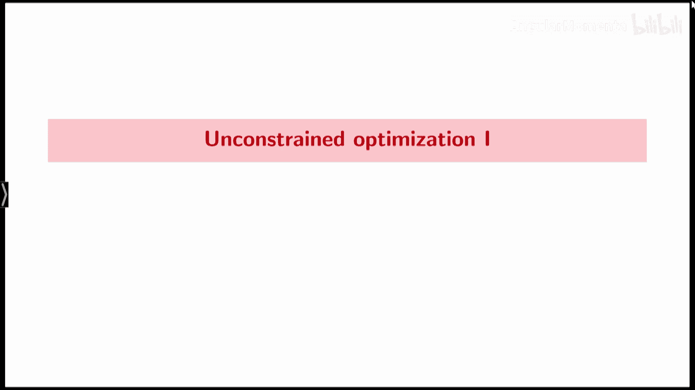
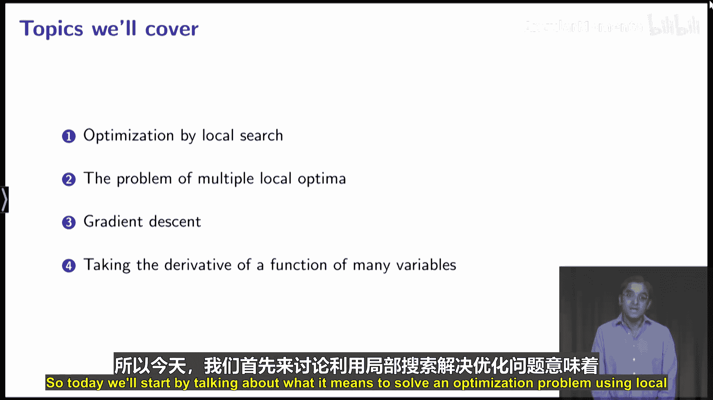
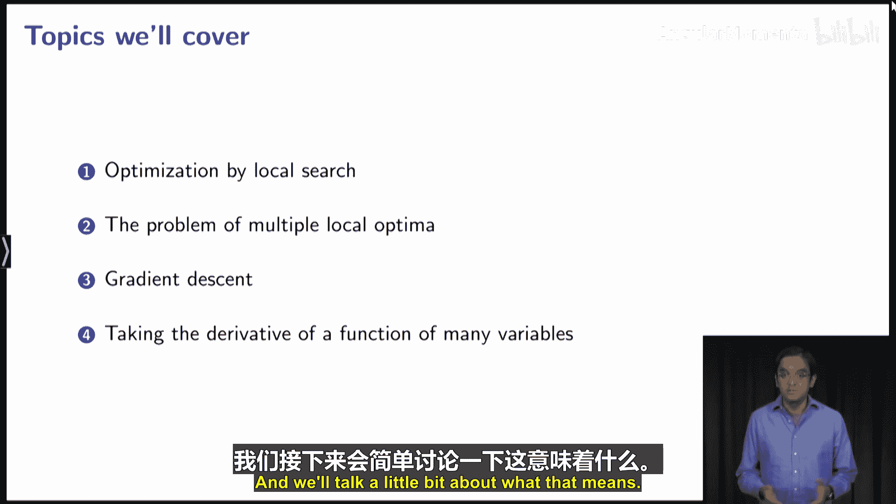
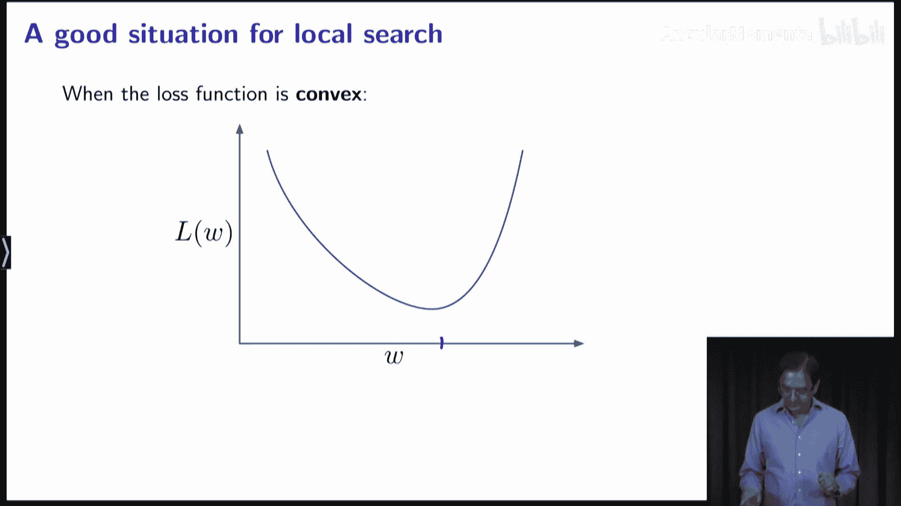
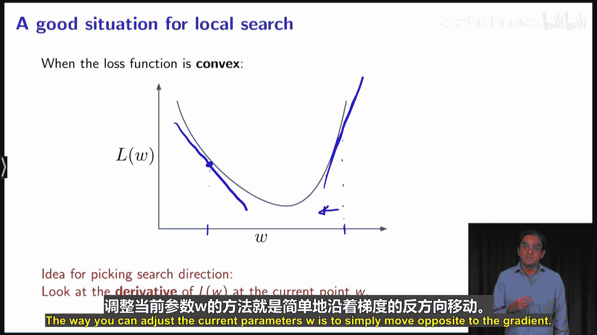
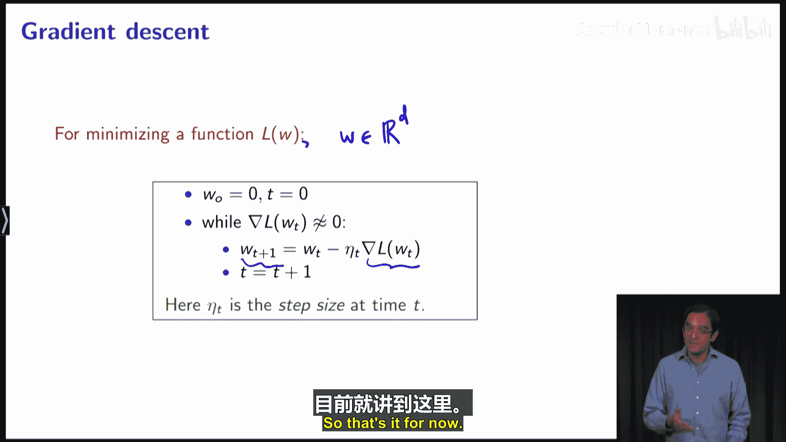

# 机器学习基础：06-01-02：无约束最优化 I

在本节课中，我们将要学习机器学习中的一个核心概念：优化。我们将了解如何通过最小化损失函数来学习模型参数，并重点介绍一种名为梯度下降的通用优化算法。掌握这个方法将使你能够为特定问题定制损失函数，而不必依赖现成的解决方案。

## 局部搜索与局部最优问题

在过去的几节课中，我们一直在使用优化方法来解决预测问题。基本做法是定义一个合适的损失函数，然后通过最小化该函数来学习参数。我们在最小二乘回归和逻辑回归中就是这样做的。在接下来的几周里，我们还会做更多类似的工作。事实上，优化是现代机器学习的核心。

有时，你需要解决的问题恰好属于某个预定义的类别，那么你很幸运，可以直接使用逻辑回归、Lasso或支持向量机等现有软件。但有时，为了获得真正好的解决方案，你必须提出一个定制的、真正为特定领域量身打造的损失函数。在这些情况下，你不能再依赖现有的代码。幸运的是，对于几乎任何损失函数，都有一些相对直接的方法来设计最小化算法。今天，我们将介绍其中一种方法，称为梯度下降。

熟悉梯度下降是一种强大的能力，因为它使你摆脱了对现成解决方案的依赖。

现在，我们开始讨论如何使用局部搜索来解决优化问题，以及多局部最优值的问题。

## 梯度下降算法

我们将要介绍的算法是梯度下降。使用它只需要能够计算损失函数的导数，我们稍后会讨论这意味着什么。

对于大多数机器学习任务，我们通过定义合适的损失函数并最小化它来学习。例如，这些是最小二乘回归和逻辑回归的损失函数。

我们如何最小化这样的损失函数？如何找到最小化参数 **W**？在大多数情况下，我们通过局部搜索来实现。我们从对 **W** 的某个猜测开始，然后稍微调整它以使其更好（减少损失），然后再调整一些，如此反复，直到整个过程收敛。

从图像上看，它是这样的：横轴代表参数 **W**，纵轴代表损失函数 **L(W)**。我们要找的是这个损失函数的最小值点，我们称之为 **W***。

局部搜索从任意一个初始解开始，比如这里。然后它稍微调整一下，使其变得更好，可能跳到那个点。然后它再调整一些，如此继续，直到到达一个地方，在那里任何微小的调整都无法再提供帮助，然后停止。在这种情况下，它最终找到了正确答案。

然而，结果很大程度上取决于你的起点。例如，如果你的参数初始猜测在这里，那么局部搜索可能只会让你停留在这里。这是一个局部最优解，但不是正确的解，它可能比 **W*** 差得多。

问题在于，这个特定的损失函数有很多局部最优值。有很多不同的地方，局部搜索算法可能会被困住。不幸的是，这种损失函数在机器学习中经常出现。总的来说，我们对此无能为力，但我们非常喜欢损失函数行为更好的情况，并且我们积极寻找它们。

那么，我们想要什么样的损失函数呢？我们想要像这样的损失函数：凸函数。很快我们会准确定义这意味着什么，但目前你可以把它想象成损失函数看起来像一个碗，我们只想到达碗的底部。这样只有一个局部最优值，它同时也是全局最优值。因此，像这样的函数相对容易最小化。

## 如何决定移动方向？📈

那么，我们具体如何做到这一点呢？假设我们处于某个特定的 **w** 值，我们如何知道该向哪个方向移动？例如，这张图中的 **W** 是一维的，我们如何知道是向左还是向右移动？

一个简单的方法是查看函数的斜率或导数。让我们看看这具体意味着什么。例如，假设我当前对 **W** 的猜测在那里。让我们看看那里的斜率。

这是斜率，它是正的。这意味着如果你增加 **W**，函数值会上升；如果你减少 **W**，函数值会下降。我们想做什么？我们想最小化函数，所以我们希望它下降，这意味着我们必须向左移动。

因此，斜率告诉我们必须向左移动。斜率为正，所以我们想朝相反的方向（向左）移动。

现在假设我们的参数估计在某个地方，那里的斜率看起来像这样。在这种情况下，斜率为负。所以，如果我们想减少函数值，我们必须向右移动。同样，斜率为负，所以我们增加 **W**，我们朝着与斜率相反的方向移动。

这是一个可以普遍使用的规则。调整当前参数 **W** 的方法是简单地沿着梯度的相反方向移动。

这就引出了梯度下降算法。假设我们想最小化函数 **L(w)**，**w** 可能由 **D** 个参数组成，所以 **w** 可能是一个 **D** 维向量。

我们首先初始化 **w** 为任意值，例如，初始设置可能只是 **0**。然后我们不断调整 **w**。在时间 **T**，我们对 **w** 的当前设置（当前猜测）是 **w_T**。然后我们稍微调整它，得到 **w_{T+1}**。

这个调整具体是什么？我们计算损失函数在 **w_T** 处的导数，然后我们想朝相反方向移动，所以我们取它的负值。这告诉了我们想要移动的方向，但我们也必须决定在这个方向上走多远。这就是步长 **η_T**（那个看起来像 **n** 的符号实际上是希腊字母 **eta**）。你可以把它看作一个小常数，我们稍后会详细讨论。它告诉我们在那个方向上走多远。

所以我们有一个当前的估计 **w_T**，我们稍微调整它得到 **w_{T+1}**，我们以这种方式继续，直到最终收敛，那就是答案。

这是一个极其简单的算法，只有四行代码。它可以用来解决各种各样不同的问题。

为了使用这个算法，我们真正需要做的一件事就是计算这个导数，即损失函数的导数。让我们看看这具体需要什么。

## 计算导数：从单变量到多变量 🧮

我想我们都非常熟悉求单变量函数的导数。例如，如果 **y = 3x²**，那么 **dy/dx** 是什么？就是 **6x**。我们知道怎么做。

但是当你有一个多变量函数时会发生什么？例如，这里有一个三个变量的函数：**W1**、**W2** 和 **W3**。在这种情况下求导数意味着什么？现在你可以对三个不同的东西分别求导数。

以下是计算多变量函数导数的步骤：

首先，分别计算对每个变量的偏导数。对于函数 **f(W1, W2, W3) = 3W1W2 + W3**：
*   对 **W1** 求导时，将 **W2** 和 **W3** 视为常数，结果是 **3W2**。
*   对 **W2** 求导时，将 **W1** 和 **W3** 视为常数，结果是 **3W1**。
*   对 **W3** 求导时，只有最后一项涉及 **W3**，结果是 **1**。

然后，将这些单独的偏导数堆叠在一起，形成一个向量，这就是函数 **f** 的梯度（导数）。对于这个例子，梯度是向量 **[3W2, 3W1, 1]**。它是一个三维向量。

让我们看另一个例子。这次我们有一个 **D** 个变量的函数：**f(w) = w · x = w1x1 + w2x2 + ... + wDxD**。

以下是计算其导数的步骤：
*   对每个 **w_j** 求导：在求和中，只有一项 **w_j x_j** 涉及 **w_j**，所以导数是 **x_j**。
*   将这些导数堆叠成向量：梯度是 **[x1, x2, ..., xD]**，也就是向量 **x**。

再来看一个例子：函数 **f(w) = ||w||² = w1² + w2² + ... + wD²**。

以下是计算其导数的步骤：
*   对每个 **w_j** 求导：只有 **w_j²** 一项涉及 **w_j**，所以导数是 **2w_j**。
*   将这些导数堆叠成向量：梯度是 **[2w1, 2w2, ..., 2wD]**，也就是 **2w**。

一般来说，如果你有一个 **D** 个变量的函数，那么它的导数（梯度）就是一个 **D** 维向量。

## 回到梯度下降

现在让我们回到梯度下降算法。假设我们要最小化的函数是 **D** 个变量的函数。让我们看看这个更新规则：**w_{t+1} = w_t - η_t * ∇L(w_t)**。

现在这个导数是什么？我们已经看到，那个导数是一个 **D** 维向量。所以这个更新规则是有意义的：**w** 是 **D** 维的，我们减去一个 **D** 维向量，至少在维度对齐上是合理的。

为什么这个规则有效？为什么朝这个方向移动会减少损失？这是我们下次课要探讨的内容。

## 总结

本节课中，我们一起学习了机器学习中优化问题的基本思想。我们了解到，通过最小化损失函数可以学习模型参数，并重点介绍了梯度下降这一强大的通用优化算法。我们讨论了局部搜索可能遇到的局部最优问题，以及凸函数作为理想优化目标的特性。我们学习了如何计算单变量和多变量函数的导数（梯度），这是实现梯度下降的关键步骤。最后，我们给出了梯度下降算法的基本框架：**w_{t+1} = w_t - η_t * ∇L(w_t)**。下次课，我们将更详细地探讨这个算法的工作原理和细节。