# 【加州大学圣地亚哥分校】机器学习基础  Machine Learning Fundamentals p26 06-02-02-无约束优化方法II -BV1TyFSziEZb_p26-

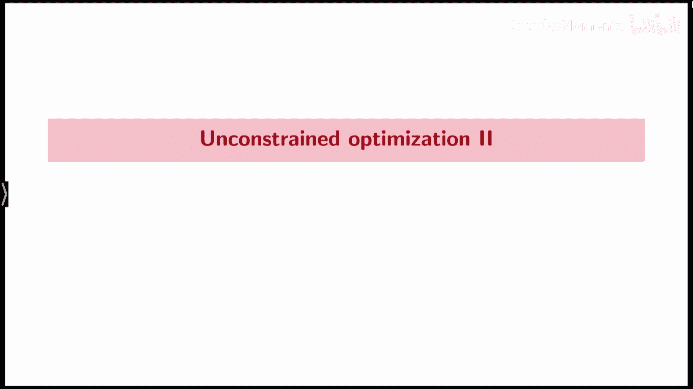

Last time we introduced gradient descent。A general purpose algorithm for minimizing a loss function。

Today we'll continue that discussion。So we'll start by talking about why exactly gradient descent works。

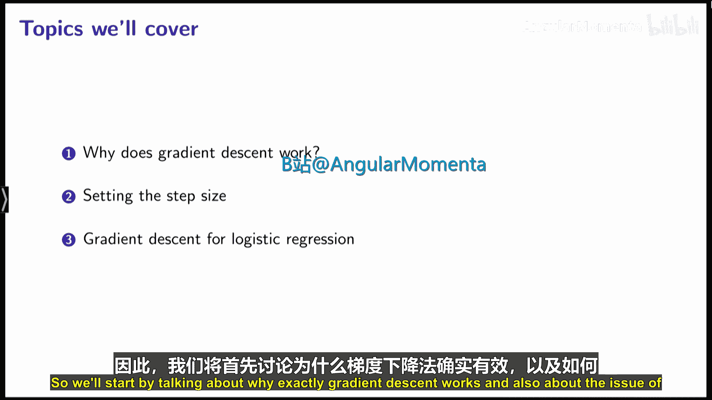

And also about the issue of how to set the step size。

Then we'll see how easy it is to derive a gradient descent algorithm。

By looking at logistic regression as an illustrative example。

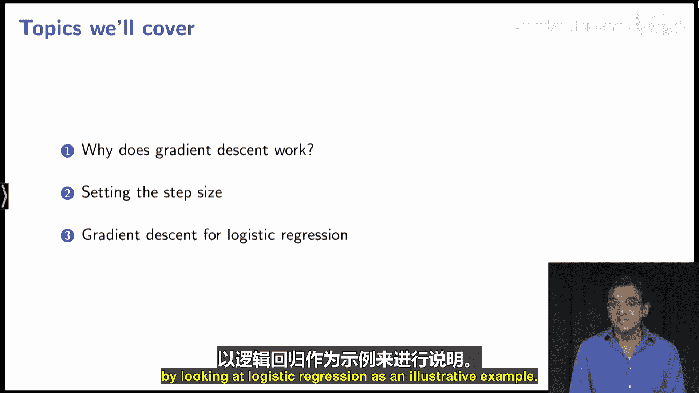

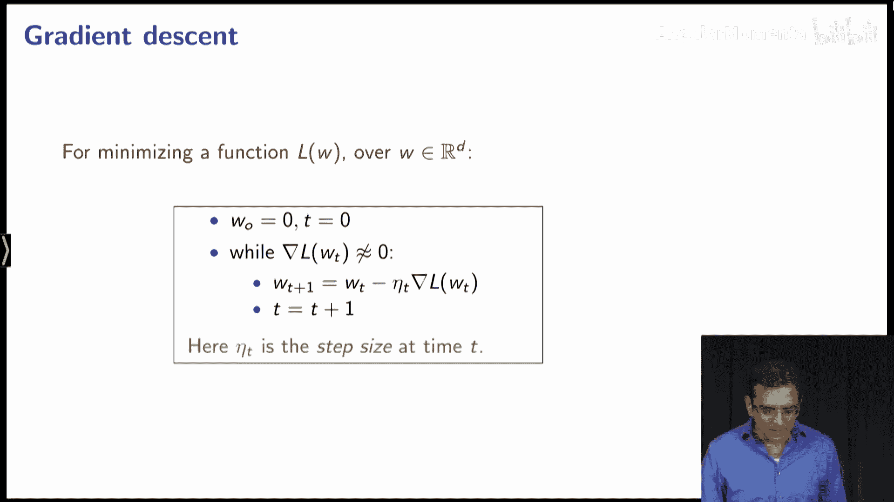

So this is the gradient descent algorithm。There's some loss function L that we want to minimize。

And we want to find the parameter vector。

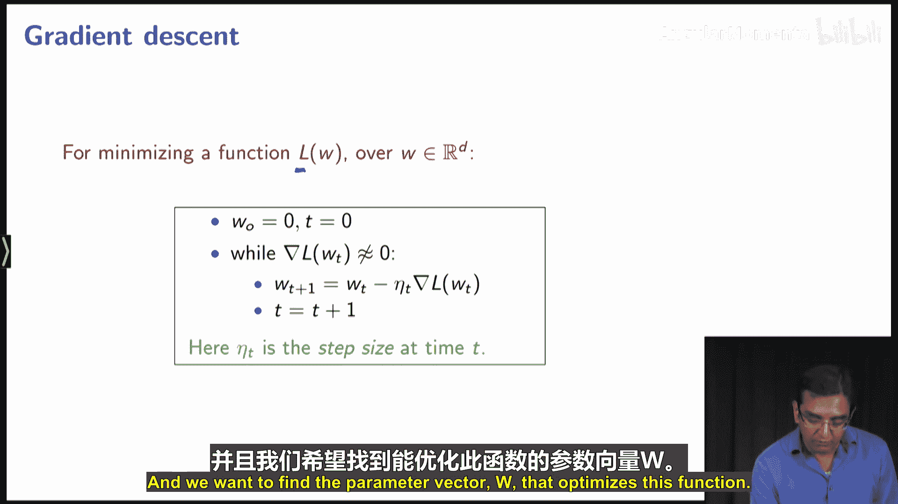

W that optimizes this function。The way we do it is by starting w at0 and then entering into this loop where we keep adjusting W。

 we keep tweaking it a little bit until it finally converges。

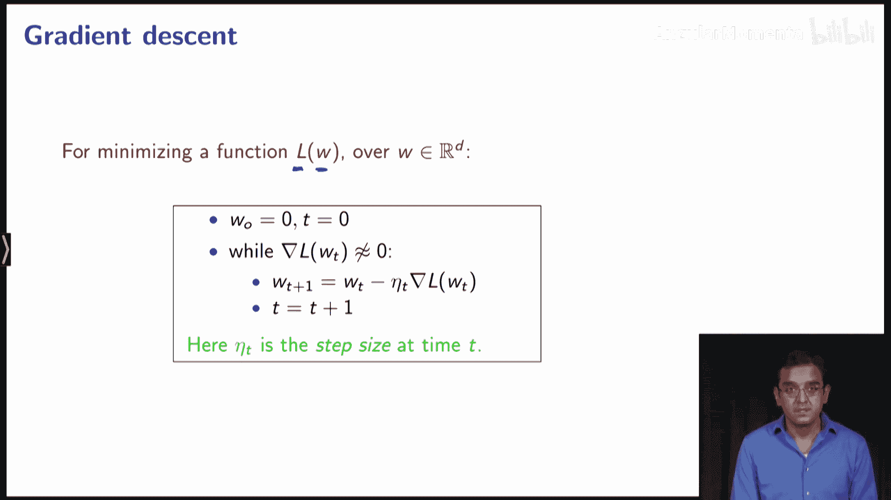

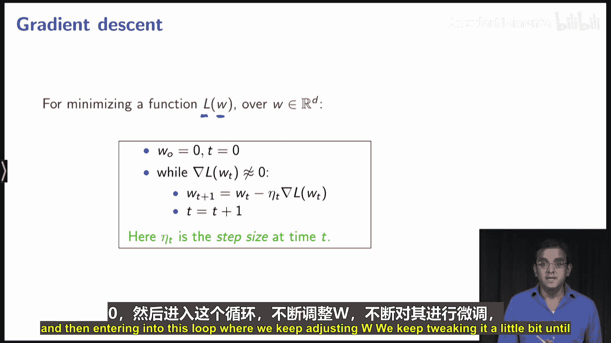

So what are these updates？Well。

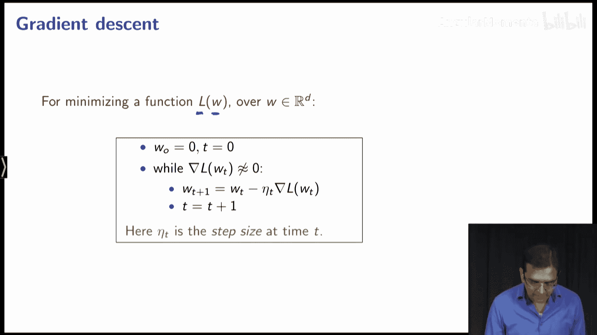

If the current parameter vector is W ofT。What we do is we compute the gradient。

 we compute the derivative of the loss function at W sub T。

And we move in the opposite direction to that derivative。With some step size ASFT。

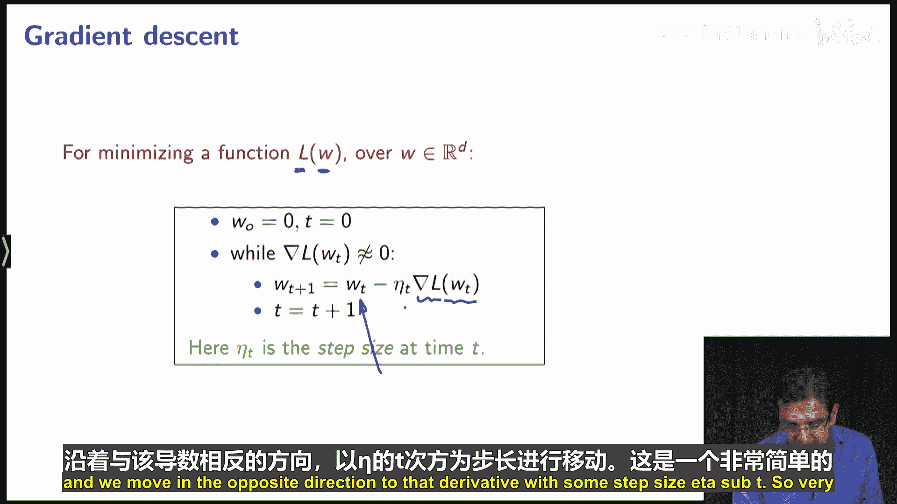

So very simple update。And the question is。Why does this work？So let's think about this a little bit。

Now， gradient descent uses the derivative of the loss function。If the derivative exists。

 it means that the loss function is locally linear， okay， what's that？

Well here's a picture of a loss function， is it linear， no， it's not。

But let's look at a little window， let's look at a little neighborhood。Okay。

 so let's pick a point on the function and look at a little window around that point。

 let's zoom in a little bit。Here's what it looks like。 Is it linear now。No， it's not linear。

 but it's more linear than before， so let's zoom in a little bit more。We pick a point， we zoom in。

 and now it's linear。Okay， so if one looks at the function， close up。

If one looks at a small enough neighborhood， then the function is approximately linear in that neighborhood。

And the linear approximation is given by the derivative of the function。

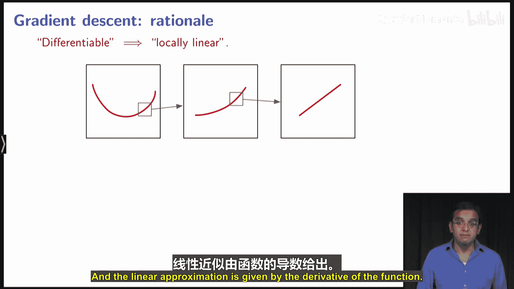

So let's look at this more concretely。

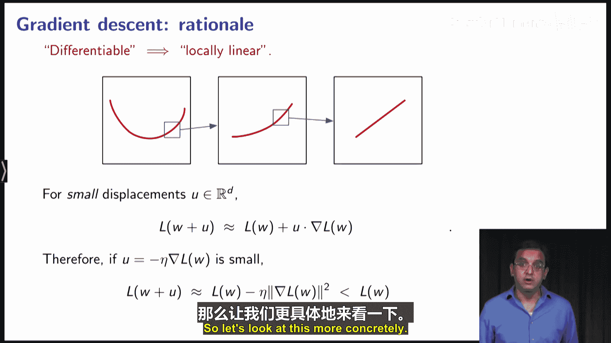

So we have some loss function L。And we're going to look at it in just a very small neighborhood。

 a small neighborhood around。The point W。So that means that the kind of points we' are looking at are points very close to W points of the form W plus U。

 where U is some minuscule displacement。Okayて。Now， because this neighborhood is so small。

 the function is approximately linear and in fact， this is what it looks like。

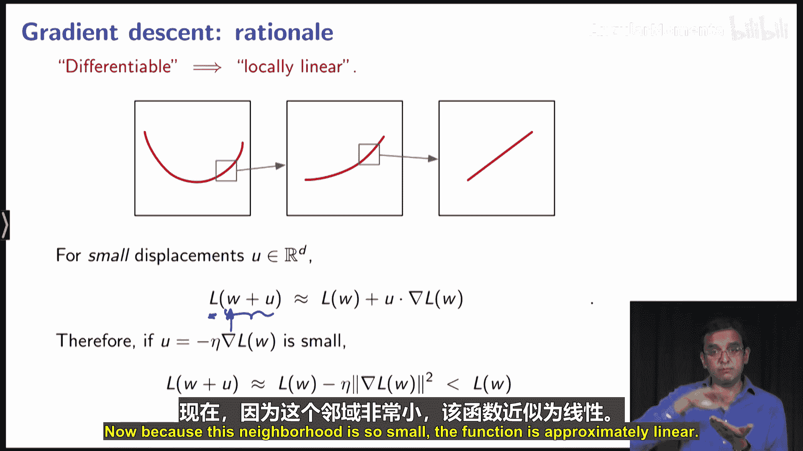

The value of ill。A W plus U。Is given by the value at W plus U dot product with the derivative of L at W。

This is linear and the derivative gives us this linear approximation。Okay。

 so let's see what this means for gradient descent。In gradientient descent。

 L is this function that we're trying to minimize。And W。Is our current parameter vector。

We're going to tweak W a little bit， we're going to move it from W to w plus U and the specific U that we pick ingredient gradient descent is this value。

It's the negative of the derivative。Dying some stepside， Ada。Okay。

 so let's plug in that value U into our linear approximation for the loss function， what do we get？

So we get L of w plus U。So just looking at this linear approximation over here。L of W。

Now U is negative beta。Times the derivative。Dot product with the same derivative。

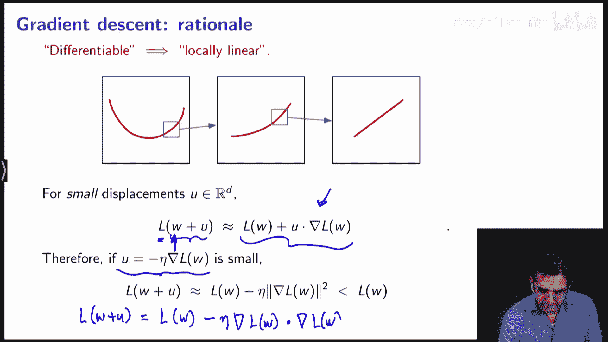

And when you take a dot product of a vector with itself， you get the vector squared。And so this。

It's the value。Approximately。Of the loss function at W+ U。

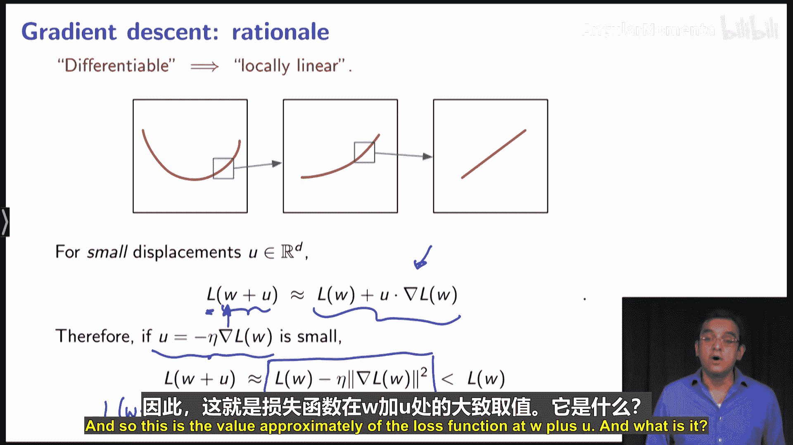

And what is it， it's the loss function at W？Minus something positive， so it's less than L ofW。

So moving in the direction opposite to the derivative is guaranteed to reduce the loss function。

This is why gradient descent works。Okay。So we also have to talk about the step size， however。

How should we set this data？Well， if we think back to our discussion。

 if we think back to our mathematical justification。

 that linear approximation only holds in very small neighborhoods。😊。

So that suggests setting the step size ada to something tiny。But if we did that。

 what it would mean is that W would only change a tiny bit on each iteration and progress would be very slow。

So that's not really something we'd like to do， we'd like to set a or larger。

But if we set it too large， then we might overshoot the mark and end up at a worse place than where we began。

 Okay， so let's look at this example over here。 So here we have。

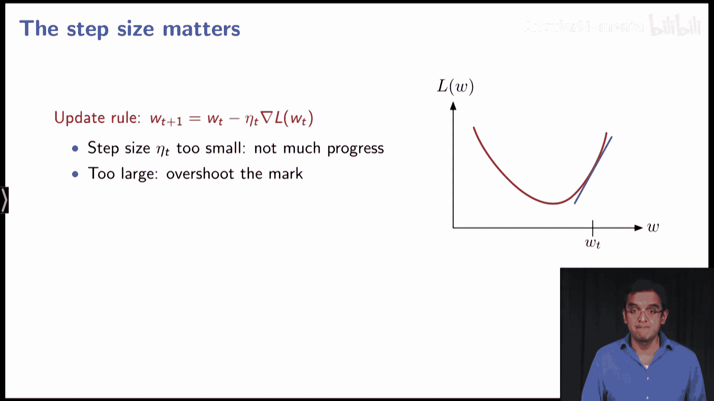

A one dimensional w， and we have a loss function shown on the y axis。

 and let's say that our current parameter is this value over here。By looking at the gradient。

 we know that we have to move to the left。But we have to set the step size8do。

 we have to decide how far to the left we want to move。If we moved too far to the left。

 we could end up somewhere like this。We could end up with a loss value that's higher than where we began。

So this sounds pretty tricky。How are we going to set this valueuator？Now， unfortunately。

 there's no straight answer to this。Different people have different ways that they like to set this constant。

And all I'm going to do here is to put out two alternatives。

One thing the one could do is to set this step size Eta to some fixed schedule。

 like setting Eta T to be one over T。 In fact， a lot of the mathematical analysis of gradient descent assumes something like this。

Another most sophisticated alternative is to set this step size adaptively so we're at a particular vector w。

 we know which the direction the derivative is in so we know which direction we're going to move in and what we can do now is to do a line search along that direction to find the optimal displacement。

 the value of Eda for which the loss will decrease the most you can imagine some combination of sampling and binary search to achieve this。

😊。

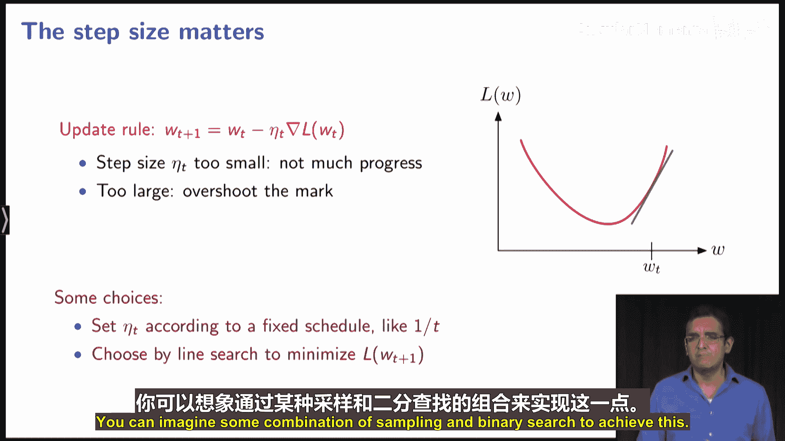

对。Okay， so we've been talking about gradient descent fairly abstractly。

But now let's get more concrete and actually go ahead and derive a gradient descent algorithm for the specific case of logistic regression。

So let's say we have a data set， x1， y1 through x and Yn。If you recall in logistic regression。

 we're looking for a linear function given by some parameter vector w。

That minimizes this loss function over here。Okay。Now， actually， I mean。

 we usually had an offset B as well， so we're looking for W and B。But if you remember。

 one of the things we showed is that you can always assimilate B into W by adding an extra feature。

 so let's just assume we've done that and that therefore this is the loss function we're trying to minimize。

😊，Now to use gradient descent， all we really need to do is to compute the derivative of this loss function。

 so let's go ahead and do that。Okay， so a parameter vector。W has D numbers in it。 Okay。

 so W is of the form。W1。Through WD。And so the derivative is going to be a D dimensional vector。

 so let's go ahead and compute the derivative of the laws with respect to some particular W sub J。

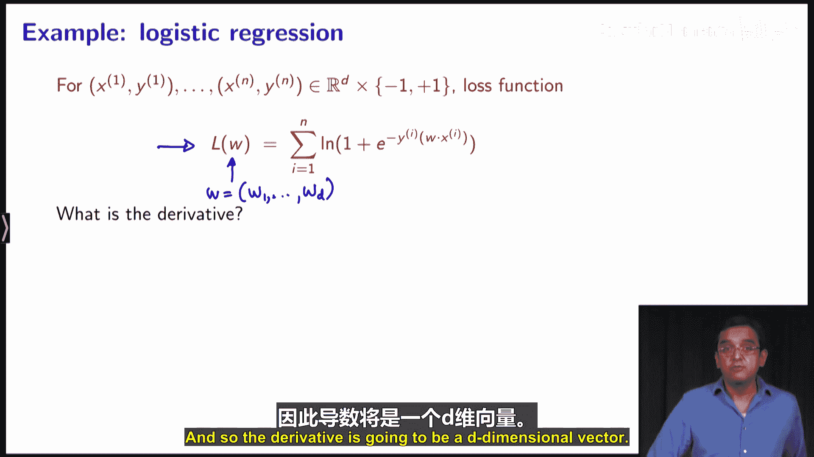

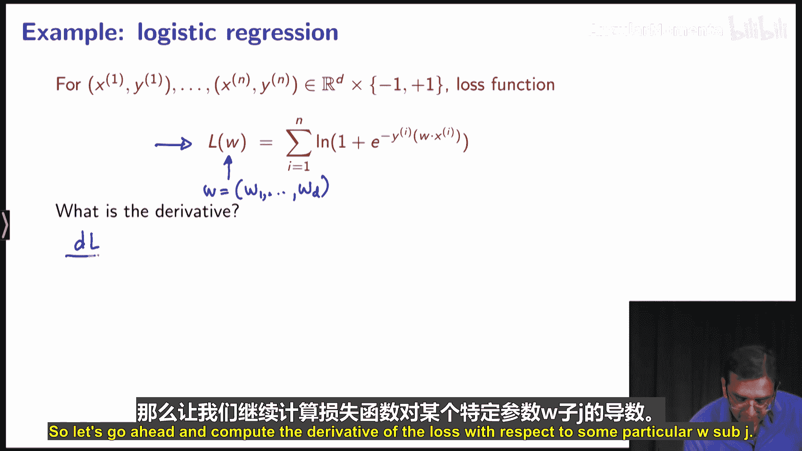

What is it Okay， Well， first off， the derivative of a sum is the sum of the derivative。

 so let's just pull out that summation。And then we have a logarithm。😊，Well。

If you remember from high school or you know， a long time ago。The derivative of log U。Is DU overU。

Okay， so let's go ahead and write down that denominator over there。1 plus E to the minus Y I。

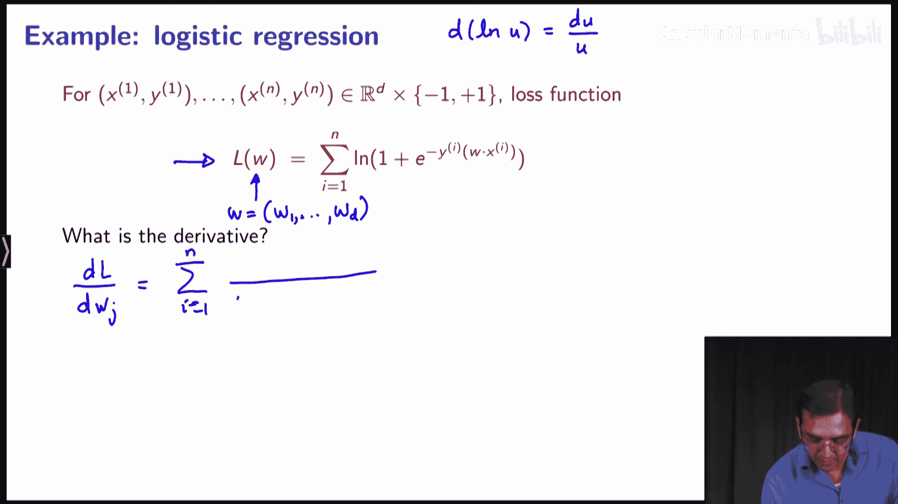

W dot Xi。And then on top， we have to write down the derivative of that。

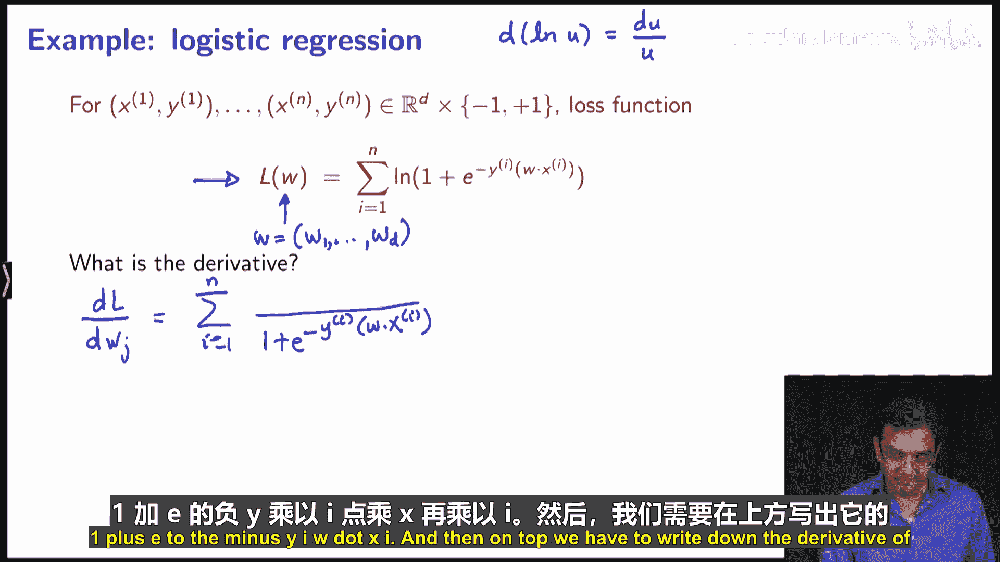

Okay， so for that there's another rule， the derivative of e to the U is e to the U D。Okay。

 so we get e to the minus Y I。W。txii。And now we need to compute the derivative of this thing over here。

What is that， okay？So there's a dot product in there， let's just expand it out。So we have minus Yi。

W1 times the first coordinate of Xi old the way to W D times the D coordinate of Xi。

Again we've expanded out the dot product。And now we need to take the derivative of that with respect to WJ。

 well there's only one term that involves WJ， so the derivative is minus Yi。😊。

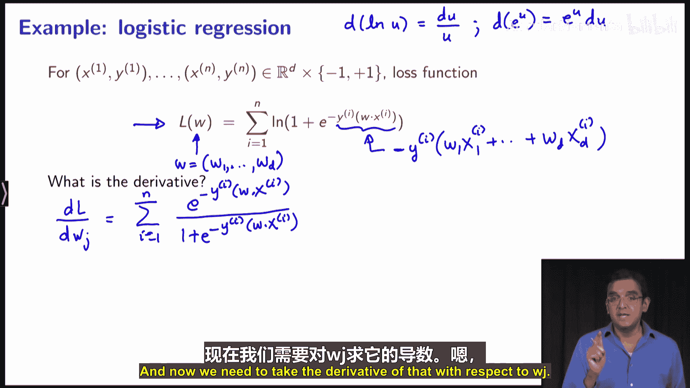

Times X， I sub。Okay， so we've computed the derivative。Now that first comes a little bit messy。

 so let's simplify it， and one way we can do that is to take it and multiply the top and bottom by E。

To the Y eye。W。xii。

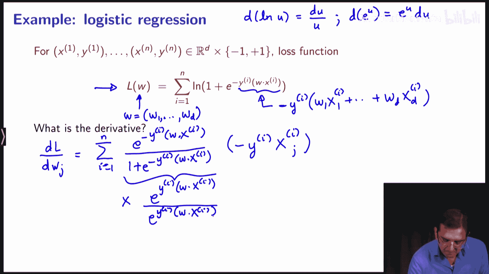

Okay， and if we do that， what do we get？Well， the numerator just becomes one？

And the denominator becomes one。Plus， B。To the Y eye。

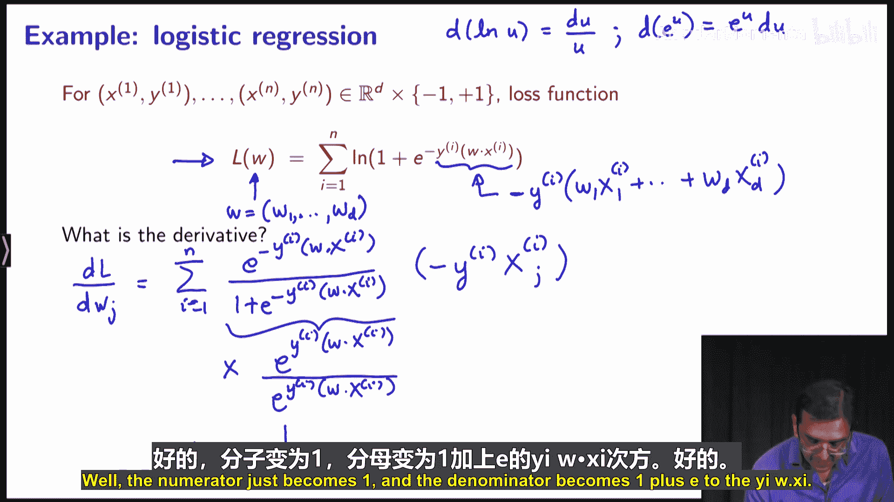

W dotxi。So let's just copy this over now。

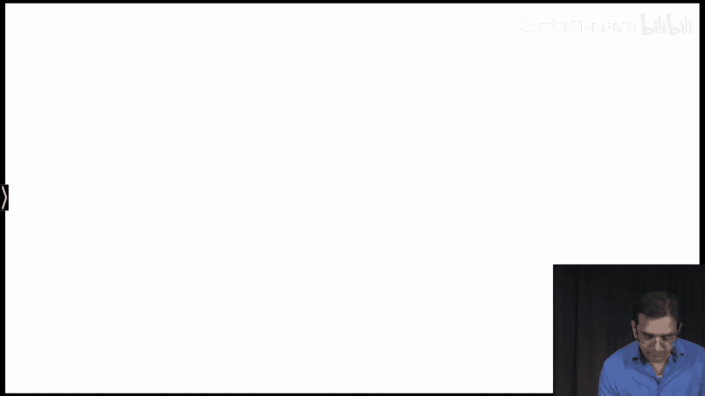

So the derivative of the loss function of WJ。Is minus。The sum over points。From one to end。

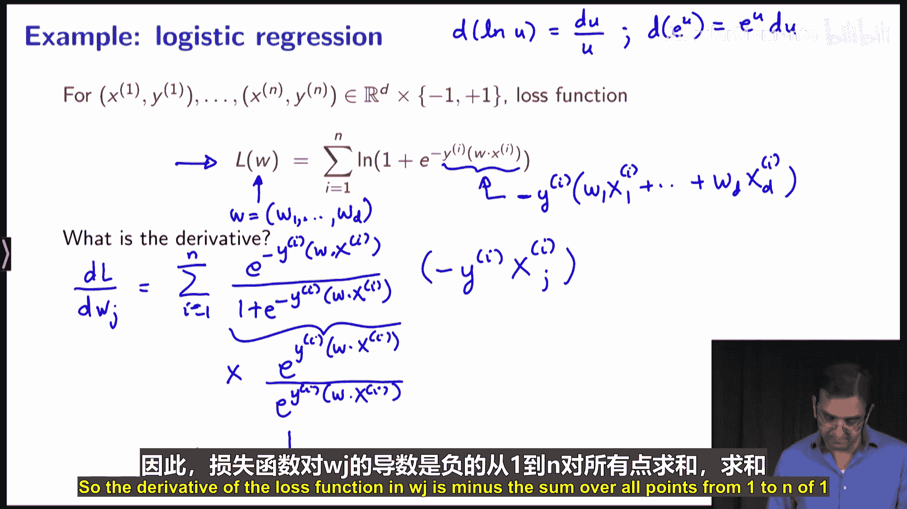

Of one over。1 plus E to the Y I。W dot Xi。Times Y I。X， I， J。O。Now。

That first term actually looks familiar。Comparing it to the logistic regression function。

What we see is that it's actually the probability。Under W。Of the label being negative Yi。

 given an Xi。Okay。And so this derivative is just the minus。

The sum overall data points of the probability。Of the opposite label。Negative Yi， given Xi。

 the labels are all plus  one or minus1， so minus Yi is the wrong label。Times Y I， X I J。Okay。

 so that's the derivative with respect to WJ and the overall derivative is the vector in which we just stack these up。

😊，Okay， so the overall derivative。Of the loss function at W。Is a vector。

There most of this is exactly the same。And we just have Xi at the end。Okay， so why is that。

 why is that what you get when you stack up these individual derivatives， Well。

 just look at this equation over here。Most of the terms here are just scalarrs are just numbers。

 Okay， so this is some number。 this is either plus 1 or minus-1。

 The only thing that's a vector is this x at the end。

So the JP coordinate of this thing is exactly this formula over here。 you copied on the same thing。

 but you just take the Jde coordinate of x。Okay， so we've computed the derivative of the loss function。

 and now we're ready to write down a gradient dissent algorithm。

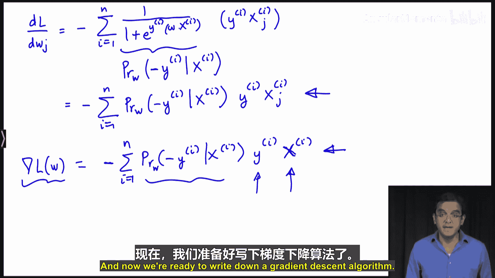

This is what it looks like we initialize W to0， and then we begin our iterative updates。

And when the current parameter vector is W subt。The update looks like this。

 we compute a weighted sum。Of the data points。And we simply add it to W ofT with some step size8 to sub2。

So what exactly is this weighted sum？This is the I data point， what is this way to open here？

It is the probability of the wrong label。Under the current parameter vectorctor。In other words。

This weight is high if we are doing badly on that data point。And this makes perfect sense。

 we're placing more emphasis on the points on which we are currently doing badly。Okay。

 so that's it for now and for gradient descent。

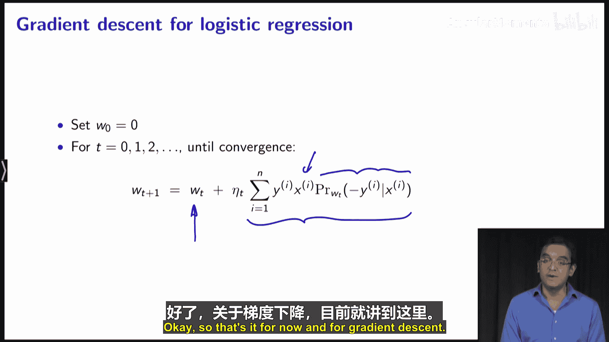

You now have。In your repertoire。The gradient descent procedure。And at this point。

 with a little bit of practice， you should be able to derive a gradient descent algorithm for any loss function you like。

 any loss function you wish to minimize。