# 机器学习基础：06-02-02：无约束优化方法II 🧠

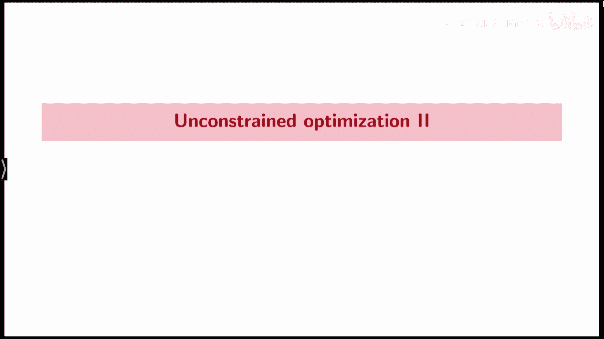

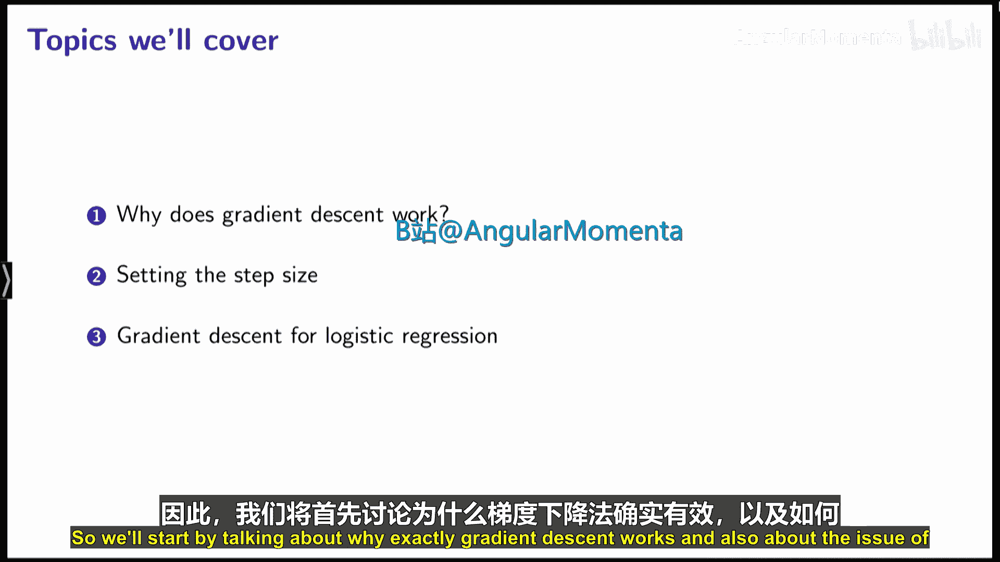

在本节课中，我们将继续探讨梯度下降法。我们将首先解释梯度下降法为何有效，并讨论如何设置学习率这一关键问题。接着，我们将以逻辑回归为例，具体演示如何推导出一个梯度下降算法。

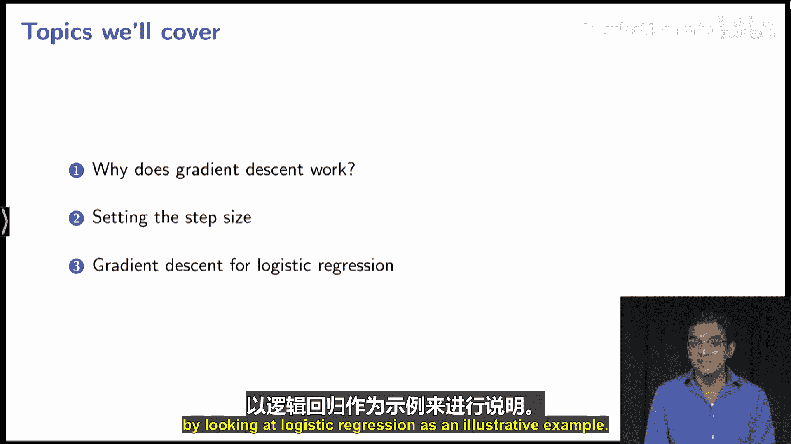

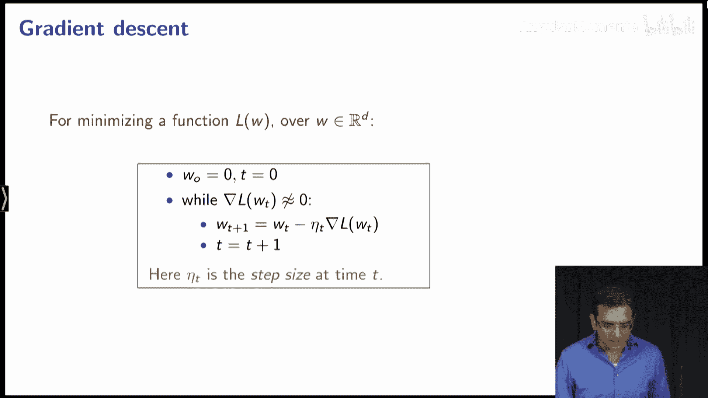

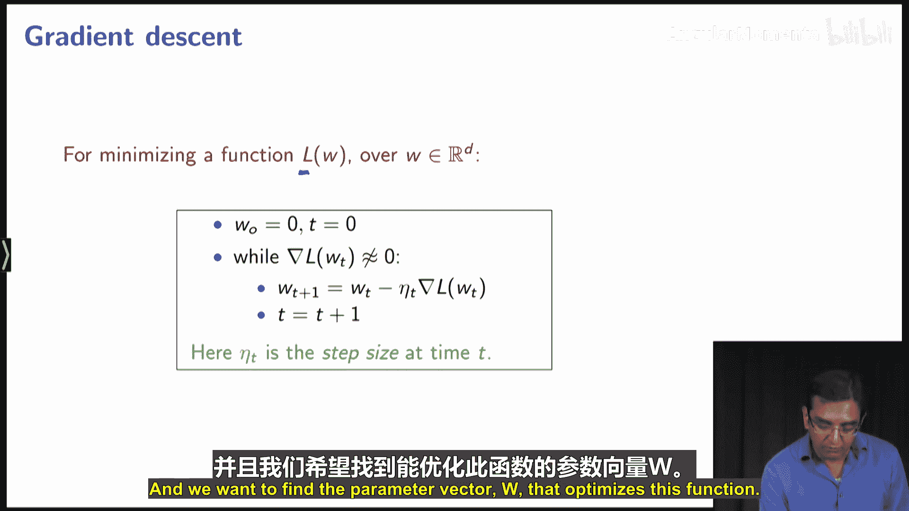

---

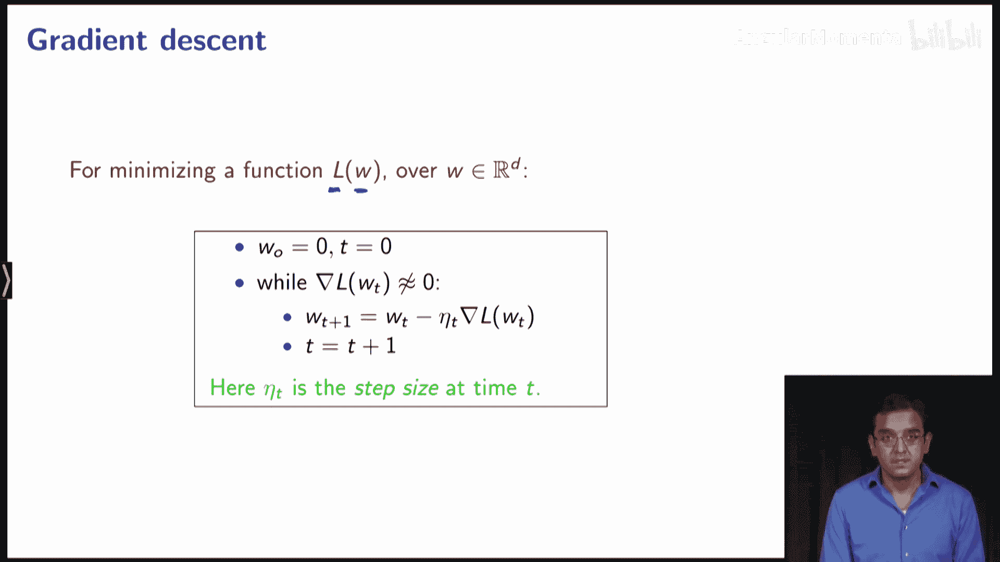

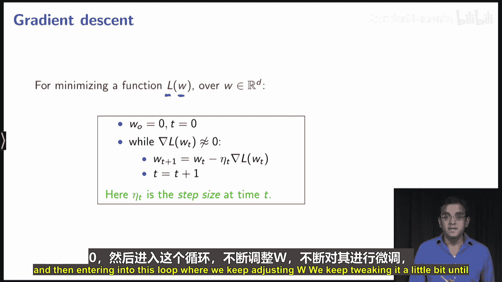

上一节我们介绍了梯度下降法，它是一种用于最小化损失函数的通用算法。

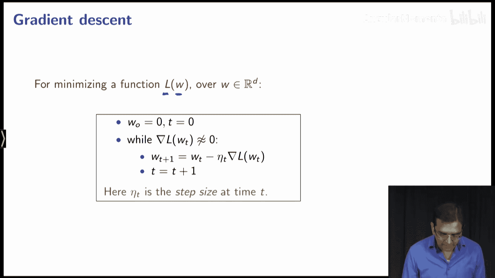

本节中，我们来看看梯度下降法的工作原理。

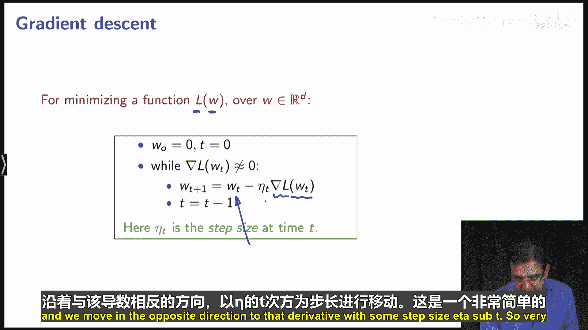

## 梯度下降法回顾 🔄

梯度下降算法的目标是找到最小化某个损失函数 **L** 的参数向量 **w**。其基本流程是：从初始向量 **w⁽⁰⁾** 开始，进入一个循环，不断调整 **w** 直到其收敛。

以下是其更新规则的核心公式：

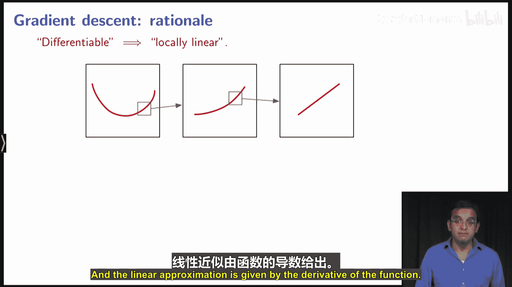

**w⁽ᵗ⁺¹⁾ = w⁽ᵗ⁾ - ηₜ ∇L(w⁽ᵗ⁾)**

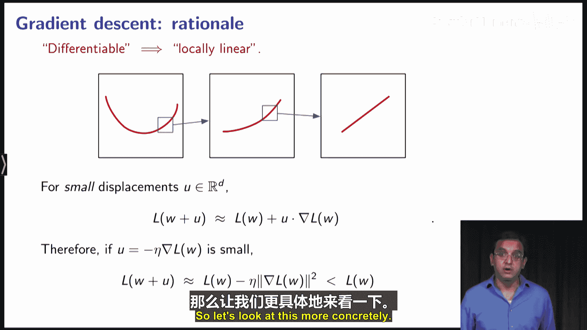

其中：
*   **w⁽ᵗ⁾** 是第 `t` 次迭代的参数向量。
*   **∇L(w⁽ᵗ⁾)** 是损失函数在 **w⁽ᵗ⁾** 处的梯度（导数）。
*   **ηₜ** 是第 `t` 次迭代的学习率（步长）。

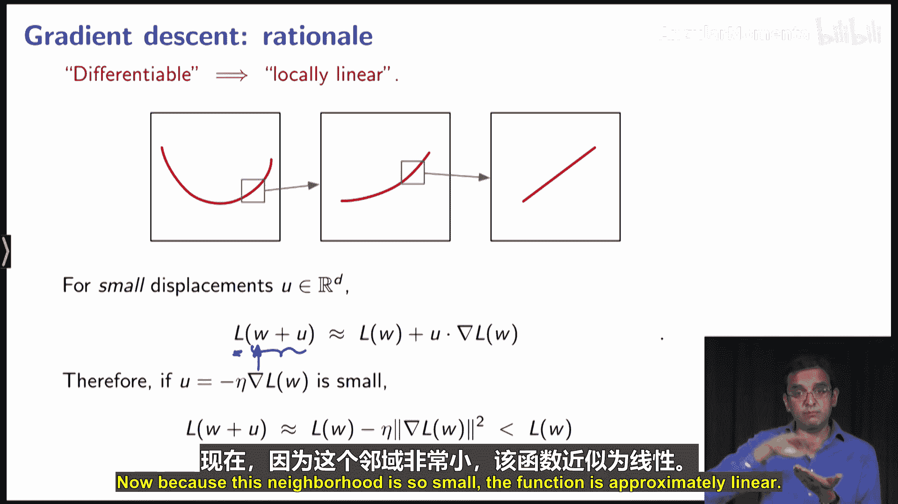

这个更新非常简单：计算当前点的梯度，然后沿着梯度的反方向移动一小步。

## 梯度下降为何有效？ 🤔

梯度下降利用了损失函数的导数。如果导数存在，意味着损失函数在局部是近似线性的。

具体来说，如果我们观察损失函数 **L** 在点 **w** 附近一个极小的邻域（即点 **w + u**，其中 **u** 是一个微小的位移），那么函数可以近似为线性：

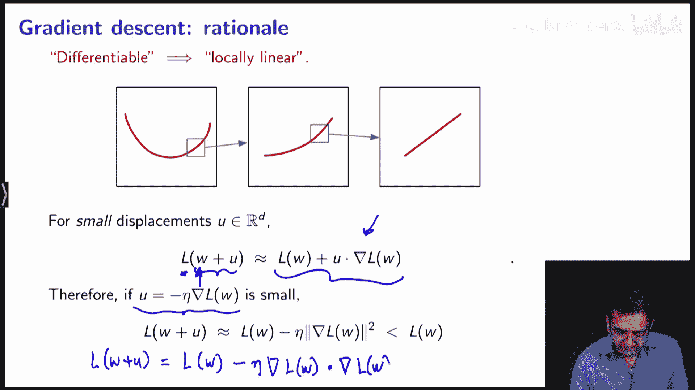

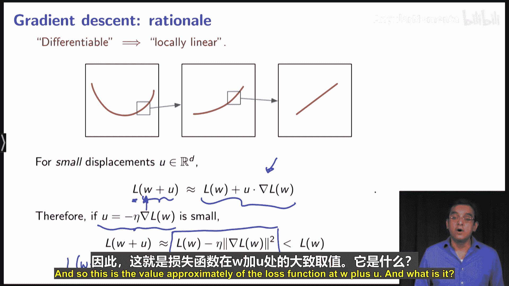

**L(w + u) ≈ L(w) + u · ∇L(w)**

这是函数在 **w** 点的线性近似，由梯度给出。

现在，考虑梯度下降的更新方向 **u = -η ∇L(w)**。将其代入上述线性近似：

**L(w + u) ≈ L(w) + (-η ∇L(w)) · ∇L(w) = L(w) - η ||∇L(w)||²**

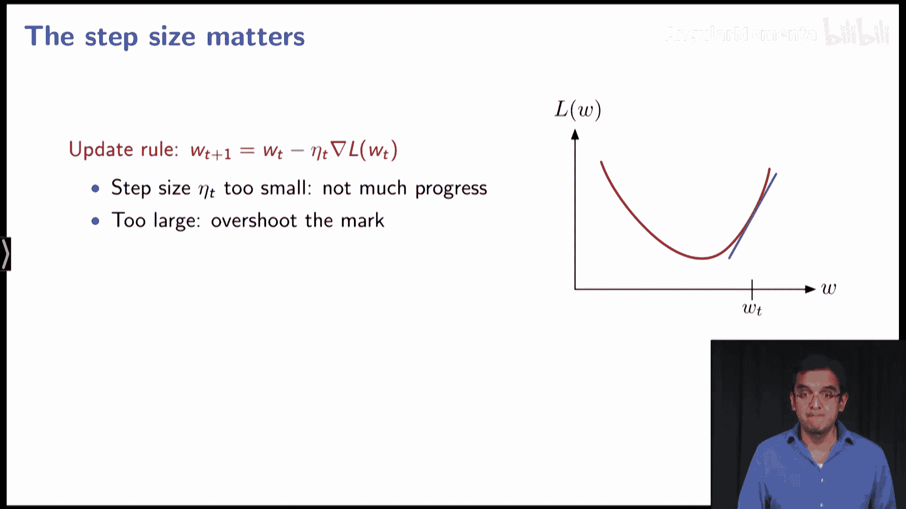

由于 **η** 为正数，且梯度模长的平方 **||∇L(w)||²** 总是非负的，因此 **L(w + u)** 近似小于 **L(w)**。这保证了沿着梯度反方向移动能够降低损失函数的值，这就是梯度下降法有效的原因。

## 如何设置学习率？ ⚖️

学习率 **η** 的设置是一个关键问题。根据上面的数学原理，线性近似只在极小的邻域内成立，这似乎意味着应该将 **η** 设得非常小。然而，过小的 **η** 会导致每次迭代参数更新幅度微小，收敛速度极慢。

反之，如果 **η** 设置得过大，则可能“步子迈得太大”，越过最低点，甚至导致损失值上升，算法无法收敛。

以下是为学习率设置提供的两种常见策略：

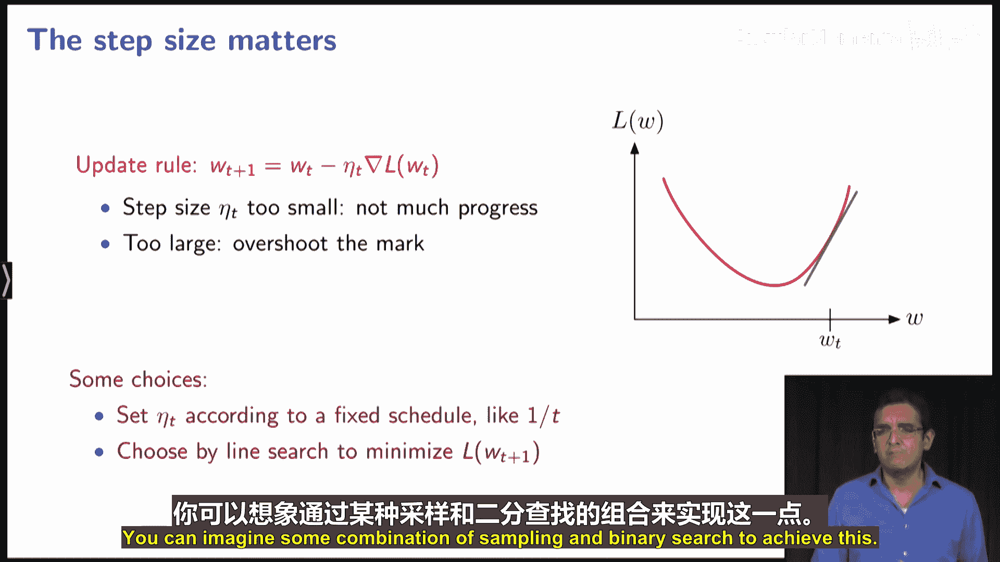

*   **固定调度**：将学习率设置为一个随时间递减的固定序列，例如 **ηₜ = 1 / t**。许多梯度下降的数学分析都基于此类假设。
*   **线搜索**：这是一种更复杂的方法。在确定了梯度方向后，沿着该方向进行一维搜索（例如通过采样或二分查找），找到能使损失函数下降最多的最优步长 **η**。

## 实例：推导逻辑回归的梯度下降 📝

现在，让我们将理论具体化，以逻辑回归为例，实际推导其梯度下降算法。

假设我们有一个数据集 `{(x₁, y₁), ..., (xₙ, yₙ)}`。逻辑回归的目标是找到一个由参数向量 **w** 定义的线性函数，以最小化以下损失函数（此处已通过添加常数特征将偏置项 `b` 并入 **w**）：

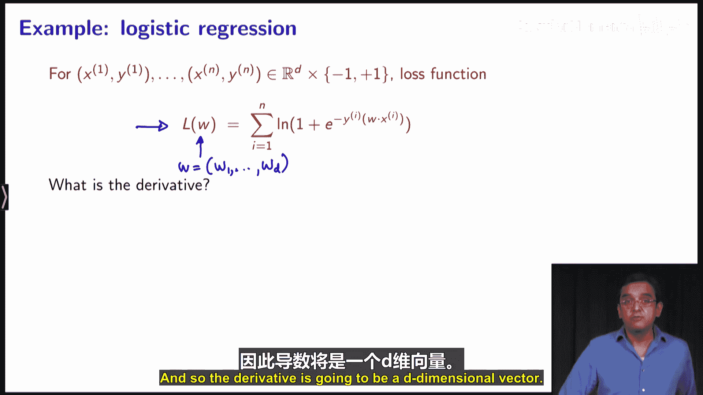

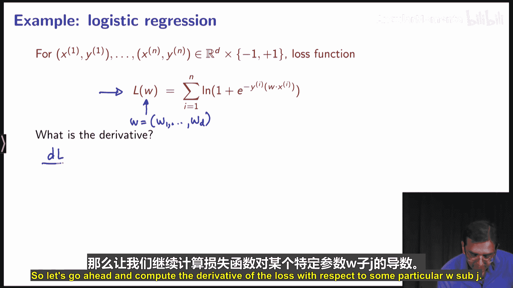

**L(w) = Σᵢ log(1 + exp(-yᵢ (w · xᵢ)))**

为了使用梯度下降，我们需要计算损失函数 **L** 关于参数 **w** 的梯度。**w** 是一个 `D` 维向量，因此梯度也是一个 `D` 维向量。我们计算其对第 `j` 个分量 `wⱼ` 的偏导数。

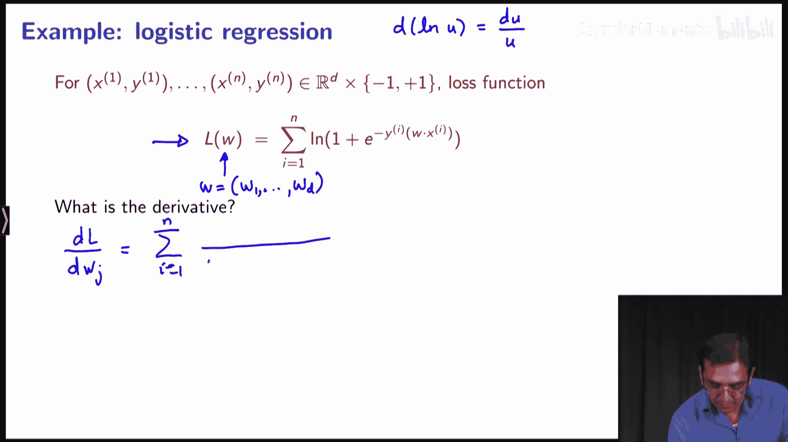

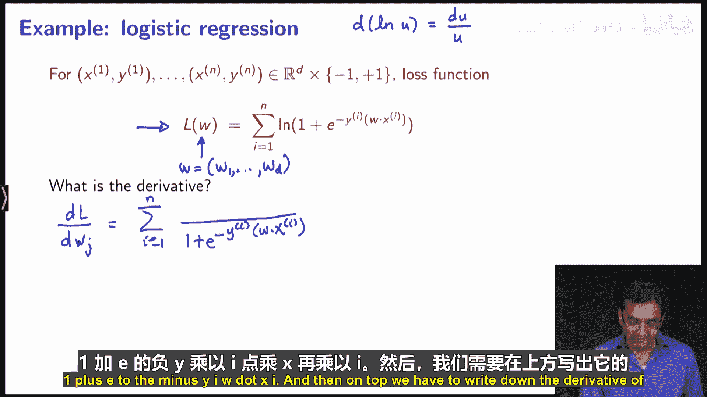

经过求导和化简（过程详见课程推导），我们得到：

**∂L(w) / ∂wⱼ = - Σᵢ [ 1 / (1 + exp(yᵢ (w · xᵢ))) ] * yᵢ * xᵢⱼ**

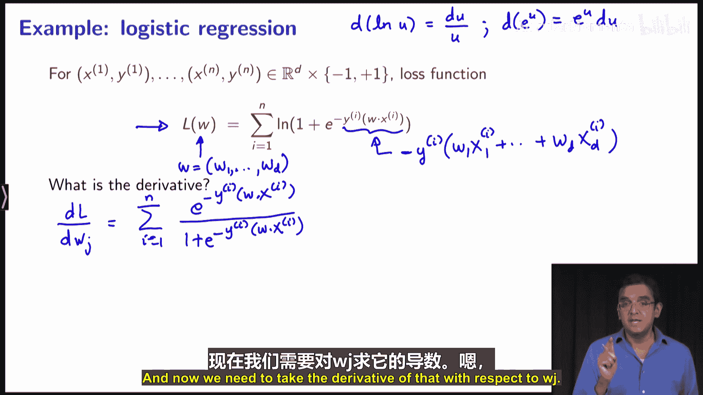

观察方括号内的项 `1 / (1 + exp(yᵢ (w · xᵢ)))`，它恰好等于在当前参数 **w** 下，给定 `xᵢ` 时预测标签为 `-yᵢ`（即错误标签）的概率，记作 `P_w(-yᵢ | xᵢ)`。

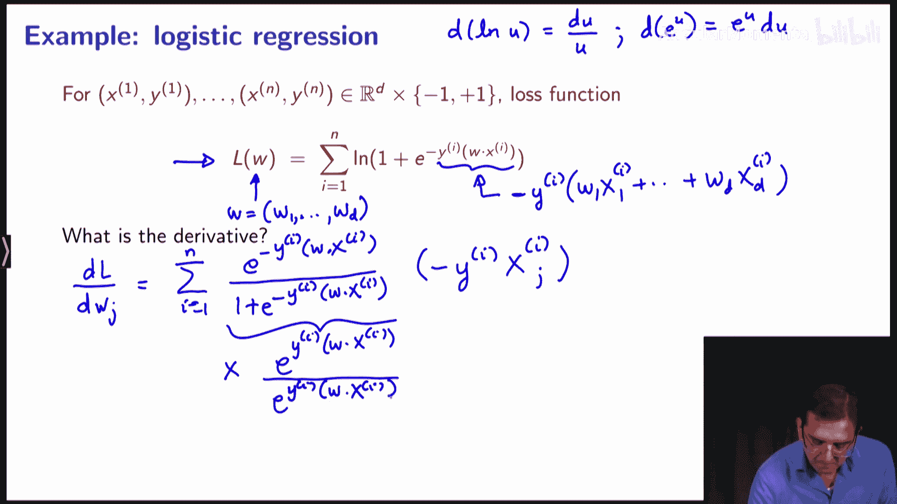

因此，偏导数可以简洁地写为：

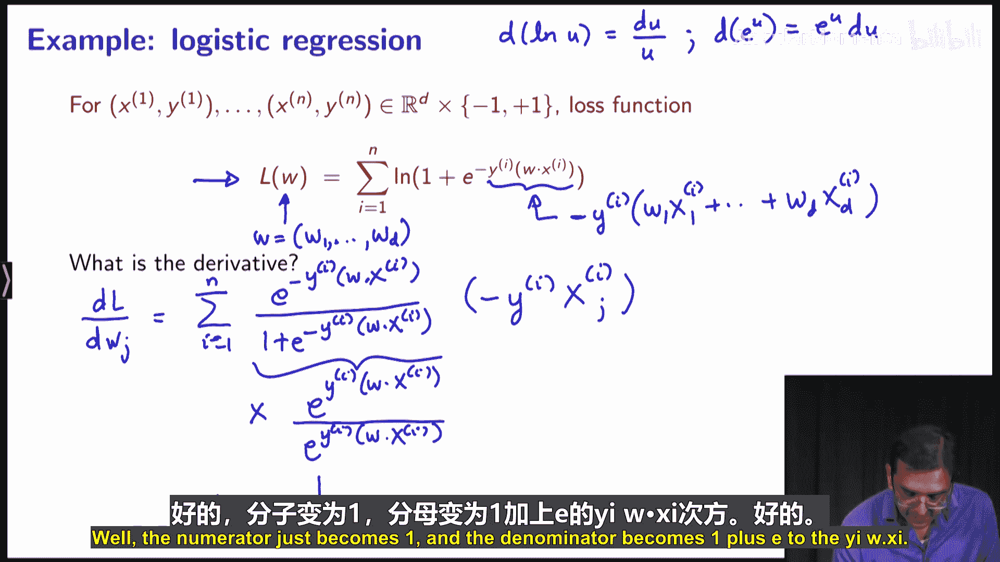

**∂L(w) / ∂wⱼ = - Σᵢ [ P_w(-yᵢ | xᵢ) * yᵢ * xᵢⱼ ]**

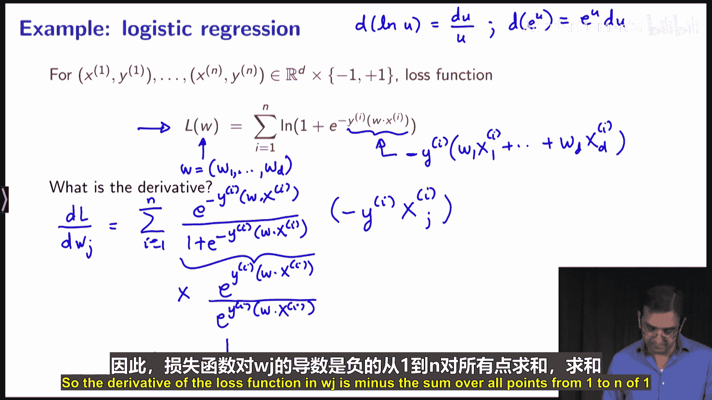

将所有这些偏导数组合起来，就得到了完整的梯度向量：

**∇L(w) = - Σᵢ [ P_w(-yᵢ | xᵢ) * yᵢ * xᵢ ]**

## 逻辑回归的梯度下降算法 🚀

基于计算出的梯度，我们可以写出逻辑回归的梯度下降算法：

1.  **初始化**：将参数向量 **w** 初始化为零向量。
2.  **迭代更新**：对于第 `t` 轮迭代，当前参数为 **w⁽ᵗ⁾**，按以下规则更新：
    **w⁽ᵗ⁺¹⁾ = w⁽ᵗ⁾ + ηₜ Σᵢ [ P_{w⁽ᵗ⁾}(-yᵢ | xᵢ) * yᵢ * xᵢ ]**

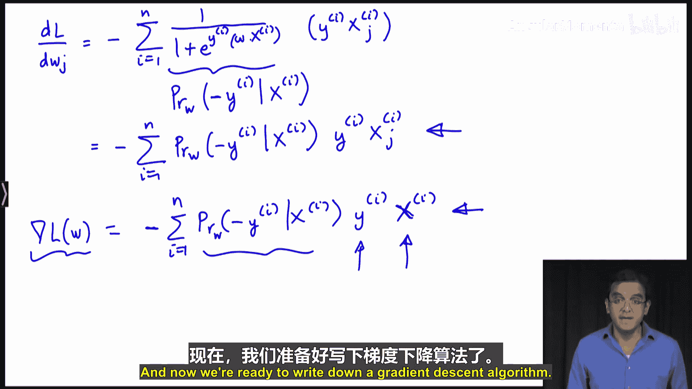

注意，这里更新是“加”而不是“减”，因为我们的梯度公式前面有一个负号。

这个更新公式具有清晰的直观解释：我们计算所有数据点的加权和，然后加到当前参数上。权重 `P_{w⁽ᵗ⁾}(-yᵢ | xᵢ)` 是模型在当前参数下对第 `i` 个样本预测出错误标签的概率。**这意味着，算法会对当前预测错误率高的样本赋予更高的权重，从而在更新时更侧重于纠正这些错误。**

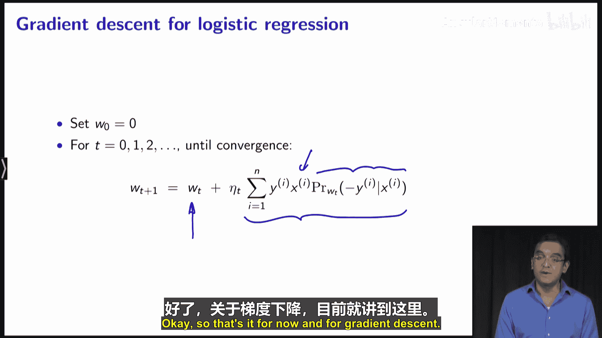

---

本节课中我们一起学习了梯度下降法的原理、学习率设置的考量，并通过逻辑回归的例子完整地推导了一个具体的梯度下降算法。现在，梯度下降法已成为你工具箱中的一项重要工具。通过一些练习，你应该能够为你希望最小化的任何损失函数推导出相应的梯度下降算法。