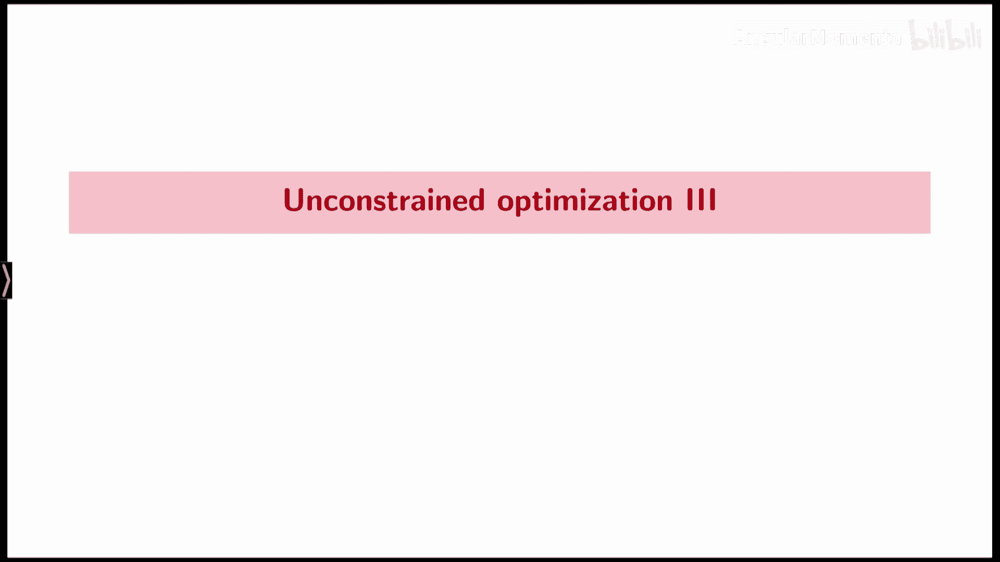
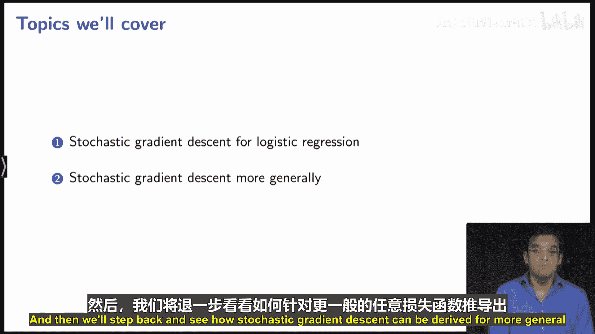
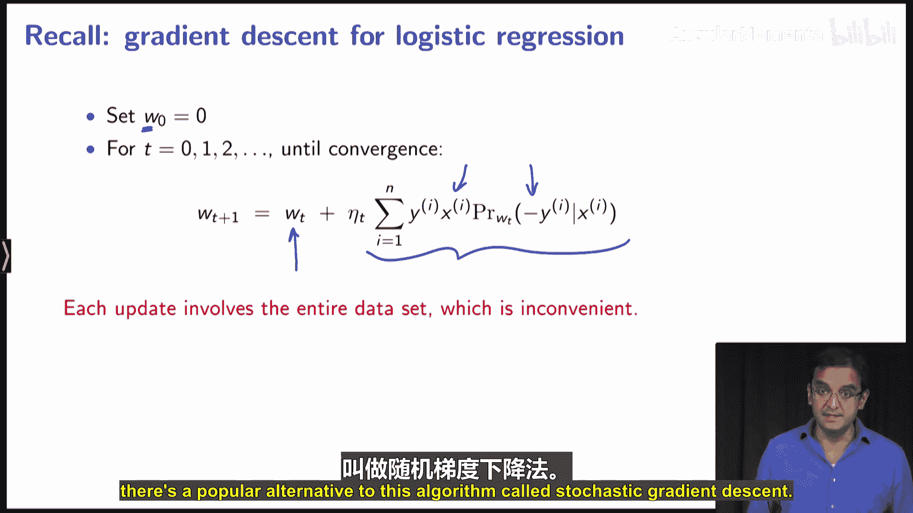
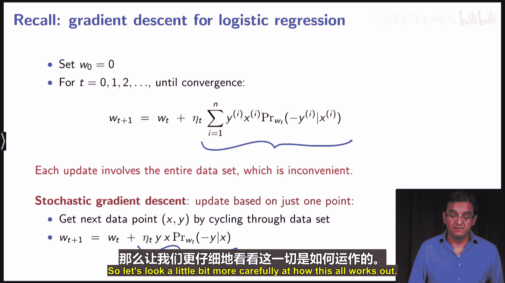
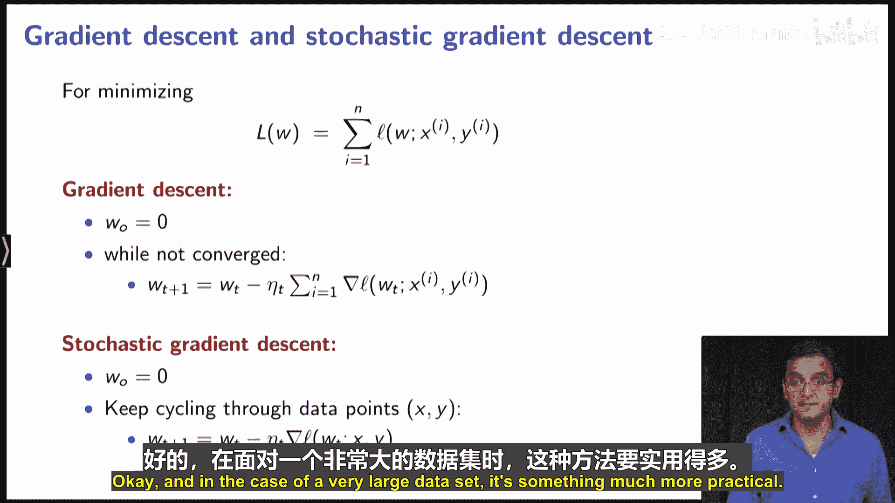
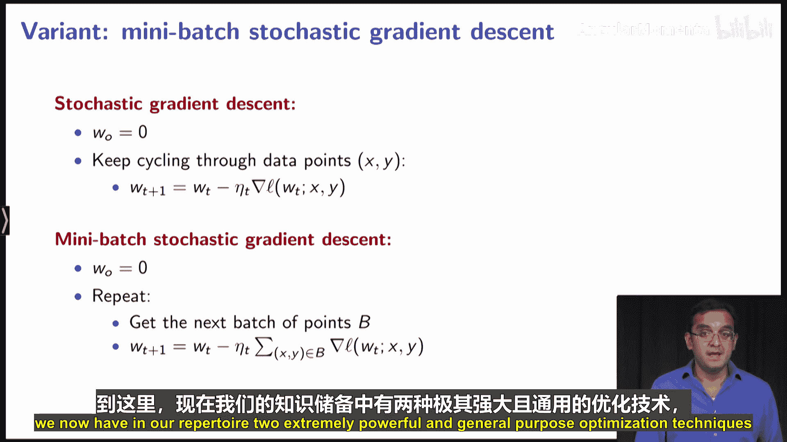

# 【加州大学圣地亚哥分校】机器学习基础  Machine Learning Fundamentals p27 06-03-02-无约束优化_III -BV1TyFSziEZb_p27-

Last time we wrapped up our discussion of gradient descent。

What we'll do today is to look at a variant of gradient descent。

That is suitable for very large data sets。 It's called stochastic gradient descent。

 and it's an essential part of the machine learning toolbox。

So we'll begin by looking at the stochastic gradient descent algorithm for the specific case of logistic regression。

And then we'll step back and see how stochastic gradient descent can be derived for more general arbitrary loss functions。

Okay， so last time we derived the gradient descent algorithm for logistic regression。

And this is what it looks like。So we want to find a parameter W。

 a parameter vector that minimizes the logistic regression loss function。And the way we do it。

Is as follows， we start by initializing W to0。And then we enter into a loop where we keep updating W。

 we keep adjusting it until it finally converges。And each update is quite simple。

If our current parameter vector。Is W5T？What we do is to compute a weighted sum of the data points。

Where the weight of a particular point is increased if we are currently doing badly on that data point。

 if this probability is high。So we compute this weighted sum。

And then we simply add it to W with a particular step size ata subt。Okay。

 so this is fairly straightforward。But one downside of this algorithm is that each update involves looking at the entire data set。

So if there are n data points， the time taken for an update is order N。

If there are a million data points， for example， this update could be quite slow。

And at the end of it all， the magnitude of the update could be something quite minuscule。

 So a whole lot of work for really a very small benefit。😊，Because of this。

 in situations where there is a lot of data， there is a popular alternative to this algorithm called stochastic gradient descent。

And this is shown over here， so it does much the same thing。It again initializes W to0。

And keeps doing updates。 But now each update is based on a single data point。

 not on the entire data set。As a result， the updates are very quick。So it starts with W at0。

 and then it updates W based just on the first data point。

 and then it updates W again based on the second data point， and then on the third data point。

 and it goes down the list。 And when it reaches the end of the data set。

 it just cycles back around to the top。 Again， it keeps going in this way。What are these updates？

Well， here are the updates right here。It's exactly the same as the gradient descent update。

Except restricted to just one point， so there's no summation any longer。Okay， so nice。

 simple and practical。Now this is just for logistic regression。

But something similar can be done for other loss functions as well。

It turns out that the gradient descent procedure。Typically ends up looking something like this。

 we end up with a summation over all the data points。

 and then the stochastic gradient descent version is exactly the same thing。

 but instead of the summation just doing one data point at a time。Okay。

 so let's look a little bit more carefully at how this all works out。😊。

So here， if you will recall， is the loss function for logistic regression。

We are looking for the parameter vector， the model W that minimizes this loss function。

 and this is a loss function over the entire training set。

Now it can also be expressed as the loss on the first data point。Plus。

 the loss on the second data point， plus the loss on the third data point and so on。

The loss function decomposes in this way。 And， in fact。

 almost all the loss functions that we encounter in machine learning are off this form。Okay。

So if we have a training set， x1 y1 through XM YM。Then the loss associated with a particular model W。

With a particular parameter or vector w can typically be expressed in this form。Here， little L。

Is a function that captures the loss on a single data point。 Okay， so L of W X Y。

Captures the loss of the Model W on the single data point X， Y。

And the overall loss of W on the entire training set is then just the sum of these pointwise losses。

Okay。So what is this loss function， What is this little L in the case of logistic regression。Well。

 it's just this function over here。Okay， so in the case of logistic regression， L of W， X， Y。

Is just the natural logarithm。Of 1 plus E to the minus y。W dotx。Okay。Okay。

 so let's say we have a loss function of this kind。 as we've seen。

 logistic regression is all this form， and so is least squares regression， Rige regression， Laso。

 this is standard。 Okay， so our loss function looks like this。

 and we want to find the parameter vector w that minimizes this loss。😊。

Now if we're going to use gradient descent to do this， we have to compute the derivative of L。

Now L is a summation， so the derivative of L is the sum of the derivatives。So the derivative of L。

Is the sum。From i equals1 to n of the derivative of little L。For the specific point， X， I， Y I。Okay。

So computing the derivative。Involves a sum over the dataset。Now， as a result。

This is what the gradient descent procedure looks like。To minimize this loss function。

 we start w with0。And then we start performing all these updates until we converge。

When the current parameter vector is WCT。The update involves moving in the opposite direction to the derivative。

And as we've seen， the derivative works out to this summation over here。

And what this means is that computing one of these updates involves summing over the entire data。

 which could be painful。The stochastic gradient descent version does something quite similar。

 except that each update only involves one data point。 Okay， so again， it starts W at 0。

But now it's cycled through all the data points。And when it gets to data point XY。

The update just involves the derivative of little L at that specific point， X Y。

So it's something much simpler and quicker。And in the case of a very large data set。

 it's something much more practical。

Now， one thing worth pointing out is that gradient descent and stochastic gradient descent are really extreme ends of the spectrum。

For gradient descent， each update involves the entire dataset set。

And for stochastic gradient descent， each update only involves one data point and is therefore potentially quite noisy。

A nice compromise is to have each update depend on a reasonable amount of data。

 say 100 or 1 thousand0 data points。😊，This is called mini batch stochastic gradient descent。

So what happens in this case？Is that you start again with WCO。

But now the first update involves a batch of， say， the first10 or 1 thousand0 data points。

So you update based on those points。Do the usual gradient descent update based on those points。

And then you move on to the next batch of 1 thousand points， do an update based on those。

 and then the next batch of 1 thousand points， and so on， and when you reach the bottom。

 you cycle back round to the top。Okay。So it's a very reasonable and sensible compromise。Okay， well。

 that's it for today。We now have in our repertoire two extremely powerful and general purpose optimization techniques。

 gradient descent and stochastic gradient descent。😊。

These have got to be among the most influential algorithms of all time。

