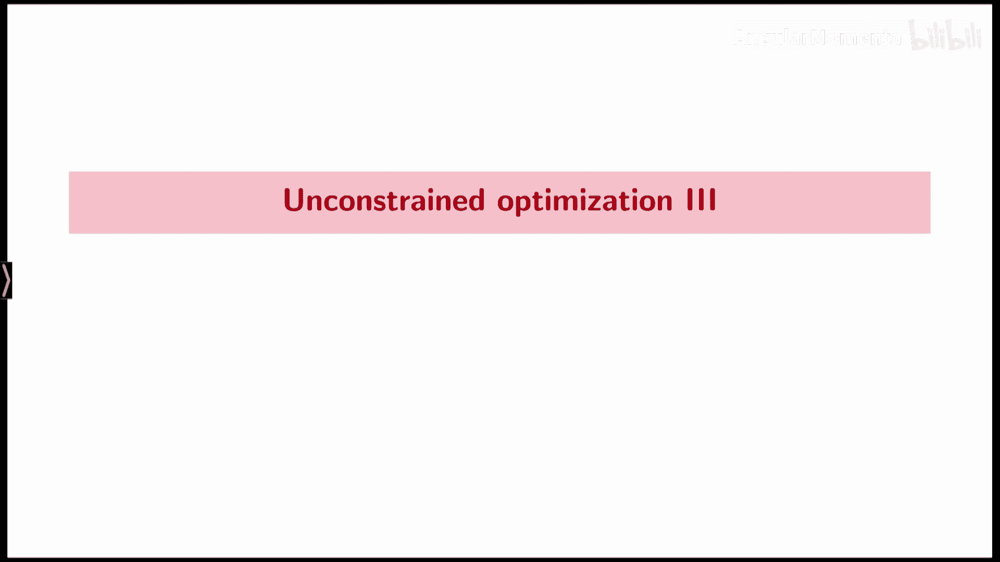
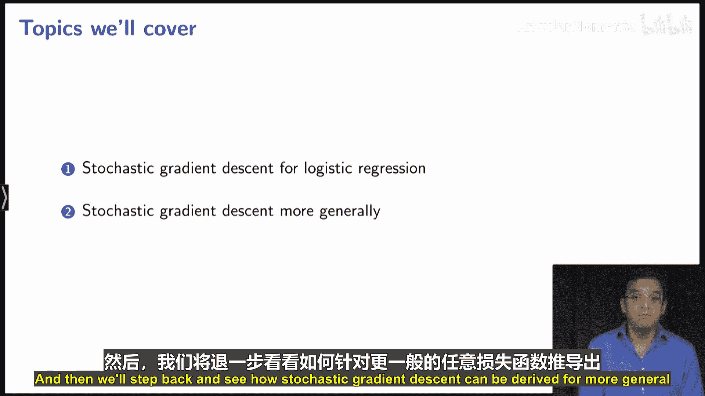
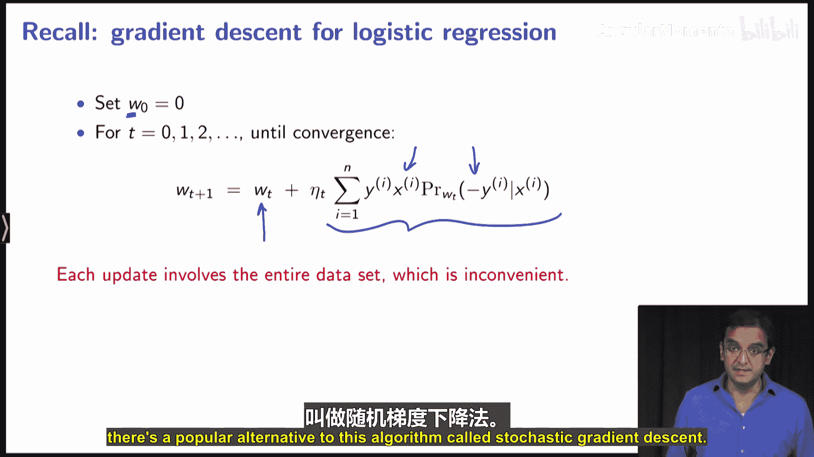
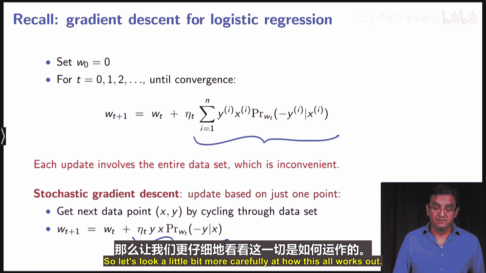
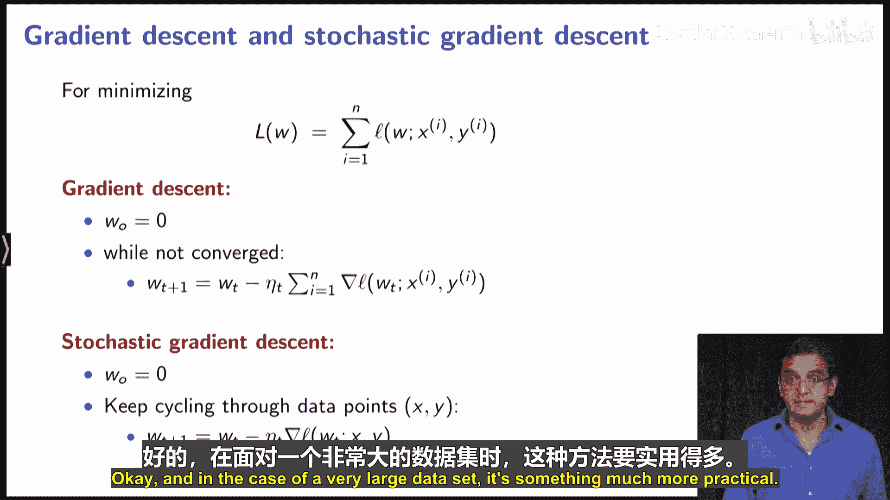
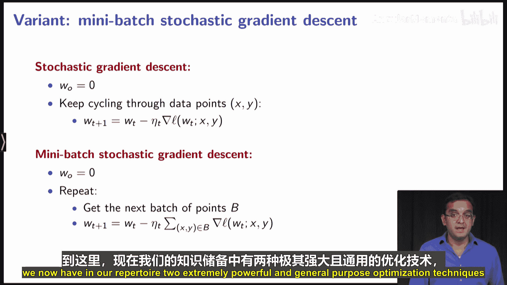

# 机器学习基础：06-03-02：无约束优化_III - 随机梯度下降法 🎯

在本节课中，我们将要学习梯度下降法的一个变体——随机梯度下降法。这种方法特别适用于处理大规模数据集，是机器学习工具箱中一个至关重要的组成部分。

上一节我们介绍了梯度下降法。本节中我们来看看一种更适用于大数据场景的优化算法。

## 梯度下降法的回顾

首先，我们来回顾一下逻辑回归的梯度下降算法。我们的目标是找到能最小化逻辑回归损失函数的参数向量 **W**。

算法步骤如下：
1.  将 **W** 初始化为 **0**。
2.  进入循环，不断更新 **W** 直到收敛。
3.  每次更新时，计算所有数据点的加权和，权重取决于当前模型在该数据点上的表现（预测概率越高，权重越大）。
4.  将这个加权和乘以一个步长 `η_t`，然后加到当前的 **W** 上。

公式表示为：
**W_{t+1} = W_t + η_t * Σ_{i=1}^n [y_i * x_i / (1 + exp(y_i * W_t^T x_i))]**

这个算法的一个缺点是，每次更新都需要遍历整个数据集。如果数据点数量 `n` 很大（例如一百万），每次更新的计算开销会非常大，而更新量可能却很小，效率不高。

## 随机梯度下降法介绍

因此，在处理大量数据时，一个流行的替代算法是随机梯度下降法。

以下是随机梯度下降法的步骤：
1.  同样，将 **W** 初始化为 **0**。
2.  进行更新，但每次更新只基于一个数据点，而非整个数据集。
3.  算法从第一个数据点开始更新 **W**，然后是第二个、第三个，依次遍历所有数据点。
4.  当遍历完整个数据集后，再从头开始循环。

其更新公式与梯度下降法类似，但移除了求和符号，仅针对单个数据点 `(x_i, y_i)`：
**W_{t+1} = W_t + η_t * [y_i * x_i / (1 + exp(y_i * W_t^T x_i))]**

这种方法更新速度快，简单且实用。虽然这是针对逻辑回归的，但类似的思路可以推广到其他损失函数。

## 损失函数的通用形式

让我们更仔细地分析其工作原理。逻辑回归的损失函数可以表示为在整个训练集上的总和。

事实上，机器学习中遇到的大多数损失函数都具有以下通用形式：
给定训练集 `{(x_1, y_1), ..., (x_n, y_n)}`，模型参数 **W** 的总体损失 `L(W)` 可以表示为每个数据点损失 `l(W, x_i, y_i)` 的和。

公式为：
**L(W) = Σ_{i=1}^n l(W, x_i, y_i)**

对于逻辑回归，点损失函数 `l` 是：
**l(W, x, y) = ln(1 + exp(-y * W^T x))**

最小二乘回归、岭回归、Lasso回归等也符合这种形式。我们的目标就是找到最小化总损失 `L(W)` 的参数 **W**。

## 梯度下降与随机梯度下降的对比

如果使用梯度下降法，我们需要计算损失函数 `L` 的梯度。由于 `L` 是求和形式，其梯度也是每个点损失梯度的和。

因此，梯度下降的每次更新都需要对全部 `n` 个数据点进行求和计算，这在数据集很大时计算量可观。

随机梯度下降法则做了类似但更简单的事情：每次更新只基于一个数据点。它同样从 **W=0** 开始，然后遍历数据点。当处理到数据点 `(x, y)` 时，更新仅涉及该点的损失梯度 `∇ l(W, x, y)`。

这使得每次更新更简单、更快速，对于非常大的数据集来说也更为实用。

## 小批量随机梯度下降法

需要指出的是，梯度下降和随机梯度下降是光谱的两个极端。梯度下降每次更新使用全部数据；随机梯度下降每次更新只用一个数据点，因此更新方向可能噪声较大。

一个很好的折中方案是让每次更新依赖于一个合理大小的数据子集（例如100或1000个数据点），这被称为**小批量随机梯度下降法**。

其操作流程如下：
1.  从 **W_0** 开始。
2.  第一次更新基于第一批（如前1000个）数据点，执行基于这批数据的梯度下降更新。
3.  然后移动到下一批1000个数据点进行更新，依此类推。
4.  当处理完所有批次后，再从头开始循环。

这是一种非常合理且有效的折中方法。

## 总结

本节课中我们一起学习了两种极其强大且通用的优化技术：梯度下降法和随机梯度下降法。梯度下降法通过计算整个数据集的梯度来稳定更新参数，而随机梯度下降法则通过每次仅使用一个样本来实现高效的大规模数据训练。作为折中，小批量随机梯度下降结合了二者的优点，在实践中被广泛采用。这些算法堪称是有史以来最具影响力的算法之一。