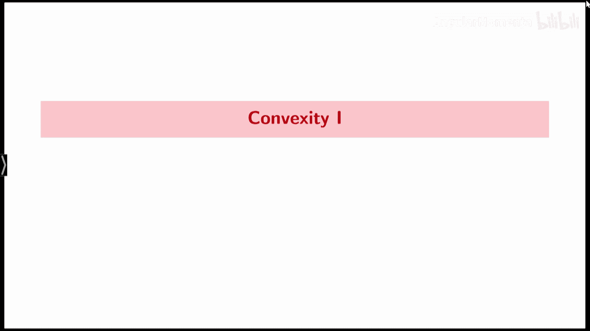
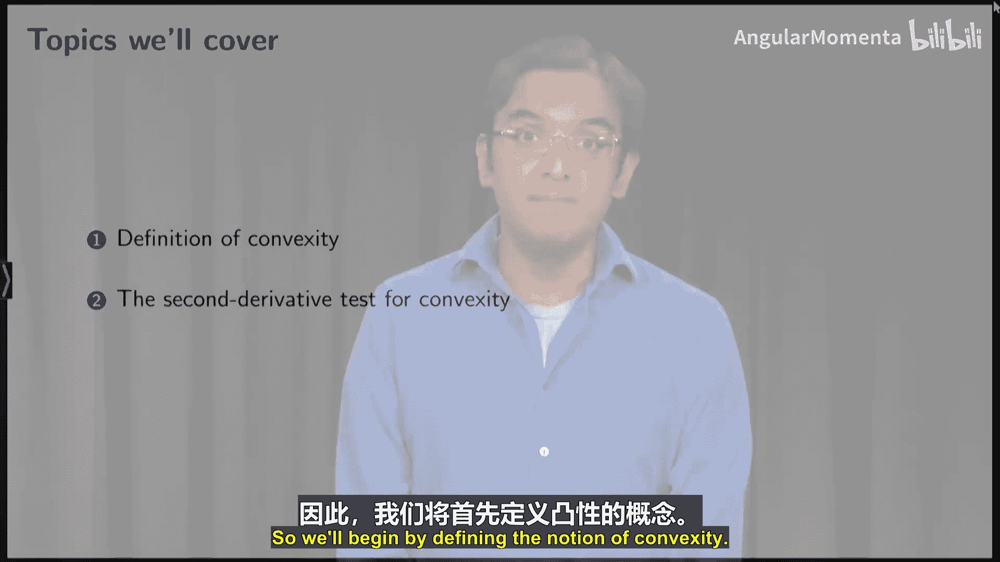
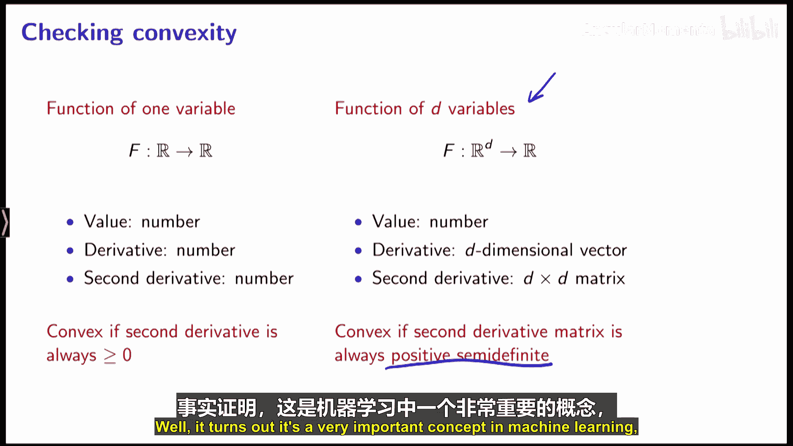

# 【加州大学圣地亚哥分校】机器学习基础  Machine Learning Fundamentals p28 06-04-02-凸性_I -BV1TyFSziEZb_p28-

As we've seen， learning often boils down to optimization。We define a suitable loss function。

 and then we learn parameters by minimizing that function。Now。

 some loss functions are much better behaved than others。

And permit a wide variety of different solution methods。

So it's important to be able to identify these special cases。

The loss functions that are the best behaved of all are those that are convex。

This is a concept that we've been skirting around for a little while。

 and today we'll finally get to focus on it。So we'll begin by defining the notion of convexity。

And then well see that establishing convexity often boils down to looking at second derivatives。

So this is the general situation we' are in。 we have some loss function for our learning problem。

which is basically an equation， a formula of some sort， and we want to know。

 does it look like the picture on the left or does it look like the picture on the right？

Does it have a whole bunch of local optima that we could get trapped in and that are ultimately going to become the focus of the optimization？

Or is it a much nicer situation like the one on the right。

 which is going to be a lot easier to optimize？And will permit us to use a wide range of methods。

So to start with， what is the formal property that makes the picture on the right so nice？

It's called convexity。Let's take a look。So what does it mean for a function to be convex。

 so here's what it means， take any two points A and B， so here's A and here's B。

And look at the value of the function at these points， So f of a。An FF P。

And now draw a line between them。 So we have this green line over here。

What we need is that between A and B， the function should lie underneath that line。

Which is exactly what is happening here。 The function lies entirely underneath that line。Okay。😊。

So for instance， if we were to look at this point over here。Okay。

That point may be two third A plus 1 third B。The value of the function at that point is f of2 third A plus 1 third B。

Okay， so that's this value over here。And the value of the line at that point。

This value over here is one third is two third F of a。Plus， one third F of B。

Now from the picture we can see。That the left hand side is less than the right hand side。

The curve lies under the line， and we need this to be true， not just for two third and one third。

 but for every point between A And D。So in this definition of convexity。

 that's the role played by Theta。Theta is a fraction that goes from 0 to 1。

 and as theta goes from0 to 1， we get all the points that lie between A and B。

 and for every single one of these points， we need the curve for F to lie underneath that line。嗯。Now。

The canonical example of a convex function is perhaps y equal to x squared， it looks like this。

Sometimes we are also interested in functions that look like upside down bolts。

 like y equals negative x squared。That looks like this。That's called a concave function。

 And in general， we say a function is concave if negative of that function is convex as we see in this particular example。

Okay， so we have the definition of convexity， how do we check if a given function is convex？

So this is particularly easy if the function has just one variable。Okay。

 so if we have a function from r to R， so a function of just one variable。

 a quick check that conveg city is to compute the second derivative。

And if it turns out that the second derivative is always greater than or equal to0。

 it means that the function is conbacks。So let's look at this example here。

 let's look at f of z equals z squared， we know this function is convex。

 let's see how this test works out so what's the first derivative。😊，DFDZ。Is 2 z。Okay。

 so that's the first derivative。The second derivative， d squared f dz squared is 2。Okay。

 and that's greater than zero， so the test really does work in this example。

So this is a nice simple test。But the loss functions that we'll typically be dealing with are not functions of just one variable。

What does one do when one has a function of multiple variables。

 how does one check conveyity in those cases？So here is the big picture that's useful to bear in mind。

 when you have a function of just one variable， which is the case over here。

Then the value of the function at any point is a number。

And the derivative of the function at any given point is a number。

 and the second derivative at any given point is a number。

And the function is convex if that second derivative is always greater than or equal to 0。Now。

 let's say you have a function of D variables。In that case。

 the value of the function at any given point is again a number。

But the first derivative at any point is now a D dimensional vector。

And the second derivative at any point， is a D by D matrix。

This function is convex if this second derivative matrix is always positive semi definite。😊，Okay。

 so what does all of this mean？So to start with， why is the second derivative？A D by D square matrix。

 So let's take a look。So we have some function。On D variables。

 so it's a function that maps D dimensional vectors to just some number。

Now we've already talked about the first derivative。

 if you have a function like this with D variables。

 then there are D things with respect to which you can take the derivative。

 so the derivative with respect to the first variable。

 the second variable all the way to the D variable。

 so you can compute each of these individual directives。

 the derivatives and then package them into a vector。

And that's why the first derivative is a Ddial vector。What about the second derivative？

So now we're taking the derivative twice。And for the first time round。

 we have a choice of D variables。 And for the second time， we again， have a choice of D variables。

 So there's a total of D squared options， and we write them together in a D by D matrix。

 And this matrix is called a hessum。😊，So it's a D byD matrix where the JK entry of the matrix is the second derivative with respect to。

The J variable and the K variable Okay， so the matrix looks something like this。It's a D by D matrix。

 and the first entry is the second derivative of F with respect to z1 squared。The second entry。

Is the derivative with respect to Z1 and then Z2。And then the second derivative with respect to Z1。

 and then Z 3。And so on。 And on the next row， the first entry。Is with respect to Z2 and then Z1。

And then the diagonal entry is z2 squared and so on。So for a function of d variables。

 the second derivative is actually a matrix， a D by D matrix。😊，Okay。

 so let's work this out in a specific example， so here we have a function of D variable。

 so let's just write it out in full a function of z1 to Zd。

And the function is just the length of z squared。 Okay， so it's z1 squared plus z2 squared。Plus。

 all the way to Zd squared。Let's compute the second derivatives of this function。 Okay， so first。

 the derivative with respect to ZJ。Well， Zj is only in one of those terms， Zj squared。

 so the first derivative is2 Zj。Now let's compute the second derivative。With respect to Z K and M Zj。

Okay， so we take this thing over here。And now we're going to compute its derivative with respect to Zk。

Okay。So what if k equals J， then the derivative is 2？And if J is not equal to K。

Well the derivative is 0。So the second derivative matrix in this case。Is a diagonal matrix。

So the second derivative matrix at a point C。Looks like this。Along the diagonals， it has twos。

And everywhere else， it's0。 so a concise way of writing this is to say that it's twice the identity matrix。

Okay， so now we know what these second derivative matrices are。Let's go back to our overall picture。

So we're dealing with functions of D variables。The value of the function is a number。

The derivative is a vector， the second derivative is a matrix。

 and the function is convex if the second derivative matrix is positive semi definite。😊。

What does that mean， It sounds mysterious。Well， it turns out it's a very important concept in machine learning。

😊。

And it's what we'll turn to next。But we've done quite a bit for today。 so let's take a break now。

 and when we meet next， we'll talk all about positive semi definite matrices。See you then。

