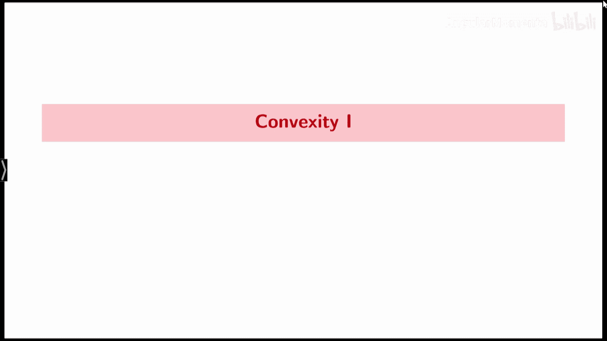
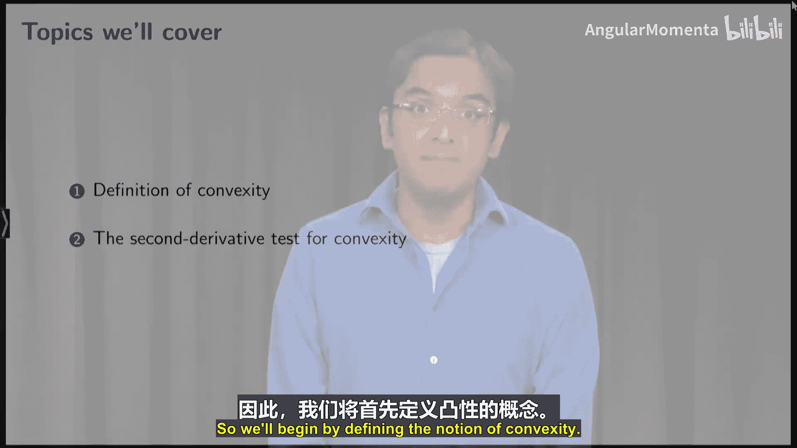
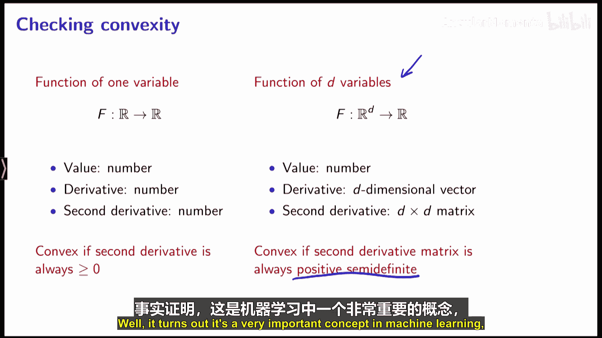

# 机器学习基础：06-04-02：凸性_I

在本节课中，我们将要学习一个在机器学习优化问题中至关重要的概念：**凸性**。我们将了解凸函数的定义，并学习如何通过计算二阶导数来检验一个函数是否为凸函数。

## 概述：为什么凸性很重要？

正如我们所见，机器学习问题常常归结为优化问题。我们定义一个合适的损失函数，然后通过最小化该函数来学习参数。然而，有些损失函数比其他函数表现更好，允许使用多种不同的求解方法。因此，能够识别这些特殊情况非常重要。在所有表现良好的函数中，**凸函数**是最优的一类。这个概念我们已经接触了一段时间，今天我们将正式聚焦于它。

## 凸函数的定义

上一节我们提到了凸函数的重要性，本节中我们来看看它的正式定义。凸性是一种几何性质，它使得函数更容易被优化。

以下是凸函数的定义：取函数图像上的任意两点A和B，连接这两点得到一条线段。如果函数在这两点之间的图像完全位于这条线段的下方，那么这个函数就是凸的。

更形式化地说，对于定义域内的任意两点 **a** 和 **b**，以及任意参数 **θ**（满足 0 ≤ θ ≤ 1），如果以下不等式恒成立，则函数 **f** 是凸的：
**f(θa + (1-θ)b) ≤ θf(a) + (1-θ)f(b)**

这个定义确保了函数图像是“碗状”的，没有局部极小值陷阱，只有一个全局最小值。

## 凸函数的检验：单变量情况

理解了凸函数的定义后，我们来看看如何检验一个给定的函数是否为凸函数。对于只有一个变量的函数，检验方法非常简单。

以下是检验单变量函数凸性的方法：计算函数的二阶导数。如果二阶导数在定义域内**始终大于或等于零**，则该函数是凸的。

让我们看一个例子：函数 **f(z) = z²**。
*   一阶导数：**df/dz = 2z**
*   二阶导数：**d²f/dz² = 2**

由于二阶导数恒等于2，大于0，因此函数 **f(z) = z²** 是凸的。

## 从单变量到多变量：海森矩阵

上一节我们介绍了单变量函数的凸性检验，本节中我们来看看如何处理更常见的多变量函数。机器学习中的损失函数通常是多个参数的函数。

当函数有多个变量时，情况会变得复杂一些。对于一个有 **d** 个变量的函数：
*   函数值本身是一个**标量**（一个数字）。
*   一阶导数（梯度）是一个 **d** 维**向量**。
*   二阶导数则是一个 **d × d** 的**矩阵**，称为**海森矩阵**。

海森矩阵的 **(j, k)** 元素是函数对第 **j** 个变量和第 **k** 个变量的二阶偏导数：
**H[j, k] = ∂²f / (∂z_j ∂z_k)**

让我们通过一个具体例子来计算海森矩阵。考虑函数 **f(z) = z₁² + z₂² + ... + z_d²**，即向量 **z** 长度的平方。

以下是计算其海森矩阵的步骤：
1.  首先计算一阶偏导数：对任意 **z_j**，有 **∂f/∂z_j = 2z_j**。
2.  然后计算二阶偏导数：
    *   如果 **j = k**，则 **∂²f / (∂z_j ∂z_k) = 2**。
    *   如果 **j ≠ k**，则 **∂²f / (∂z_j ∂z_k) = 0**。

因此，这个函数的海森矩阵是一个对角矩阵，对角线元素全为2，非对角线元素全为0。我们可以将其简洁地写为 **2I**，其中 **I** 是单位矩阵。

## 多变量函数的凸性检验

现在我们已经知道了海森矩阵是什么，可以回到核心问题：如何判断一个多变量函数是否为凸函数？

检验多变量函数凸性的关键，在于其海森矩阵。一个函数是凸的，当且仅当它的海森矩阵在定义域内的每一点都是**半正定**的。

“半正定矩阵”听起来可能有些神秘，但它是机器学习和线性代数中一个极其重要的概念。由于我们已经学习了足够多的新知识，现在让我们稍作休息。在下一次课程中，我们将深入探讨**半正定矩阵**的含义及其重要性。

## 总结

本节课中我们一起学习了凸性的基础知识。我们首先了解了凸函数在机器学习优化中的重要性，因为它能保证损失函数具有良好的形状，易于找到全局最优解。然后，我们学习了凸函数的正式几何定义。接着，我们探讨了如何通过计算二阶导数来检验单变量函数的凸性。最后，我们将概念扩展到多变量函数，引入了**海森矩阵**的概念，并指出多变量函数凸性的最终检验标准是其海森矩阵是否为**半正定矩阵**。这是我们下一节课的重点。