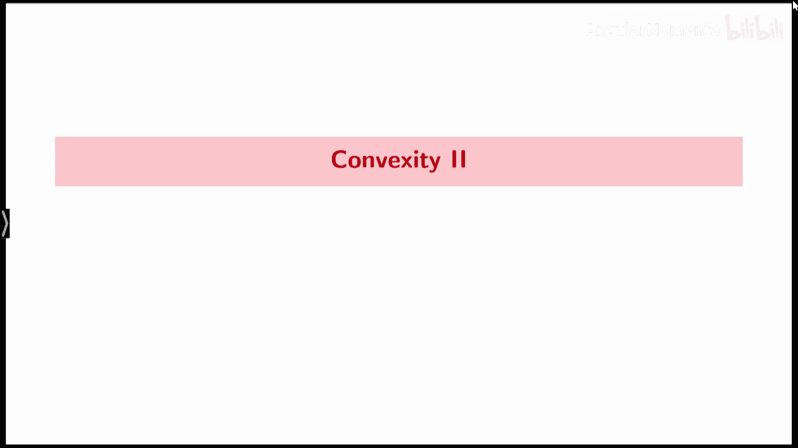
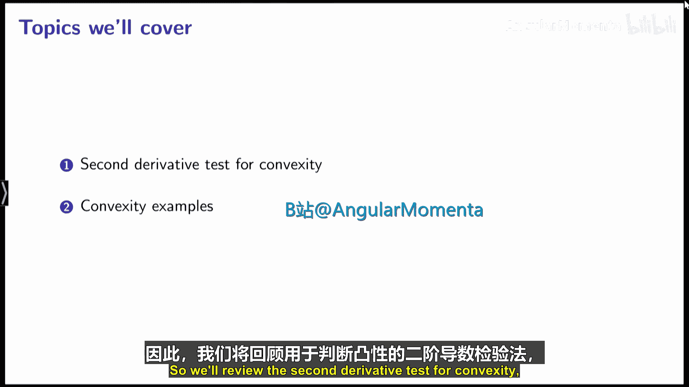
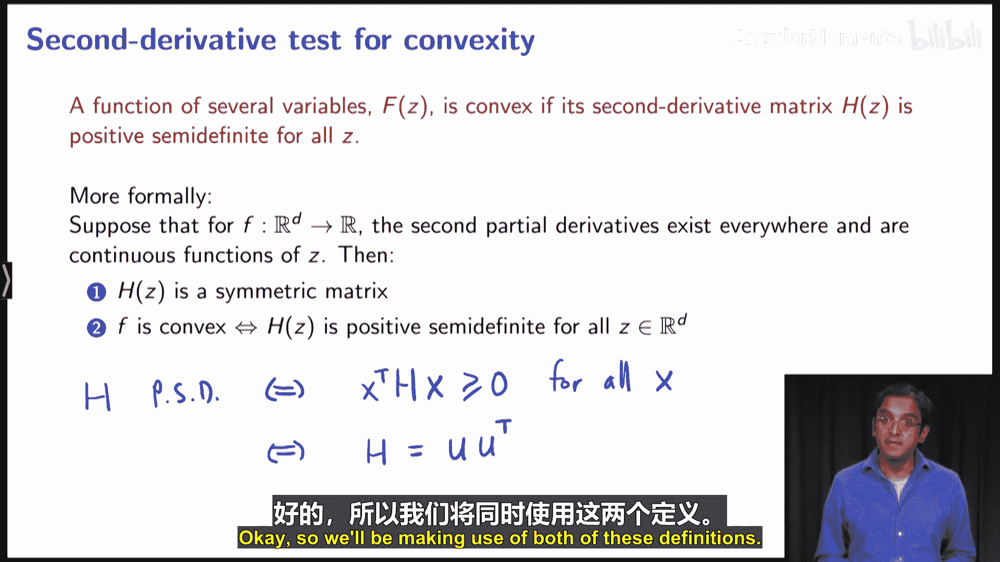
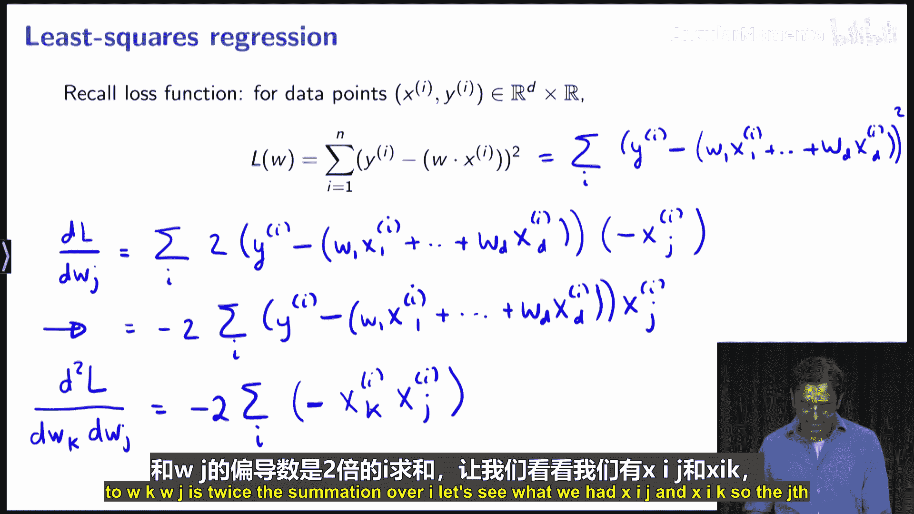
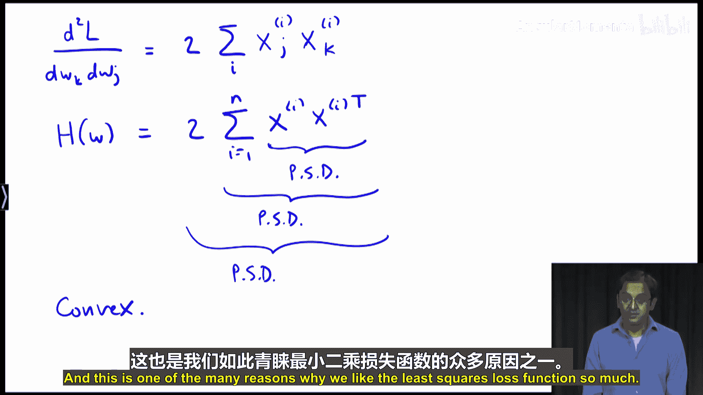

# 【加州大学圣地亚哥分校】机器学习基础  Machine Learning Fundamentals p30 06-06-02-凸性_II -BV1TyFSziEZb_p30-

A lot of machine learning is about minimizing loss functions。And the way you do that depends in part。

 upon whether the function is convex。Today we'll see how we can check that。

So we'll review the second derivative test for convexity。

And then we'll go through a whole slew of examples。

We've already seen what it means for a function to be convex。When we have a function of D variables。

It's convicx if its second derivative matrix， which is a D by D matrix。

 is positive semidefinite at all points so what exactly does this mean？So at any given point。

 the second derivative matrix is a D by D matrix。Its positive semideite。

 a matrix H is positive semidefinite。If。The quadratic function defined by the matrix， x transpose Hx。

Is always greater than or equal to zero。No matter what X you plug in。

We also saw an alternative characterization of positive semidefininite matrices that is somewhat easier to use in many situations。

so a matrix is positive semidefinite， if it can be written in the form U U transpose。

Where you is any al matrix， Okay， so we'll be making use both of these definitions。

So let's look at an example。This function， f of x equals the length of x squared， is it convex？Well。

 the first step is to compute its second derivative matrix， the hessian。

And we actually did that last time， and this turned out to be twice the identity matrix。

Is that positive semidefinite？Well， let's see。What is z transpose times twice the identity times C？

Well， we can pull the two out and we get z transpose times the identity times C。

The identity times z is just C。So this is twice z transpose z。Which is twice the length of z squared。

Which is greater than or equal to zero， so this is positive semi definite。

Another way to see it is that that matrix twice the identity is a diagonal matrix。

 and all the entries along the diagonal are positive， so the matrix is positive semidefinite。Good。

 so F is a convex function， it looks like a bold， and in fact。

 it's the high dimensional analog of our classical convex function， y equals x squared。

I think this is the D dimensional version of exactly the same thing。Let's do another example， okay。

 so here u is any fixed vector in D dimensional space and we define a function。F of C。

 so Z has d variables， z1 to Zd。And F is simply the dot product we've used squared， so it's u1。

 z1 plus u2 z2。All the way to UDZD squared。Is this a convex function， Well。

 let's start by computing the second derivative。 Okay， so first， what is Df。DC。

 what is the first derivative with respect to C subject？When we have something of the form。

Something squared， we first pull down the two。Then we copyied on the whole expression。对。

And then we take the derivative of the inside part with respect to ZJ and that's just UJ。Okay。

 so that's the first derivative with respect to ZJ。And now let's take the second derivative。

With respect to Z sub K。Of this thing。Okay， so we're going to start with this and now we're going to take the derivative with respect to z sub K。

Now， in this whole expression， there's only one term that involves z sub k。Okay。

 and that's the term with UKZK。So the second derivative is just2 UJ UK。

So the second derivative matrix。Is a D by D matrix whose JK entry is twice UJ UK。

One concise way of writing this is to say that the Hassian。At point C is twice U U transpose。

So do you remember this if you have a vector U？Then UU transposeses a D by D matrix whose IJ entry is UIUJ。

 so that's exactly what we need in this case。If so， is this positive semidefinite？

U U transpose this positive semidefinite， it has that special form that immediately identifies as it is being of this type。

 and when we multiply by two， it remains positive semidefinite。Okay， so this is PSD。

And so this function is indeed convex。Okay， those were warm ups。

 let's move on to a somewhat more challenging example。So this， if you will recall。

 was our loss function for least squares regression， so we have a set of data points and data points。

 X Xj where the x' is are vectors in ddisal space。And the wise are the response values， real values。

And we want to find a linear function given by W that minimizes the squared error。Now。

 normally we would also have an intercept term in here， a plus B。But if you recall。

 we had a way of assimilating that into W， so you can imagine that we've already done that and that this is the function we now want to minimize。

Is this a convex function？Well， let's start by computing the second derivative and en route to that the first derivative Okay。

 so our function over here。Is the sum over I of Y I minus w dot X I。 That is w1， X I 1。

Alll the way to WDX。Id。Squared。So the derivative with respect to W sub J。Well。

 the derivative of the sum is the sum of the derivatives。So we can just pull the summation out。

Then we have something of the form U squared， the derivative of that is2 UDU。

 so we bring down the two。And we have Y I。Minus this whole thing over here， W1。

X I1 all the way to WD。Exciing。Okay。And now we take a derivative of just that inside part with respect to WJ。

 so we get negative XIj。Okay， that's the first derivative。

Let's pull the minus2 in front just for convenience。Okay， so we get something like this。WD。X I。

Excell slide， chair。Okay。Now let's take the derivative with Re to W subK。

So we take this expression and we take the derivative of that with respect to WS sub K。

So that's the second derivative。And what do we get？Well， for the term in the middle。

 there's only one term that involves W sub K。So we get negative。😔，X。I k。X， I， J。Okay。

 and so the negatives cancel out and if we just copy this over。

 what we have is that d squared L with respect to Wk Wj。Is twice the summation over eye。

Let's see what we had， X IJ and X IK。

So the J coordinate of the I data point and the K coordinate of the I data point。Okay。

 so this is the second derivative or at least one term of the second derivative matrix。

 what's the entire matrix？Well， this is again， something of that special form。

UU transpose if you remember if you have a vector U。

 UU transpose is a D by D matrix whose IJ entry is UIUJ so this entire matrix over here。

The HessN at W is twice times the sum over i equals 1 to n。Of the I data point。

ET data point transpose okay， this is a D by D matrix over here。So that's the hesian。

Is this positive semidefinite？Well， this particular term here does have that UU transpose form。

 so this is positive semidefinite。Okay。And we've already seen that if you have the sum of positive semi definite matrices。

 that's also positive semi definite。そうです。Is also positive semi deffinite。

And we've seen that multiplying a positive semidefinite matrix by a positive constant again leaves you with something positive semidefinite。

So the whole thing is positive semidefinite， and that means that this is a conx function。Okay。

And this is one of the many reasons why we like the least squares loss function so much。

Okay well that's it for today， I think we have convexity under control now and in fact we have all the tools we need to get started on our next set of classification methods。

See you soon。