# 【加州大学圣地亚哥分校】机器学习基础  Machine Learning Fundamentals p31 07-01-02-一个简单的线性分类器 -BV1TyFSziEZb_p31-

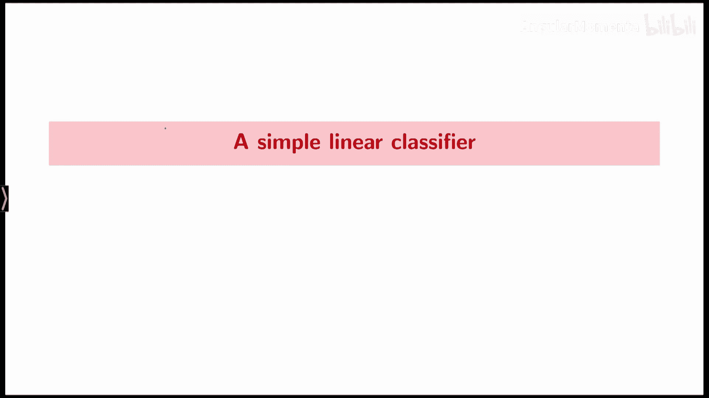

Recently， we've been talking a lot about regression and conditional probability estimation。

And the way we've been approaching these problems is to phrase the learning task as an optimization problem。

 defining a suitable loss function， and then looking at ways to minimize it。

What we're going to do now is to circle back round to classification。

 bringing with us this new optimization centric mindset。So we'll talk about binary classification。

And how it might be solved using a linear separator。

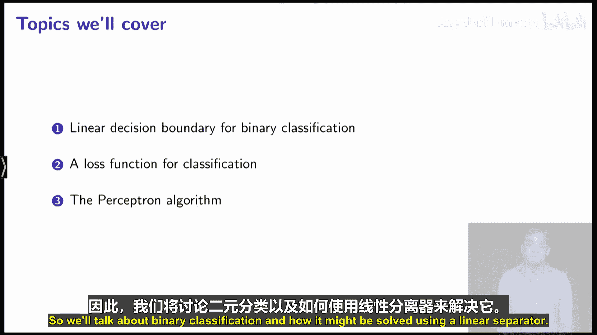

We'll define a suitable loss function for classification。

And then look at a stochastic gradient descent procedure for it。

 and this will yield the perceptron algorithm。Okay， so here is a linear boundary in R2。

What is the equation of this line Okay so let's go ahead and figure this out。 So we have。

 let's call this feature x1。And this feature xs2。The equation of this line is something of the form x2。

Equals the slope times x1 plus the intercept。 Okay， so what is the slope over here。

 it's minus4 hertz。So minus4 herdes x1。Plus。The intercept on the Y axis， which is4。

That's the equation of the line。 Okay， now we'll be writing it in a slightly different way。

 So let's multiply3 by three。 and then this becomes。4our x1。Plus 3 x2 minus 12 equals0。

And we'll always be writing linear decision boundaries in this way in the form w dot x plus b equals0。

 the form w dot x plus b equals0。So that's the equation of this line。

 and that's going to be a decision boundary， points on this side。

 will say are plus points on this side will say are minus。

Now how do we make a prediction on a new point， so let's say we get a new point x。

 maybe this point over here。3，3。How do we predict the label at that point。

 Well we plug it into our linear function。So we have this linear function over here。

We plug in three3。What do we get？We get four times 3，12。Plus 9 minus 12， that's 9。

That's greater than zero， so we classify it as positive。Okay。Let's take another point。

 maybe 11 over here。Let's plug it into our linear function， 4 x1 plus 3x2 minus 12。

 what we we get 4 plus 3 minus 12， what is that that is negative 5 and that's less than0。

 so we classify that point as negative。So the classification rule is very simple。

 When we get a new point， we simply compute our linear function， which is 4 x1。Plus 3 x to minus12。

And then we look at the sign of that。So we take this and we look at its sign。

If it's a positive number， we say the class is plus1， if it's a negative number。

 we say the class is minus1。

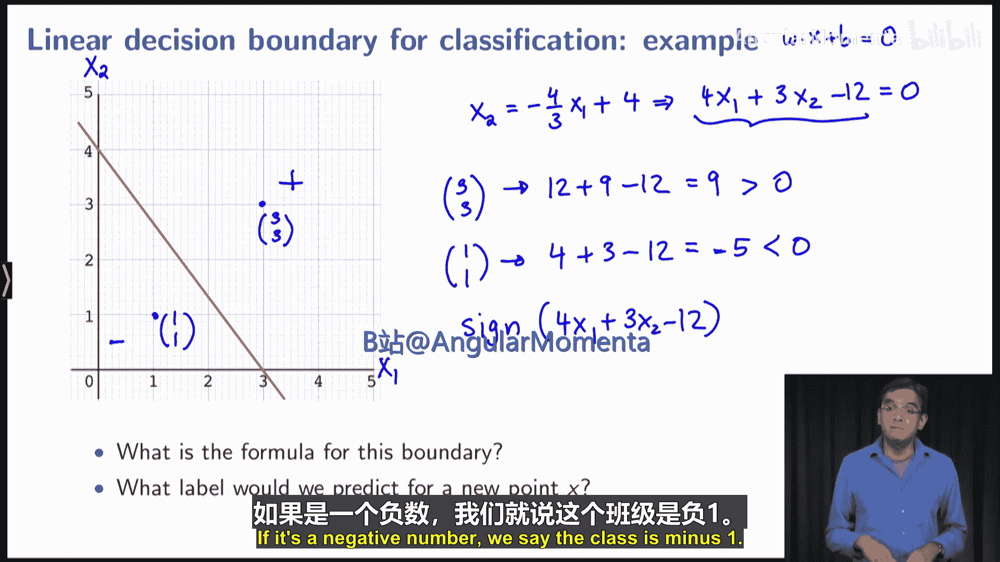

Okay， so in a little bit more generality。

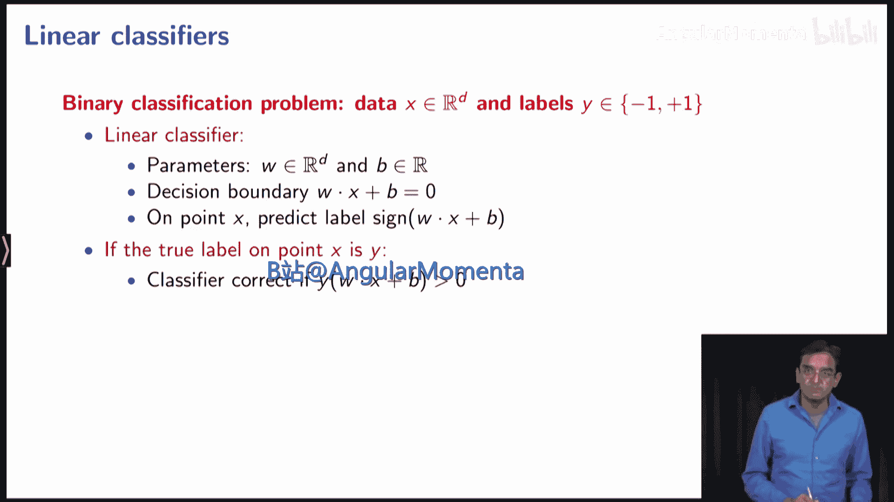

If we have data now in D dimensional space， so point x and Rd。And two possible labels。

 plus 1 and minus1。This is a general setting for binary classification。

And we're going to be looking at situations where we have a linear classifier。

 so there's a decision boundary which is linear， it's of this form w dot x plus b equals0 and here W and B are parameters。

 they're the parameters of the linear function that we have to figure out typically from training data Okay so these are our parameters over here。

And when we get a new point x， and we have to predict its label plus 1 or minus1。

 the way we do it is we compute this linear function， and then we just return its sign。

 we just see whether it's positive or negative， and that's the answer。Okay。

 so when are we correct okay， so let's say we get a new point X Y。When are we correct on that point？

So we're correct。If。The the label of y plus1 or minus1 has the same sign as w dot x plus B。

 so y has the same sign。That's w。t x plus B。And to spell it out even more。

 what that means is that either。Y is plus1？And。W dot x plus b is greater than0。

Let's say to greater10。Or。Yhy is minus1？And w dot x plus B is less than 0。If that happens。

 then we're correct。And now we have two conditions over there。

 We can combine them into a single more concise condition like this。

 We can just say that y times w dot x plus B。Is greater than zero。

Either they are both greater than0 or they are both less than 0。 Okay， so this is a nice。

 concise way。Of writing the condition that we are correct on point X Y and we'll be using this formulation quite a bit more。

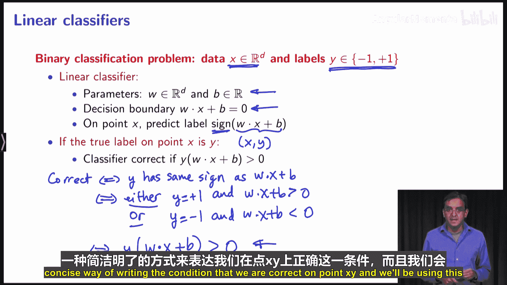

Okay。So now let's come up with a loss function for classification。

So we have some linear classifier given by WB。And we want to know what is the loss incurred by this classifier on a point Xy。

How should we define this loss， should we use square loss or logistic loss。

 what's a suitable loss function okay and there are actually many ways to do this。

 there are many different loss functions for classification that all have their strengths and weaknesses and we'll just look at one particular plausible loss function right now。

Okay。So we have a 0 x Y。Let's say we are correct on that point。

 so y times w dot x plus b is greater than zero。 If we're correct， we'll just say no loss。

 we're correct。Nothing to worry about， okay？On the other hand， if we are wrong。

If y times w dot x plus b is less than0， if y and w dot x plus B have different signs。

 then we are wrong。How much penalty should we incur？

Well one thing we can do is to say that our penalty is the amount by which we are wrong。Okay。

 so what does that mean， So let's say that the correct label is plus one。

And when we compute w dot x plus B。It turns out to be negative 01。So we are wrong， okay。

 because we predict minus。But we're only wrong by a little bit， only by point one。

So we shouldn't feel too bad about it， okay， so in that case we'll think about loss as being just 01。

On the other hand， if y equals plus 1 and w dot x plus v equals minus 6。Then we're pretty far wrong。

 Okay， we also predict minus， but this time we're really far from that boundary。 Okay， we're minus6。

 And so in this situation， we'll say our loss is6。Okay。

So here's sort of a picture of the loss function Okay， so over here。

 I'll draw the possible values of y times w dot x plus B。And we want this to be positive， okay。

 so we'd like this to be on this side at zero。And now let's look at the loss。

I'll draw that on the Y axis。So if we classify the point correctly， then our loss is zero。

 then we lie along this line。No loss at all， we're correct。If we are wrong。

 then our loss looks like this。Okay。Now one notable feature of this loss function is that it's convex Okay why is that Because if you look at any two points on the curve？

And you connect them。The graph， the curve lies below that line， so this is a convex slot function。

Okay， that's something that should in general make us feel good。

But now let's go about trying to find a linear classifier that is minimizing this loss。 Okay。

 and we could do that by gradient descent if we wanted to， but to keep things really simple。

 let's just use stochastic gradient descent。Okay。So the way this is going to work。

 this is a local search method， so we start by setting W andB to any old values。

 let's say we start them at zero。And then we keep updating them。

 so we update W&D a little bit and then we update some more and we keep going in this way。

And in stochastic gradient descent each update is just based on a single data point。

 so we first update on the first data point， then we update on the second data point and we keep going through the data set and when we reach the bottom we cycle back round to the top and then update on the first point second point and so on。

 and what are these updates the update is to take W andmb and then move in the negative direction of the derivative。

Okay， so let's work that out。So we have our current guesses， WMP。Okay。

New data point arrives the next in the list， at some point， X and y。What's our update going to be。

 Well， let's say we actually get x and y correct。 Okay。

 so let's say y times w dot x plus B is greater than0。In that case， the loss is zero。

 and the derivative is zero so there's no update。Okay， that's easy。What if we get it wrong。

 what if times？X plus B has a different sign from y。 In that case。

 the loss that we formulated is minus y times W dot x plus B。

And what is the derivative of this thing Okay， so let's see what is the derivative of this with respect to W？

Well， it's just minus yx。And what's the derivative of this with respect to be。It is just minus y。

And so the stochastic gradient update in this case would be to take W。

And move in the negative direction of the derivative So we take W。And we go plus Yx。

 and we also have a step size eda。And we take B， and we also move in the negative direction。

 so step size times y。That's the stochastic gradient update， very simple。Well。

 there's the matter of this step size， we have to decide what to set a to。

 and let's just keep things extra simple， let's just make it equal to one， so we can get rid of this。

So that's going to be our update。And when we do things in this way， we get the piceptron algorithm。

So here it is。Very simple algorithm， we start W and B and0。

And then we just keep cycling through the data。And if we correct on the next data point。

There's nothing to do if we are wrong on the data point， then we simply take W and add Yx to it。

And we take B and add Y to it。 That's it。 This is literally four lines of code。

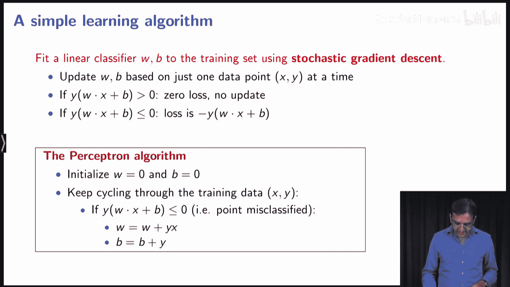

Let's see it at work。So here are 85 data points and they're linearly separable。

 so there really is a line that separates the pluses from the minuses。

 or in this case the red circles from the black triangles。

Let's run the perceptron algorithm on this data set and see what linear separator it finds now usually when you run perceptron or stochastic gradient descent algorithm of some kind。

 one thing that is often done is to begin by randomly permuting the data in case they're in some sort of weird order。

Now， in the case of perceptron， different random permutations can lead to different outcomes。

 so let's just look at several runs。

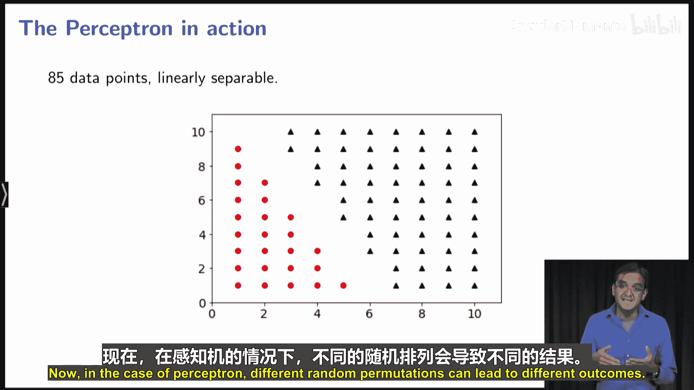

So this is the first one。It found a linear separator that perfectly classifies the data。

And it made nine updates， So what I mean by that is that if to we go back to the algorithm over here。

 this is what I'm calling an update。

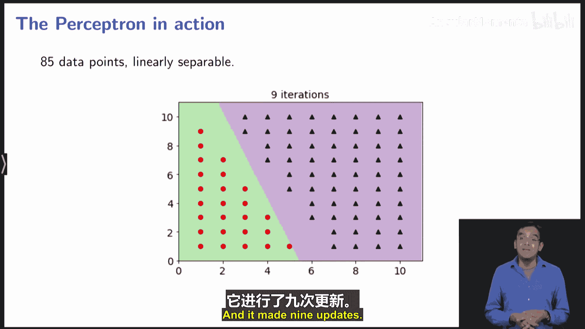

When it gets to a point on which it's wrong， it updates the parameters。

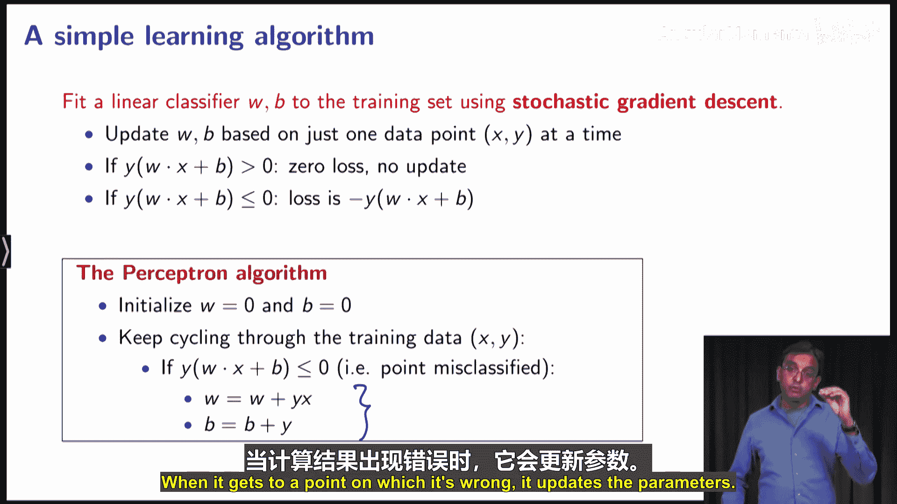

So in this case， it only did nine updates and once it did those nine updates。

It cycled through the data and it was correct on everything it saw， so it stopped at that point。

Here's another iteration， this time it made 15 updates。Another one， this one did eight updates。

Another one， 14 updates。Another one， this one was eight updates。Okay。So here's one question， okay。

 so in this case it did eight updates。What do you think the final value of B was in this case？

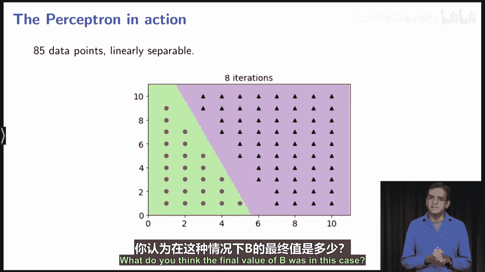

So， let's go back to the algorithm。So B starts out at zero。And each time you make a mistake。

You change B by adding y to it Now Y is e the plus1 of minus1 so each time you do an update B either goes up by one or goes down by one that means that if you make eight updates total。

 the final value of B is an integer。Which is somewhere between minus8 and plus8。Okay。

 so that's something we can infer just from the fact that there were eight updates。😊。

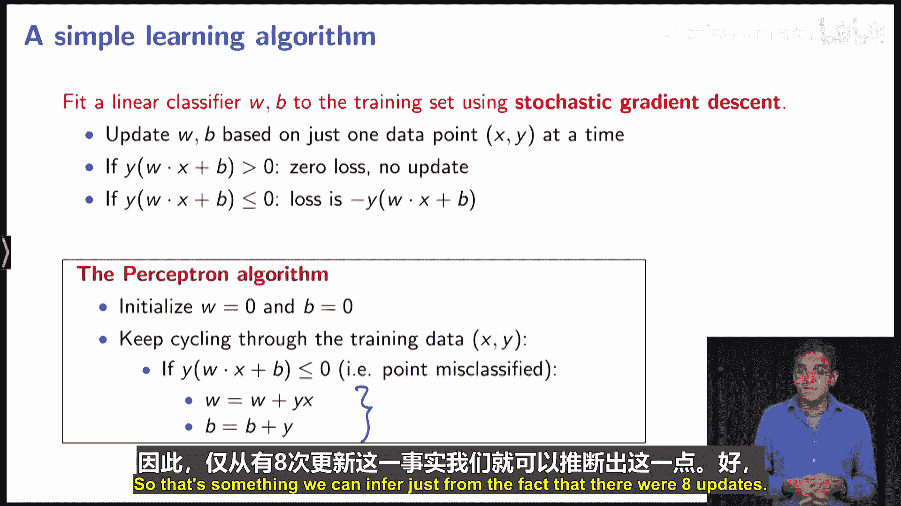

Okay， so we had these multiple different runs， and every single time it found a perfect classifier。

And in fact， this wasn't just a lucky data set。

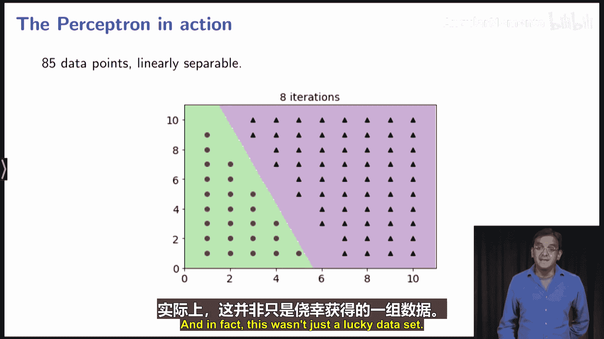

The perceptron algorithm is guaranteed to do this。 Okay， so there's a mathematical theorem。

That says that if the data is linearly separable， in other words。

 if there is some linear boundary that separates the pluses from the minuses。

 then the perceptron algorithm will find such a boundary， it's guaranteed to。

 and it'll converge within a finite number of steps。Not bad。

 a full line algorithm that is guaranteed to always return the correct answer。嗯。Now。

If we have a data set like this， for instance， here we have eight points。

 what this theorem is telling us is that the final answer is going to be some separator like the ones shown。

 okay， something that separates something that really does separate the reds from the blues。Now。

 one thing one might think at this point， you know。

 now that we've now that we have this under control， you know。

 maybe we can get a little bit greedy and say， well， maybe these are not all equally good。

 Can we get something that's more central， You know， maybe something that's right in the middle。

And that's exactly the question that we'll tackle next time okay so for now that's it。

 we have seen the perceptron algorithm and we derived it by formulating a loss function and looking at the stochastic gradient descent algorithm for that loss function and the result is a four line algorithm that any of us could code up in five or10 minutes。

 it's one of the real gems of machine learning。😊。

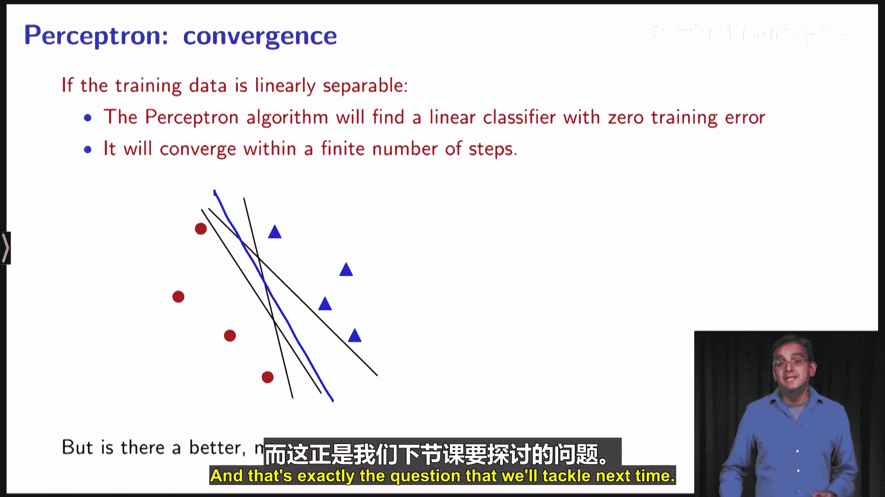

See you next time。