# 机器学习基础：07-01-02：一个简单的线性分类器 🧠

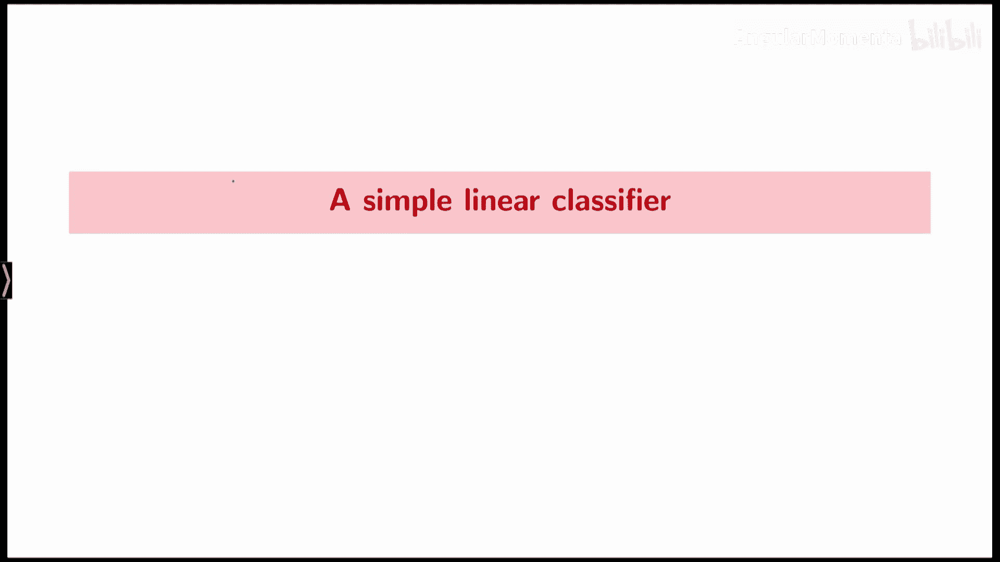

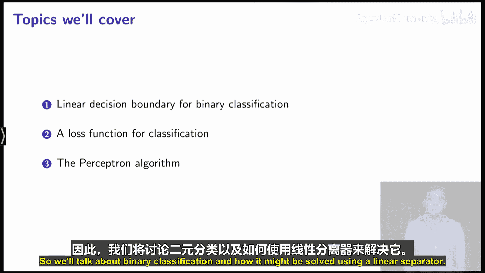

在本节课中，我们将学习线性分类器的基本概念，并推导出一种名为感知机（Perceptron）的经典算法。我们将从回归和概率估计转向分类问题，并采用以优化为核心的视角来构建解决方案。

---

## 线性决策边界 📏

上一节我们讨论了回归和条件概率估计。本节中，我们来看看如何将学习任务构建为一个优化问题，并应用于分类。

一个线性分类器通过一个线性边界（决策边界）来分隔数据。在二维空间中，这个边界是一条直线。其方程可以表示为：

**公式：** `w · x + b = 0`

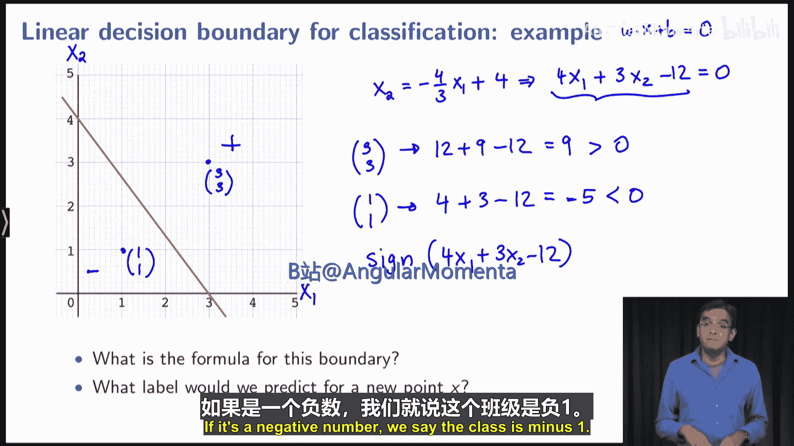

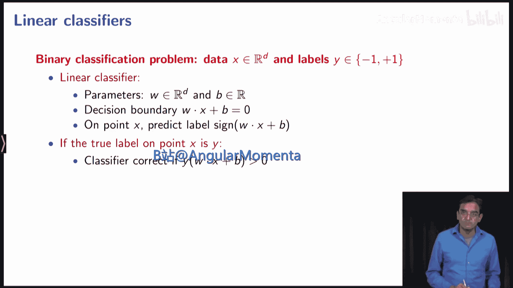

其中：
*   `w` 是权重向量。
*   `x` 是特征向量。
*   `b` 是偏置项。

对于一个新数据点 `x`，我们通过计算 `w · x + b` 的值并取其符号（正或负）来进行预测。

**预测规则：**
```python
if w · x + b > 0:
    prediction = +1
else:
    prediction = -1
```

---

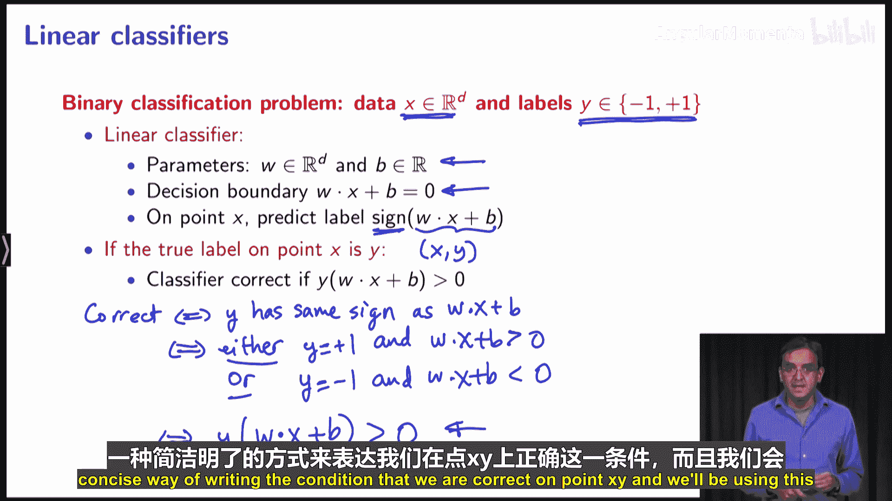

## 分类的正确性条件 ✅

对于一个带有真实标签 `y`（取值为 +1 或 -1）的数据点 `(x, y)`，我们的分类器何时是正确的？

以下是判断条件：
*   当 `y = +1` 且 `w · x + b > 0` 时，分类正确。
*   当 `y = -1` 且 `w · x + b < 0` 时，分类正确。

我们可以将这两个条件合并为一个简洁的表达式：

**公式：** `y * (w · x + b) > 0`

如果该乘积大于 0，说明预测标签与真实标签符号相同，分类正确。

---

## 定义分类的损失函数 📉

为了训练分类器，我们需要定义一个损失函数来衡量预测的错误程度。对于分类问题，有多种损失函数可供选择。

我们这里采用一种直观的损失函数：
*   如果分类正确（即 `y * (w · x + b) > 0`），则损失为 0。
*   如果分类错误（即 `y * (w · x + b) < 0`），则损失为 `-y * (w · x + b)`。这个值越大，说明我们错得越离谱。

这个损失函数是凸函数，这有利于我们使用梯度下降等优化方法找到最小值。

---

## 随机梯度下降与感知机算法 ⚙️

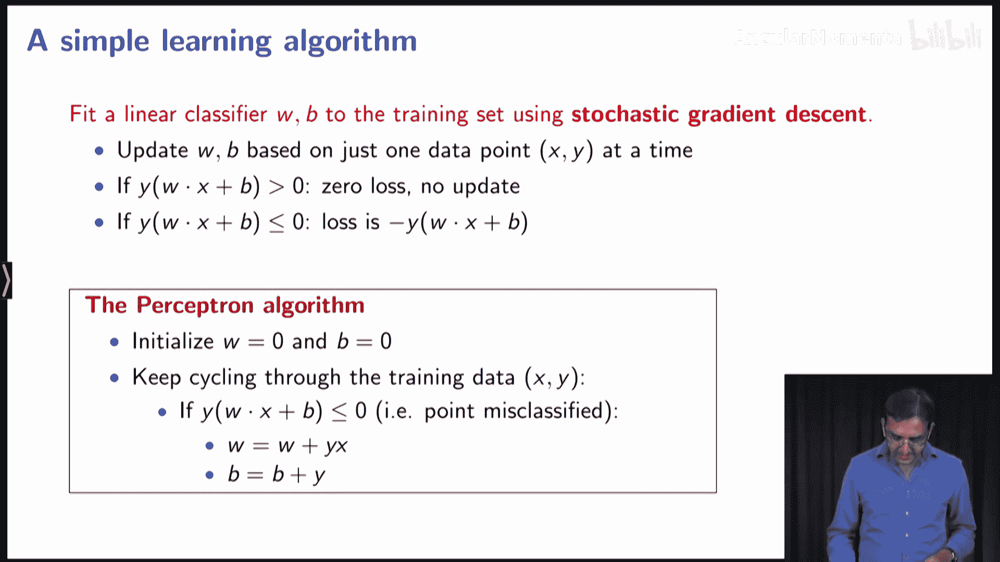

现在，我们希望通过最小化上述损失函数来找到最优的 `w` 和 `b`。为了使过程简单，我们使用随机梯度下降（SGD）方法。

以下是更新规则：
1.  初始化 `w = 0`, `b = 0`。
2.  遍历数据点 `(x, y)`。
3.  如果 `y * (w · x + b) > 0`（分类正确），则参数不变。
4.  如果 `y * (w · x + b) <= 0`（分类错误），则按以下规则更新参数：
    *   `w = w + y * x`
    *   `b = b + y`

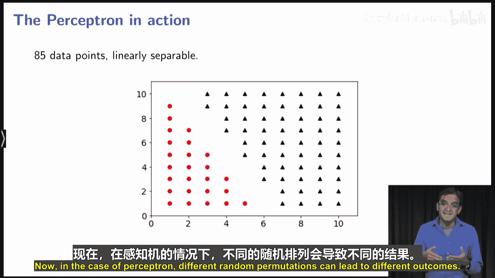

这个极其简单的更新规则，就是著名的**感知机算法**。

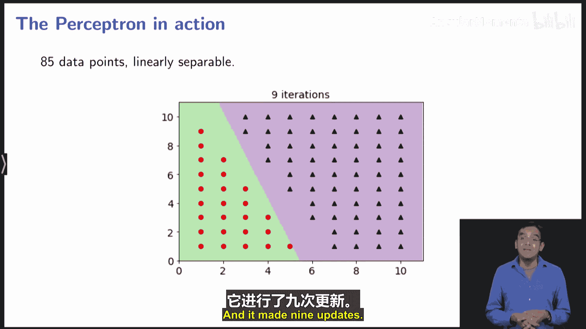

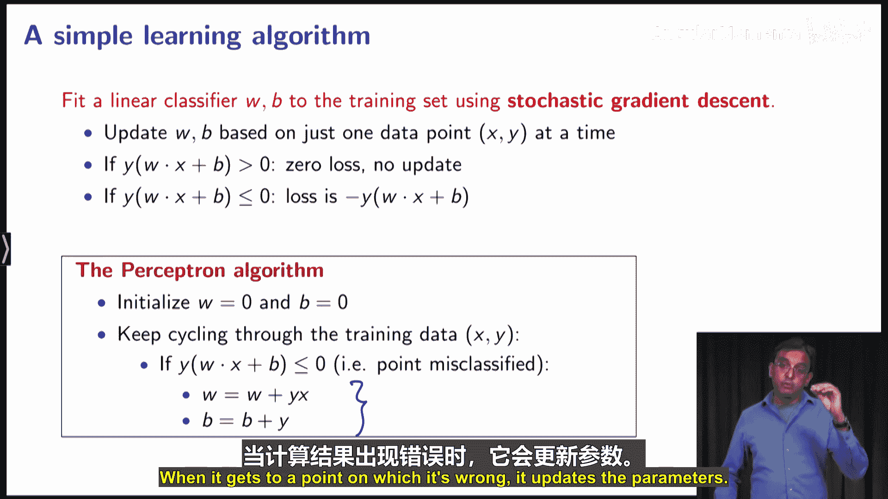

---

## 感知机算法的特性与保证 🛡️

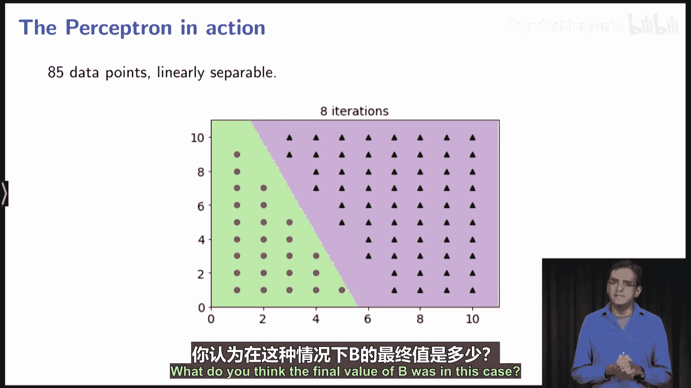

感知机算法虽然简单，但有一个重要的理论保证：**如果训练数据是线性可分的**（即存在一个超平面能完美分开两类数据），那么感知机算法**保证能在有限步内收敛**，并找到一个完美的分类器。

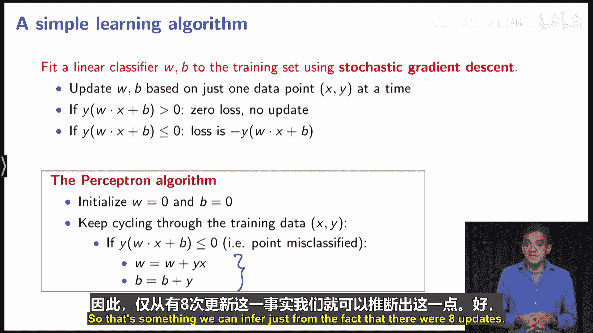

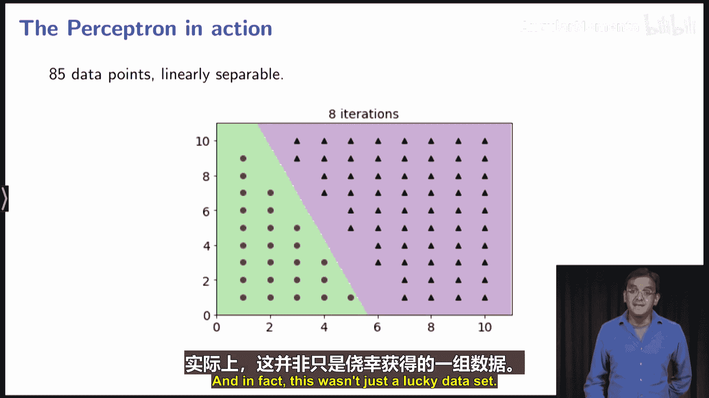

在实际运行中，算法对数据点的遍历顺序可能敏感，但最终总能找到一个解。每次参数更新（即发生分类错误时）都会使分类器向正确方向调整一步。

---

## 总结 🎯

本节课中我们一起学习了：
1.  **线性分类器**的基本形式：`w · x + b = 0`。
2.  分类正确的条件：`y * (w · x + b) > 0`。
3.  为分类问题设计了一个简单的**凸损失函数**。
4.  通过对该损失函数应用**随机梯度下降**，推导出了简洁优雅的**感知机算法**。
5.  了解了感知机算法的核心特性：对于线性可分数据，它能保证找到完美解。

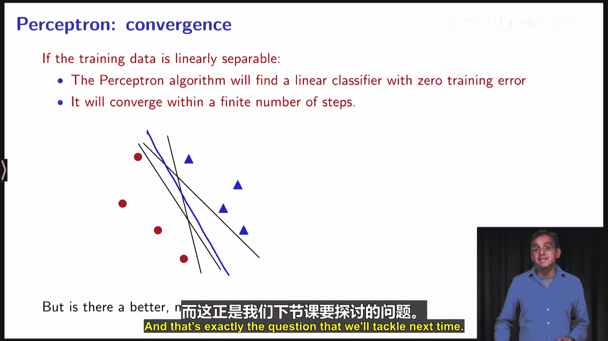

感知机算法是机器学习中的一颗明珠，它用寥寥数行代码就实现了一个强大的学习原理。下一节，我们将探讨如何在线性可分的数据中找到那个“最理想”或“最安全”的决策边界。