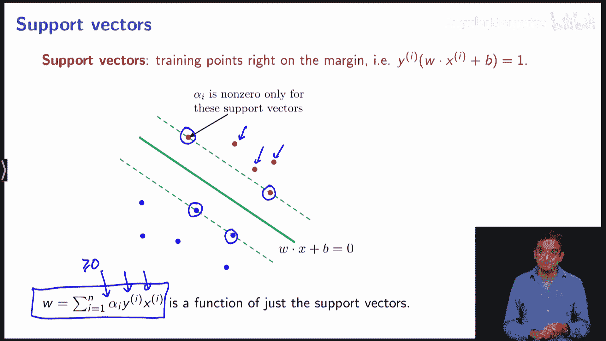
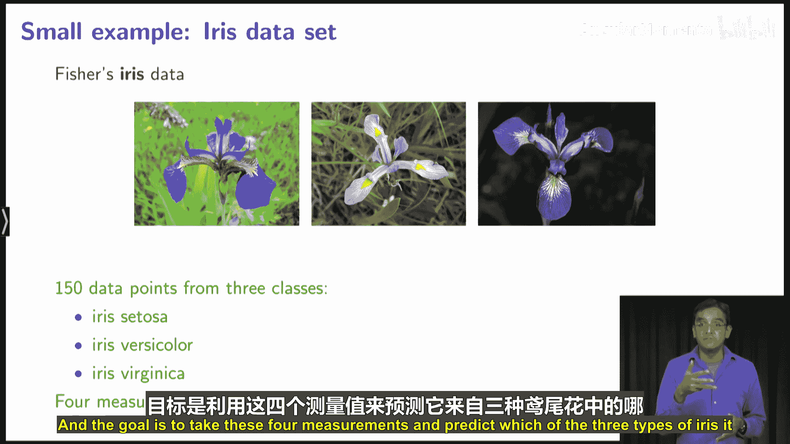
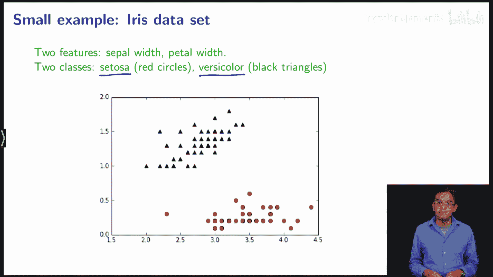
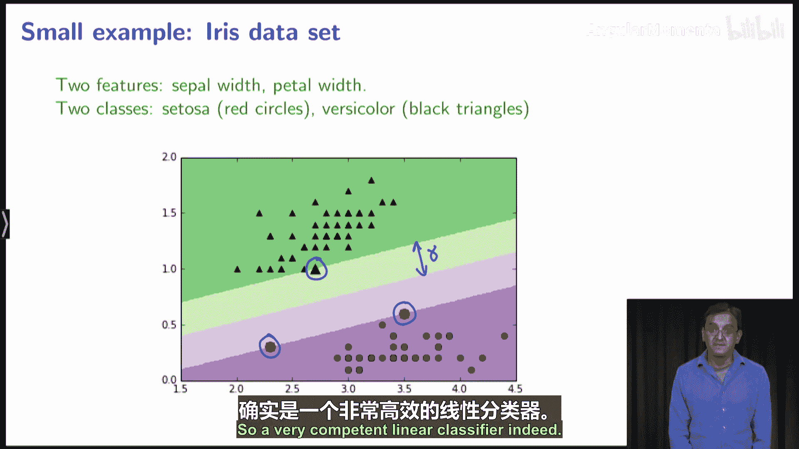

# 【加州大学圣地亚哥分校】机器学习基础  Machine Learning Fundamentals p32 07-02-02-支持向量机_I -BV1TyFSziEZb_p32-

Today， we will study a fantastically competent linear classifier。

 It is called the support vector machinech。So we'll begin by talking about the margin of a linear classifier。

And then we'll formulate the problem of finding the linear classifier that has the largest margin possible。

This will turn out to be a convex optimization problem。

 which means that it's actually pretty easy to solve and will turn out that the solution has a unique property。

It only depends on a few of the training points， which we call support vectors。

 and this is why the method overall is called a support vector machine。Okay。

 when we were talking about the perceptron algorithm。

We mentioned that there is this convergence theorem。

Which says that if a data set is linearly separable， then the perceptron algorithm。

 those four lines of code are guaranteed to find a linear classifier that perfectly separates the training set。

So in this picture， for example。It'll return something。That could be one of these lines or。

Maybe this one or maybe this one， something like that。

But what if we want the linear classifier that is the most central？Maybe something like this。

The classifier that has the most。Buffffer around it， for example。How would we even formulate that。

 what does that mean？So let's take a closer look。Okay， so the setting is that we have。

Training data say npoint x1 through XN。These are some dedial vectors。

 and we're looking at binary classifications， so each point has its label y。

 which is either plus1 or minus1。Now we want to find a linear classifier， so we want to find W and B。

That perfectly classifies this data okay so if y is plus1 w dot x plus b should be positive。

 if y is minus1， w dot x plus b should be negative and last time we saw that a concise way to write this is to simply say that y times w do x plus B should be greater than zero either they both greater than zero or they're both less than0 okay and we want this condition to hold for every one of the n training points。

Now， in order to start talking about margins， what we're going to do is to take this condition and reformulate it just a tiny bit。

We'll write it like this。Instead of asking that y times w dot x plus b be greater than 0。

 we ask that it be greater than or equal to 1。Okay， why can we do this？

It seems like a stronger condition， Certainly if y times w do x plus b is greater than or equal to 1。

 then it's greater than zero。So it certainly implies that。But it seems like it's something more。

 it seems like it's requiring more。And。It's actually not。If you can solve this。

If you can find W andB that solve that， you can also find WnB that solved this and let me explain why okay so let's say you manage to find a WnB such that for all the training points y times w do x plus B is greater than zero so let's look at what these values actually are maybe for the first training point is 3。

2。Something greater than 0， maybe for the next training point it's 1。6， maybe for the next one is 0。

1， maybe for the next one it's 2。3。And all the way to the endth point， maybe it's 1。0。

So we have these n different numbers and they're all greater than zero。

Let's look at the smallest of them。Let's say it's this one and let's call it epsilon。

Now if we take W and B and we multiply them by one over epsilon。

You can just scale them up by a factor 1 over Epsilon。

Then w dot x plus B also gets magnified by  one over epsilon in this case by 10。Okay。

 so the first number will become 32。And the next number will become 16。

 and the next number will become1， and the last one will become 10。And in this way。

 all the numbers become greater than are equal to1。 Okay， so if you can find W and B。

Such that y T dot x+ b is greater than0。Then by simply scaling up W and D。

 you can get the second condition as well。 you can make all of these values be greater than or equal to1。

 Okay， so this is the condition we'll be working with。

 This will be our linear separability condition。Okay， that makes sense。

 but why did we actually do this， how did this help us to rewrite our condition in this way？Well。

 it will turn out。That if we write our separability condition in this way。

 it's very easy to come up with a nice formula for the margin and let's see what that is。Okay。

 so now we're going to have some decision boundary， w dot x plus b equals0。

 and that's the thick green line in the middle。What is w dot x plus b equals1？

That is a parallel hyperplane， and it's shown by the dotted line over there。

And what's w dot x plus b equals minus1， that's another parallel hyperplane on the other side。

So in this condition over here， in our separability condition。

 what we are insisting is that all the positive points， in this case。

 the blue triangles have to be to the right of the right hyperplane。

And all the negative points in this case， the red circles have to be to the left of the left hyperplane。

Okay， so not only do they have to be on the correct side of the boundary。

 but also there should not be any points in that middle buffer zone。Okay。

And the margin is the width of the buffer zone for which I'm using the Greek letter gamma。

That's the margin， and that's the thing we want to maximize。嗯。

Now it turns out that there's a simple formula for the margin。

 the margin is simply one over the length of W。Why is that？Well， you can just take my word for it。

 it's just a simple geometric argument， you don't need to know what it is。😊，In case you're curious。

 I'll just give you a quick hint， okay。So。Let's look at our right hyperplane and look at any point z on it。

 okay， so the point lies on the hyperplane so we know w dotc plus b equals 1。

Now we also know that if we move gamma units。In this direction， we land on the decision boundary。

What is this point over here， What is this point gamma units in that direction， Well， it's Z。

Minus gamma。In the direction of W。Okay。Actually， W might not be a unit vector。

 so we have to normalize it to make it a unit vector。 and if we do that。

 then we end up with that point。Now， since that point lies on the decision boundary。

 we know that W dot that point。Plus， B。Equals0。And when we solve these two equations。

 we get our formula for the margin。Okay， at any rate， we now know what the margin is。

It's1 over the length of W。And since we want to maximize the margin。

 what we need to do is to simply minimize the length of W。

So this is the optimization problem we want to solve， we have our end data points。

We want to perfectly classify all of them， that's this condition over here。

And while perfectly classifying those points， we also want to maximize the margin。

So we want to minimize the length of W or equivalently minimize the length of W squared。

 so this is an optimization problem that we want to solve in which the things we are solving for are W and B。

So how do we solve this problem？Well， the nice thing is that this turns out to be a convex optimization problem。

Now， soon， maybe in a couple of lectures， we'll define exactly what this means。

But for the time being， the reason it's a convex optimization problem is because the thing we are minimizing is convex。

 we know the length of W square is convex， that's one of the examples we saw。

And all the constraints are linear functions of W and B。

So when you have a convex thing that you're minimizing and all the constraints are linear。

 that's a convex optimization problem， and it means that it's pretty easy to solve。

 you can just hand this over to some standard package and it'll give you back the answer。

Now there's a second benefit of convex optimization。

 which is not only can you solve the problem efficiently。

But you can use the theory of duality to also tell you a little bit about what the answer looks like and this also I'm sure sounds somewhat mysterious andll it's also something we'll talk a little bit more about later on。

But let me tell you what dualy theory tells us。It tells us that the solution is of a particular form。

 the solution looks like this。It is the sum overall data points of the data point。Times its label。

 which is plus1 or minus1 times。Some coefficient。Which is greater than equal to0。Okay。

 so for each day to point there some coefficient alpha a I。And the solution W。

 the optimal W is just a linear function of this form。

 alpha I times the label plus 1 minus1 times Xi。Now， the remarkable thing。Is that。

Most of these alpha I's may well be zero。Okay。The only alpha Is that are going to be non zero are for the points。

 the data points that lie exactly on the margin。In this data set， there's just four of them。

These are called the support vectors。No。For all the other points。The coefficients alpha I will be 0。

So in this case， in this example， W will be a function just of the four support vectors。

 the four data points that I've circled。Okay， so you could have a data set of a million points。

But if there's just a hundred of them that lie on those margins。

Then the final answer is a function just of those hungry points。

Okay， let's see a quick example of the SVM at work。

And this is a very famous data set called the IIS data。So it consists of measurements of 150 flowers。

😊，Which are all irises of three different types， there's Iis sattoa， Iis Vererssic color。

 and Iis vena， there's 50 of each， so 150 points total。And for each flower。

 four measurements were taken。Pedal length and width。And the sepel length and width。

And the goal is to take these four measurements and predict which of the three types of iris it comes from。

So here's a plot of the data， since we're doing binary classification。

 I just pulled out two of the three classes， so I pulled out Satosa and Versy color。

The Satoa are shown by red circles， versy color are shown by black triangles。

 these are the two classes， and for visualization purposes although there are four features I just pulled out two of them okay so we'll just use two of the features。

 the widths of the sepals and petals。So you can see the data set， is it linearly separable。

 it certainly is， so if we were use the perceptron algorithm。

 it would indeed find a classifier that was perfect on the training set okay。

But let's see what the SVM does。This is where it returns。A very nice linear classifier。

 the one right in the middle， okay。So this linear classified depends。

On just these three training points， it's a function of just those three support vectors。

And the margin。Is this distance over here， this gamma。

And this is the largest margin possible on this data。So a very competent linear classifier， indeed。

Okay， well that's it for today， we've got our first glimpse of the support vector machine。

And what we did today was to focus on the case where the data is linearly separable。Now， in practice。

 this is usually not the case or at least fairly often not the case。

So what we'll do next time is to look at the case of arbitrary data and it'll turn out that this same methodology extends very easily to that more general setting。

So see you next time。