# 【加州大学圣地亚哥分校】机器学习基础  Machine Learning Fundamentals p33 07-03-02-支持向量机_II -BV1TyFSziEZb_p33-

Last time we introduced the support vector machine。Give me a training set。

This finds the linear classifier with the widest margin by solving a convex program。

It works beautifully， but it's only for data that is linearly separable。

 that is data for which there truly is a linear classifier that perfectly separates the pluses from the minuses。

In practice， this is often not the case， so what we'll do today is to look at another version of the support vector machine called the soft margin SVM。

This can deal with any type of data。

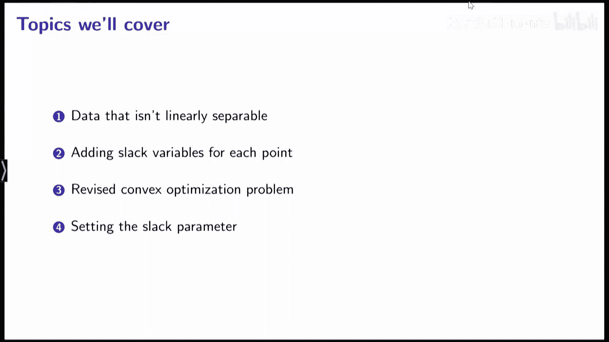

So we'll see how the situation of nonseparable data。

Can be handled quite easily by introducing new Slack variables into the convex program。

We'll then look at how this works in practice and at some of the issues that arise。

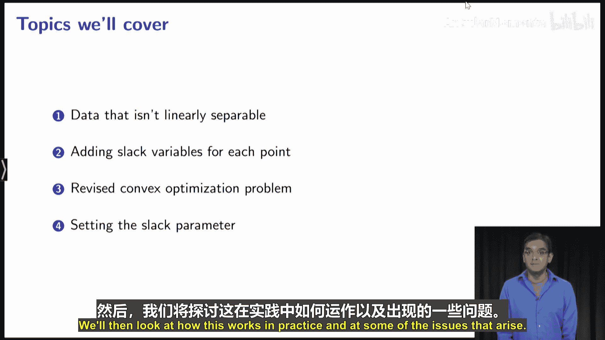

Okay， so here is the situation from last time。We have a data set， a training data set of endpoints。

 x1 through XN， and each point has a label， y1 through YN， these are plus1 or minus1。

 it's a binary classification task。The support vector machine。

Finds a linear classifier by solving a convex program， this program over here。

 So it looks for a linear classifier given by a vector W and an offset beat。And this program。

 this conx program， contains n linear constraints， these constraints over here。

 one for each data point。What the constraint says is that that data point has to be correctly classified。

Now， subject to these constraints， the program additionally wants to find the classifier that has the widest margin。

 and as we saw， this is the same as minimizing the length of W or equivalently the squared length of W。

嗯。Now this is a convex program which means that it can be solved efficiently and there are packages that will just do this for us。

 we don't have to worry about the algorithms behind it Moreoverover， the solution。

 the W that arises in the end is of a very nice form。

It's a linear combination of the data points of the X's。And more。

 this linear combination only uses some of the data points。

 the ones that happen to lie exactly on the margin。These are the support vectors。Okay。

So this is a very nice picture。 This is all very well。

 but this only works if data is linearly separable。 And the question is。

 what happens in the nonseparable case。 For instance， suppose there were a blue point over here。😊。

If we had that， then there would be no linear classifier that could perfectly classify the training data。

 so we would not be able to satisfy all of these constraints。We'd have to give up on some of them。

How do we do that？

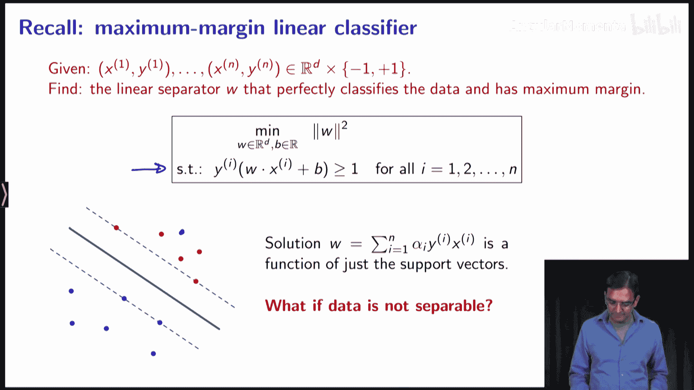

It turns out that a very simple way of doing this is to introduce new Slack variables and let me explain what that means。

 so previously for each data point I， we insisted that Yi times w。t Xi plus B。

Be greater than or equal to one。That was a hard constraint。

Now we are in general not going to be able to satisfy all any of these constraints。

So what we'll do is we'll allow some of these constraints to be violated。

And we will introduce a new slack variable。 pciabi。 This is the Greek letter，si。

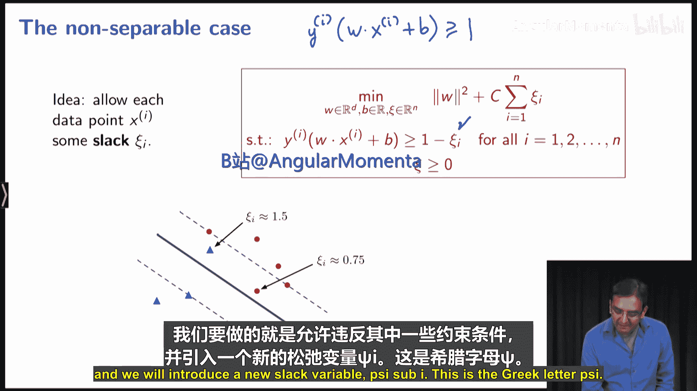

We'll introduce these variables one per data point。And they capture the extent of the violation。Okay。

 so for data point I， we would ideally like y times w。t x plus B。To be greater than or equal to one。

But we'll allow it to be violated and size of I tells us how large violation we have on that particular point。

Now the thing we want to minimize is the same thing as before W squared because we want a white margin。

But at the same time， we want to make sure that too many constraints aren't violated。

 so we also add in the sum of thess， the overall extent to which the constraints are violated。😊，嗯。

So to understand these slack variables a little bit more。

 let's look at this picture so here we have a decision boundary， w。 x plus B equal0。😊。

The margin on this side is w dot x plus b equals 1。

And the parallel hyperplane on the other side is w dot x plus b equals minus1。

The margin in this case is this distance over here。And as we sold before。

 this distance is just1 over the length of W。So that's all the same as last time。

 but what's different now is that the points aren't all exactly where we would like them to be Okay。

 look at this point， for instance。😊，It's on the correct side of the boundary。

 it's on the red side of the boundary， but we want it to be to the right of this margin。And it's not。

 it falls a little bit short。For that particular point， we would ideally like w。

xii plus B to be greater than or equal to 1。But it's not， it's actually equal to something like 0。25。

So we make up that difference using the Slack variable。

The slackck variable on that particular point is therefore 0。75。

 the difference between the actual value of y times w do x plus B and what we would like it to be。

Now let's look at this point。This point is actually on the wrong side of the boundary。

 It's on the red side of the boundary。 Okay， so it's very far from where we want it to be。

 We want it to be all the way there。So what is the slack variable on that？

There's a slack of 1 just to get to the boundary and an additional slack of about 0。5。

 so the slack variable on that point will be something like 1。5。

Now in this picture those are the only two data points on which any slackla at all is used。

 the other ones are just fine， they're where we want them to be and so the total amount of slack that we've used。

 which is the sum of these psi I's from I equals 1 to n。Is in this picture， just。75 plus 1。5， so 2。

25。Okay。So let's see this at work。

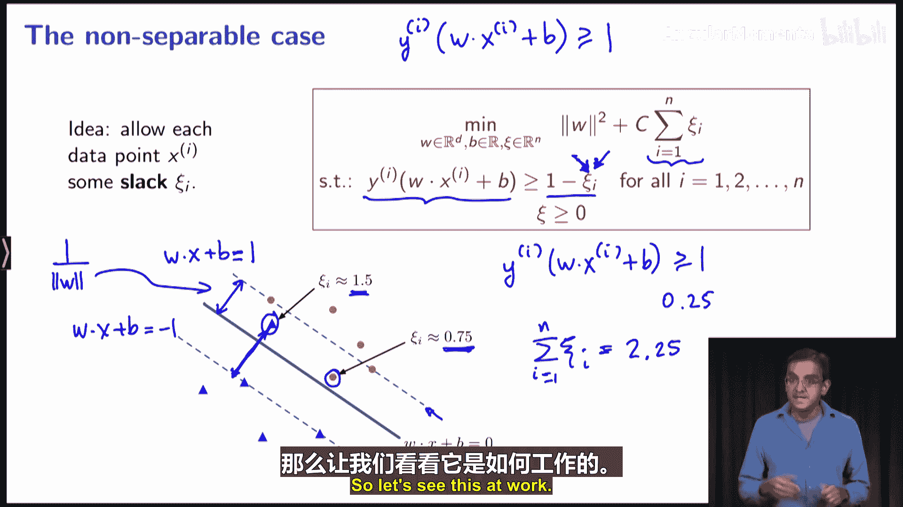

So this is the winery dataset from a few weeks ago， if you don't remember it that's fine。

 all that matters here is that it's a two dimensional data。

 it's got two classes over here shown as red and black and it's not linearly separable okay there's no linear separator that will separate the red and blacks。

So let's see what the soft margin support vector machine does on it。

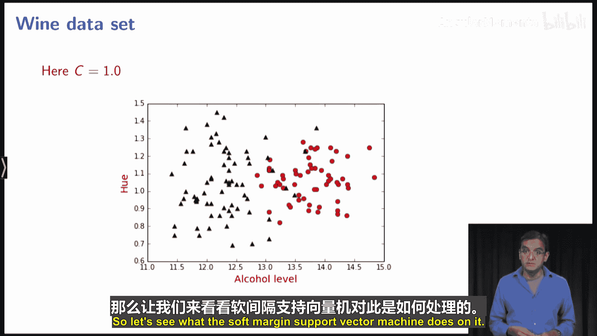

Here's the result。Not too bad。Okay， it's found a reasonable boundary。

The points that I've shown in bold are the support vectors。

They now include any point that's actually on the margin like that point。

As well as any point that's not on the right side of the margin so that includes all the points that are in the middle。

 as well as these points over here that are far out。

 so in this picture there are quite a lot of support vectors。But it seems to be working fairly well。

Now over here， I've said that c equals 1。0。

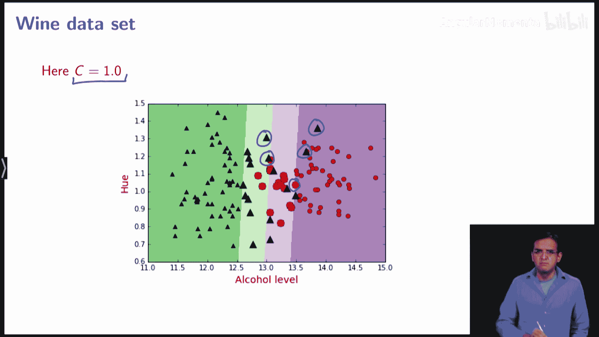

What is that， what is the C over here Well let's go back and look at the convex program Oh here's the C that I'm referring to。

Okay what is that thing？Well， the two things we're trying to minimize。

 we're trying to minimize the length of W because we want a large margin。

And we're also trying to minimize the total amount of slack。The sum of the S eyes。

This is because we don't want too many constraints to be violated。

So the two things we're trying to minimize， and there will inevitably be a trade off between these two things。

So C is a constant that manages that trade off， it's something that we have to say appropriately。

So to understand the effect of C， let's look at the two extremes。

 let's look at when C is as small as possible， when C is0。

And the other extreme when C is really large， when C goes to infinity。

And let's see what happens in each case。Okay， so what happens when c is zero， when c is0。

 this second term basically vanishes。It says that Slack is free， we can use as much slack as we like。

 there's no charge for it。We can go ahead and violate as many constraints as we like。

 we can make thoses eyes as large as we like， it's all free。

The only thing we want to do is to minimize the length of w， so what are we going to do。

 we're going to set w to zero。Okay。Now let's look at the other extreme。😊，If c equals infinity。

 that means that slack is infinitely expensive。If we use even a tiny amount of slack。

 the cost for it is infinity。So we're not going to use any Slack at all。

 which gets us back to the previous hard margin SVM。

We're going to have to classify every point perfectly， no slackck allowed。Okay。Now， of course。

 we're going to pick some number between these two extremes。

And let's see a small example of how this panto。So this is the IIS dataset set from last time and over here I'm just showing two different classes。

 two of those three types of flour， okay， so we have the reds on the blacks。

 this is two dimensional data。And as you can see， it's linearly separable。 Okay。

 so let's start with a large value of C。If you remember， that means that Slack is expensive。

 and so we're essentially back in the case of the hard margin SVM。

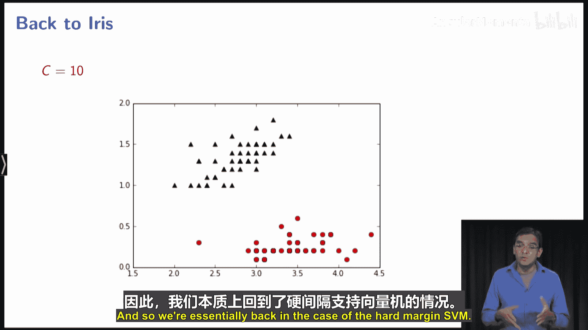

So in that case， this is the solution we get。Okay。All constraints are satisfied perfectly。

 and there are three support vectors， these three points。This is the hard margin SVM solution。

Now let's reduce C a little bit， okay？Let's make Slack a little bit cheaper。This is what happens。

 okay， so we reduce C to 3。And now we're starting to use some slacklack。

 we're using a little bit of slacklack on this point。

And we're using a little bit of slackla on this point， and now there are four support vectors。

 we have two support vectors that are actually on the margin。

 and then there are two points on which we are using Slack， a total of four support vectors。

So what exactly is going on over here？The data is linearly separable。

 There is no need to violate any constraints。Why is it violating the constraints。

 why is it doing this？And it's doing this because it's allowed to violate constraints。

 Slack is not too expensive， and because in doing so it gets a wider margin。😊，See。

 this is the margin we had before and this one is slightly larger， it' got a slightly larger margin。

So let's reduce the a little bit more。Oh now we are violating some more constraints。

 this one is violated quite a bit。What do you think the slack variable on that is well？

It's probably something like。I don't know， the psi on that might be 0。6 roughly， okay。

 quite a lot of slack on that one， and now we have six support vectors。

We have these six points over here， they're all support vectors。And we have a wider margin。

Let's reduce see some more。Even more support vectors， even wider margin。And wider and wider。

And now all the constraints are violated， and we have a very wide margin。Okay。

 so this is what happens as you vary that parameter see。😊。

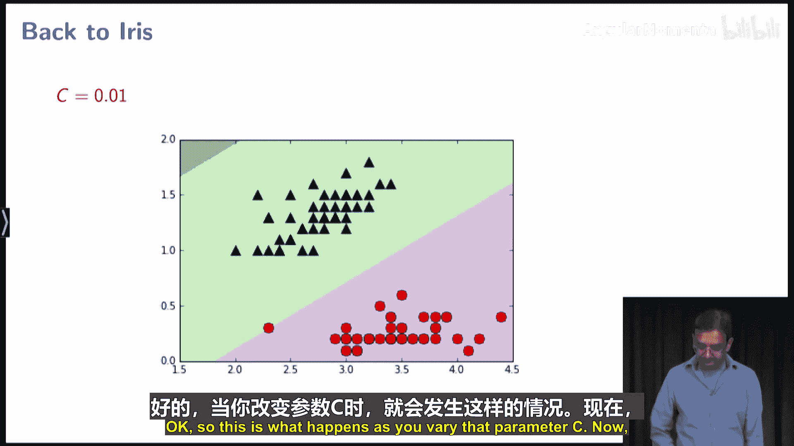

Now let's look back at the sentiment data set， so if you recall this is a data set that contains sentences that have been pulled out from reviews of products or movies or restaurants okay so each data point is just one sentence and it's been labeled as positive or negative is it a positive review or a negative review。

Now， when we were talking about logistic regression， we were looking at this data set。

And we saw that you can convert each sentence into a vector by using the bag of words representation so each sentence is now a vector。

And we have 2，500 training points and about 500 test points， not a huge amount of data。

In order to use the soft margin support vector machine on data like this。

 we have to decide how to set that parameter C so let's look at the effect of different settings at sea。

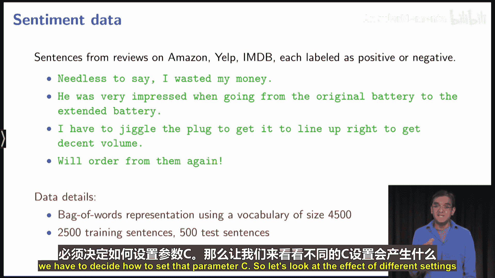

So here I'm increasing see by orders of magnitude。Okay， and if you remember as gets larger。

 it means Slack becomes more and more expensive。😊，So slacklack， more expensive。

When Slack becomes more expensive， it means fewer and fewer constraints are violated。Okay。

 and as a result， the training error goes down that explains that。

And because fewer constraints are violated， the number of support vectors is also going down。

 if you notice over here。That's because the support vectors include the points on the margin。

 but also any point for which the constraint is violated。

 okay so as the number of violations is going down。

 it's reasonable that the number of support vectors is also shrinking。

But what happens to the test era so we had that separate test set of 500 points？

The test error goes down a little bit。And then it starts to go up。

So the sweet spot seems to be somewhere between。1 and 10 somewhere in there。Which C do we pick。

 how do we choose a value of C？In reality， we wouldn't have a test set that we could peak at。

 we just have the training set， we just have the training error， how do we pick C？As always。

 we would pick it using cross validation， and let's see how that works out。

So what I've done over here is to try a whole bunch of different values at C and I've showed them over here on a log scale。

 so I've tried values of C that go from one over 1000 to well above 1000。Okay。

And for each value of C， we have to estimate the resulting error using only the training set。

The way we do that is with cross validation， and in this case I've used fivefold cross validation。

 so there's a training set of 2，500 points。We divide it into five batches okay。

 so first I treat the first batch of 500 points as a test set。Train on the remaining 2000 points。

And look at the error on those 500 points。Then treat the next batch of 500 points as the test set。

 train on the remaining 2000 points， obtain the error on those 500 points and so on。

 and in this way I get five error numbers and I take their average。

And that's how I get an error estimate for every particular value of C。 Okay， so for each value of C。

 I do。F fold cross validation and I get some error estimate。As you can see。

 these estimates dip quite a bit at first， and then they start going up。

 so which of the best value of CTs well based on this cross validation。

We would pick this one right there。Okay。And that turns out to be c equals 0。32。

 and the resulting test error is 15。6%。Not bad at all。

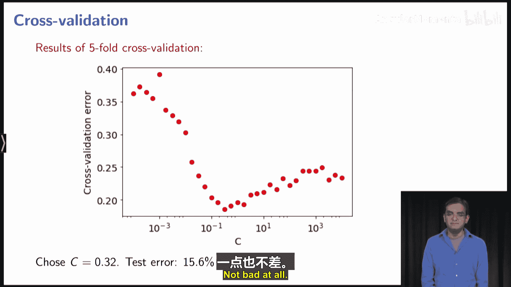

Okay， well that's it for today。Today we've seen the soft margin SVM。

 which is the form of the SVM that's typically used in practice。

It's an extremely competent linear classifier。The amazing thing is that you can actually use it to go even further to obtain boundaries that are quadratic or polynomial or beyond and in the upcoming week we'll see how to do this。

See you later。