# 机器学习基础：07-03-02：支持向量机 II 🧠

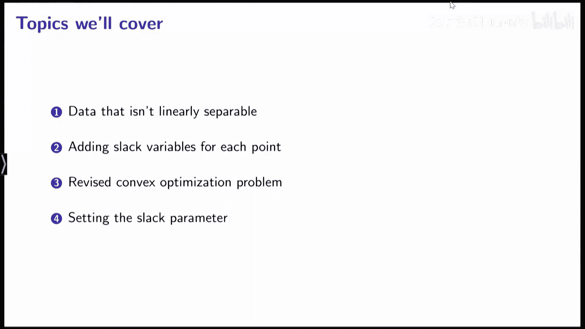

在本节课中，我们将要学习支持向量机（SVM）的一个重要扩展——软间隔支持向量机。上一节我们介绍了硬间隔SVM，它要求数据必须是线性可分的。本节中我们来看看当数据无法被完美线性分割时，如何通过引入松弛变量来构建一个更强大、更实用的分类器。

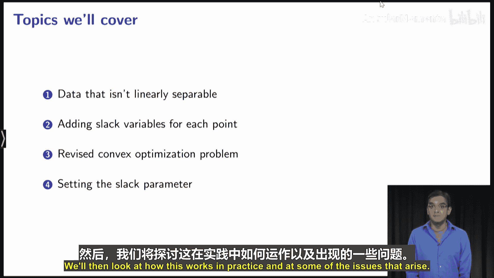

## 回顾：硬间隔支持向量机

上一节我们介绍了支持向量机。给定一个训练集，它通过求解一个凸优化程序来寻找具有最宽间隔的线性分类器。

它效果很好，但仅适用于线性可分的数据，即确实存在一个线性分类器能完美地将正类（+1）和负类（-1）分开的数据。

在实践中，情况往往并非如此，因此我们今天要做的是研究支持向量机的另一个版本，称为软间隔支持向量机。它可以处理任何类型的数据。

我们将看到，通过向凸优化程序中引入新的松弛变量，可以轻松处理不可分数据的情况。然后，我们将看看它在实践中如何工作，以及会出现的一些问题。

## 软间隔SVM的数学形式

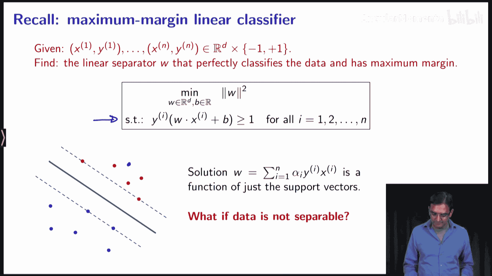

以下是上一节的情况。我们有一个数据集，一个由点 x₁ 到 x_N 组成的训练数据集，每个点都有一个标签 y₁ 到 y_N，这些标签是 +1 或 -1。这是一个二元分类任务。

支持向量机通过求解一个凸优化程序来寻找线性分类器，即下面这个程序。它寻找一个由向量 **w** 和偏移量 **b** 给出的线性分类器。

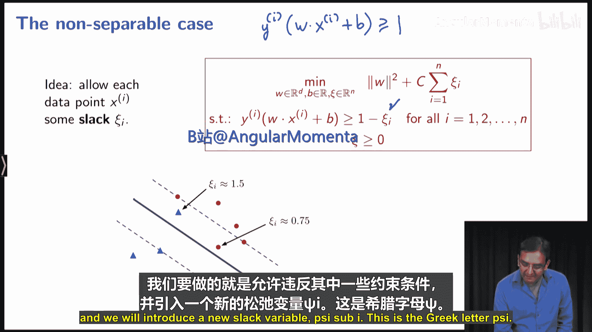

这个凸优化程序包含 n 个线性约束，即这里的这些约束，每个数据点一个。约束的含义是该数据点必须被正确分类。

在满足这些约束的前提下，程序还希望找到具有最宽间隔的分类器。正如我们所见，这等同于最小化 **w** 的长度，或者等价地最小化 **w** 的平方长度。

这是一个凸优化程序，意味着它可以被高效求解，并且有现成的软件包可以为我们完成，我们无需担心其背后的算法。此外，最终得到的解 **w** 具有非常优美的形式：它是数据点 **x** 的线性组合。更重要的是，这个线性组合只使用了部分数据点——那些恰好位于间隔边界上的点。这些点就是支持向量。

这是一个非常优美的图景。这一切都很好，但这仅适用于数据线性可分的情况。问题是，在不可分的情况下会发生什么？例如，假设这里有一个蓝点。

如果我们有这样一个点，那么就不存在能够完美分类训练数据的线性分类器，因此我们将无法满足所有这些约束。我们必须放弃其中一些约束。我们该怎么做呢？

事实证明，一个非常简单的方法是引入新的松弛变量。让我解释一下这意味着什么。

以前，对于每个数据点 i，我们坚持要求 y_i * (**w**·**x_i** + b) ≥ 1。这是一个硬约束。

现在，我们通常无法满足所有这些约束。所以我们要做的是，允许违反其中一些约束，并引入一个新的松弛变量 ξ_i（希腊字母 xi）。我们为每个数据点引入一个这样的变量，它们记录了违反约束的程度。

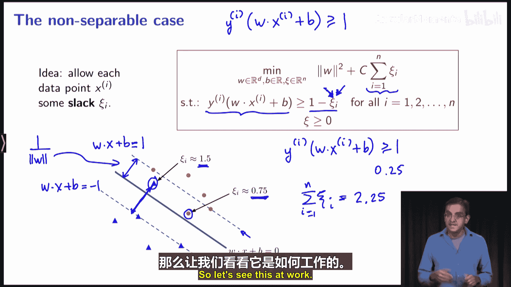

对于数据点 i，我们理想情况下希望 y_i * (**w**·**x_i** + b) ≥ 1。但我们将允许它被违反，ξ_i 的大小告诉我们该特定点的违反程度。

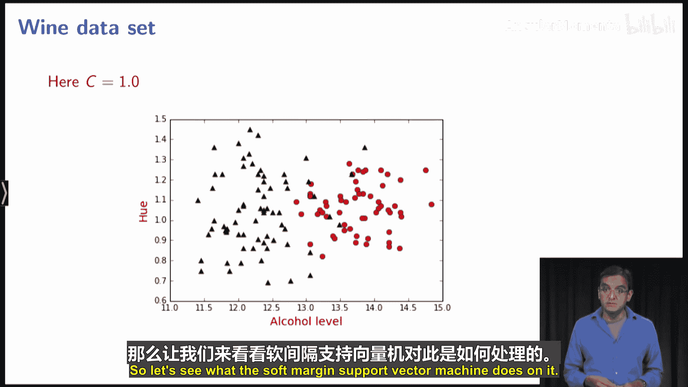

现在，我们希望最小化的目标与之前相同，即 **||w||²**，因为我们希望间隔宽。但同时，我们要确保没有太多约束被违反，因此我们还要加上所有 ξ_i 的总和，即约束被违反的总体程度。

为了更深入地理解这些松弛变量，让我们看看这张图。这里我们有一个决策边界 **w·x + b = 0**。这一侧的间隔边界是 **w·x + b = 1**，另一侧的平行超平面是 **w·x + b = -1**。在这种情况下，间隔就是这个距离。正如我们之前推导的，这个距离就是 1 / **||w||**。这些都与上一节相同。

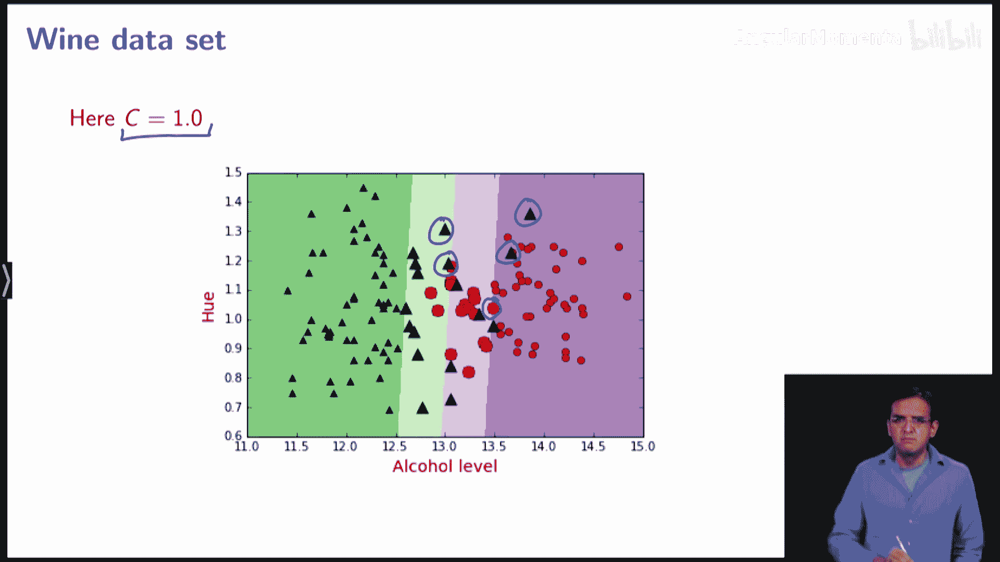

但现在不同的是，点并不都完全在我们希望它们所在的位置。例如，看这个点。它在边界的正确一侧（红色一侧），但我们希望它在间隔边界的右侧。它没有，它差了一点。对于那个特定的点，我们理想情况下希望 y_i * (**w·x_i** + b) ≥ 1。但它没有，实际上等于像 0.25 这样的值。因此，我们用松弛变量来弥补这个差值。该特定点的松弛变量因此是 0.75，即 y * (**w·x** + b) 的实际值与我们希望它达到的值之间的差值。

现在看这个点。这个点实际上在边界的错误一侧（红色一侧）。它离我们希望的位置很远。我们希望它完全在那边。那么它的松弛变量是多少？为了到达边界，需要 1 的松弛，再加上大约 0.5 的额外松弛，所以该点的松弛变量大约是 1.5。

在这张图中，只有这两个数据点使用了任何松弛，其他点都很好，它们就在我们希望的位置。因此，我们使用的松弛总量，即从 i=1 到 n 的 ξ_i 之和，在这张图中就是 0.75 + 1.5 = 2.25。

## 软间隔SVM的优化目标

因此，软间隔支持向量机的完整凸优化问题如下：

**最小化：** (1/2) **||w||²** + C * Σ_{i=1}^{n} ξ_i

**约束条件：**
1.  y_i (**w·x_i** + b) ≥ 1 - ξ_i， 对于所有 i = 1, ..., n
2.  ξ_i ≥ 0， 对于所有 i = 1, ..., n

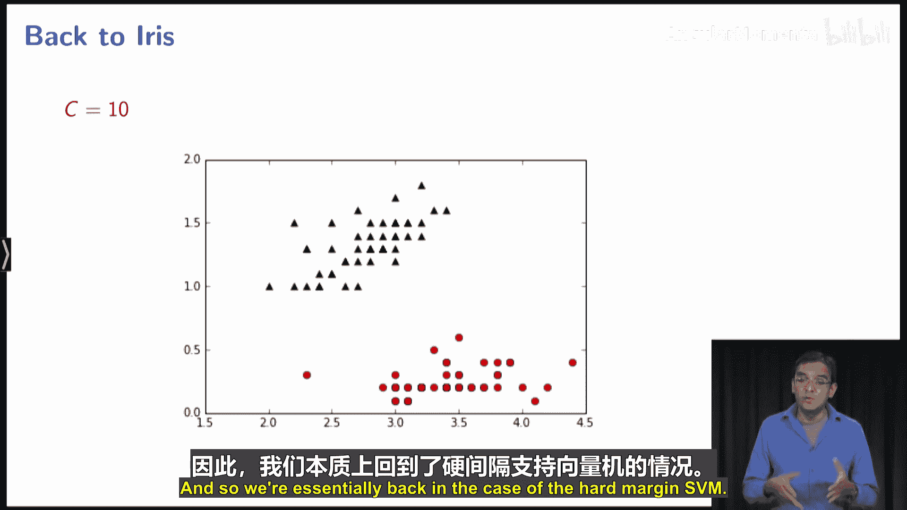

这里，**C** 是一个大于 0 的正则化参数，它控制着我们对最大化间隔（最小化 **||w||²**）和最小化分类错误（最小化 Σ ξ_i）这两个目标的重视程度之间的权衡。

## 参数 C 的作用

为了理解参数 **C** 的影响，让我们看看两个极端情况：当 **C** 尽可能小（趋近于 0）时，以及当 **C** 非常大（趋近于无穷大）时，看看每种情况下会发生什么。

*   **当 C = 0 时**：公式中的第二项基本上消失了。这意味着松弛是免费的，我们可以使用任意多的松弛，无需付出代价。我们可以随意违反任意多的约束，可以随意增大 ξ_i。我们唯一想做的就是最小化 **w** 的长度，所以我们会将 **w** 设为零。
*   **当 C → ∞ 时**：这意味着松弛是无限昂贵的。如果我们使用哪怕一点点松弛，其代价都是无穷大。因此我们将不使用任何松弛，这就回到了之前的硬间隔 SVM。我们必须完美分类每一个点，不允许任何松弛。

当然，在实践中我们会选择介于这两个极端之间的某个数值。让我们通过一个小例子看看这是如何运作的。

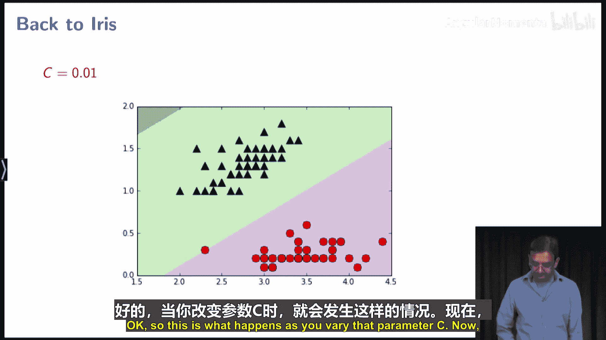

## 实践中的效果与参数选择

以下是使用软间隔SVM处理一个线性可分数据集（鸢尾花数据集的一部分）时，不同 **C** 值的效果：

*   **C 很大（如 1000）**：松弛非常昂贵，本质上等同于硬间隔SVM。所有约束都被完美满足，只有少数几个点成为支持向量（位于间隔边界上的点）。间隔相对较窄。
*   **逐渐减小 C（如 3）**：松弛变得便宜一些。算法开始允许违反少数几个点的约束（使用松弛），以换取获得更宽的间隔。支持向量的数量会增加，包括那些被违反约束的点。
*   **C 很小（如 0.01）**：松弛非常便宜。算法倾向于使用大量松弛来违反许多约束，从而获得一个非常宽的间隔。许多点都成为支持向量。

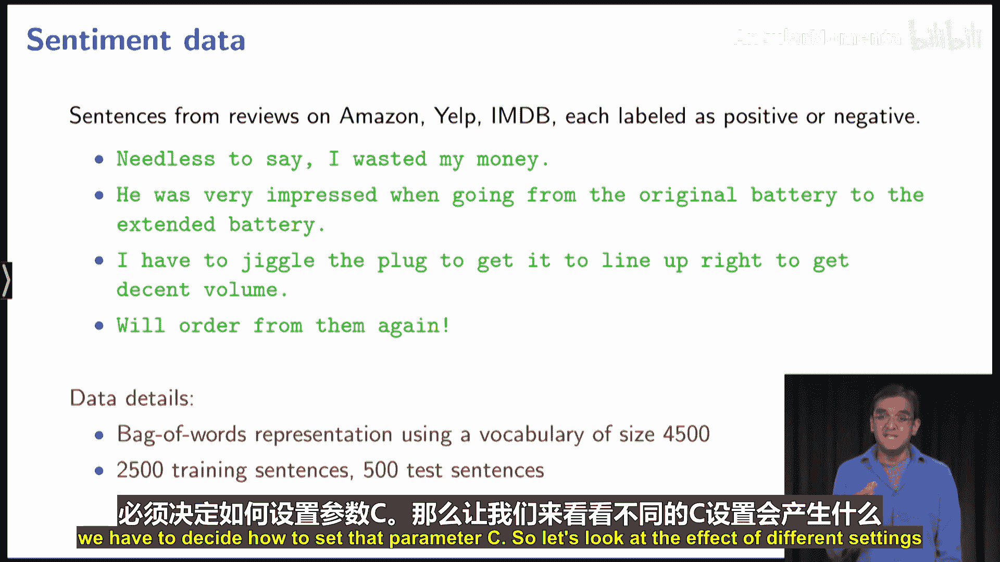

这个例子说明，即使数据是线性可分的，允许少量违反约束（使用软间隔）也可能通过获得更宽的间隔来提升模型的泛化能力。

## 在情感分析数据集上的应用

现在让我们回顾情感分析数据集。这个数据集包含从产品、电影或餐厅评论中提取的句子，每个句子被标记为正面或负面。我们可以使用词袋表示法将每个句子转换为向量。

为了在这样的数据上使用软间隔支持向量机，我们必须决定如何设置参数 **C**。让我们看看不同 **C** 设置的效果。

随着 **C** 增大（松弛更贵）：
*   训练误差下降（因为违反的约束更少）。
*   支持向量的数量减少（因为违反约束的点更少）。
*   测试误差先下降后上升，存在一个“最佳点”。

我们如何选择 **C** 的值？我们不能偷看测试集。标准的做法是使用交叉验证。例如，我们可以尝试一系列不同的 **C** 值（如在对数尺度上），对每个值进行 k 折交叉验证（例如 5 折），计算平均验证误差，然后选择验证误差最小的那个 **C** 值。这样选出的 **C** 通常能在未知数据上取得良好的性能。

## 总结

本节课中我们一起学习了软间隔支持向量机，这是实践中通常使用的 SVM 形式。它是一个极其强大的线性分类器。

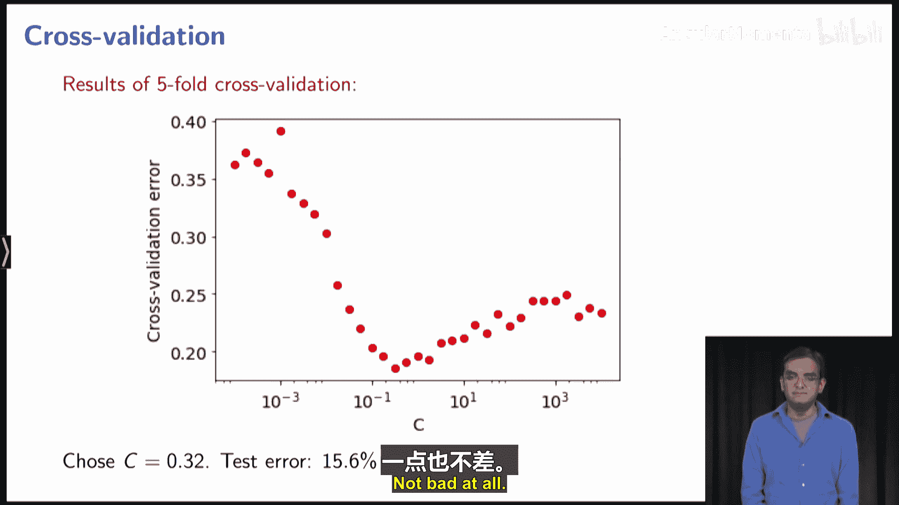

其核心思想是通过引入**松弛变量 ξ_i** 来允许某些训练样本被误分类或落入间隔之内，从而将原始的硬间隔优化问题转化为一个更灵活的软间隔优化问题。关键的**正则化参数 C** 控制着最大化间隔和最小化分类错误之间的权衡。

软间隔SVM的美妙之处在于，你实际上可以进一步使用它来获得二次、多项式或更复杂的决策边界。在接下来的课程中，我们将看到如何通过“核技巧”来实现这一点。