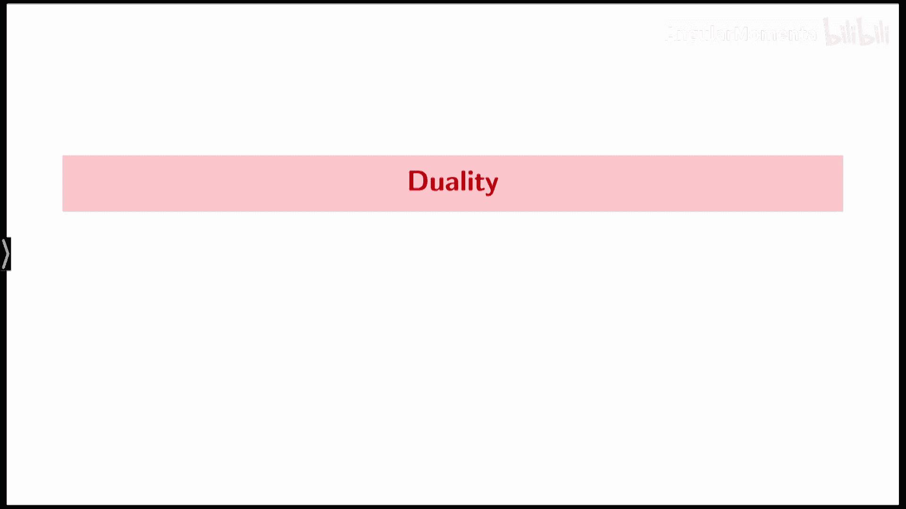
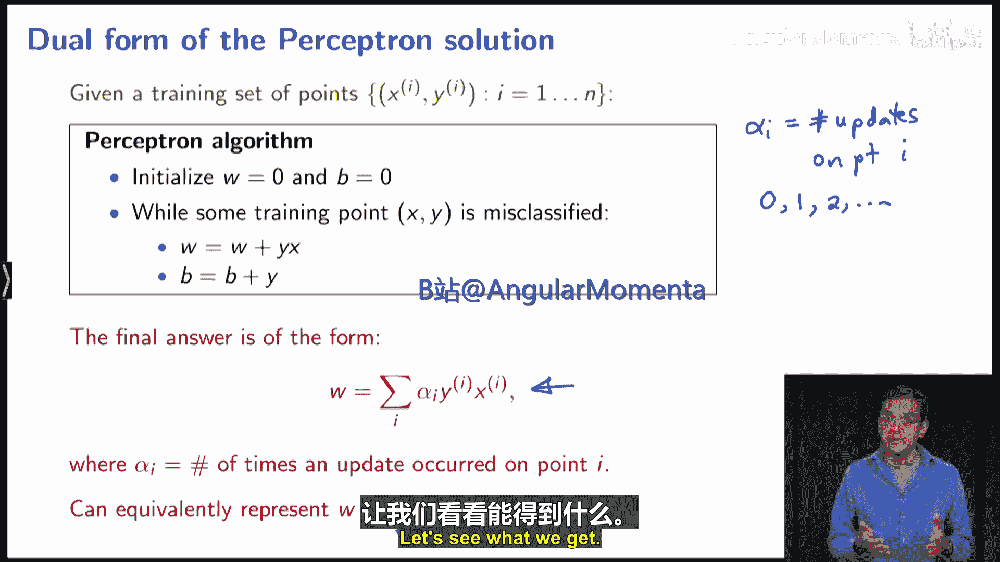
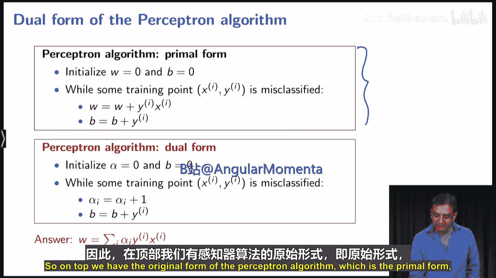
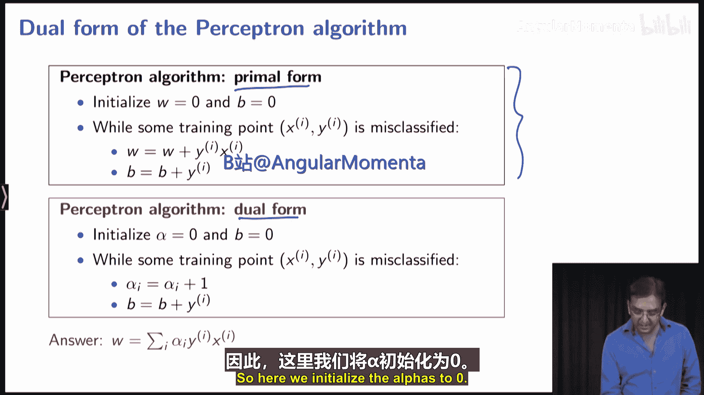
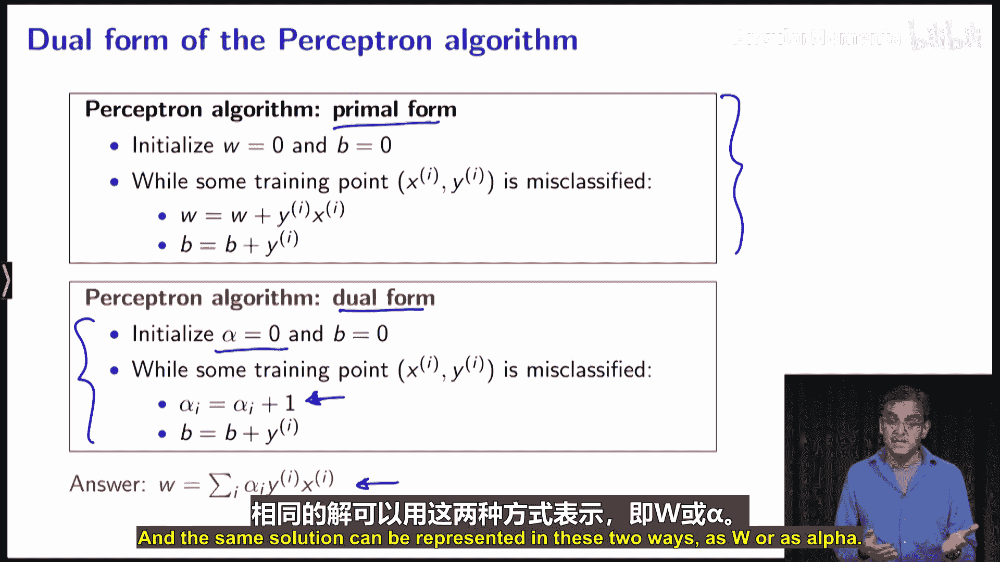
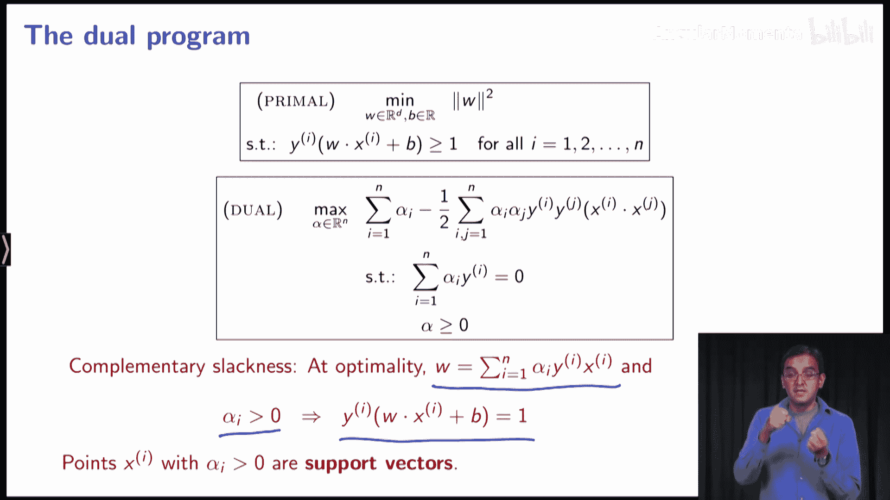
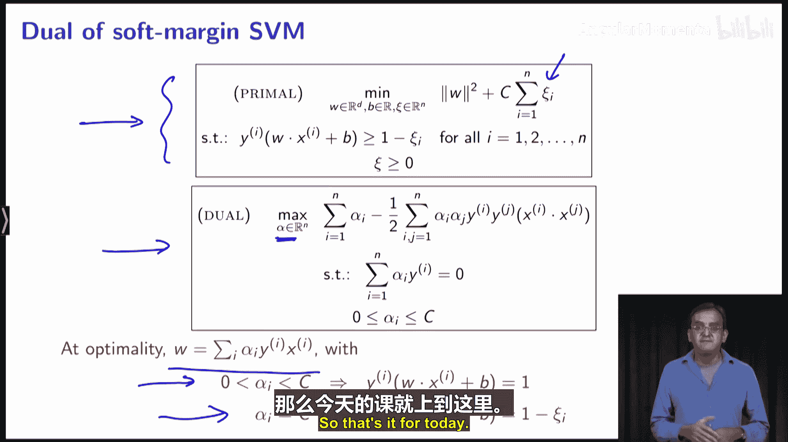

# 【加州大学圣地亚哥分校】机器学习基础  Machine Learning Fundamentals p34 07-04-02-对偶性 -BV1TyFSziEZb_p34-

We have seen some beautiful and powerful linear classification methods。

 the perceptron algorithm and two forms of the support vector machine。😊。

It turns out that you can actually do much more with them。

 Go beyond just linear boundaries to boundaries that are quadratic or polynomial or even more general。

The first step in doing this is to look at these algorithms in a slightly different way。

 to look at their dual form。So this might sound a little bit mysterious。

 and we'll try to shed as much light on this as possible。 What we'll see。

Is that the piceptron and the two forms of the support vector machine can be expressed in a slightly different way that is also very intuitive。

Let's start with the Poceptron。So here's the algorithm， the setup is that we have training points。

 X I， Y I， the x's are vectors in say some d dimensional in space。

 the Y's are the labels plus 1 or minus1。Now we're going to learn a linear classifier given by WNB。

And the way we're going to do this is just by cycling through the data set。

And each time we come to a point on which we are wrong。 each time we come to some point， X， Y。

That are misclassified by the current W And B。We do a simple update。We just add Y x to W。

And we add Y to be。That's it， just four lines of code， totaltal。

Now what this means is that the final answer， W is of a very simple form。Here it is。

 the final answer。Is just the sum over data points。Of Yi Xi。Times。

 the number of times we updated on that data point。嗯。

So this is interesting because it means that we can represent the final answer as the vector W。

Or alternatively， equivalently， we can represent the final answer just by providing these coefficients。

 alpha1 to alpha n。So alpha I。Is just the number of times we updated on point height。Okay。

 so we never updated on that point。Which might be the case for many of the data points。

Then it would take on a value of0。If we updated just once on it， it would take on a value of one。

 if we updated it twice， it would take on a value of two and so on。

So alpha subbi is a non negative integer。😊，And if we just take this vector alpha。

 which gives us these update counts for each of the n data points。

 we can recover W using this formula here。So there are two ways to represent the answer。

Either is the vector W， which has dimension D。Or as this vector of counts， alpha。

That has dimension in。We will call this the dual form of the solution。

The original primal form of the solution is W， and the dual form is alpha。Okay。Now。

 we can take this one step further by rewriting the entire algorithm just in terms of the alphas。

Let's see what we get。

So on top we have the original form of the perceptron algorithm。

Which is the primal form。The same thing we saw before。Let's look at the dual form。

So here we initialize the alphas to0， so alpha is a vector within entries。

 we initialize it to zero because we haven't updated on any of the points yet。

Did we start cycling through the points？And each time we come to some point， X， I， Y。

 I that we've misclassified。 It means we're going to update on that point。 So we simply。

Increment alpha sub， we're doing one more update on that point。That's it。

 and we make the same change to be as before。Now， at any given point。

 the corresponding W was just given by this formula。

But we have now a different form of the algorithm。That works entirely with the alphas。

 And in some ways， it's simpler than the original perceptron algorithm。At each step。

 we aren't adding a vector to W。 We are just incrementing a single count。Okay。

 so these are two ways of looking at exactly the same algorithm。

And the same solution can be represented in these two ways as W or as alpha。

Now let's move on to the support vector machine。 If you remember we had two forms of SVM。

 we have the hard margin SVM， which enforces all constraints strongly and works only if the data is linearly separable。

And then we have the version that's more commonly used in practice the soft margin SVM。

 So let's start with the hard margin case。We have training data。

And we solve for a linear classifier given by W and B。Vre a convex program。

So this program has a linear constraint for each data point。

 we insist that that data point be correctly classified。And subject to all those constraints。

 we also want to maximize the margin， which we've seen is the same as minimizing the length of W。

Okay， so this is the specification of an optimization problem。

It doesn't tell us how to solve the problem， but it turns out that this is a nice problem。

 It's a convex optimization problem， and that means automatically that it can be solved efficiently。

We don't really have to worry too much about how that's done。

 we're just going to hand it over to a package and it will give us the answer。

It doesn't matter what exactly the algorithm is。 We don't have to worry about it。Okay。

So where does the duel come in？Well， it turns out。😊。

That every optimization problem has a dual optimization problem。Okay， and so this particular problem。

 for example， which is a minimization problem。 So the primal problem is a minimization。

It has a dual problem that is a maximization problem。

And these two optimization problems have exactly the same optimal value。Okay。

 so what is this dual problem？Here it is。This is the original primal problem that we just saw。

 and this is the duall。What exactly is this doing， Well， it now has。A different set of variables。

 It's not solving for W And B。 It's solving for alphas， Al 1 through alpha N。

 And these are the same alphas that we saw in the case of the perceptron。

So this is solving the problem in alpha space。And once again， once we solve the problem。

 the solution we want， the W will turn out to have the same form as it did with the piceptron。

The sum of data points where the coefficient of each point is alpha I。嗯。😊。

So the two things to mention over here。The first thing is that the primal problem we said was a nice problem。

 a convex minimization problem。The dual problem is also nice。 It's a concave maximization problem。

 It's also one of these problems that can be solved efficiently。

It might be a little hard to figure out exactly what it's doing。

But this is beautiful theory called complementary slackness。

That tells us the relationship between the primal solution and the dual solution and what it tells us in this case。

Is that。In terms of the alphas， the only points on which alpha is non zero are the points that lie exactly on the margin。

This is where the notion of support vector comes from。Duality gives it to us。

 Duuality is what tells us that the solution W depends only on the support vectors。

 the points that lie exactly on the margin。

Okay， so let's move on to the soft margin SVM。So this is rather like the hard margin problem。

Except that we also have these slack variables。 We are no longer in a situation where the data is necessarily linearly separable。

So instead of having hard constraints that every point has to be perfectly classified。

 we allow some of these constraints to be violated and the slack variables size a I capture the extent of the violation。

 Okay， so this is the primal problem。😊，And we saw it last time。And once again。

 we can write down a dual problem。And the duel， in fact。

 looks a whole lot like the duel for the hard margin SVM。And the solution， again。

Gives us these coefficients alpha。Where the W we want。

Is just given by a linear combination of data points with these coefficients alpha。Now。

 when we use complementary slackness， we find that in this case。

 there are actually two kinds of support vector。 there are two kinds of points on which alpha is non zero。

😊，There are the points that lie exactly on the margin。

And there there are points on which we've used Slack。So there are two kinds of support vector。

 And again， it is this beautiful theory of duality that gives us this surprising insight。😊。

So that's it for today。

We have got just a very small glimpse of duality。 Duity is central to optimization。

 And as you go further and further into machine learning。

 it's a concept that you're going to bump into again and again。😊，For our purposes。

 we've seen just enough of it to give us what we need to take perceptron and support vector machine to the next level to use them not just for linear boundaries。

 but for polynomial and beyond。See you next time。