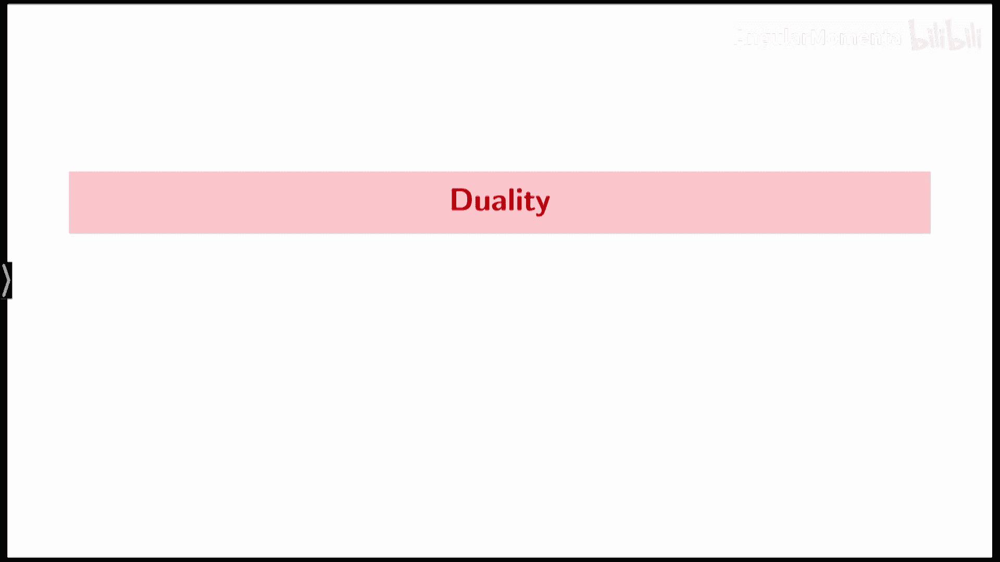
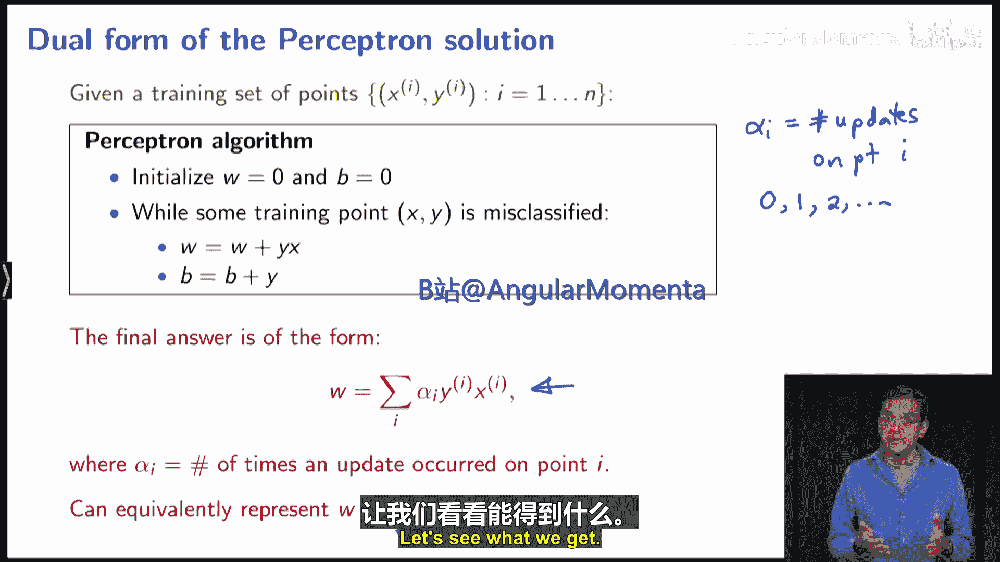
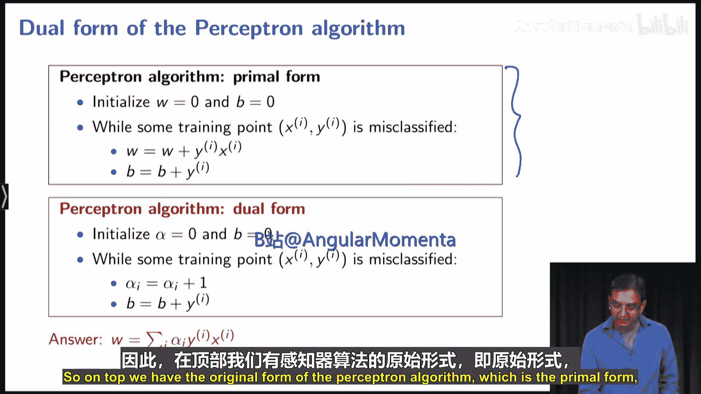
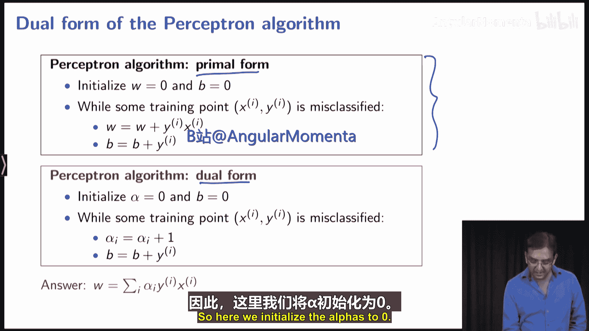
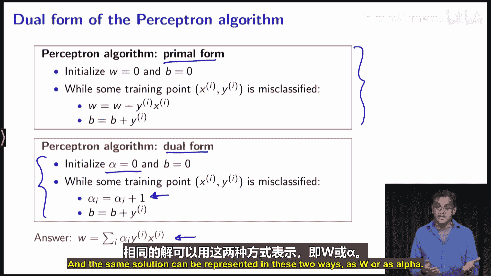
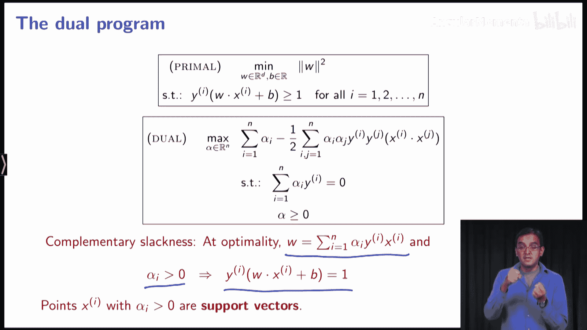
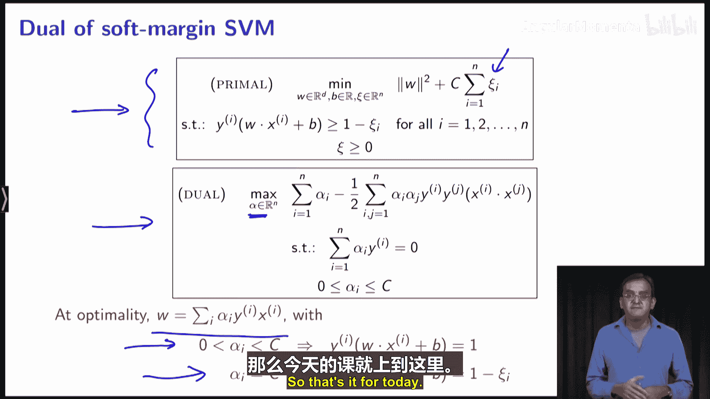

# 机器学习基础：07-04-02：对偶性

## 概述

在本节课中，我们将学习线性分类算法中的“对偶性”概念。我们将看到感知器算法和支持向量机（SVM）都可以用一种新的、被称为“对偶形式”的方式来表达。这种视角不仅提供了对算法的新理解，也是我们后续将线性方法扩展到非线性边界（如二次或多项式边界）的关键第一步。

---

## 感知器算法的两种视角

上一节我们回顾了感知器和SVM等强大的线性分类方法。本节中，我们来看看如何从“对偶”的角度重新审视这些算法。

感知器算法的原始形式非常直观。其设置如下：我们有训练点 `(X_i, Y_i)`，其中 `X` 是 `d` 维空间中的向量，`Y` 是标签 `+1` 或 `-1`。我们学习一个由 `W` 和 `B` 给出的线性分类器。

以下是算法的原始（原始形式）步骤：

1.  初始化 `W = 0`，`B = 0`。
2.  循环遍历数据集。
3.  每当遇到一个被当前 `(W, B)` 错误分类的点 `(X, Y)` 时，执行更新：
    *   `W = W + Y * X`
    *   `B = B + Y`

这意味着最终得到的 `W` 具有一个简单的形式。最终答案 `W` 可以表示为：

**公式：** `W = Σ_i (α_i * Y_i * X_i)`

其中，`α_i` 是我们在第 `i` 个数据点上执行更新的次数。这是一个非负整数。如果我们从未在该点更新，则 `α_i = 0`；更新一次则为 `1`，以此类推。

因此，我们有两种表示答案的方式：
*   **原始形式**：向量 `W`（维度为 `d`）。
*   **对偶形式**：计数向量 `α`（维度为 `n`，即数据点数量）。

我们可以进一步重写整个算法，使其完全用 `α` 来表示。

以下是感知器算法的对偶形式步骤：

1.  初始化 `α = 0`（一个 `n` 维向量），`B = 0`。
2.  循环遍历数据点。
3.  每当遇到一个被错误分类的点 `(X_i, Y_i)` 时，执行更新：
    *   `α_i = α_i + 1` （增加该点的计数）
    *   `B = B + Y_i`

在任何时刻，对应的 `W` 都可以通过公式 `W = Σ_i (α_i * Y_i * X_i)` 计算得到。这个对偶形式的算法在每一步只增加一个计数，在某些方面比原始形式更简单。这两种形式描述的是完全相同的算法和解决方案。

---

## 支持向量机（SVM）的对偶性

现在让我们将对偶性的概念应用到支持向量机上。我们有两种SVM：硬间隔SVM（要求数据严格线性可分）和更常用的软间隔SVM。

### 硬间隔SVM

对于硬间隔SVM，我们求解一个由 `W` 和 `B` 定义的线性分类器，这是一个凸优化问题（原始问题）。其目标是最大化间隔，等价于最小化 `W` 的范数，并满足每个数据点都被正确分类的约束。

每个优化问题都有一个对应的对偶优化问题。原始问题是最小化问题，其对偶问题是最大化问题，并且它们具有相同的最优值。

硬间隔SVM的对偶问题如下：它不再求解 `W` 和 `B`，而是求解变量 `α_1` 到 `α_n`（与感知器中的 `α` 类似）。求解出 `α` 后，我们想要的解 `W` 同样具有与感知器相同的形式：`W = Σ_i (α_i * Y_i * X_i)`。

原始问题和对偶问题都是可以高效求解的“好问题”。对偶性理论（特别是互补松弛性）揭示了原始解和对偶解之间的关系。它告诉我们：**只有那些恰好位于间隔边界上的点，其对应的 `α_i` 才非零**。这正是“支持向量”概念的来源。对偶性告诉我们，解 `W` 仅依赖于这些支持向量。

### 软间隔SVM

软间隔SVM的原始问题类似于硬间隔问题，但引入了松弛变量 `ξ_i`，允许某些约束被违反，以处理非线性可分数据。

同样，我们可以写出它的对偶问题。这个对偶问题看起来与硬间隔SVM的对偶问题非常相似。解同样给出系数 `α`，而 `W` 由这些 `α` 与数据点的线性组合给出。

应用互补松弛性分析，我们会发现在软间隔SVM中，实际上有两种支持向量：
1.  恰好位于间隔边界上的点。
2.  使用了松弛变量的点（即被错误分类或落在间隔内的点）。

这再次体现了对偶性这一优美理论所带来的深刻见解。

---

## 总结

本节课我们一起学习了机器学习中的“对偶性”概念。我们看到了感知器算法、硬间隔SVM和软间隔SVM都可以用原始形式和对偶形式两种方式来表达。对偶形式将解表示为数据点的线性组合，其系数 `α` 揭示了算法内部的工作原理，并清晰地定义了“支持向量”。对偶性是优化理论的核心，在机器学习中会反复出现。对我们而言，理解对偶性为我们下一步将感知器和SVM从线性边界扩展到多项式乃至更一般的非线性边界奠定了必要的基础。