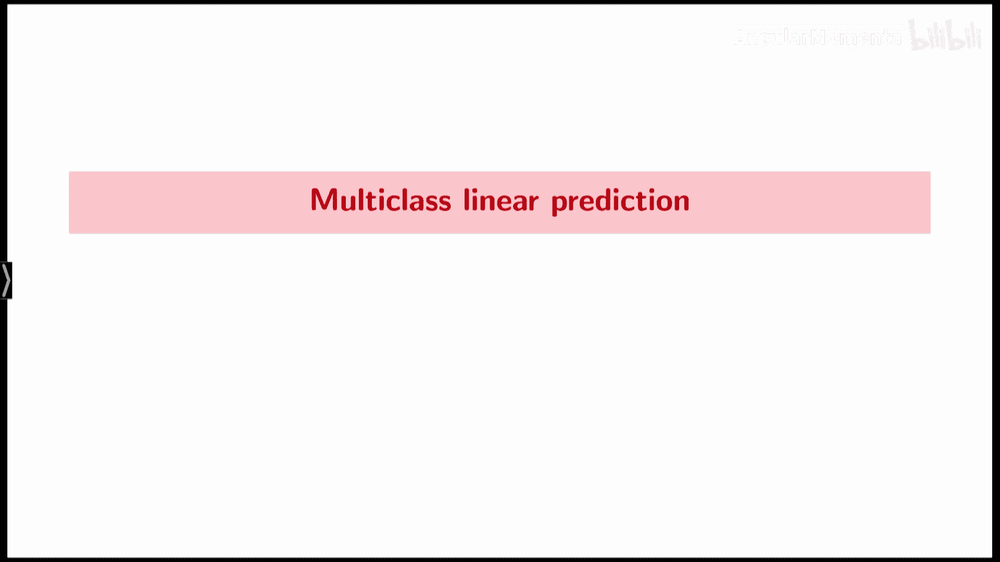
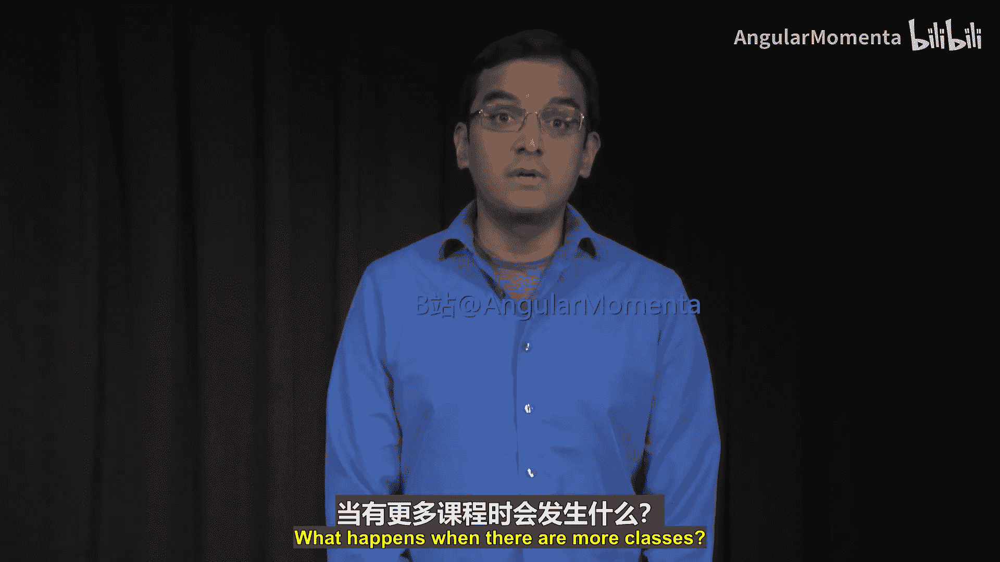
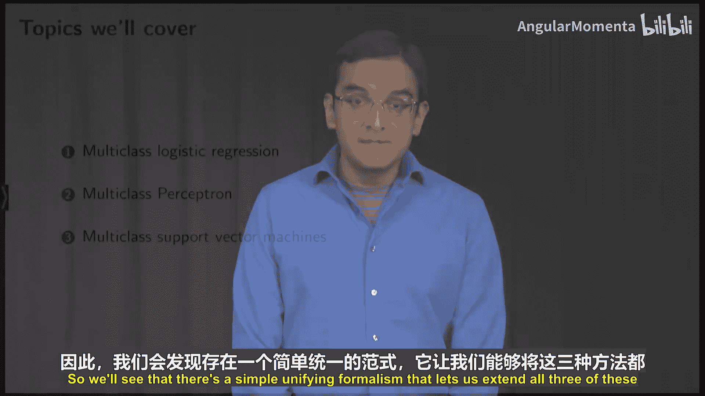
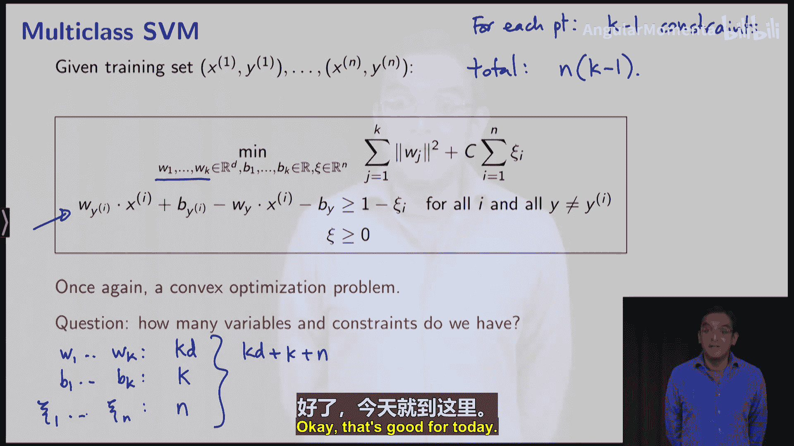
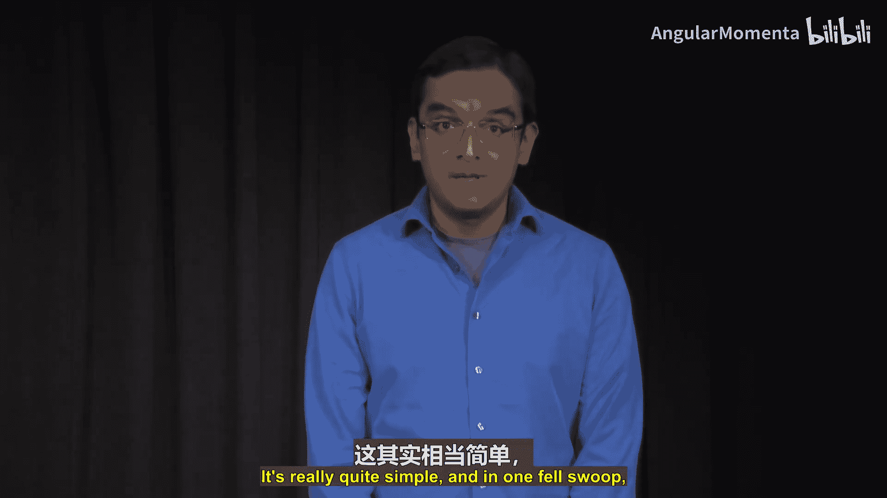

# 【加州大学圣地亚哥分校】机器学习基础  Machine Learning Fundamentals p35 07-05-02-多分类线性预测 -BV1TyFSziEZb_p35-

We have recently seen some beautiful methods for linear classification， logistic regression。

 the perceptron algorithm， and support vector machines。

But we've only talked about the binary case where the possible labels are plus one or minus one。

What happens when there are more classes， how can we accommodate them？

So we'll see that there's a simple， unifying formalism。

That lets us extend all three of these methods to multiclass， and we'll look at them one by one。

So in this class， we've studied all sorts of different methods for classification。

And some of them are inherently multiclassed， nearest neighbor， for instance。

It just automatically adapts till however many classes there are。

 you don't need to do anything special at all。Genrative models are also inherently multiclass。

You just fit a Gaussian or some other distribution to each individual class。And that's it。

 nothing else needs to be done。Linear classifierifies， on the other hand， seem a little bit tricky。

After all， when you have a line。There are only two sides to it。

So how can we possibly accommodate more classes？So to get the main idea。

 let's think back to Gaussian generative models。What we were doing there was to fit a Gaussian to each class。

 so maybe a Gaussian for class one。Another Gaussian to class2， another Gaussian to class three。

 another one for class four， and so on。We observed then that the log of the Gaussian density is a quadratic function。

😊，And so effectively， each class has got its own quadratic function。When a new point comes along。

Each class evaluates its quadratic function。And the one with the highest value is the winner。

That's the label we predict。So we can do something similar to this the linear classification。

We can let each class have its own linear function。Okay， so let's see what that means。

So let's say we have data in D dimensionsal space。So our data points X line Rd。

And let's say that the labels now。Have K possible values say。One， two all the way to class number K。

We will let each class have its own linear function okay， so class one。Has some linear function。

 let's call it w1 dot x plus B1。And here w1 is a vector in D dimensional space。

 and B1 is just an offset， just a number。Class 2 has its own linear function， say w2。x plus B2。

All the way to Class K。Say wk dot x plus Bk。And now when a new point comes along。

 when a new point X arrives， every class evaluates its linear function。

And the one with the largest value is the winner， and that's the label we predict。对。

So let's see how this works out for logistic regression。So for binary logistic regression。

 which is the case we studied before， if you remember， we just had one linear function， w。x plus B。

And for any given point x， the probability that y equals 1 was given by this formula over here。

Now let's move to the case wave we have K possible labels，1 through K。

We'll now have a linear function for each label， so for label 1， we have W1 B1 for label 2， W2 B2。

 label K， WK BK。And for any given point x， the probability that the label is J。

 the probability that y equals J is going to be proportional to。E raiseds to the J linear function。

 Wj dot x plus BJ。Okay， so the higher this linear function， the larger the value of this function。

 the more likely it is that the label is J。😊，Okay， so we said proportional to what is the exact formula for the probability Well we just need these to add up to one okay。

 so we just need to normalize。So the probability that y is J。Give an X。Is exactly that term up there。

E to the WJ dot X plus BJ。And now we normalize it so we divide it by。The term for class one。

Plus the term for class two， all the way to the term for class K。

So that's the probability that y equals J given x。Now， what label would we predict for x。

 Well the one for which this function is the highest， the one for which Wj dot x plus Bj。

Is largest in other words the arcm of this。Okay， and that's it。So here's a summary over here。

Of our prediction rule and our model。How about learning， so let's say we have a training set。X1。

 y 1 all the way through X and YN。How do we learn these K linear functions？Well。

 we'll do exactly what we did in the binary case， we'll just pick the parameters that maximize the likelihood of the data。

 that is that maximize the probability of the first data point times the probability of the second data point all the way to the probability of the end data point okay so that's this。

Function over here。And as usual， products are a little bit tricky to deal with so we can just take the logarithm to make it into a sum。

And if we want to make it into a minimization problem， we can just stick a minus sign in front。

And when we do that， we end up with a convex minimization problem。In other words。

 it's a problem that's quite easy to solve。And in practice。

 we'll just hand the data over to a package which will then return the solution to us。Okay。

 so multiclass logistic regression is not a problem at all。

Now let's move on to the Poicron algorithm。That was just four lines of code。

Can we somehow adapt the peretron to deal with multiple classes？

And it turns out that it's actually really simple to do so。Here's the modified algorithm。

 also very short。So we have a training set。X1 y1 all the way through x and YN。

 and as usual we begin by setting all the parameters to0， by setting all the linear functions to0。

 in this case we have k of M。Then we start going through the data and each time we come to a point that's misclassified。

 we do a little update。So we go through the data and let's say that we arrive at a particular point XY。

The first thing we have to do is to figure out what label we would predict on x given our current parameters and that label is simply。

The label J that maximizes Wj dot x plus Bj。Where the Ws and Bs are our current parameter values。

Okay， so let's say that the label we'd predict is Y hat。Now if that's the correct label。

 if y hat equals y， then we don't have to do anything。But if we predicted the wrong label。

 if y hat is not equal to y， then we have to update the parameters。But which parameters do we update。

 we have K different linear functions。Well were only going to update two out of the K functions。

We're going to update the function for the correct label。

And the function for the label that we actually predicted。

And both of these updates are very simple okay， so for the correct label。

We simply add x to the W vector and increment B。For the label we predicted。

We just subtract X from the W vector and decrement B， and that's it。

 the multiclass theceptron algorithm。So let's see it at work on a simple data set。

So here is some data in two dimensions。And with three classes， we have the black triangles。

 the blue stars， and the red circles。What does multiclass biceptron do on this？Well。

 this is the buying boundary that it finds。It perfectly classifies the data Now as you can see。

 the boundary that it finds is made up of three linear pieces， there's this piece over here。

This piece over here and this piece over here。OkayAnd basically it keeps cycling through the data until it finds this perfect classifier at which point it immediately holds。

😊，It does not for instance， try to optimize the boundary further， for instance。

 by trying to center the boundary or by trying to maximize the margin in some way。Okay。

So that makes us wonder， what about the support vector machine？Can we make that multiclass as well？

And indeed we can， and it's quite simple， okay， here is the convex program for multiclass support vector machine。

Okay， so as before， let's say we have a training set x1Y1 through XM YN。As usual。

 we want to minimize the norm of W squared。But in this case， we have k different ws。

So what we are minimizing is the sum of all of their square norms。As usual， with the soft margin SVN。

We have a slacklack parameter。For each data point。Now， if you recall。

 the function of this was to allow us to violate some of the constraints because， for example。

 it might not be possible to perfectly classify all of the training data。😊。

So the Slack parameter allows us to violate some of these constraints。

 but we don't want too much violation， and so we include the sum of the slacklack variables in the function that we want to minimize and that remains unchanged from before from the soft margin SVM。

And then。Over here， we have the constraints that say that we want the data points to be classified correctly。

So what exactly are these constraints？Let's take a look， let's say we have a particular data point。

X I， Y I。Now there are K possible labels。In order for this point to be correctly classified。

 we need the linear function for the correct label。

To beat out the linear function for any of the incorrect labels。

 so for the linear function for y sub。Has to be greater than the linear function for the k minus1 other labels。

 the Y's that are not equal to y sub。So if we write out this condition。

 what we have is that the correct linear function， which is w of y sub I。

 the w for the correct label。Dot x of5。Plus。B of y sub。Should exceed。

Any of the wrong linear functions， so wy dot x sub I。Plus BY。For any of the labels that is incorrect。

This is the condition that says that all the points are perfectly classified。😊，Now， as we did before。

 we can equivalently insist。That actually the correct label exceeds the incorrect labels by one。

And we can do this by simply rescaling the Ws and V's appropriately。Okay。

 so this is another way of saying that all the points are correctly classified。

Now of course it might not be possible to correctly classify all the points。

 so we do have to allow a little bit of slacklack and that's where we include the Slack variable size of I。

😊，Okay， so these are our final constraints and this is exactly the inequality we have over here。

 just shifted around a little bit。Okay。So this is the convex program for the multiclass SVM。

So let's see it at work， this is the IIS data which we've talked about before。

 I've chosen two of the four features。There are three classes and it's clear that the data is not linearly separable。

So in particular， we would not be able to run the perceptron algorithm on this， okay。

 but let's see what the multiclass soft margin SVM does。This is the boundary of pines。

It does a very good job， as usual， it is a very competent classifier。

So let's end a little bit with a small question。Okay。

 so this was the convex program for the multiclass soft margin SM。

How many variables do we have here and how many constraints， let's see if we can count these。Okay。

 so。The variables are the Ws。Okay， so W1。Through WK。

How many parameters do we have that well each of them is a d dimensional vector。

 so it's a total of KD parameters。Our variables also include B1 through BK。Each of them is a number。

 so that's K parameters。And then we have the slacklack variables。😊，Si1。Throughs N， so n parameters。😔。

So the total number of variables is kd plus k。Plusね。How about constraints？

How many constraints do we have over here？Okay。So let's see for each point。

We need the correct label to beat out the K minus1 incorrect labels。

 so for each point we have K minus1 constraints。So the total number of constraints。

Since our n data points is n times k minus1。Okay， and that's it。Okay， that's good for today。

We've seen how we can extend our linear classification methods from binary to multiclass。

It's really quite simple and in one fell swoop we were able to take care of logistic regression。

 the saron and the support vector machine。

See you next time。