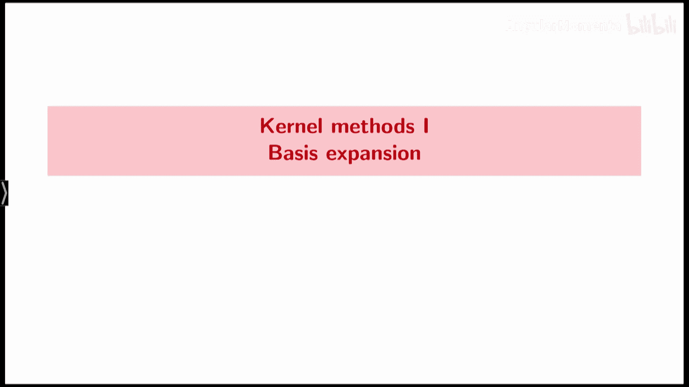
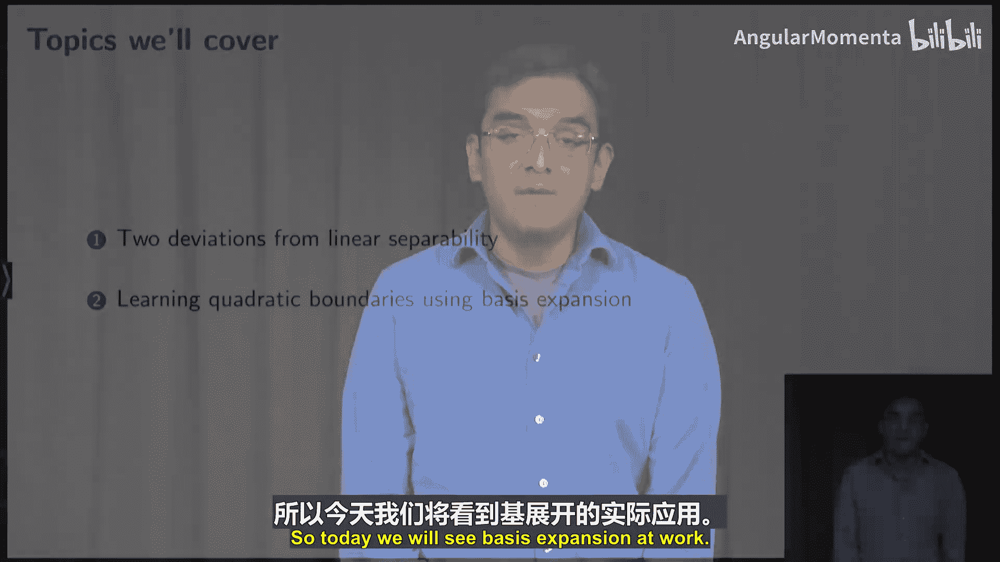
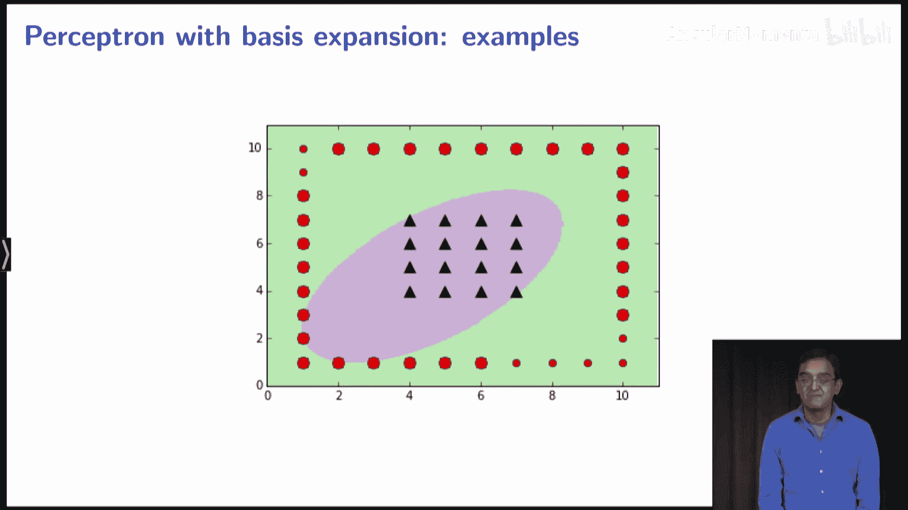

# 【加州大学圣地亚哥分校】机器学习基础  Machine Learning Fundamentals p36 08-01-02-基扩展 -BV1TyFSziEZb_p36-

Today we will begin our study of kernelno methods。These do something truly amazing。

They let us use linear classifiers， like perceptron or SVM to produce decision boundaries that are quadratic or polynomial or even more complicated。

There are several ideas that go into this and we'll cover them slowly one by one。

The first big idea is called basis expansion。So today we will see basis expansion at work。

And what we'll be using it for is to get the perceptron algorithm。

To learn quadratic decision boundaries。One thing that we've seen in our study of classification so far is that if data is linearly separable。

 then life is good。We can， for example， use the simple aceron algorithm to learn the classifier。

But linear separability often fails， and there are two significant ways in which this might happen。

The first is that the data is approximately linearly separable。

 but there are a few points that lie on the wrong side okay and that's the situation shown over here。

So over here， there's a linear classifier that's almost perfect。😊，But there's a couple of points。

 there's one plus point on the wrong side and one minus point on the wrong side。

Situations like this can be dealt with very easily using the soft margin SVM， for example。But Po if。

The data is very， very far from being linearly separable。

What if the decision boundary looks something like this， something like a parabola。

 a quadratic function？What can we do in this case？So let's start by figuring out what the equation of this decision boundary might be。

Okay， so the data is in two dimensions， so let's say this dimension is x1。And this dimension is x2。

Now if we had a curve like this， that's the usual y equals x squared， and in terms of x1 x2。

 it would be something like x2 equals x1 squared。if we turn it on its side。

Then we're sort of flipping the roles of x1 and x2， so we'd get something like x1 equals x2 squared。

Okay， and maybe it's offset a little bit， so maybe this boundary up here is something like this。

X1 equals x2 squared plus 5。This is a quadratic boundary。

 in this case it has this quadratic term over here。How can we learn a boundary like this？

The idea is to expand the input representation。Okay， so here's what we do。

The original data is two dimensional， it consists of points x， with these two features， x1 and x2。

What we're going to do is to expand the representation。Instead of x， we are going to use phi of x。

Which contains five features。In addition to x1 and x2。We also throw in x1 squared。X2 squared。

And the cross term x1 x2。렇게。So in this case， the original data。Lay in R2。

And we are creating these expanded data vectors that lie in R5。It's easy to create these。

 we have x moon and x2， so we can just add on these three extra features。

 that's not a problem at all。But how does it help us？Well， it turns out that this boundary over here。

 for example， is linear in p of x。Okay let's see that， so what is the equation of this boundary。

 we've got accustomed to writing boundaries in the form some function equals0。

 so in our case it's x1 minus x2 squared minus 5 equals0。Now that's quadratic in x1x2。

But it's linear in p of x， it is of the form w dot v of x。Plus B equals zero。Okay。

Why what are W&B in this case Will？We know phi of x。Is x1， x2， x1 squared， x2 squared and x1 x2。

The W vector in this case， where we need an X1。The boundaryry doesn't have any x， too。

It doesn't have any x1 squared。It has a minus x2 squared。And it doesn't have any X1x2。

And the offset beat is negative5。So our boundary is literally of this form。

It is linear in the expanded representation。So essentially we take our two dimensional data and em it in a higher dimensional space。

 in a five dimensional space。And the decision boundary that's quadratic。

In the two dimensional space is just linear。In the embedded five dimensional space。Okay。

So we can just go ahead and look for a linear boundary in the five dimensional space。

So let's see what happens。When our data is not two dimensional， but is d dimensional。

 so say our data consists of vector x with d features。What do we do in that case？Well。

 if the decision boundary is quiteraatic。That means that it can have terms of the form x1 squared。

 x2 squared， xd squared。Or possibly cross terms like x1x2， x1x3， x5， x6， and so on and so forth。

So what we can do is to create an expanded representation in which we throw in all of these terms。

Okay so we create this expanded representation， this higher dimensional embedding phi of x。

 it contains all the original features， x1 through xd， as well as the squares。

 x1 squared to xd squared， as well as all the pairwise products， x1 x2。

 x1 x3 all the way to xd minus1 xd。And why have we done this？Because any boundary that is quadratic。

In the original features， x。Is actually just linear。In these expanded features， Fx。

So we can just try to learn a linear classifier of the X。嗯。

So let's be a little bit more concrete about these embeddings。Suppose for example。

That we start with three dimensional vectors。What is this embedding phi of x so phi of x in this case？

Consists of all of the original features。Then all the squares。And then all the cross termss， okay。

 so we have x1x2， x1x3， and then x2 x3。So what is the dimension of this vector， it is9 dimensional。

Okay。What if we start with D features， what is the dimension of the expanded representation？Okay。

 so in this case， the expanded representation has all the original features。That's D of them。

Then it's got all the squares。So x1 squared to xd squared。That's another D features。

And then it has all the pairwise terms， like x1x to x by x7 and so on。

X1 x2 all the way to xd minus1 xd。And how many of those are there？Do choose to。Okay。

 so the dimension of this expanded representation is 2 d plus d choose 2。

 which is d times d minus1 over 2。Okay。So roughly it's O of d squared。Okay。So what do we have to do？

To get the perceptron algorithm。To learn a quadratic boundary。And it's really very simple。

 we just take the original perceptron algorithm and instead of x。

 we substitute in phi of x so each time we see an x in the original perceptron algorithm。

 we just plug in phi of x instead。And that's it， it's the only thing that changes。Okay。

So let's see how it works。Here's a data set that has two classes。

 we have the black triangles and the red circles， this is clearly not linearly separable。

But let's run the Perceptron algorithm with basis expansion。

This is an algorithm that can learn quadratic decision boundaries， okay， let's see what it does。

This is the boundary of down。It perfectly classifies the data。

The boundary looks like part of a pararabo at perhaps， so it's a quadratic boundary。

And the key point over here is this is boundary that you see over here， although it looks quadratic。

If you were to visualize the same boundary in five dimensional space。And the five dimensional。

 embedded space。It would be perfectly linear。Okay。Let's look at another example， again。

 two classes and clearly not the nearly separable。Here's what perceptron gives us。

The boundary is an ellipse， which is quadratic， okay， and once again。

This is just what it looks like in two dimensional space。

 but in a sense the Perceptron algorithm is actually operating in the embedded five dimensional space。

In that space。The black triangles would be on one side。The red circles would be on the other side。

 and this thing that looks like an ellipse would actually be a linear hyperplane separating the two groups。

Okay， so that's it for today， we have seen， we've got our first glimpse of the power of kernel methods。

😊。

But we are going to take this a whole lot further， so stay tuned for the next installment。

See you soon。