# 【加州大学圣地亚哥分校】机器学习基础  Machine Learning Fundamentals p37 08-02-02-核方法技巧 -BV1TyFSziEZb_p37-

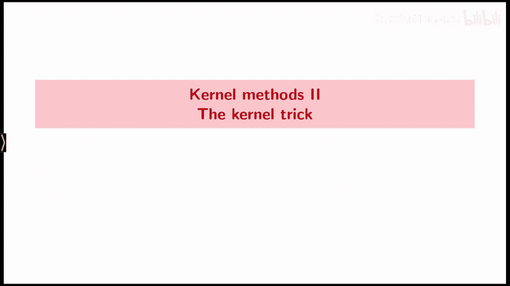

Last time we saw how the Perceptron algorithm， those four lines of code。

Could be adapted to learn quadratic decision boundaries。The trick was to expand the input features。

 a trick known as basis expansion。Now， it turns out that these expanded inputs can often be inconveniently large。

😊，Large enough to be impractical。And we'll see how we can get around this problem by using the kernel trick。

 So the focus today will be developing the kernel trick for quadratic decision boundaries and culminating in the kernel perceptron algorithm。

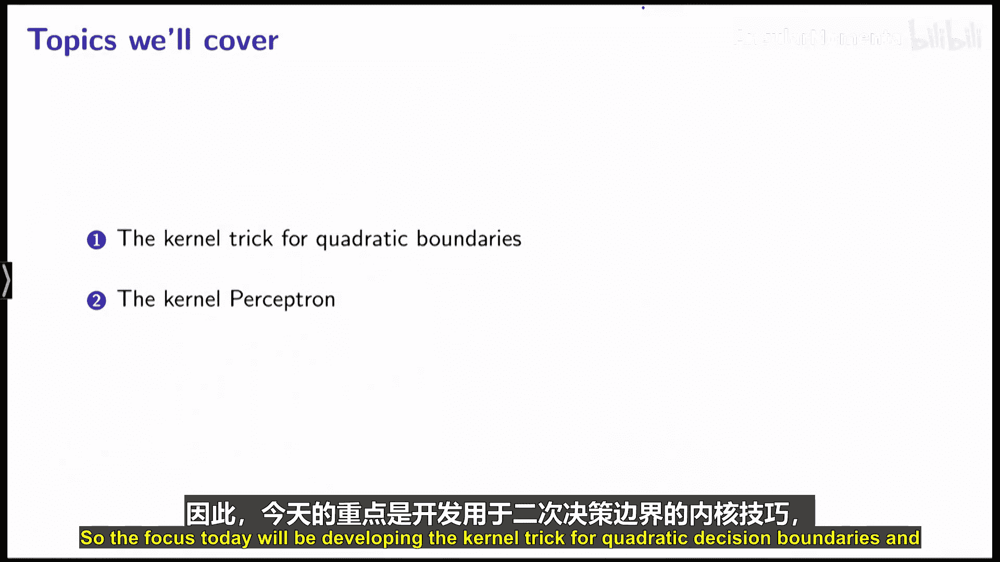

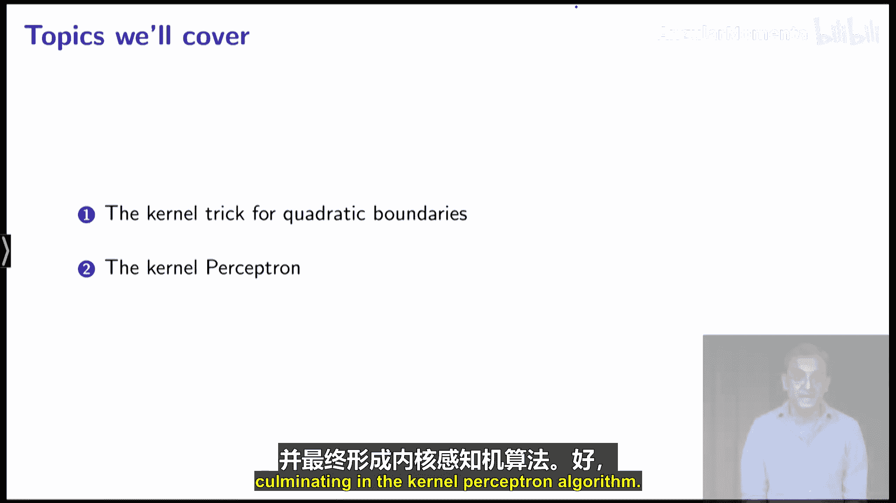

Okay， so first a quick recap。So last time we were looking at the situation where we want to learn a quadratic decision boundary。

And we were wondering whether we could use our standard linear classifier technology for doing this。

And we saw that we really can do this by expanding the input features。

So we take the original features X。And we create an expanded feature vector。

 phi of x that includes the original features。The squares。And also pairwise products like X1 and X2。

Now the reason for doing this is that any boundary or any function that is quadratic in X。Is also。

Linear。In fear ofx。

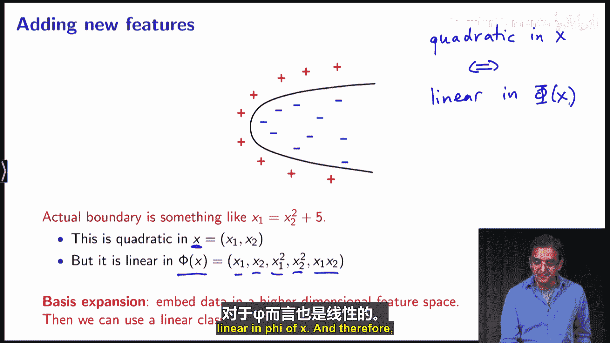

And therefore， we can learn a quadratic boundary in the low dimensional space。

By just learning a linear boundary in the higher dimensional space of the of x。

So here is the perceptron algorithm with basis expansion。

It's exactly like the usual piceptron algorithm。

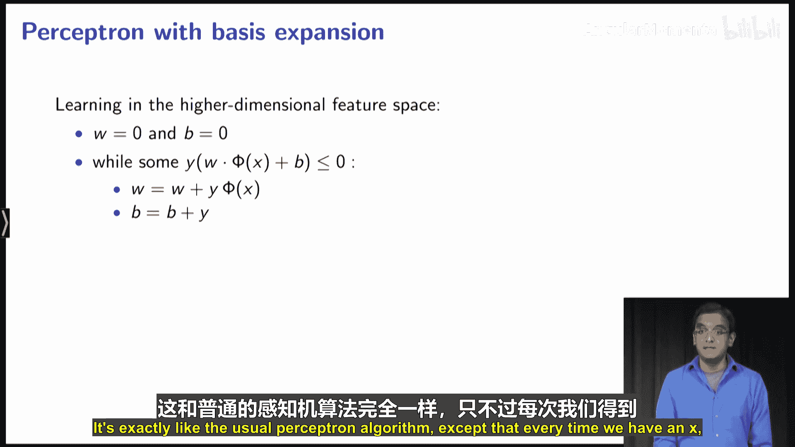

Except that every time we have an x， we replace it with the higher dimensional representation phi of x。

And last time we saw some pictures of the kind of quadratic boundaries that this produces。

So this is all well and good。But there is one fairly significant problem。

And that is that these expanded feature vectors。Can be very high dimensional。

So let's look at the situation of MNIS， for example， the MNIS dataset set of handwritten digits。

Theyre the original dimension。The dimension of the data points x。Is 784。

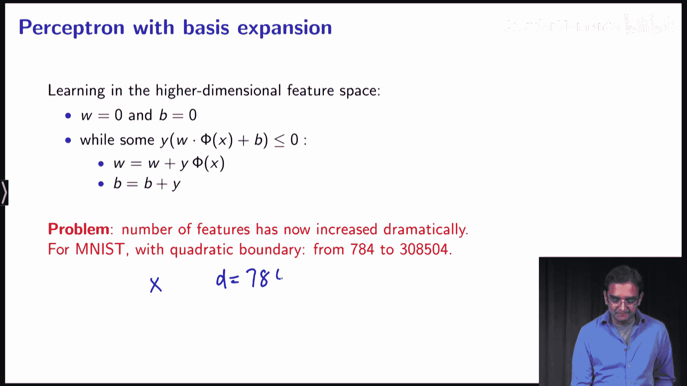

What is the dimension of phi of x？Well， we actually saw a formula at this last time。

 but roughly the dimension is about d squared。

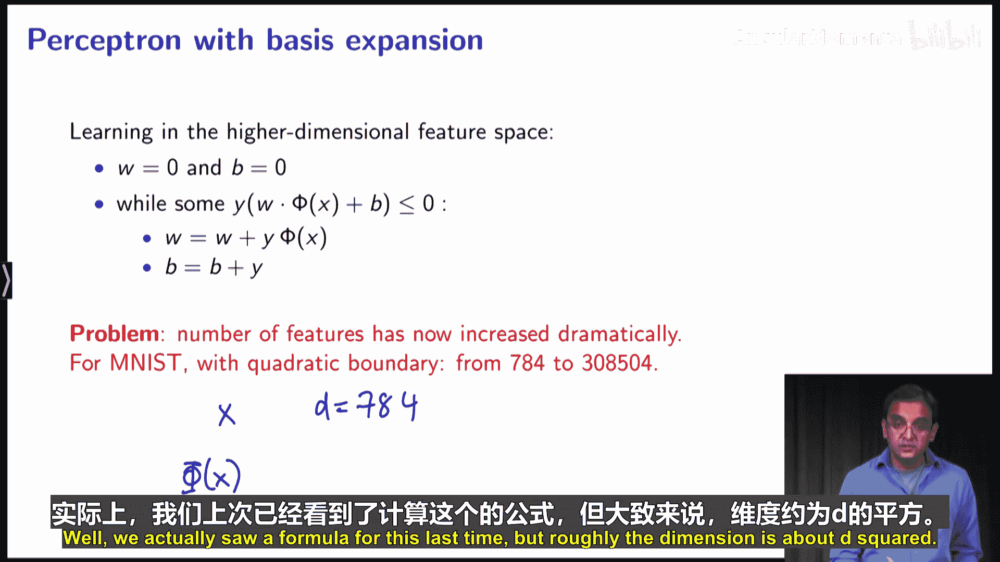

And in this case， it works out to 308，504 dimensions。

This is the space it it takes to write down a single data point。Okay。

Now this is way more time and way more memory than we want to spend on individual data points。

 and it's enough to render this method impractical。So is there anything we can do？

And it turns out that there is， it's called the Colel trick。

The idea is that we can take the same algorithm。And implemented without ever writing down anything in the higher dimensional space。

How do we do this？Okay， let's take this one step at a time。

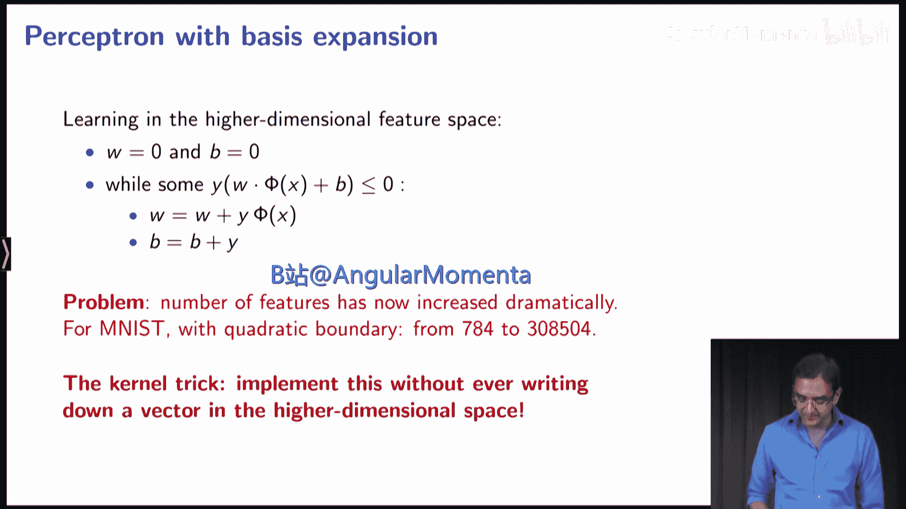

So here's the algorithm。That we want to implement the Perceptproron algorithm with basis expansion。

Now， a bunch of the vectors that we're dealing with over here are potentially very high dimensional。

 so in the case of MNT。The x's are 784 dimensions。The p of x is。We set are over 300，000 dimensions。

What about W？Is W 784 dimensions， or 300，000。Unfortunately， it's 300，000。Well， W is the final answer。

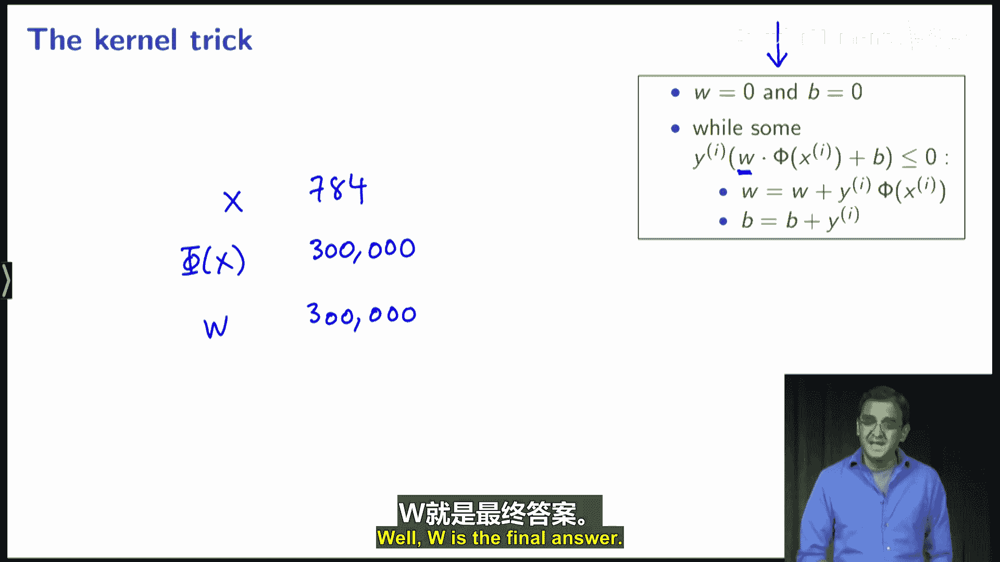

We can't avoid writing that down surely。Well， actually we can if we move to the dual form of W。Okay。

 so last week， we talked a little bit about the dual form of the perceptron algorithm。

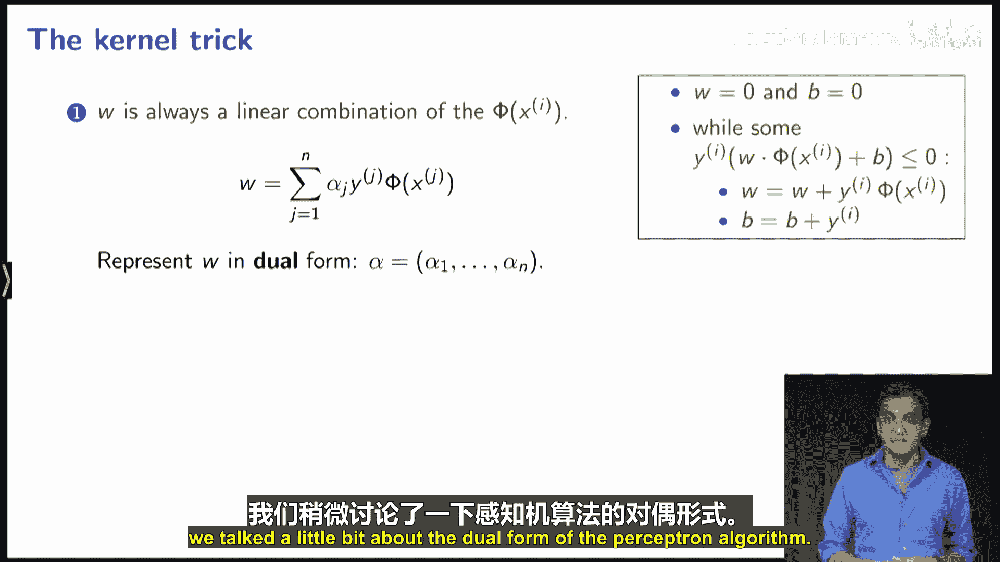

And the main observation over there。😊，Is that the W vector at any given time， is of this form。

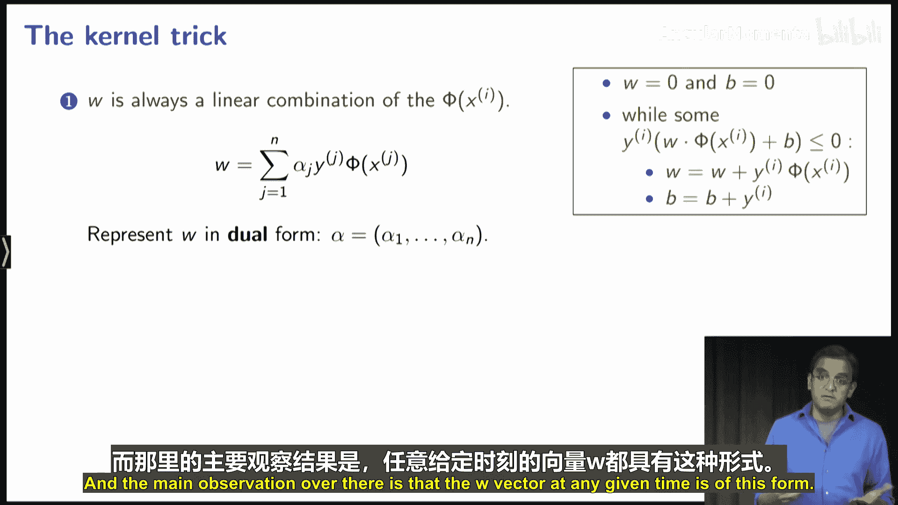

You see we start W at 0。And the only way we modify it is when we are updating on a specific point。

And when we update on the Ith point， what we do is we add Y I phi of Xi2 W。So at any given time。

 W looks like this， where alphage is exactly the number of times we have updated。On the Jade point。

So。Instead of working with W， we can instead equivalently work with the coefficients alpha1 through alpha n。

There is one of these coefficients for each data point。

 and we can put them together into a vector alpha。

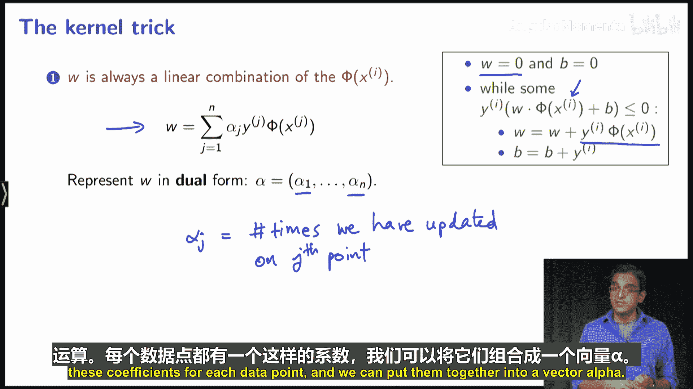

And from alpha we can， if we like， recovercover W。Okay， so we have solved the problem with W。

 We're just not going to use it at all。 Instead， we are going to use the dual representation alpha。

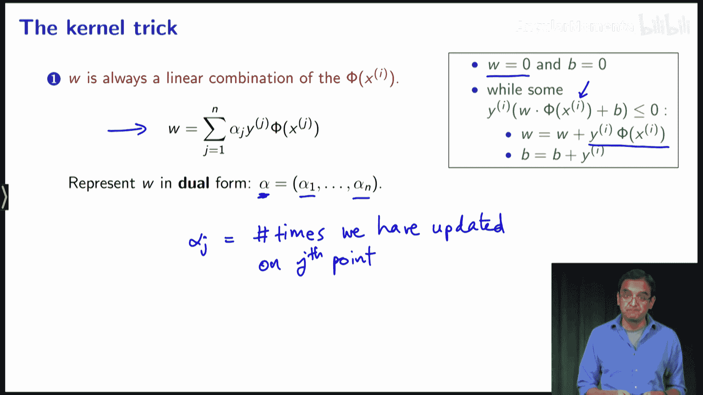

Okay， so the first problem is solved。But now it does look like in order to classify a point。

We need to compute w dot3 of x。How do we do this without actually writing out W。 Well， again。

 we use the dual form of W。 Okay， so w dot v of x。 well， what is w。

 Let's just plug in this formula right here。We have the sum over J。Of alphapha J。Yhy J？Phi of x J。

And we want to take this whole thing dot product with Phi of x。

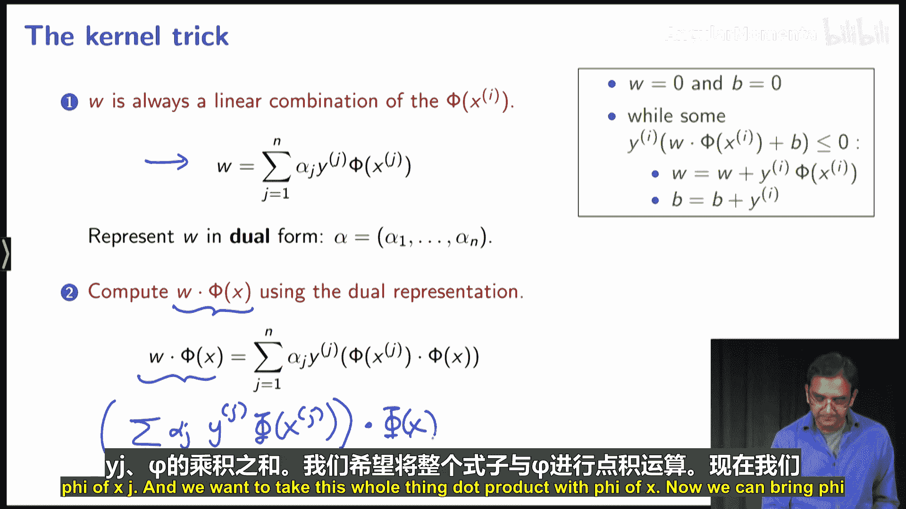

Now we can bring phi of x inside the parentheses， and then we get exactly this formula over here。

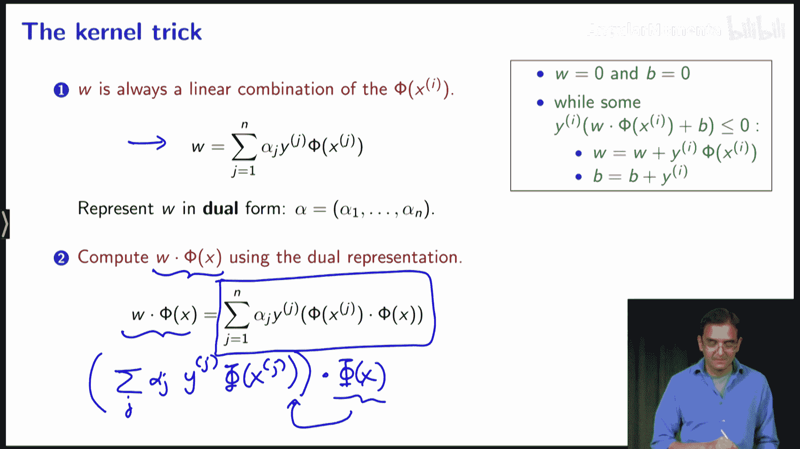

So we don't need W after all， we can work directly with the coefficients alpha。

 alpha 1 through alpha M。Okay， so to compute the dot product， w。v of x。

 we simply sum over all the data points。Of the coefficient for the date， Jth point， alphapha J。

The label for the J point， Y at J and the dot product。Of phi of x J with phi of x。

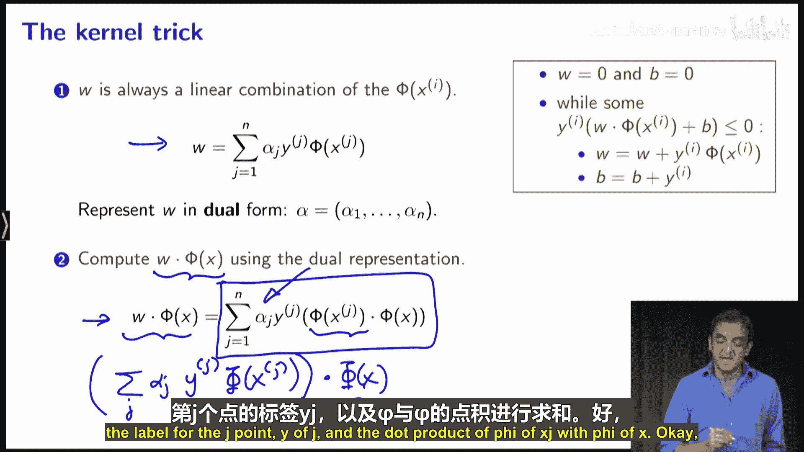

Okay， so we have eliminated W effectively。But there's still something that's a little bit troubling。

 It looks like we have to compute these dot products over here。The dot product between two， say 300。

000 dimensional vectors。How do we compute these dot products。

 don't we at least have to write the vectors down？Surprisingly， it turns out that we don't have to。

It turns out that for any X and Z， we can compute the dot product。

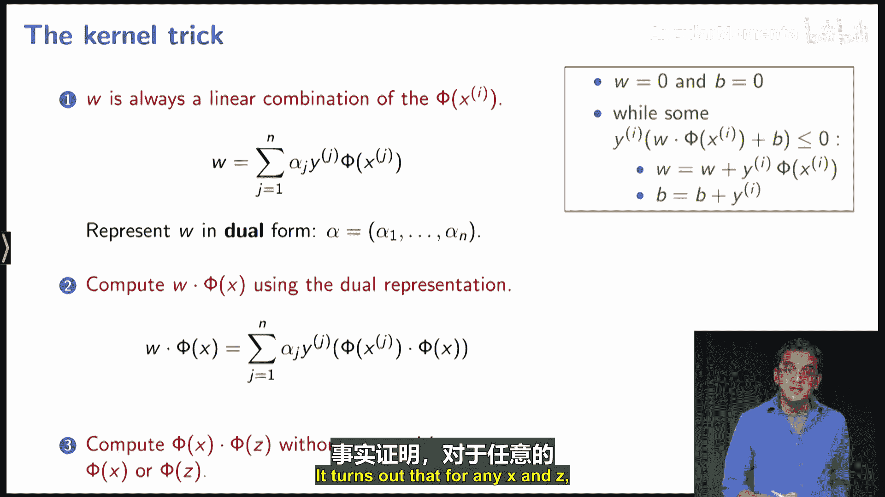

Phi of x do phi of c without writing down either phi of x or phi of c。

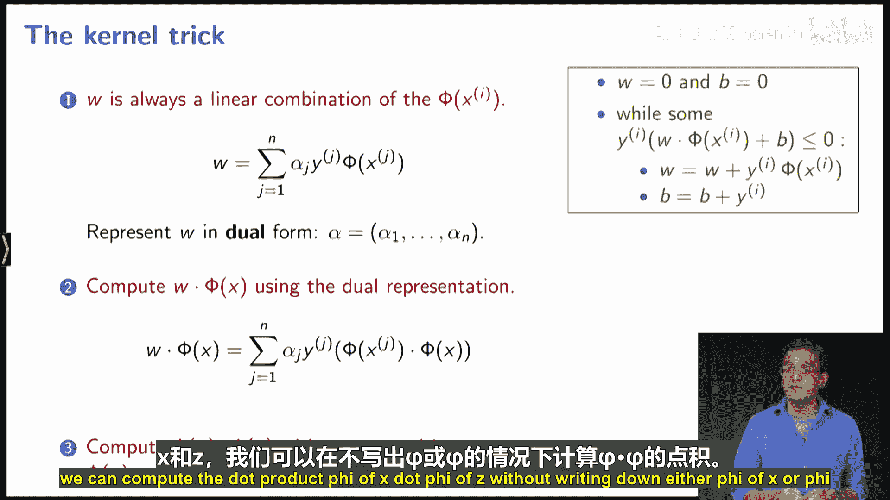

And let's see why this is the case。so let's start with the two dimensional case。

 so we have data points x with two features， and in this case the expanded representation p of x contains those features as well as their squares。

 as well as the pairwise1 x1x2。Now let's actually tweak this a little bit， okay。

 we'll throw in an extra feature that's identically one and we'll stick a square root two in front of some of the features。

😊。

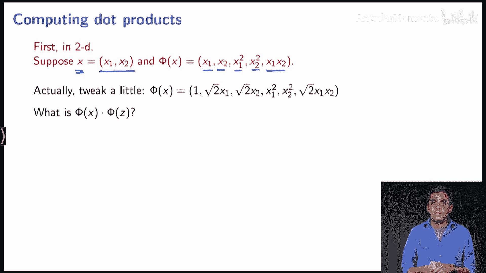

This is linear in the original p of x so it doesn't really change things any function that's linear in the original p of x is linear in the new phi of x and vice versa。

😊。

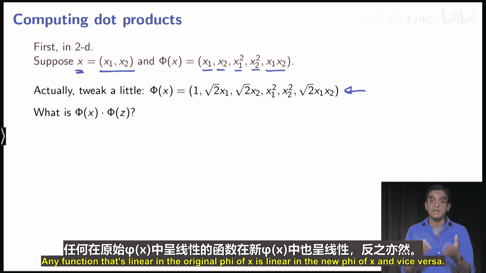

So we'll work with this slightly modified representation。What is the dot product， P of X with P of Z？

Let's write it out。 Okay， so phi of x contains1 square root 2 times x1， square root 2 times x2。

 x1 squared x2 squared and square root 2 x1 x2， and we're going to take the dot product of this with p of z。

 which is1 square root 2， z z1。

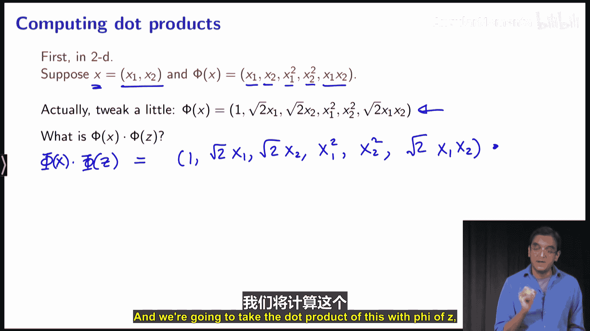

Square root 2， Z2。Z1 squared， z2 squared and square root 2。

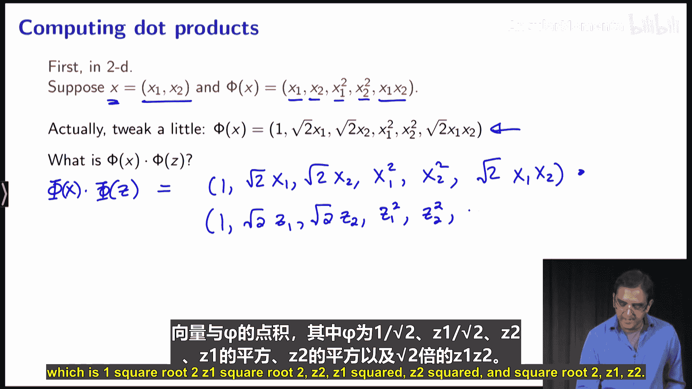

Z1 Z2。Okay。

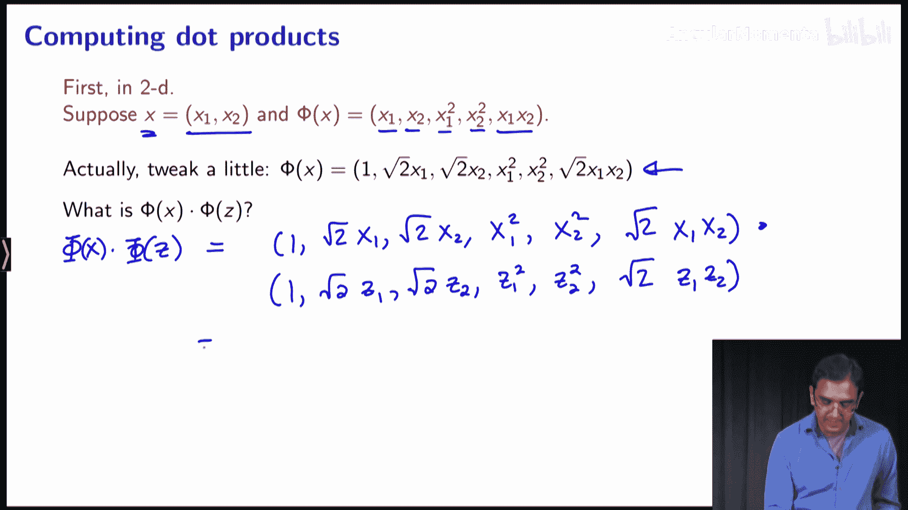

So let's multiply this up， we get1 plus 2， x1 z1。Plus 2， x2， z2。Plus， x1 squared， z1 squared。

Plus x2 squared z2 squared， plus 2， x1， x2， z1， z2。

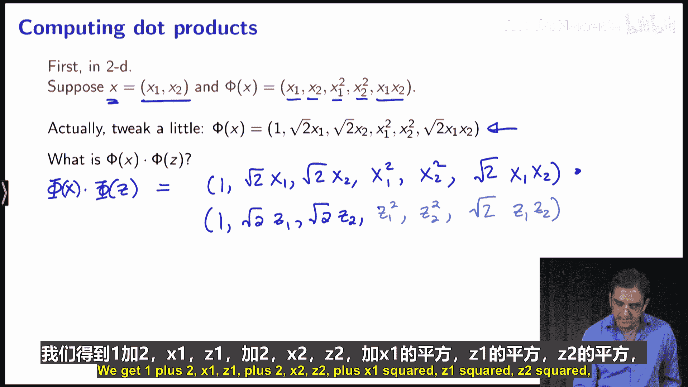

Okay。Now it turns out that you can simplify this expression。It's actually equal to one。Plus， x1 z1。

Plus x2， z2 squared。Okay， and if you stare at it a little bit， you'll see that this is true。Okay。

So in other words， it's equal to 1 plus x dot c squared。

So the dot product between the higher dimensional vectors。

Is the dot product between the original low dimensional vectors plus one squared。

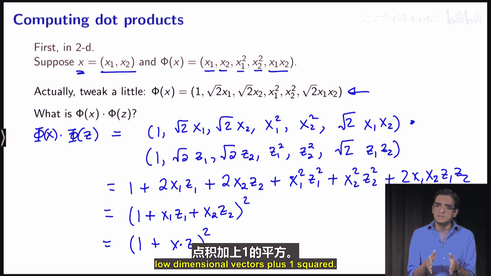

Now， exactly the same thing holds。When the original vectors are de dimensional。Okay。

 so we start with x that is D dimensional。We look at the expanded representation and again we tweak it a little bit。

 we add in a feature that's identically one and we put some square root2s in there。

And if you compute p of x dot p of z， it turns out that it's exactly x dot c plus1 squared。

So in the case of Eminist。😊，To compute the dot product between two high dimensional vectors to 300。

000 dimensional vectors。You simply compute dot products between the original 784 dimensional vectors。

And then you take the answer， you add one and you square it。It's very simple。

 and it's something we can do efficiently without ever writing down。

Anything in the 300000 dimensional space。 So here is the kernel perceptron algorithm。

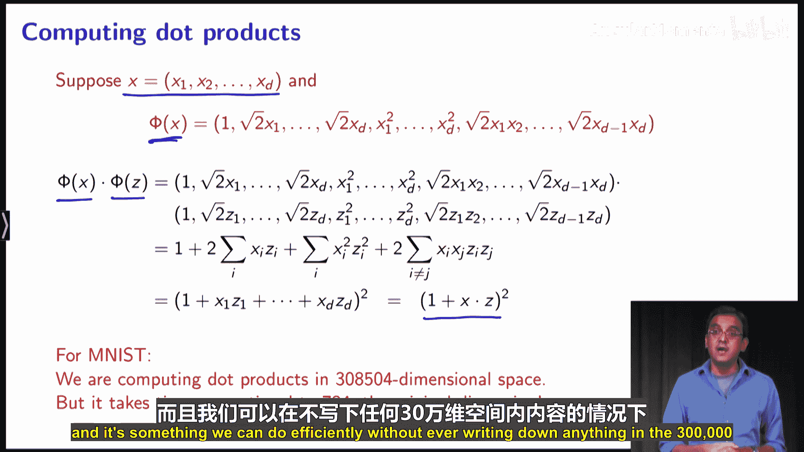

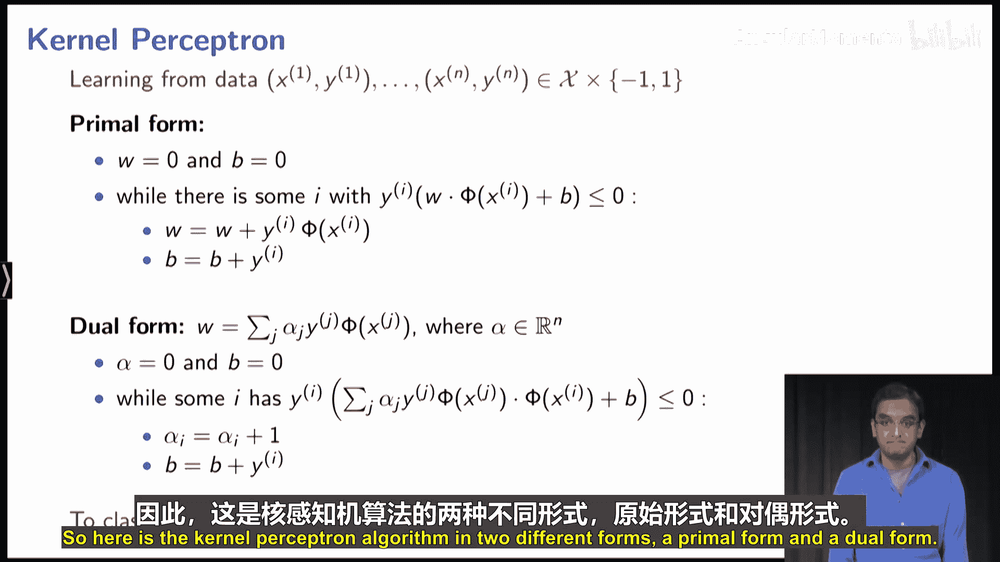

In two different forms， a primal form and a dual form。Okay， so the setup is we have a data set。X 1。

 y 1 through x and yN。In the primal form， which is the form that we use with basis expansion。

We are working with W and these expanded representations fee。This is a perfectly correct algorithm。

But the downside is that W and these fees can be extremely large。

 so large as to be impractical in many situations。To deal with those cases。

 we can instead use the kernel trick and work with the dual form of the algorithm。

 which is shown down here。Here we avoid W altogether。And work alternatively with the factor alpha。

 the vector of coefficients。The updates in this version of the algorithm are extremely simple。😊。

We start by setting alpha to 0 and the offset B to 0。And then we cycle through the data。

Each time we come to a data point that's misclassified， let's say it's the IT data point。

All we do is to increment alpha sub。And add the label Y sub。

 which is either plus  one or minus1 to B。These are childishly simple updates。

The only thing that looks remotely complicated is that we have to compute these dot products between the high dimensional embeddings of the data points。

And as we've seen， this is something we can do efficiently without ever writing down the high dimensional vectors。

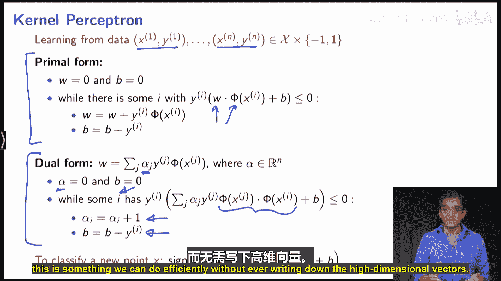

Now to classify the data point， to classify a new test point。We again use the dual form of W。

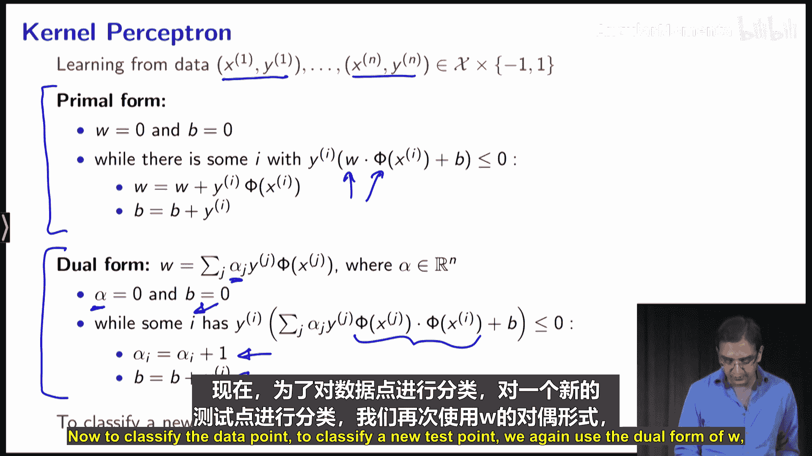

And we use this rule Okay， so this is equivalent to doing the sign of w dot v of x。Tos speed。

A linear classifier in the high dimensional space of phi of x。

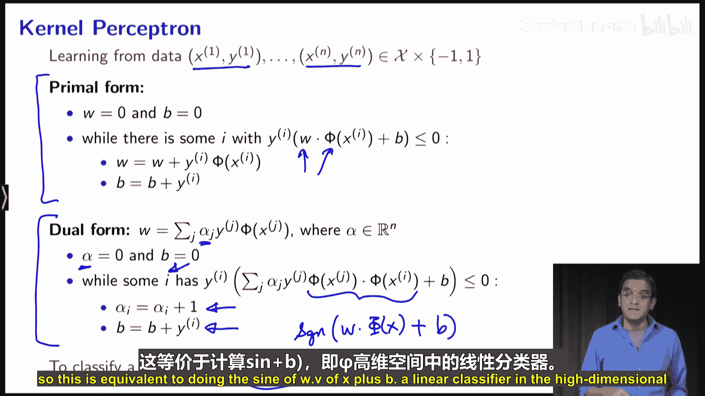

Now， last time we saw some of the boundaries that the perceptron algorithm with basis expansion yielded Okay。

 so here's a situation that's not linearly separable。

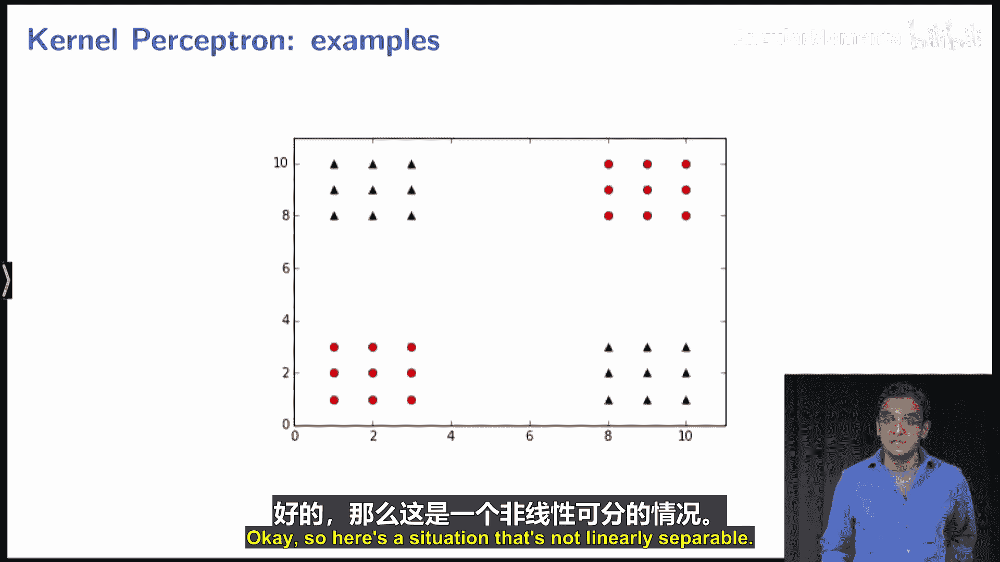

And the preceptron algorithm gave us this boundary which looks like part of a parabola。Now。

 the points that are shown in bold like this point over here are points for which alpha is not0。

 Okay， so the alpha vector has got to coordinate for every single data point。 And in this case。

 there are 36 data points。 So alpha is 36 dimensional。

Some of those features on zero and the ones shown in bold over here are the coordinates corresponding to points on which they were updates and those are the non zero alpha sub。

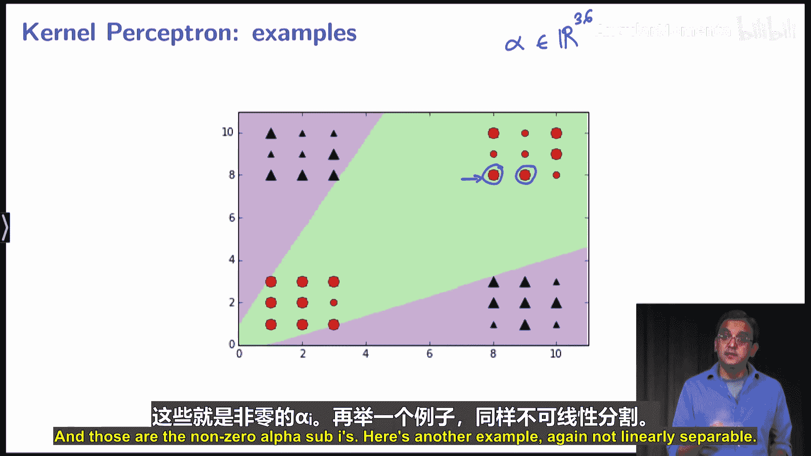

Here's another example， again， not linearly separable。

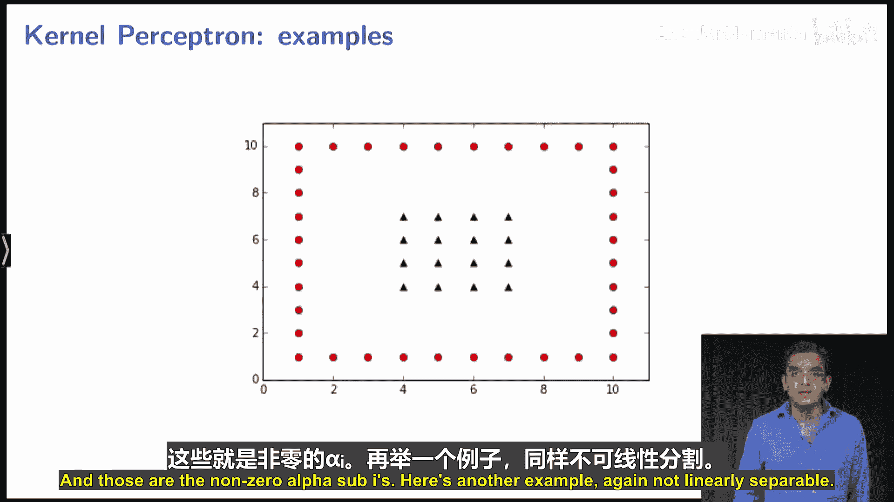

And here's a boundary that the kernelel perceptron algorithm yielded。In this case。

 almost all of alpha is non0。 There are just a few points in the corners。

On which no updates were ever made。Now。These are two dimensional data sets， and in this case。

 the expanded feature vector is only five dimensional。In situations like this， we could easily。

 easily use either the primal or the dual form of the algorithm。

They would both be perfectly efficient， but when the dimension of the data gets higher when it gets to 10。

 say or above。The primal form of the algorithm can become highly inefficient just because the expanded vector P of x becomes so large。

In those cases， the kernel trick is what saves us and allows us to use the dual form of the perceptron algorithm。

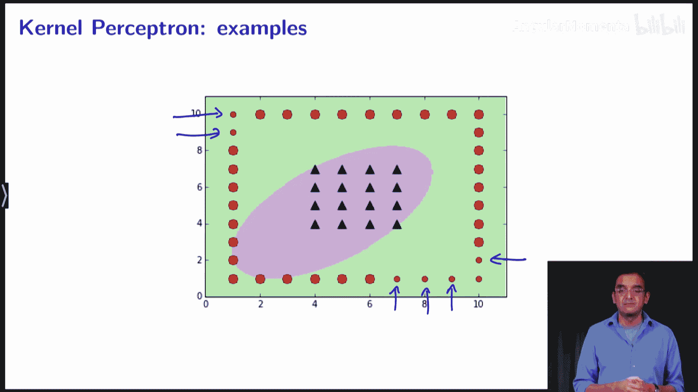

Okay， that's plenty for now。We've seen how the perceptron algorithm， just a few lines of code。

 can be modified to efficiently learn quadratic decision boundaries。

Next time we'll take this much further and show how we can deal with boundaries that are arbitrary polynomials。

See you then。