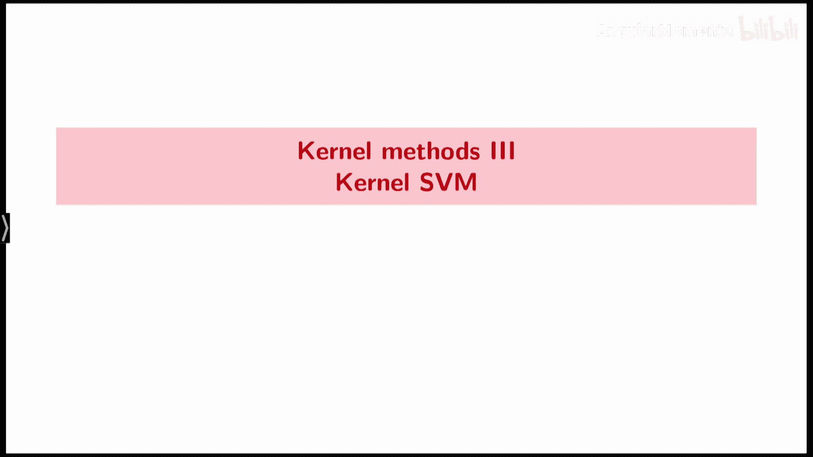
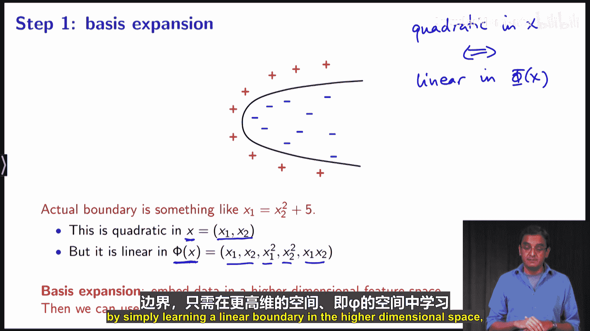
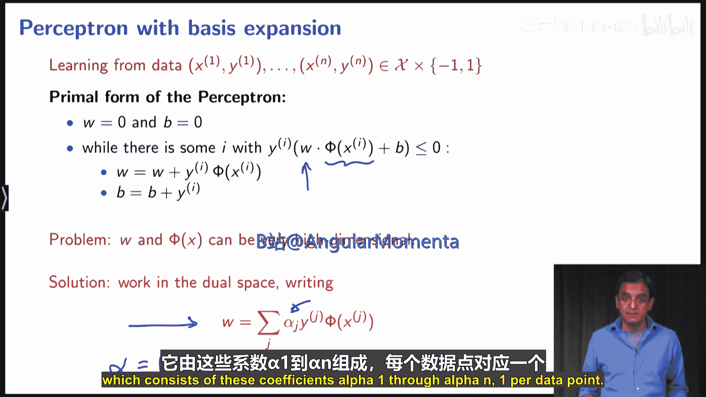
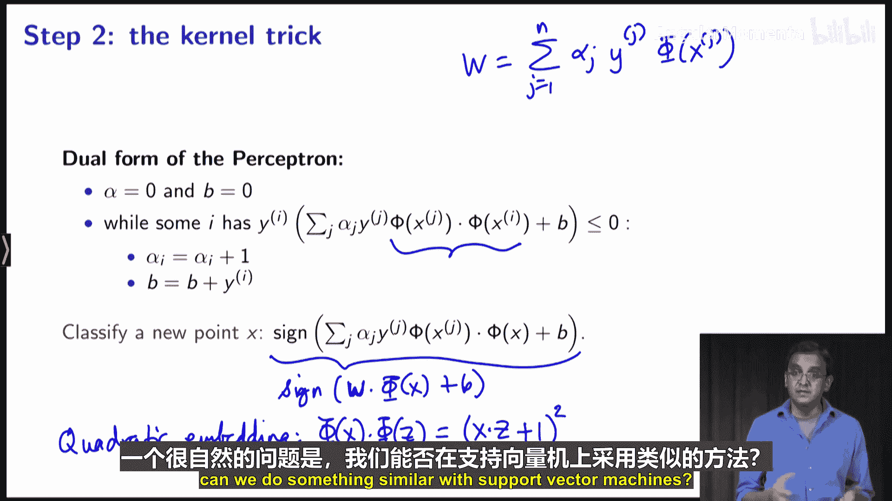
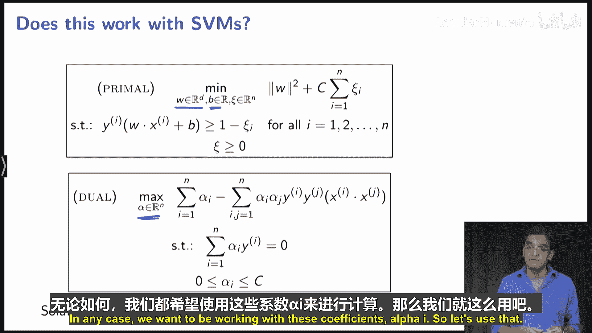
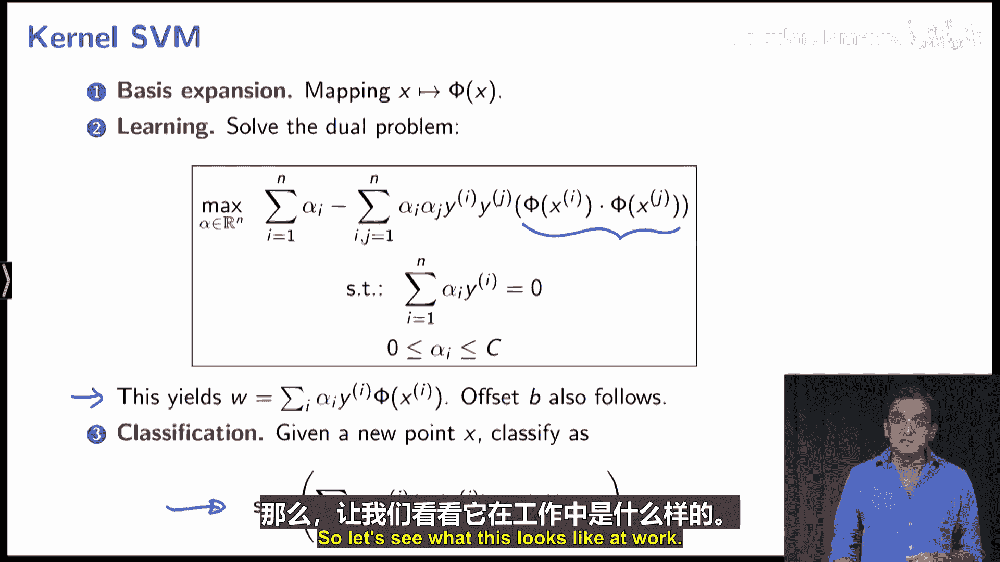
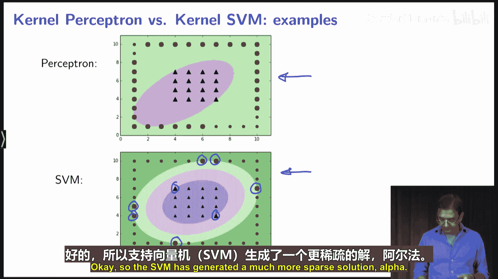
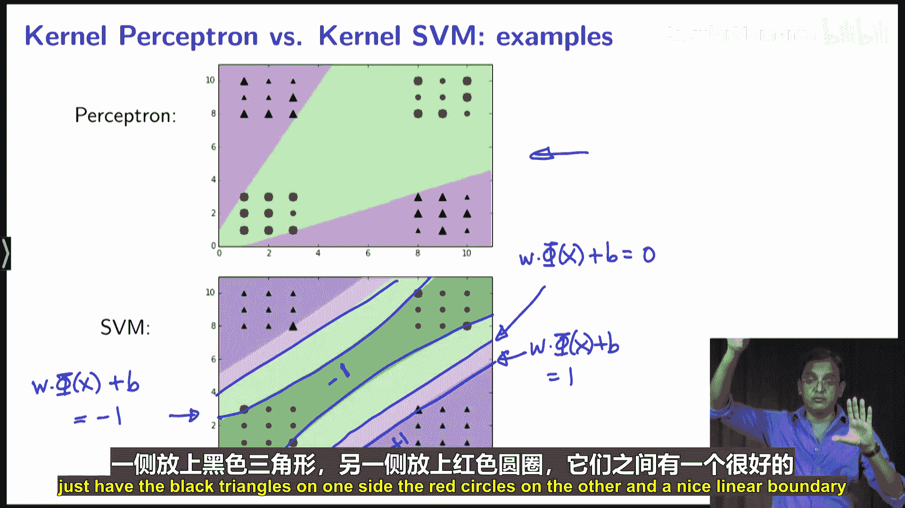
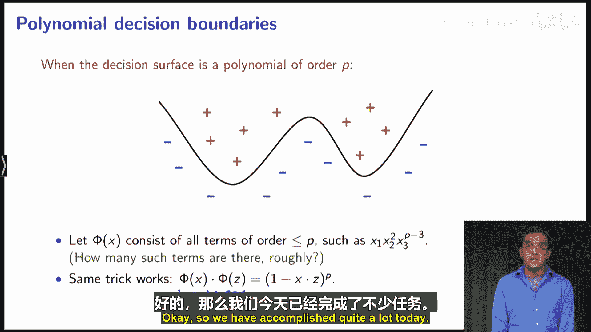

# 【加州大学圣地亚哥分校】机器学习基础  Machine Learning Fundamentals p38 08-03-02-核支持向量机 -BV1TyFSziEZb_p38-

Last time we saw the Colel trick in its full glory。😊。

And it gave us an efficient version of the perceptron algorithm that can learn arbitrary quadratic decision boundaries。

Today， we'll see that we can do the same thing with support vector machines， and what's more。

 we can go beyond quadratic boundaries to arbitrary polynomials。

So our first order of business will be to kernelize the support vector machine。

And then we'll go ahead and see how we can get polynomial decision boundaries。

So let's begin with a quick recap。In the past couple of lectures。

 we've been looking at the problem of learning a quadratic decision boundary。😊。

Using simple methods for linear classification。There are two tricks that we've used so far。

The first one is basis expansion。So the idea here。Is to replace。A original data vectors？

With expanded vectors， fear X。So if the original data vectors。Have features， x1， x2， and so on。

The expanded vectors， vhi of x， have the same features。As well as the squares of those features。

As well as bearwise products like X1 x2。Now the reason for doing this。😊。

Is that if you have a boundary or if you have a function that's quadratic in X。Then。

It's also linear in P of x。And as a result。We can learn a quadratic boundary in the space of x。

 in the original space， by simply learning a linear boundary in the higher dimensional space。

 the space of p of x。

And this gave us the perceptron algorithm with basis expansion。

 which is just the usual perceptron algorithm， except that we replace x with phi of x。Okay here。Okay。

Now， there was a significant drawback to this algorithm。😊，Which is the these。

Expanded vectors phi of x and w can be extremely high dimensional。We saw， for example。

 that in the case of the Ms data set of handwritten digits。

 the original dimension of the data vectors is only 784。But these expanded vectors。

 fear of x are over 300，000 dimensions。This makes them very inconvenient to work with。

So the solution that we came up with is the kernel trick。

And the key idea there is not to work with W at all。But instead to work with the dual representation。

From the form of the perceptron algorithm， it's clear that at any given time。

 the w vector is of this form。 because we start w at 0。

 and the only thing we ever do to W is to add Y I phi of X I to it。 Okay， so at any given time。

 it's a combination of y I is p of Xs。 and these coefficients， the alpha J over here。

Is exactly the number of times we have updated on the Jth data point。So instead of using W。

 we are going to work with the dual form， which consists of these coefficients。

 alpha1 through alpha n1 per data point。

O。So here's the dual form of the perceptron algorithm， and as you can see。

 all mention of W has disappeared。Okay， so we're working entirely with the alphas over here。

 we initialize them to one。We cycle through the data。

And if we get to a point on which we've made a mistake， say the IT data point。

 all we need to do is to increment alpha I， the coefficient corresponding to the IT data point。

And either increment B or decremented。These updates are extremely simple。To classify a new point？

We simply use this formula here。Where。It's exactly the same as the sign of W dot phi of x plus B。

Except that we have substituted。W， we've substituted the expression for W using the coefficients alpha 1 through alpha N。

 Okay， we've substituted the formula W equals alpha J， Y J。Fear of ex。Okay。

 so all these operations are extremely simple， except for one。

 it looks like we have to compute dot products between these expanded data vectors。

 in the case of MNIST between these 300，000 dimensional vectors。😊，What we saw last time， however。

 is that we can compute these dot products very easily。😊，For the quadratic embedding。In fact。

We saw that this dot product。Fear of x dot v of Z。It's simply exancy。

So the dot product in the low dimensional space。Plus one squared。And as a result。

 the entire algorithm is extremely efficient。So this works so well that a natural question is。

 can we do something similar with support vector machines？

So let's take a look。So in the case of support vector machines。

The way we do learning is by solving an optimization problem。

 and we've seen two versions of this problem， the primal form and the dual form。

So in the primal form， we're solving directly for W。And for the offset beat。In the dual form。

 we are solving for the coefficients alpha which have the same interpretation as with the perceptron so W。

Is out this form？The alpha I is just the coefficient for the I data point。

So which of these should we with， should we work with the primal form or the dual form？Well。

 it looks like the dual form gets us halfway to where we want to be in any case。

 in any case we want to be working with these coefficients Al I， so let's use that。

So here is the kernel SVM， we have a particular embedding。

 we've seen what it is for quadratic decision boundaries。

And now we solve the dual optimization problem so our data points are X I，Yi。For the dual problem。

We have to compute dot products。Between the expanded forms of these data vectors。

 we have to compute dot products between all P of Xi and phi of Xj。That's okay。

 We've seen that these dot products can be efficiently computed。 We compute these dot products。

 we also have the Y's and Yjs which are just plus or minus1。

 and we just hand all of this over to the optimization package and it gives us back alpha。

And in order to classify， again， we use the rule the s of w dot phi of x plus B。

 or we can plug in the dual form for W， and we get this classification rule right here。So it's all。

 very straightforward， using exactly the same ideas as we developed in the case of the kernelnal perceptron。

So let's see what this looks like at work。

Over here， we have a dataset set that we saw before。

 And this is the boundary that the theceptron algorithm came up with。 It's a quadratic boundary。

 It's an ellipse。 It's pretty good。 But look at the boundary that the kernelel SVM comes up with。😊。

It's much nicer。It's nicely centered。嗯。The points that I've shown in bold over here are the support vectors。

 And there's really very few of them。 There's 1，2，3，4，5，6，7，8。Just eight support vectors。

 so the final alpha vector in this case is mostly zero。

 there are only eight coordinates that are non zero。By contrast。

 the perceptron algorithm has ended up using almost all of the data points。

 so the SVM has generated a much more sparse solution alpha。

Let's look at another example so another data set that's not linearly separable。

 the perceptron algorithm comes up with some quadratic boundary。

And this is the boundary that the support vector machine comes up with。Okay。

 so what are these lines over here， Okay， so this is the decision boundary right here。

The formula for this boundary is w dot v of x。Plus B equals0。Okay。What about this boundary over here。

 What's that？Well， let's say that the greens are minus1。And that the purples are plus one。Okay。

 let's say that's how we code the classes。Then this boundary over here。Is w dot v of x？

Plus B equals minus1。Okay， and the corresponding boundary over here。Is w dot v of X。

Plus B equals one。Okay。Now， these boundaries look quadratic over here。

But in the higher dimensional embedding， in that five dimensional space。

 these are just linear hyperplanes。Okay， so this is what everything looks like in two dimensions in the five dimensional space。

 you just have the black triangles on one side。The red circled on the other。

And a nice linear boundary between them。

That has the maximum margin。嗯。Okay。So we've achieved a lot， okay， we found a way to get。

Qudratic decision boundaries using either the perceptron or the soft margin SVM。

 I think we can say that we have solved the problem of learning quadratic decision boundaries。

So let's go a little bit further， let's see if we can get decision boundaries that are more complicated。

 say decision boundaries that are higher order polynomials okay not just quadratic。

 but maybe polynomials of degree3 or degree 4 so here for example。Is a polynomial decision boundary。

 what is the degree of this polynomial？Well， it looks like it's turning three times。

 so the degree is at least four。Okay， so degree4 polynomial。

Can we learn decision boundaries like this？And it turns out that we can do this very easily using much the same trickrick。

😊，So what is our embedding， what is the expanded vector p of x in this case？So。As usual。

 we take the original features x1 through xt。But now we also throw in all terms of order up to p where p is the degree of the polynomial we want so for example。

 let's say we want a boundary that's a degree4 polynomial so in that case p equals 4。

So our expanded vector vhi of x will have all the original features。

But it'll also have turns of order up to4， terms like x1 to the 4。Or x2 squared， x7 squared。Or x1。

 x2， x3， x4。Or x1 cubed x8。 all terms whose exponents add up to4 or less。

There are a lot of such terms。Okay， it turns out that the number of such terms is。Roughly D to the P。

And click where D is the size of the original vector。And P is the degree of the polynomial。

But if we do this， we can again keep using our linear classifier technology because any function that is a degree P polynomial in X。

Is linear。In this representation phi of x。Okay， so it's the same idea now extended to polynomials of degree P。

So in order to make this work， these representations are now truly enormous。

 there is no way we can write down even one data point of this type。

Is there a kernel trick we can use， is there a way to do these dot products efficiently？

And it turns out that there is okay， so the dot product between phi of x and phi of z is again。

 just the dot product between x and z plus one， but now raised to the P power。

So things have worked out as simply as we could possibly have imagined。Okay。

 so we have accomplished quite a lot today。

We have created kernelized versions of both the perceptron and the support vector machine。

 and we've seen how these can easily and efficiently be used to learn any kind of polynomial decision boundary。

😊，The amazing thing is that there is even more that we can do with the Colel trick。 so stay tuned。

And see you next time。