# 【加州大学圣地亚哥分校】机器学习基础  Machine Learning Fundamentals p39 08-04-02-核函数 -BV1TyFSziEZb_p39-

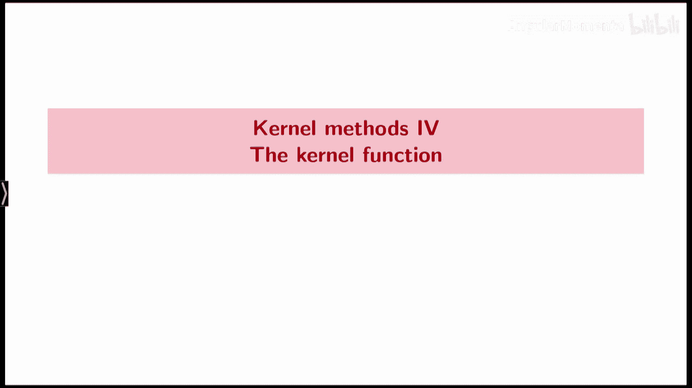

Our study of kernel methods has been full of tricks and surprises。First。

 we saw that the four line perceptron algorithm。Could actually get us quadratic decision boundaries by using basis expansion。

Next， we saw how we could implement basis expansion efficiently using the kernel trick。

Then we saw that you could do all of this with support vector machines as well。And finally。

 last time we saw how this could also be extended to get decision boundaries that are arbitrary polynomials。

So what we'll do today is to take all of this to a whole new level。We'll start。

By observing that the central object in the kernel perceptron and kernel SVM is something called the kernel function。

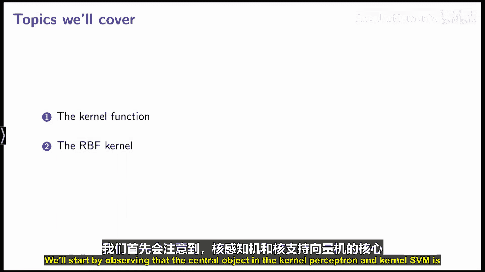

And this will open the door to all sorts of other dives of decision boundaries。

So let's start with a quick recap。Suppose we want a decision boundary that is a polynomial of degree P。

How can we get something like this using linear classification technology？

So the key is to use basis expansion。Instead of the original data vectors x。

 we create extended representations phi of x。Okay so this phi of x includes all the features that are in X。

As well as all terms in these original features that are of order up to an including p。

so for example， let's say that the original data points are two dimensional， so x has two features。

 x1 and x2。And let's say that the kind of boundary we want is a polynomial say of degree3。Okay。

 so p equals3。We then create an expanded representation fee of x。That includes the original features。

X1 and x2。As well as all terms of order，2。 So x1 squared。X2 squared。X1， x2。And all terms of order 3。

So x1 cubed。X2 cubed。X1 squared x2。And x1， x2 squared。Now these representations can get pretty large。

 so if x is originally D dimensional。And we want all terms of order P。

Then the size of p of x could potentially be something like D to the P。In case。

 we can be fairly large。And how exactly has this helped us， Okay。

 so the reason this helps is because any function。That is a polynomial of order P and X is actually just linear in p of x。

Okay， so this is the key idea。If we want to learn a decision boundary in the original space。

 that's a polynomial of order P。We can equivalently just learn a linear decision boundary in the higher dimensional feature space of F of X。

😊，And in order to learn that decision boundary， in order to learn that linear classifier。

 we can just use a standard method like perceptron or SVM。Now。

 the only downside to all of this is that these vectors， v of x。

 these extended representations can get enormous。So large， in fact。

 that we don't want to write them down at all。And this is okay because we don't need to。

For perceptron and 4D SGN， all we need to be able to do is to compute dot products。

AndIt turns out that we can do these efficiently okay， so as we saw last time。

The dot product between p of x and p of Z is just one plus x dot Z raised to the power of P。

So in other words， to compute the dot product between two high dimensional vectors。

 p of x and P of C， we just need to compute the dot product in the original space and then add one to the answer and raise it to the power of the。

It's easy。And this gives us the kernel SVM algorithm that we saw last time。

 so the first step is to choose a basis expansion， in our case。

 we would need to choose the degree of the polynomial。Once that's done。

 we learn a classifier by solving this optimization problem。The dual SVM optimization problem。

 Or more precisely， we don't solve it ourselves。 We hand it over to a standard SVM package that returns a classifier to us。

 Okay， so what information do we have to provide Well we have a training set， X 1。

 Y 1 through X and Y， N。And we have to supply to the optimization package， the labels， the Y eye。

And also， the dot products between all of these extended feature vectors。

 the dot products between each pair of data points in the extended feature space。Luckily。

 we've seen that this can be computed efficiently。So we compute all this information。

 we hand it over to the optimization package， and we get back a vector alphapha。And an offset bee。

Now alpha has got n coordinate one per data point。Last time we talked about what this alpha is。

 it's essentially the dual form of the linear classifier in the high dimensional feature space。😊。

So alpha and B specify a classifier。When we get a new point。

And we want to predict its label what we do is we compute this weighted sum over here so it's the sum over all data points。

Of the coefficient for that data point， alpha I。Times the label of that data point plus 10 -1。

Times the dot product between the extended representation of that data point and the extended representation of x。

 and these dot products， we can compute efficiently。 So we compute that sum， we add in V。

And if the result is a positive number， we predict plus1， if it's a negative number。

 we predict minus1。Okay。So that's all pretty straightforward。

 but there's something interesting going on over here。

Although we've explicitly specified what this expanded representation Theex is。

 we wrote down exactly what this representation was。In the algorithm。

 we do not construct V of X at any point。All we ever use are these do products。And in fact。

 this is the only way in which we ever look at the data。

Our only access to data is through these dot products in the high dimensional feature space。

So these dot products really are the central object， so let's give them a special name。

 Let's take this dot product over here and call it。Ki。😔，呃，的。ET data point。And the Jaith data point。

Okay， so more generally。We'll say that for any two points x and z in the original feature space。

K of xc is the dot product of the expanded representation of x。

With the expanded representation of the sea。And we're going to call this the kernel function。Okay。

This is the only way in which we access the data so we can just go ahead and rewrite all of our algorithms。

 kernelonel SVM， kernelonnal perceptron， entirely in terms of the kernel function。Okay。

 so let's see what we get for connal SVM。Okay。So now we begin by selecting a kernel function。

For example， if we want a polynomial of order P。We know that the kernel function would be。

Something very simple。 It's1 plus x dot c raised to the power of P。Okay。

So we select the kernel function。Then we learn by solving this optimization problem。Okay， so again。

 we have this data set x1 y1 through x and YN。And we compute the kernel。

But the kernel function between all pairs of data points。Okay。

We hand this information over to the optimization package， it gives us back our alpha and our beat。

And now we've learned our model and to classify a new point， we evaluate this sum。

 and we return its signed。Now， one thing about the kernel function is that it's useful to think about it as a sort of measure of similarity between data points。

😊，The closer two data points are to each other， the more closely their vectors are aligned。

 The higher the dot product is going to be。 So the kernel function is some sort of notion of similarity between points in the original feature space。

Okay。Okay， so what have we， What have we done so far。 Okay， we've noticed。

That this embedding phi of x is something we never construct in the algorithm itself。 Okay。

 which is a relief， because it's something that's potentially enormous。😊，Instead。

 our only access to the data is through dot products between these high dimensional representations。

 and so we gave that a special name， the kernel function。😊。

We also noted that this kernel function is essentially some sort of notion of similarity between points。

 between the points x and Z。And we saw how we could rewrite the support vector machine entirely in terms of the kernel function。

What about the piceptron algorithm， what does it look like when read written in this way？

So let's see here it is， it is just wonderfully simple。We start by initializing the parameters to0。

Then we just cycle through the data until everything's perfectly classified。If at any given point。

 we happen' to misclassify some point， say the light data point。

All we do is to increment the coefficient alpha I。The coefficient for the I data point。

And to the value B， we add the label wise sub。That's it， extremely simple updates。

We learn a model in this way， and when we want to classify a new point x。

 we compute this weight at sum。Exactly the same as with the SVM。 And we return its sight。

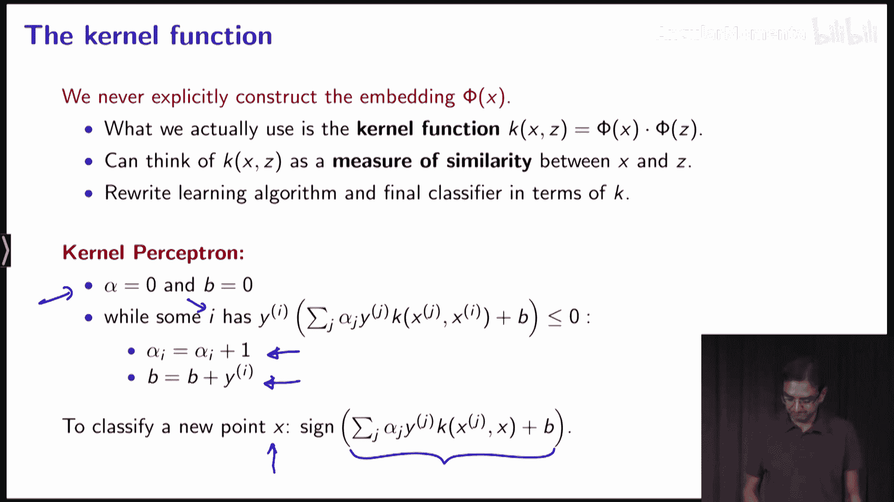

So let's look a little bit more closely at this sum over here。

What is this weighted sum that we use for classification at the end？

It's really some sort of similarity weighted vote。In order to classify a point x。

We compute the similarity to the first data point， the similarity to the second data point。

 all the way to the similarity to the end data point。And based on these similarity values。

 we take a weighted vote of the labels of these points。Okay， so for example。

 if point x is very similar to x1 to the data point x1。

And very dissimilar to all the other data points。Then this term will prevail。And will。

 we may well output just the label Y1。Okay。So this is something that is very intuitive。

 It makes perfect sense when we think about similarities。And it makes sense。

 even if we don't care what the decision boundary looks like。

 whether it's linear or quadratic or cubic or whatever。And so this raises an interesting question。

Can we just choose any similarity measure we want。Can we just pick any similarity measure K。

So for instance。Let's say that we are classifying documents。

Can we just pick some similarity measure between documents that make sense to us， for example。

Let's say x and Z are documents， and we define the similarity between them to be。

The fraction of words on which they agree。A fraction of common words。Or some such thing。

Are we allowed to do that， Are we allowed to just put down any similarity measure that sounds good to us。

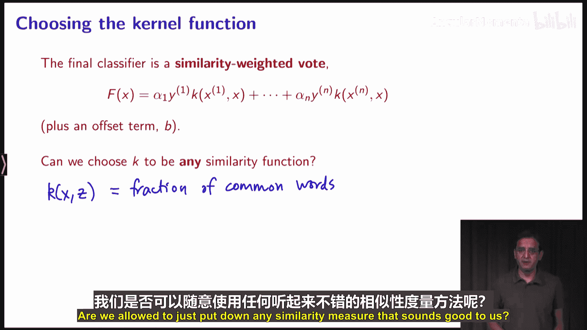

And then go to the preceptron algorithm and use that similarity measure。

And get back this vector alpha and this offset B and use this classification rule over here。

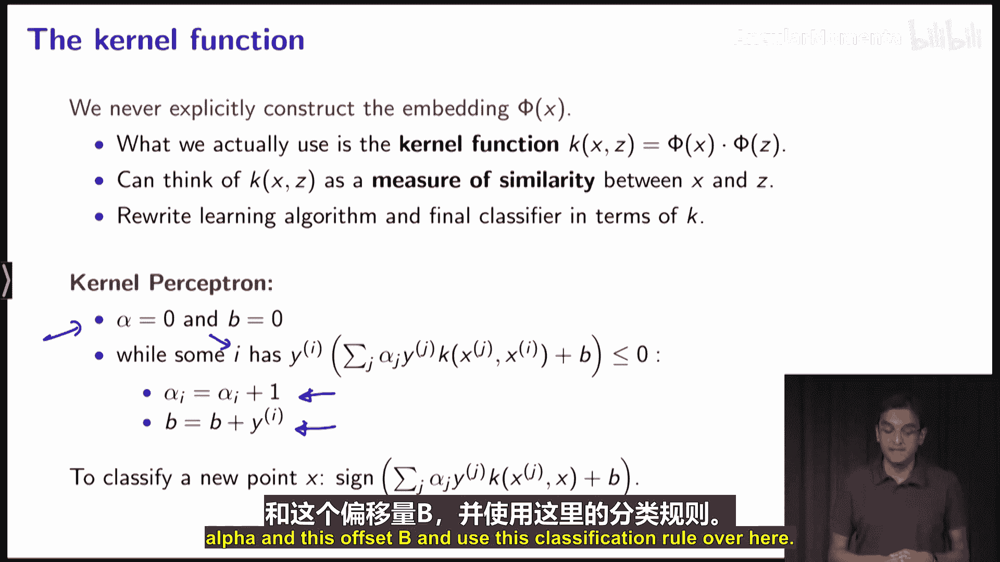

That's a very intriguing prospect。Okay。So it turns out that we can almost do this， but not quite。

What we need is for the similarity measure。😊，To correspond to dot products in some high dimensional expanded feature space。

It doesn't matter what exactly this extension is。As long as it exists。😊，Okay。So how do we do this？

We cook up some similarity measure。How do we check if it's legitimate in this way。

How do we check if there is some extended representation phi of x such that dot products in this extended representation will exactly give us Kx Y？

This sounds difficult to do。Well， it turns out that there's a fairly simple way of checking or at least conceptually simple。

😊，And it's called Mercer's condition。So here's what you need。D any finite set of data points。

 say x1 through Xn。So M data points and now you want to check your similarity functions。

 you have the similarity function， you want to check if it's okay if it's a valid kernel function。

So what you do is you take these M data points。And you compute similarities between all pairs of them。

And you write these down in an M by M matrix， let's call that matrix K。Okay。

 so k is an M by M matrix where the Ij entry is the similarity between data point I and data point J。

 so it's this matrix over here。What we need is for this square matrix to be positive semi deffinite。

Okay， so this is the notion of positive semidefiniteness again。The last time we encountered this。

 we were trying to check if functions were convex。 And now the same thing has come up。

 but in an entirely different context。No matter， it's something we know how to check。

And this is one way in which we can confirm that the similarity function that we like。

 something that we've cooked up and that appeals to us is actually a legitimate kernel function。

This has opened the door to all sorts of kernel functions。

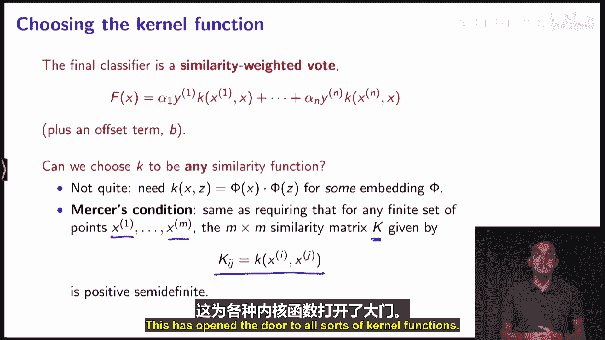

So for example， here is a very popular kernel function。

It is called a Gaussian kernel or RBF Radial basis function kernel。

And it defines the similarity between two points， x and z。

To be E raised to the power of minus the distance between x and E squared。

 divided by a scaling factor as squared。Okay。So what is this exactly， Well let's see。X equals C。

 then the distance between them is 0。And so that exponent over there becomes 0。 Okay。

 And so the similarity becomes one。 Okay， so if x equals z。Then k of x e is equal to one。Okay。Now。

 as x moves further away from Z， the distance between them grows。 And so the exponent gets smaller。

 And so it drops below 1， and it keeps getting smaller and smaller。

 So k of x e is always in the range0 to 1， and it's maximizeimd when x equals Z。

 So it really is a fairly sensible notion of similarity。😊。

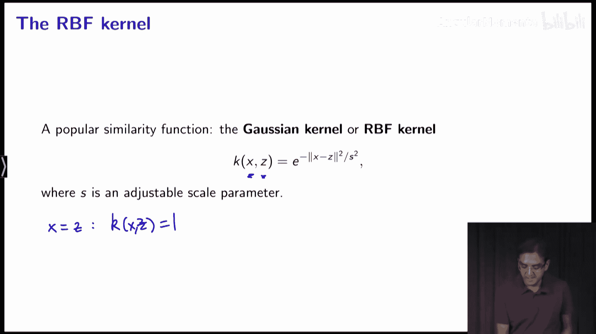

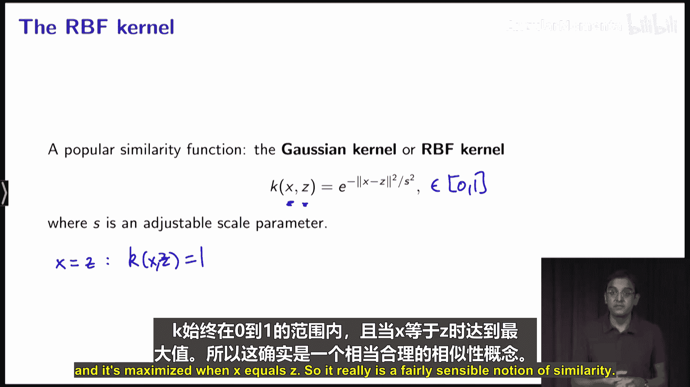

It's also a valid kernel function。That means that， in fact， K of x z is equal to p of x。Dot Pency。

For some extended representation fee。What are these extended feature vectors in this case。Well。

 it turns out they are infinite dimensional， but it doesn't matter。 We never need to construct them。

 We just need the dot products， and the dot products are very easy to compute。

 So let's see the R B F kernel in action。Here's a familiar data set。

 a 2D data set that's not linearly separable。We run the support vector machine with the RBF kernel。

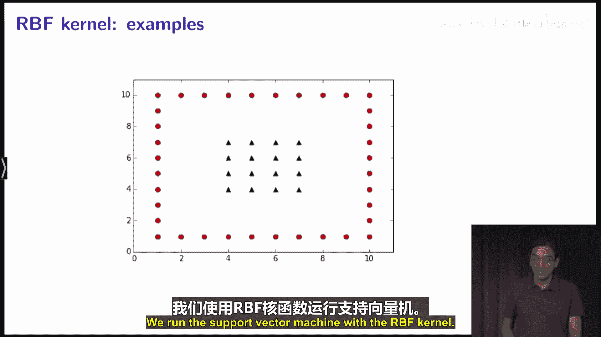

And here's what we get。 a beautiful decision boundary。 Okay， now。

 the points shown in bold are the support vectors， and there's just a few of them。😊。

So we get a nice sparse solution containing just these 12 support vector。

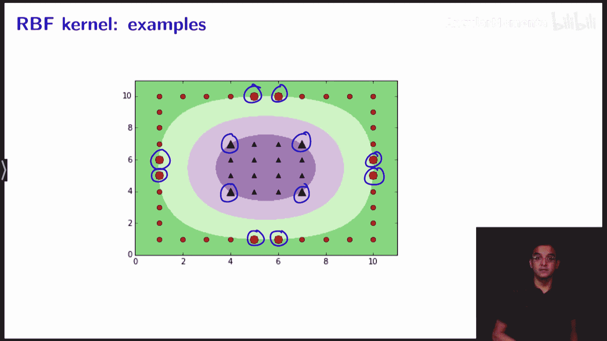

Very nice job。Here's another binary classification problem。 This one is a lot more tricky。 Okay。

 so this if we wanted to use a polynomial kernel for this。

 we would need a pretty high degree polynomial。

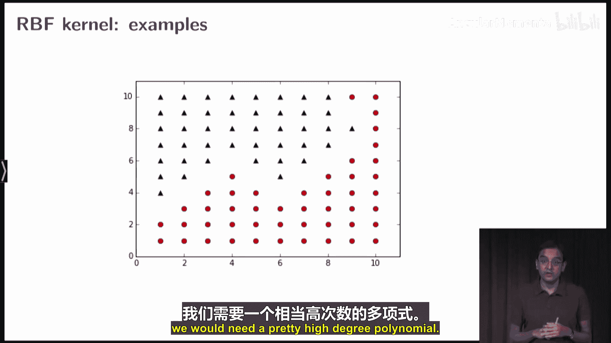

But the RBF kernel has no problem at all， and this is the decision boundary it comes up with。Okay。

Perfectly separates the data。And well， here's a question。 look at this point over here。

Why is that a support vector， The support vectors are supposed to be the points that are on the margin or on the boundary in some way。

 But that seems to be an interior point。How did that happen？Well。

What actually on the margin or not is not something that can be assessed in the low dimensional space。

Remember， in a sense， what's actually happening is that were finding a linear classifier in the higher dimensional feature space。

In the case of the RBF kernel， this higher dimensional space is infinite dimensional。

So in that infinite dimensional space， the black triangles are on one side。

The red circles are on the other side， there is a nice linear classifier。

And that black triangle over here， this point。

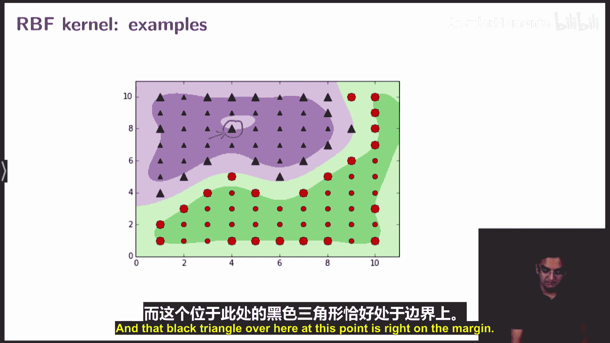

Is right on the margin。Okay。Okay， now this RBF kernel seems very attractive。

But it's got the scale parameter S。What is what is this parameter doing。

 What is the effect of changing that parameter Okay。

 and that's something that we need to discuss a little bit。 Yeah now。

 recall that at the end of the day， the prediction function， F is going to be a weighted vote。

 a similarity weighted vote given by this formula over here。

How is this function affected as we vary S。 Okay， let's look at two extremes。

 S going to infinity and S going to 0。So let's see what happens first as S goes to infinity。

When it goes to infinity。Let's see what happens。Well， we are dividing by infinity。

 which means that exponent basically goes to 0。 So all similarities become the same。

 They all become equal to one。と。So all similarities become identically one。

And that means looking at the formula for F。That it will return the same answer for every point X。

 these similarity values。Between the data points X I and X will all be identically equal to one。

And so the value of F of x will be the same at every data point。Okay， so the prediction。

Is always the same。This is the sort of thing wed do if we had essentially no data。

Now let's look at the other extreme。When S is going to0。In that case。

 what's happening is that we are dividing over here by a tiny number。

 And so that distance x minus z squared， we effectively multiply it by some huge number。

 so all distances get magnified。😊，That means any differences in distances get amplified dramatically。

Okay。So if we get a new point X。Okay。And let's look at the point that it's closest to。

 let's look at the data point that's closest to， let's say it's X1。If we let S become really small。

Then that particular similarity value will get magnified dramatically relative to the other similarities。

 and the label we will predict will simply be y1。😊，Okay， so as S goes to0， all differences。

In similarity， get amplified。And essentially， we start。Behaving rather alike near his neighbour。

So these are the two extremes of the RBF kernel。As we get more data。

 we would clearly want to move from the left towards the right。Okay， well。

 that's all we are going to be able to say about Colel methods。

And that's unfortunate because there really is a lot more to be said。

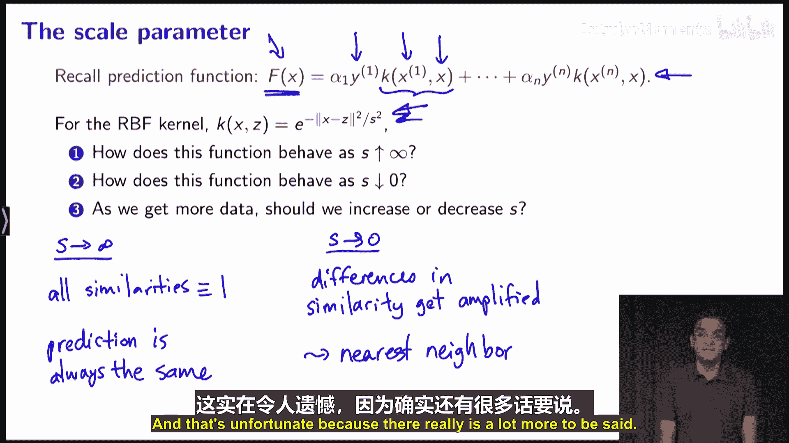

But we have to move on to other topics。 and if you are interested in this area。

 I would really urge you to delve into it much further。See you next time。

