# 机器学习基础：08-04-02：核函数 🧠

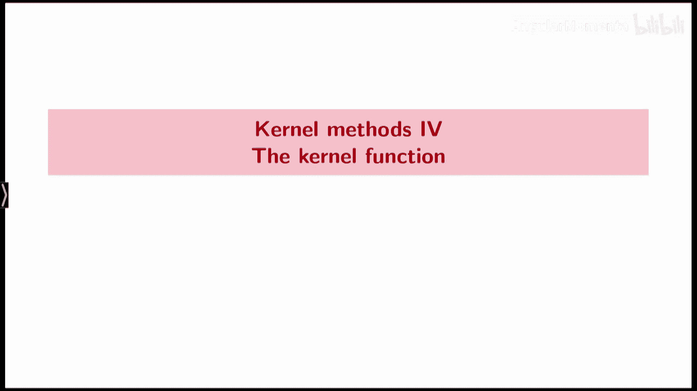

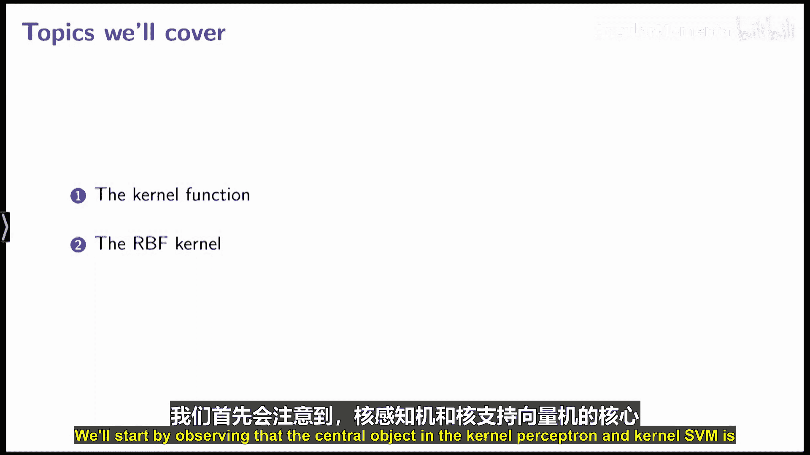

在本节课中，我们将学习核方法的核心概念。我们将看到，核感知机和核支持向量机的核心是一个称为核函数的对象。这将为我们打开通往各种复杂决策边界的大门。

## 回顾：多项式决策边界

上一节我们介绍了如何通过基展开获得多项式决策边界。本节中，我们来看看如何利用线性分类技术实现这一点。

关键在于使用基展开。我们不是使用原始数据向量 **x**，而是创建其扩展表示 **φ(x)**。**φ(x)** 包含 **x** 中的所有原始特征，以及这些原始特征中所有阶数最高为 **p** 的项。

例如，假设原始数据点是二维的，即 **x** 有两个特征 **x₁** 和 **x₂**。我们想要一个阶数为3的多项式边界（即 **p=3**）。那么，我们创建的扩展表示 **φ(x)** 将包含：
*   原始特征 **x₁** 和 **x₂**。
*   所有2阶项：**x₁²**、**x₂²**、**x₁x₂**。
*   所有3阶项：**x₁³**、**x₂³**、**x₁²x₂**、**x₁x₂²**。

如果 **x** 原本是 **D** 维的，并且我们想要所有 **P** 阶的项，那么 **φ(x)** 的大小可能达到 **Dᴾ**，这可能会非常大。

这之所以有帮助，是因为任何关于 **x** 的 **P** 阶多项式函数，实际上在 **φ(x)** 空间中是线性的。如果我们想在原始空间中学习一个 **P** 阶多项式决策边界，等价于在 **φ(x)** 的高维特征空间中学习一个线性决策边界。

为了学习这个线性分类器，我们可以使用感知机或支持向量机等标准方法。唯一的缺点是这些扩展表示向量 **φ(x)** 可能非常庞大。但幸运的是，我们不需要显式地写出它们。

对于感知机和SVM，我们只需要能够计算点积。事实证明，我们可以高效地计算这些点积。两个高维向量 **φ(x)** 和 **φ(z)** 的点积就是 **(1 + x·z)ᴾ**。

## 核支持向量机算法

基于此，我们得到了核支持向量机算法。

以下是核SVM的步骤：
1.  **选择基展开**：在我们的例子中，需要选择多项式的阶数 **p**。
2.  **学习分类器**：通过求解对偶SVM优化问题来学习分类器。更准确地说，我们不需要自己求解，而是将其交给标准的SVM软件包。
3.  **提供信息**：我们需要向优化包提供训练集 **{(x₁, y₁), ..., (xɴ, yɴ)}**、标签 **yᵢ**，以及所有扩展特征向量之间的点积（即每对数据点在扩展特征空间中的点积）。我们可以高效地计算这些点积。
4.  **获取参数**：优化包返回一个向量 **α** 和一个偏移量 **b**。**α** 有 **N** 个坐标，每个数据点一个。
5.  **预测新点**：要对一个新点 **x** 进行预测，我们计算加权和：**∑ᵢ (αᵢ * yᵢ * (φ(xᵢ)·φ(x))) + b**。如果结果为正，则预测+1；如果为负，则预测-1。

## 核函数：核心概念

虽然我们明确指定了扩展表示 **φ(x)**，但在算法中，我们从未在任何时候构造 **φ(x)**。我们只使用了这些点积。事实上，这是我们访问数据的唯一方式。

因此，我们给这个点积一个特殊的名称：**核函数**。对于原始特征空间中的任意两点 **x** 和 **z**，核函数 **K(x, z)** 定义为：
**K(x, z) = φ(x)·φ(z)**

我们可以用核函数完全重写我们的算法。对于核SVM，步骤如下：
1.  **选择核函数**：例如，如果我们想要一个 **P** 阶多项式，核函数就是 **K(x, z) = (1 + x·z)ᴾ**。
2.  **学习**：计算所有数据点对之间的核函数值，并将此信息提供给优化包，得到 **α** 和 **b**。
3.  **预测**：对新点 **x** 分类时，计算 **∑ᵢ (αᵢ * yᵢ * K(xᵢ, x)) + b** 并返回其符号。

核函数可以看作数据点之间相似性的度量。两个数据点越接近，它们的向量对齐越紧密，点积（即核函数值）就越高。

## 核感知机算法

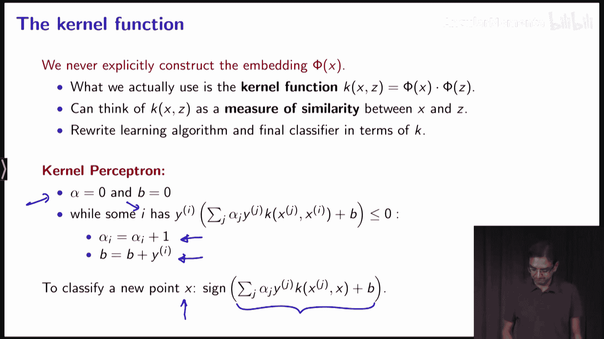

那么感知机算法用这种方式重写后是什么样子呢？它非常简单。

以下是核感知机的步骤：
1.  **初始化**：将参数 **α** 和 **b** 初始化为0。
2.  **循环训练**：循环遍历数据，直到所有点都被正确分类。如果在某个时刻错误分类了第 **i** 个数据点，我们只需更新：**αᵢ = αᵢ + 1** 和 **b = b + yᵢ**。
3.  **预测**：要分类一个新点 **x**，计算 **∑ᵢ (αᵢ * yᵢ * K(xᵢ, x)) + b** 并返回其符号。

让我们仔细看看这个用于分类的加权和。它实际上是一种**基于相似性的加权投票**。为了分类一个点 **x**，我们计算它与每个训练数据点的相似度，然后根据这些相似度值，对这些点的标签进行加权投票。

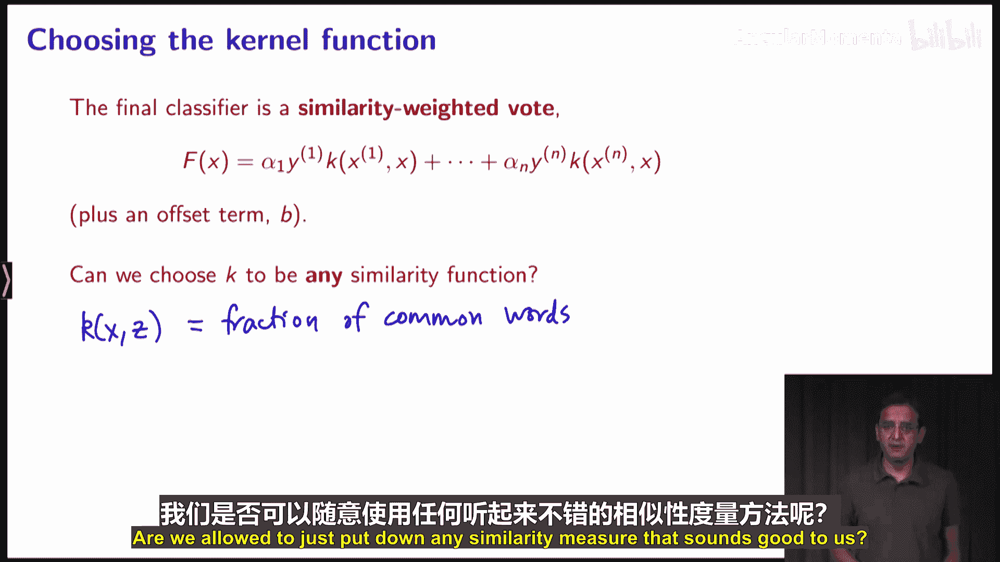

## 选择任意相似性度量

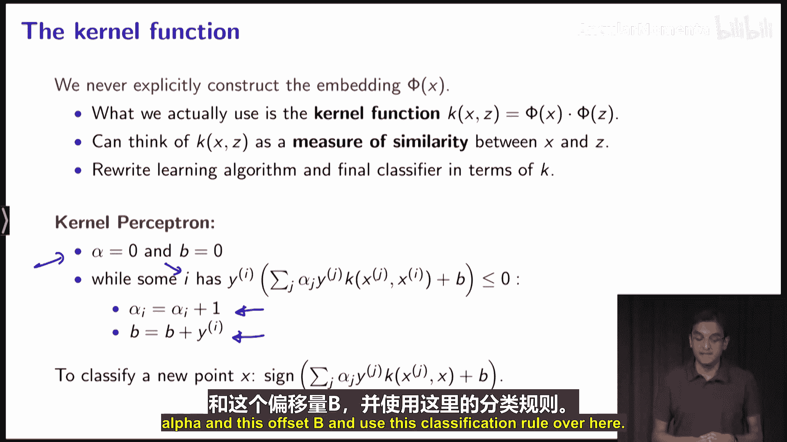

这引出了一个有趣的问题：我们能否选择任何我们想要的相似性度量？例如，如果我们正在对文档进行分类，能否定义一个合理的相似性度量（比如文档之间共同单词的比例），然后将其用于感知机算法？

答案是：几乎可以，但不完全是。我们需要这个相似性度量对应于某个高维扩展特征空间中的点积。只要这样的扩展表示 **φ** 存在，具体是什么并不重要。

如何检查我们设计的相似性度量是否合法（即是否存在对应的 **φ**）？这可以通过**Mercer条件**来检查。

概念上很简单：取任意有限的数据点集 **{x₁, ..., xₘ}**，计算所有点对之间的相似度，并将其写入一个 **m×m** 的矩阵 **K**，其中 **Kᵢⱼ = K(xᵢ, xⱼ)**。我们需要这个方阵是**半正定**的。如果满足，那么这个相似性函数就是一个有效的核函数。

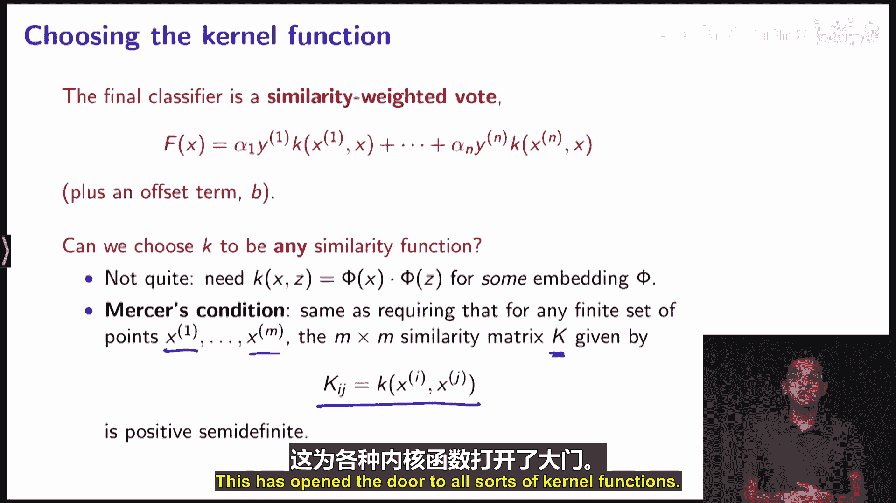

## 高斯核（RBF核）

这为我们打开了使用各种核函数的大门。一个非常流行的核函数是**高斯核**或**径向基函数核**。

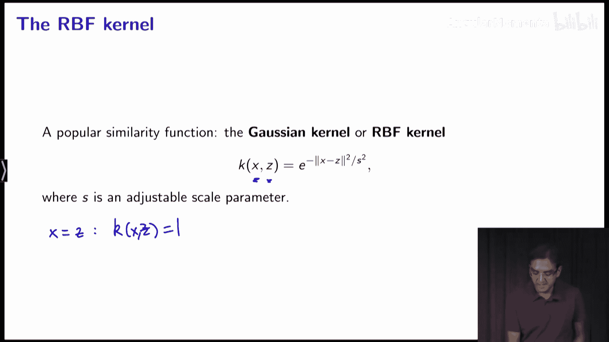

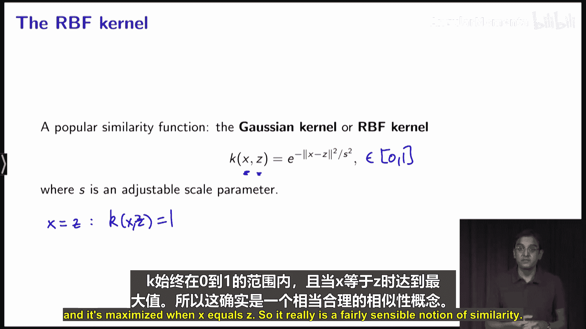

高斯核定义两点 **x** 和 **z** 之间的相似度为：
**K(x, z) = exp(-||x - z||² / s²)**

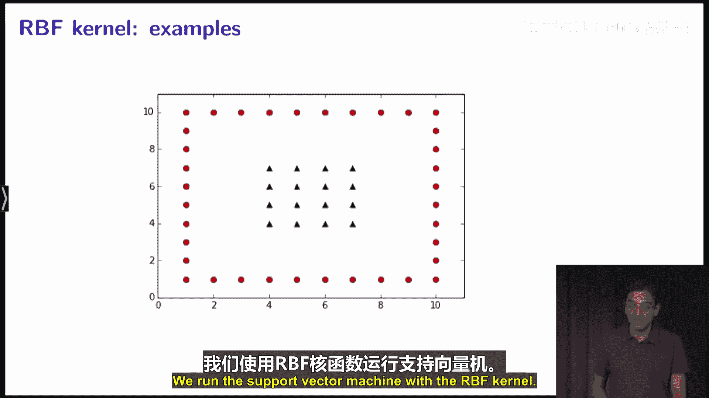

其中 **s** 是一个缩放参数。

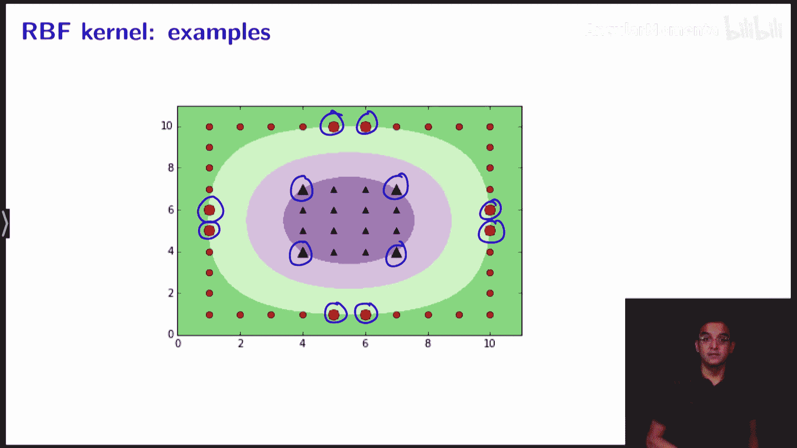

*   当 **x = z** 时，距离为0，指数为0，相似度为1。
*   当 **x** 远离 **z** 时，距离增大，指数减小，相似度从1向0下降。
*   因此，**K(x, z)** 总是在0到1之间，并在 **x = z** 时达到最大，这是一个相当合理的相似性概念。

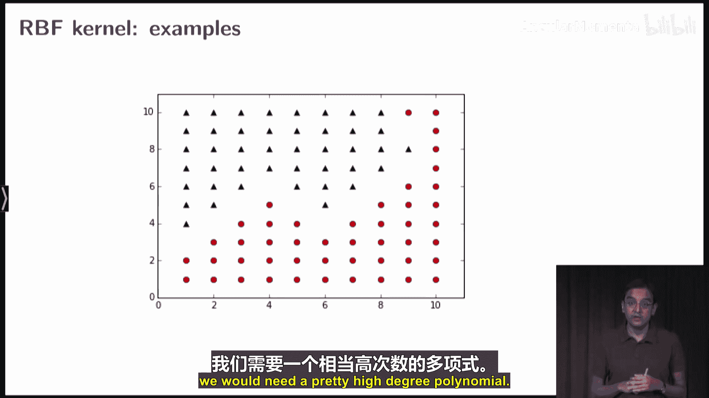

高斯核是一个有效的核函数，它对应的扩展特征向量 **φ(x)** 是无限维的，但我们永远不需要构造它，只需要计算点积，而点积的计算非常简单。

高斯核的效果非常强大。即使在原始空间数据不是线性可分的，使用RBF核的SVM也能产生复杂而漂亮的决策边界。

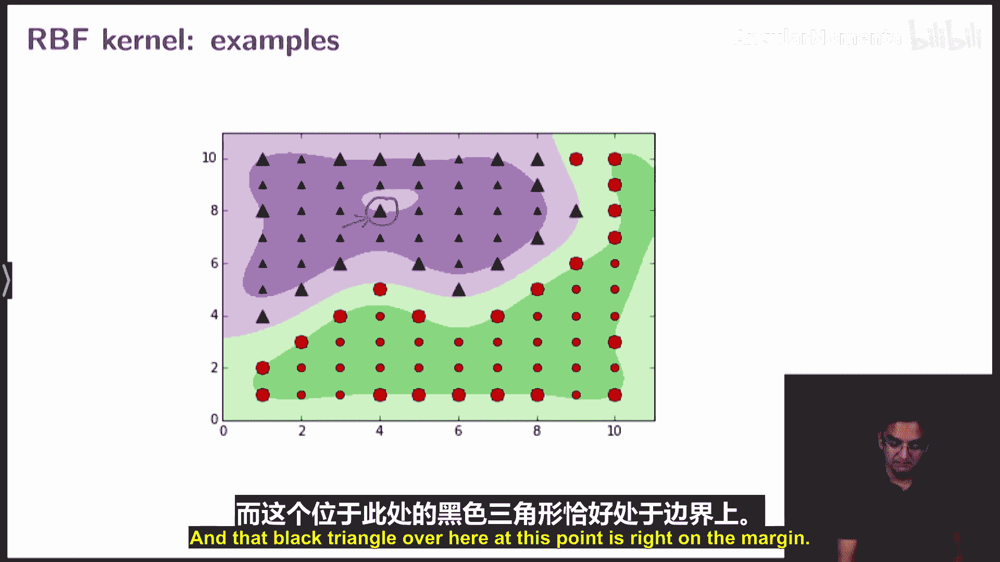

## 高斯核的参数 `s`

高斯核有一个尺度参数 **s**。改变这个参数有什么影响呢？预测函数 **f(x)** 是一个基于相似性的加权投票。让我们看看两个极端情况：

*   **当 s → ∞**：除以无穷大意味着指数项趋近于0，所有相似度都变得相同（等于1）。因此，对于任何点 **x**，预测结果总是相同的。这类似于我们几乎没有数据时的情况。
*   **当 s → 0**：除以一个极小的数意味着距离被极大地放大。任何距离上的微小差异都会被急剧放大。对于一个新点 **x**，与其最接近的那个训练数据点的相似度将占绝对主导，预测的标签将基本上就是那个最近邻的标签。这类似于最近邻分类器的行为。

随着我们获得更多数据，我们显然希望从左侧（**s** 很大）向右侧（**s** 较小）移动，以捕捉数据中更细致的结构。

## 总结

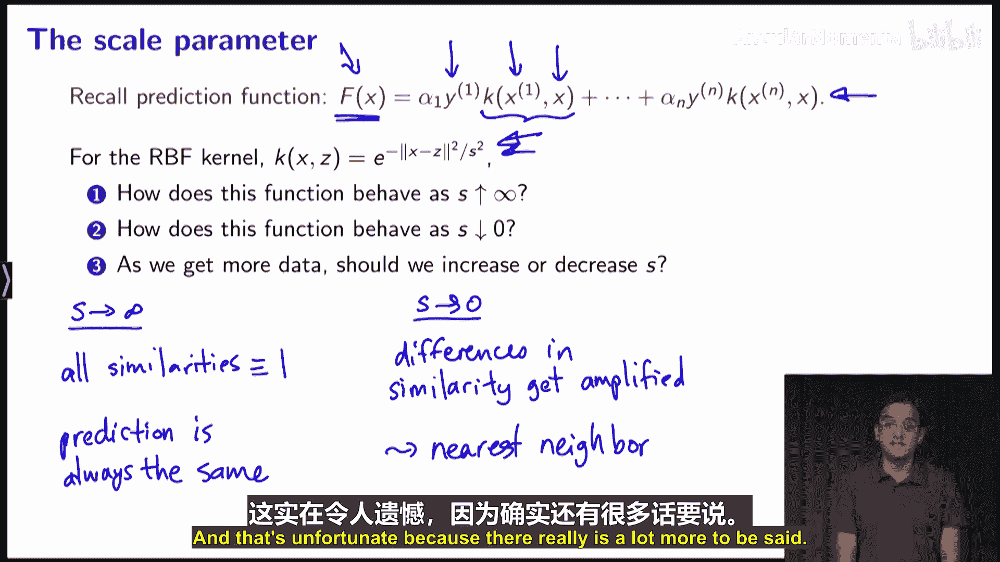

本节课中，我们一起学习了核方法的核心。我们首先回顾了通过基展开获得非线性决策边界的方法，并指出了其计算瓶颈。接着，我们引入了**核函数**的概念，它高效地计算了高维空间中的点积。我们看到，无论是支持向量机还是感知机算法，都可以完全用核函数来表述，从而避免显式处理高维特征。我们还探讨了如何判断一个自定义的相似性度量是否构成有效的核函数（Mercer条件）。最后，我们介绍了一个强大且常用的核函数——**高斯核（RBF核）**，并分析了其尺度参数 **s** 对模型行为的影响，从过于平滑（大 **s**）到过于局部（小 **s**）。核方法为我们提供了构建复杂、非线性模型的强大工具，而计算成本依然可控。