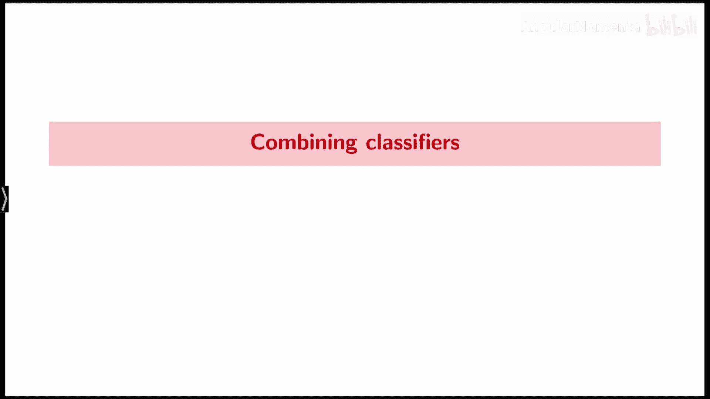
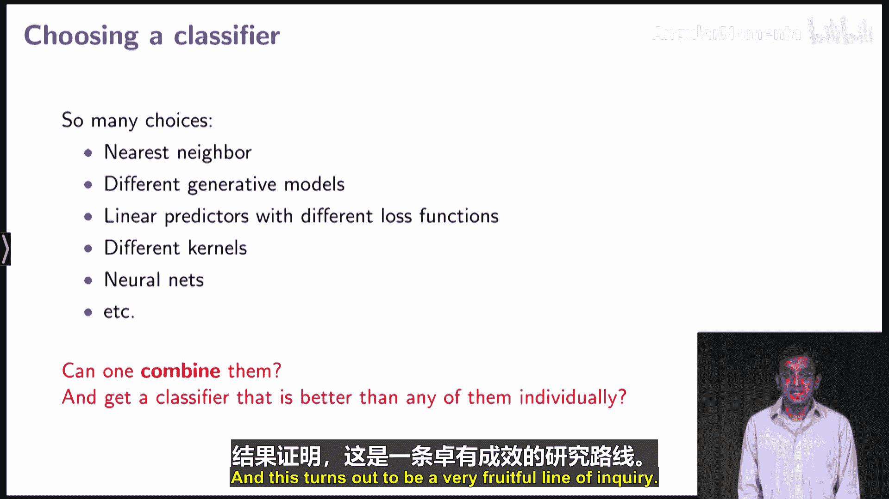
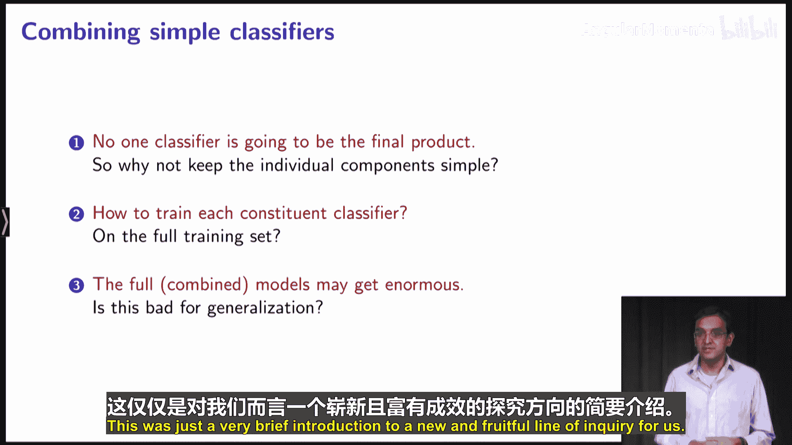

# 【加州大学圣地亚哥分校】机器学习基础  Machine Learning Fundamentals p40 08-05-02-组合简单分类器 -BV1TyFSziEZb_p40-

We' are now going to switch gears and take a very different view of learning。

This will lead to some of the most successful off the shelf classification systems out there。

We've talked about many different types of classifiers。Nearest neighbor。

Generative models with different distributions。Linear predictors like logistic regression or support vector machines。

Non nonlinear decision boundaries using kernel methods。And soon we'll be seeing neural nets。

But here's one question we haven't considered。Can we take a bunch of different classifiers and combine them to get something better？

Something that is superior to any of the individual models。The answer is yes。

 and this turns out to be a very fruitful line of inquiry。

So let's look at some of the basic questions that arise when we start investigating this whole business of combining classifiers。

First off。We're going to be combining a bunch of models。

So no one of these models is the final product。This means that none of the individual models needs to be perfect。

So maybe we can keep them simple。In fact， maybe we can make them really simple， for example。

 classifiers that depend on just one feature。Second。

We need a collection of models and we're going to combine them in some way。

But how do we train these models？Do we train them separately and independently all on the same training set？

Or is there something cleverer we can do？For instance， can we train the models one at a time？

Always focusing on the area of the training set on which we're doing badly so far。Finally。

 there's the issue of generalization。We're going to be combining a lot of models。

The final model can potentially be enormous with a huge number of parameters。

Does this mean that we also need a huge amount of data in order to learn all these parameters？

So these are examples of some of the basic questions that are going to be lurking in the background as we start looking into combining classifiers。

So that's all for now。This was just a very brief introduction to a new and fruitful line of inquiry for us。

Next time we will begin in earnest with decision trees， see you then。

