# 【加州大学圣地亚哥分校】机器学习基础  Machine Learning Fundamentals p41 08-06-02-决策树 -BV1TyFSziEZb_p41-

Decision trees are flexible classifiers that are really easy to use and to understand。Today。

 we'll see what they are all about。So we'll start by looking at the form of a decision tree。

And then we'll see how these models can be learned。

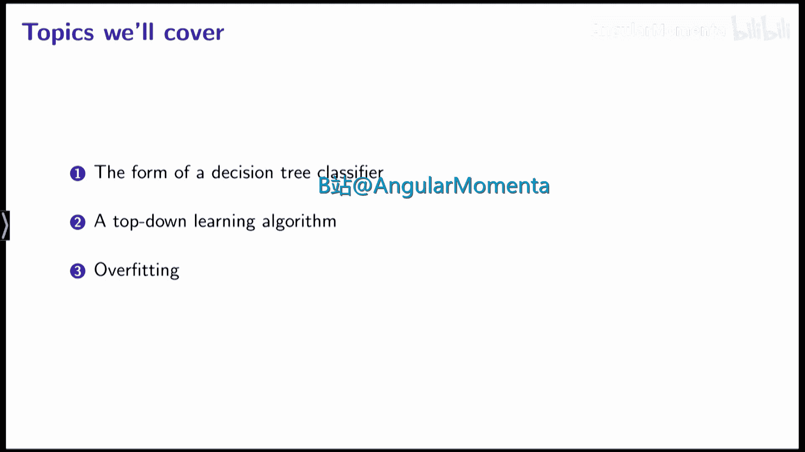

It'll turn out that a major issue is overfitting and we'll spend some time discussing this and how it can be mitigated。

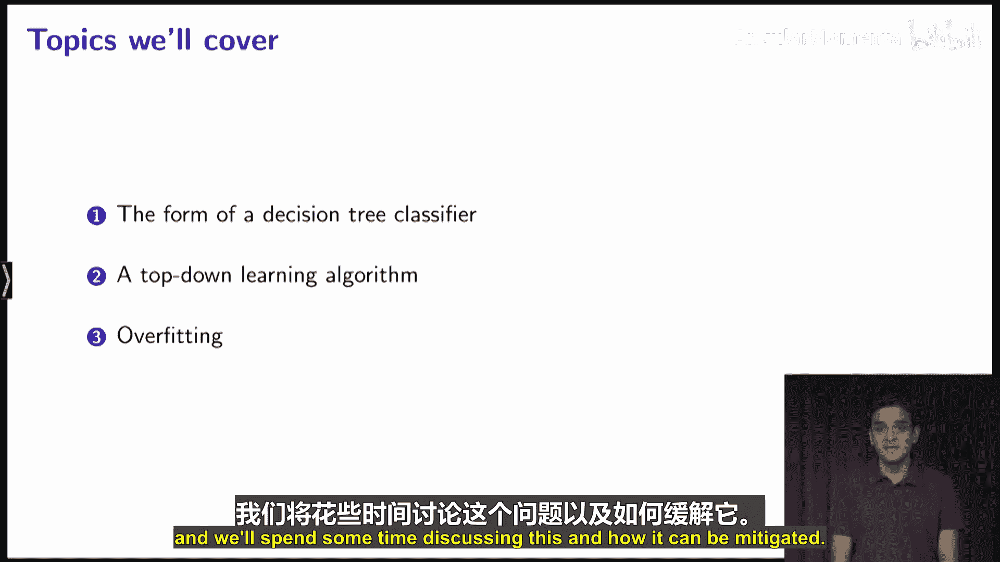

So let's start with an example。In the late 1970s， researchers at the UC San Diego Medical Center。

Wanted to solve a particular prediction problem。They wanted to know。

Which heart attack patients could safely be released from the hospital？Okay， so in particular。

 what they wanted to know was is this patient who has recently suffered a heart attack。

In danger of dying within the next 30 days。Is this a high risk patient。Now。

 in order to understand this better， they collected some data， so they got data on 215 patients。

 and for each patient， 19 relevant features were measured while the patient was in the hospital。

Of these patients， it turned out that 37 about 20% died within the ensuing month。

This is a classic binary classification problem。And as such。

 the researchers had a whole slew of standard methods at their disposal， nearest neighbor。

 generative models， linear classifiers， etc cetera， etc。

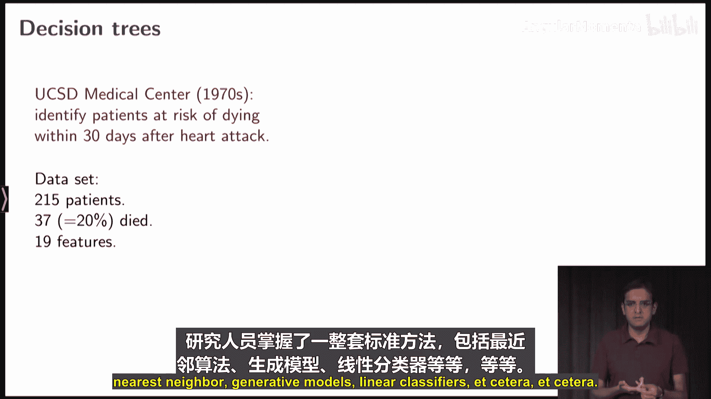

But what they wanted above all was a model that would be easy to interpret and to understand。

 and so they decided to use decision trees。Here's the decision tree they found。

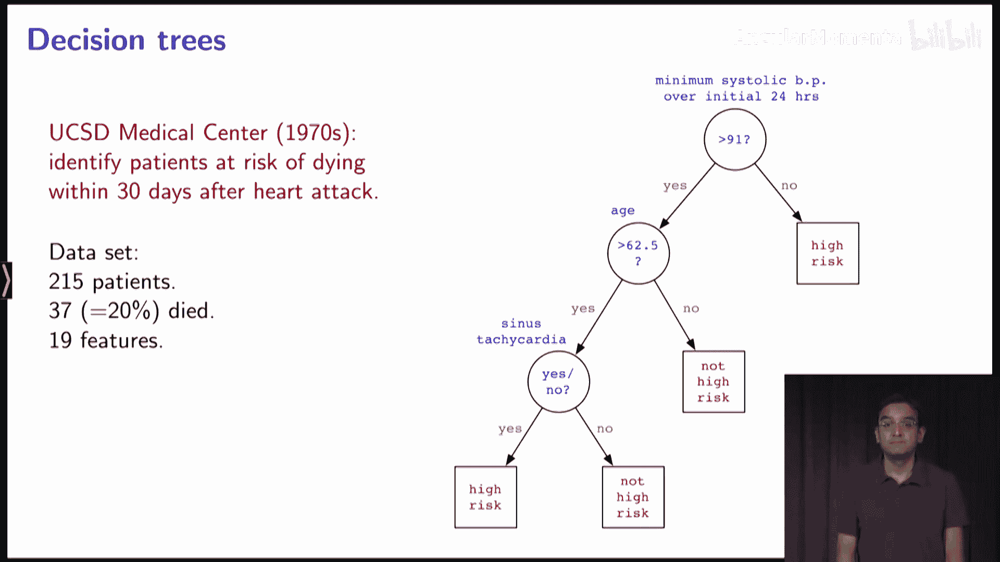

Okay。So this model， this decision tree， classifies a patient as either being high risk or not high risk。

And does so after asking at most three questions。

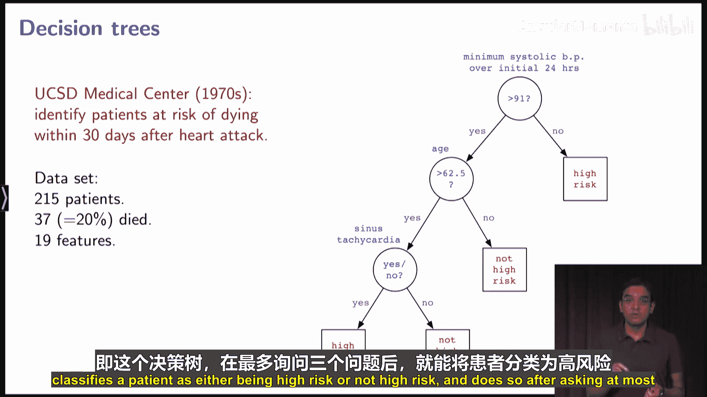

So the very first question。Is。Look at the patient's minimum systolic blood pressure over the last 24 hours。

Is that blood pressure over 91？If it's not， that's a bad sign。

 the blood pressure is low and the patient is high risk。If the blood pressure is okay。

Then the next question is about the patient's age。Is the patient over 62。5 years old？If not。

Just classify the patient is not high risk。The last question therefore applies to patients。

Whose blood pressure is okay？And who are elderly。 Okay， And the question is。

Does the patient have an abnormal heart rate。If so， the patient is classified as high risk。If not。

 not high risk。So this is the model。It's extremely simple to understand and is based on features that are clearly relevant。

And yet， a model like this would be very hard for a human to construct， even an expert。

What features exactly should be used in what order should the questions be asked？

And what are the cutoffs， exactly the 62。5 and the 91。

So this is really a wonderful application of machine learning。😊。

And let's see how trees like this get learned。

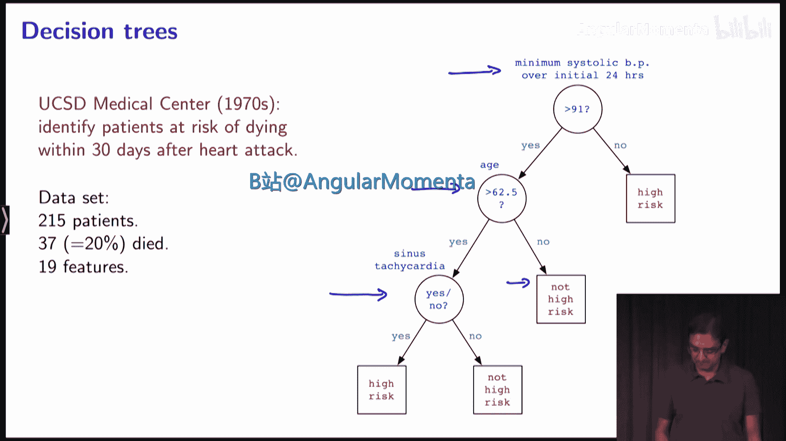

So here is a toy example。That we have a data set in two dimensions， so they're just two features。

 x1 and x2。And there are two classes， red and blue， circles and stars。

A decision tree is built in a do down manner。So initially we just have one node that contains all the data points。

 it has 13 red points and 15 blue points， and so if we had to make a prediction we predict blue。

 but the arrow would be very high， there's high uncertainty。And so we want to split this node。Now。

 the way we're going to do this is literally by trying all possible splits。 Okay。

 so we can split either along x1 or x2 along x1 we could split over here or here or here or here or here。

Along x2， we could split here， here， here， here or here， and we try all of these splits。

 and we see which one leads to the greatest reduction in uncertainty or the greatest reduction in error。

Now there are several different ways of quantifying this and we don't really need to worry about them too much。

 we typically just let a package do this for us。But the high level point is that it tries all possible splits。

And it greededily picks the best one。And in this case。It chooses discipline。So it splits on x1。

By asking the question。Is x1 less than 0。5？So to the left， it gets eight points that are all red。

Perfect， okay。Over here we'll predict red and the error， the training error will be0。On the right。

 which is this cell over here。It gets five red points and 15 blue points， so if we had to predict。

 we'd predict blue and the error would be roughly 25%。

Now we'd like to reduce the  error a little bit more so we're going to split that leaf Okay。

 so let's go ahead and split this。And the way we'll do it is again by looking at all possible splits。

 so we are splitting this cell over here。

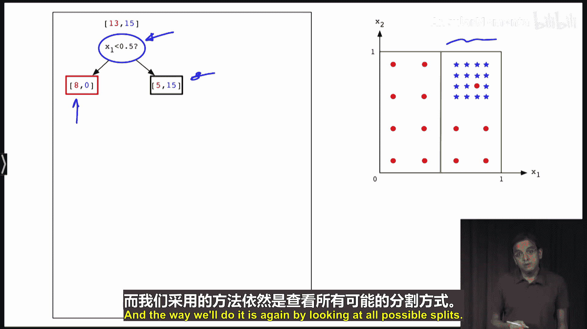

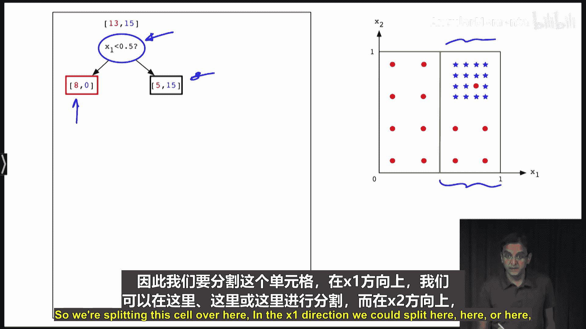

In the x1 direction， we could split here， here or here。

 and in the x2 direction we could split at any of these points。Okay。We try all of them。

And the best one turns out to be this。We basically split at x2 equals 0。5。

And now we get a cell with four red points， this cell down here。We're done。

 everything's perfect in that cell。And then we get a cell over here in which we have 15 blue points and one red point so we would certainly predict blue and the error would be just something like one over 16。

 so about 6% not 6% overall， just 6% of the points that happen to end up in this cell。

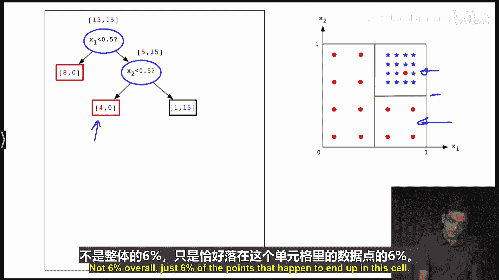

Now at this point we could stop if we wanted to and we probably should or we could keep going so let's just keep going okay so these cells are perfect we're not going to split them okay but let's go ahead and split this cell let's try and drag the error down further so again we try all possible splits and this is the one we end up with。

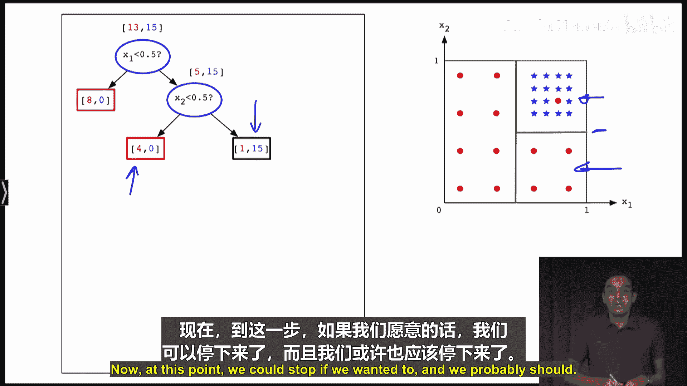

So on this side， we have eight blue points， wonderful。

And over here we have this one red point in a C of blue。So let's go ahead and split this again。

This is what we get。Again， there's just one cell we need to split that split it。

And let's do one final split， and now everything's perfect。

 every leaf of the tree is completely pure in its label。This is the resulting decision tree。

 and over here you see the partition of the original data space that is induced by this decision tree。

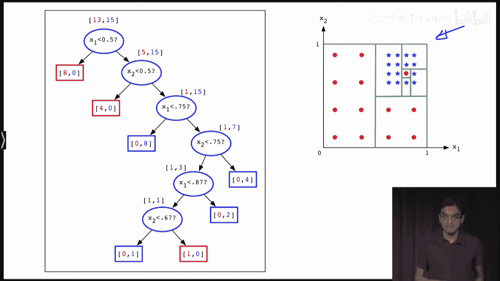

Okay， so to summarize the way we build a decision tree is by a greedy top down algorithm。

 we start with all the data points in one node。

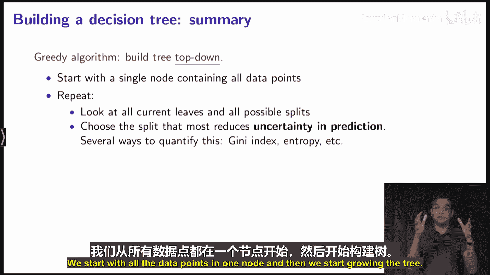

And then we start growing the tree。At any given point， we've grown the tree a little bit。

 and we have a bunch of leaves。And we can split any of those leaves。

 so we're going to try all possible leaves and all possible splits。

 and we're going to choose the one that leads to the greatest reduction in error。

 the greatest reduction in uncertainty， and there are all sorts of ways to quantify this with names like gen indexs and entropy and so on。

So one important question is， when do we stop growing the tree okay， at what point are we done？

So here are some possible ways to answer this question。

Perhaps we should just keep going until every leaf is pure， okay that's what we did in the example。

Or maybe we'll just keep going until the tree gets too large。

 okay so maybe we'll stop when the tree gets to a certain depth or when we get to a certain number of nodes。

Or maybe we keep going until each leaf is relatively pure， it doesn't have to be perfect。

 but maybe 95% pure。Which of these should we do Well。

 they're actually all perfectly reasonable stopping criteria。😊。

The one we used in our example was this one。We kept going until each leaf was pure。 And that's okay。

 But if we do that， there is a serious danger of overfitting。

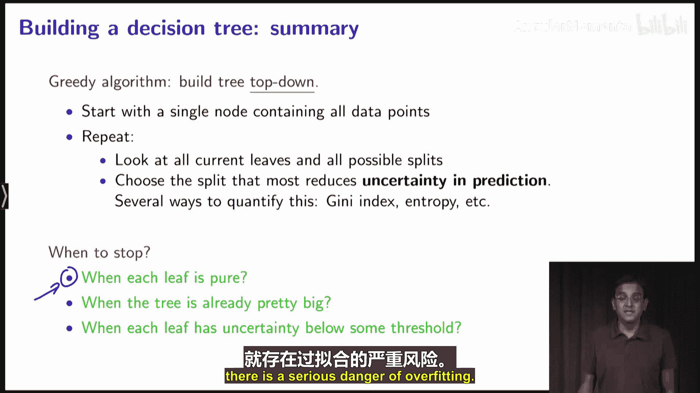

Okay。And so let me just talk a little bit about that。Okay， so in our example。

 this was the tree we ended up with， where every cell is pure。

And this was one of the intermediate trees that we encountered along the way。

Which of these is better？Well， the final tree， the one on the right。Has zero training error。

 so it's good in that respect。The one on the left has a little bit of training error。

 which just very little， and it's much simpler。

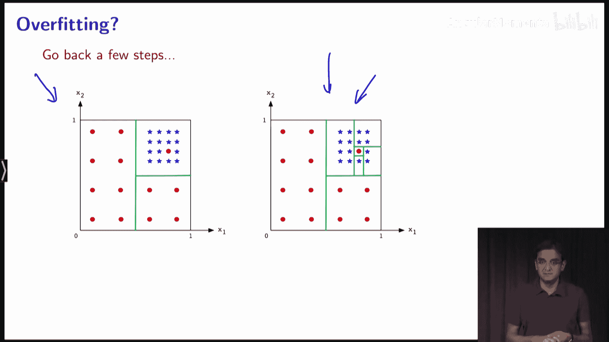

In many respects， it's better。 I mean， on the one on the right。

We just have that one extra point to be correctly classified。

 and we had to work very hard to get that last red point correct。Was it worth the effort？

Probably not。 That point might just be an outlier anyway Okay。

 so there's a good chance that on the data set on the right。

 okay that this tree on the right ended up overfitting the data。

So let's talk about what that means concretely。

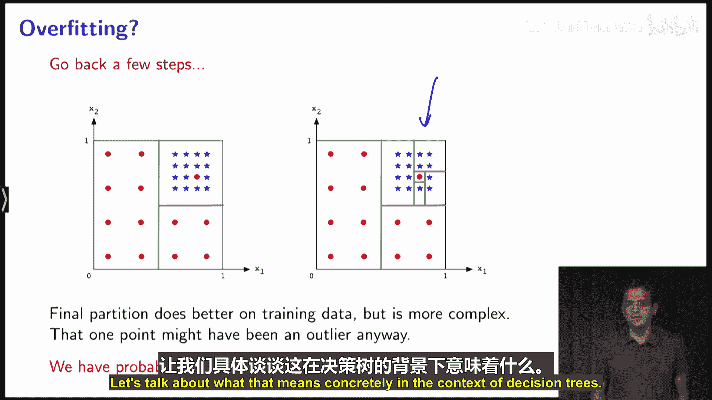

In the context of decision trees。Okay， so。As you grow the decision tree。

 you can drive the training error down to0， if necessary。

 you can have each point in its own leaf in its own cell。

 so on the X axis over here I'm showing the process of growing the tree。

 the number of nodes in the tree is getting larger and larger and as we grow the tree。

 the training error goes down the y axis shows the error。

But what we are ultimately interested in is not the training error， but the future performance。

 the error on future data， the test error， and the test error typically looks something like this。

Thank you。So when we are initially growing the tree。

 the training error and test error are both going down， everything's going well。

But then it gets to a point where the training error keeps going down。

 but the test error starts going up。This is the point at which we are overfitting the data。

We are fitting aspects of the data that are really just sampling error。

 that are just noise and that are not helping us， that are not really helping us in future prediction。

So what we would ideally do is to stop the tree growing process somewhere over here。

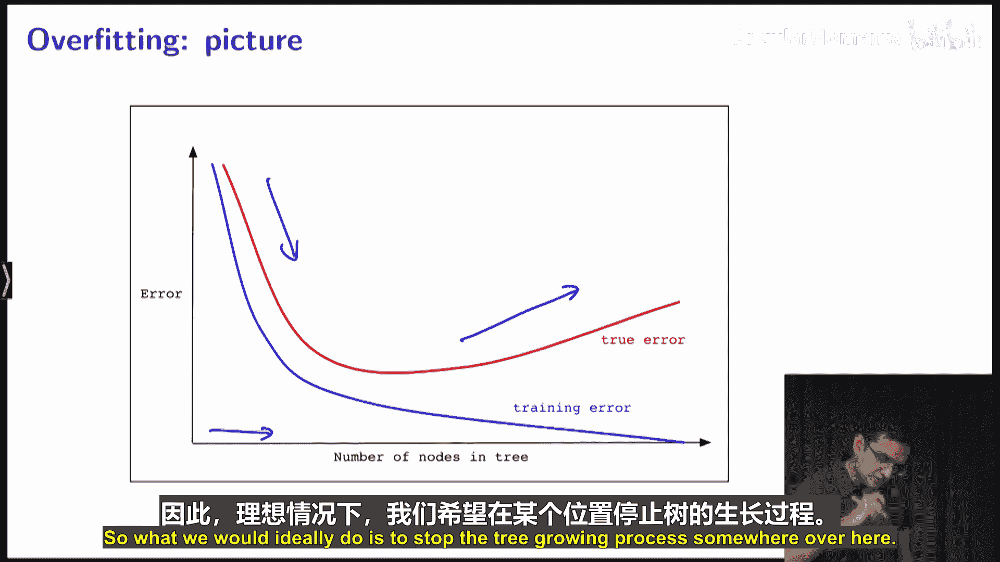

嗯。

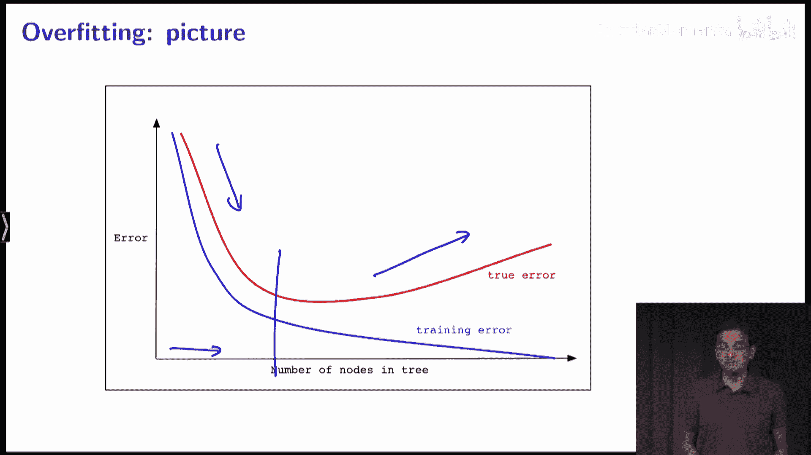

。So let's get a slightly different perspective on overfitting。Okay。

So let's say that the underlying true decision boundary is something like this。嗯。

Now there's no way we can get this decision boundary based on just a small amount of data based on a finite collection of data here we have just a few decision。

 we just have a few data points and if we were to perfectly fit those data points with a decision tree。

 we'd probably end up with a jagged staircase。Something like this， okay？So it's correct in spirit。

 it has approximately the right shape of the true decision boundary。

 but a lot of the detail over here。These little stairs。Are really just fitting noise。

 fitting chance structure in the data。They're really just a reflection of sampling error and paying too much attention to this kind of detail is overfitting。

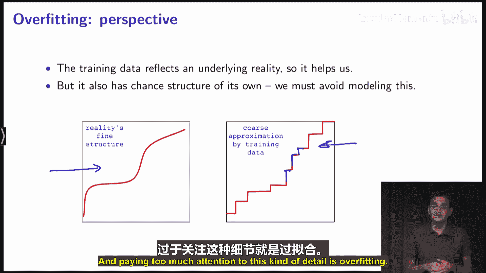

Okay， so let's summarize some of the properties of decision trees。

These are very flexible and expressive classifiers。

They can accommodate any kind of data in our examples we had numeric data。

 but they can also deal with categorical data， for example， what color are a person's eyes。Blue。

 black， brown。 Okay， so in the decision tree， we could have questions like， are their eyes brown。

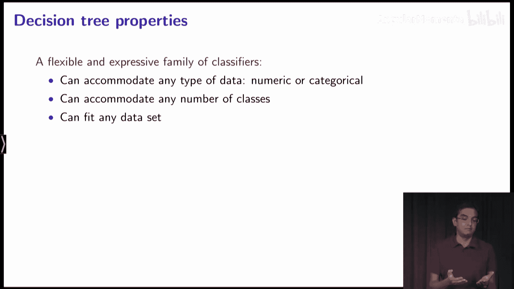

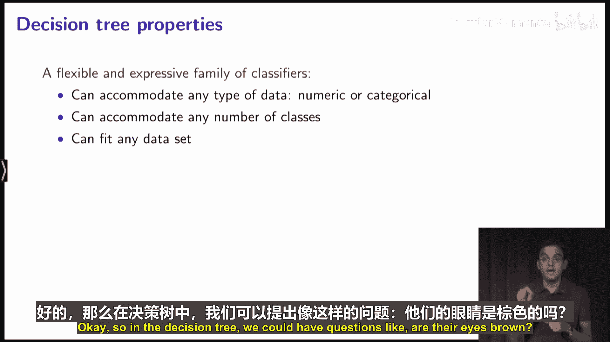

Decis tree has no trouble with that。They can accommodate any number of classes。

 they are inherently multiclass， you don't have to do anything special。

They can fit any data set by growing the tree large enough。

 you can drive the training error down to 0。And best of all， they are extremely interpretable。 Okay。

 so they are very nice models。😊，And the big downside is that they are prone to overfitting。

So what are some strategies for dealing with this？

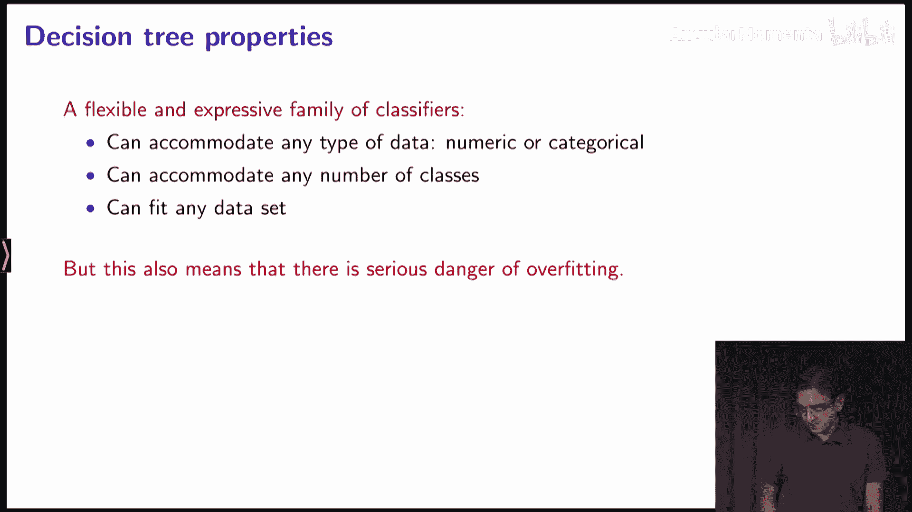

Well， we can stop growing the tree early， for instance。

 when the leaves reach a desired level of purity or when the tree reaches a certain maximum size。

Or if we like， we could keep growing the tree all the way out and then prune it using a validation set。

Okay， so what exactly does that mean so in this case？

We keep growing the tree and we keep going and going until all the leaves are perfectly pure。

And so we get a truly enormous tree， okay， this could easily be。Hundreds of levels deep。

This where we get some huge decision tree。And we know that we've gone overboard。

 and we know that this tree needs to be trimmed。 And the way we do that is with the validation set。

 we find the way to trim this tree to prune the tree。

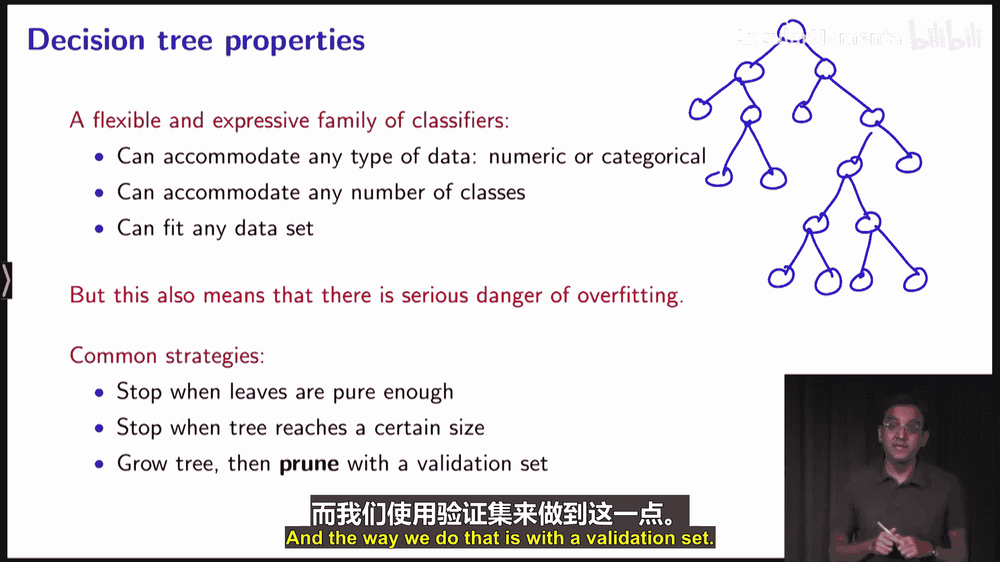

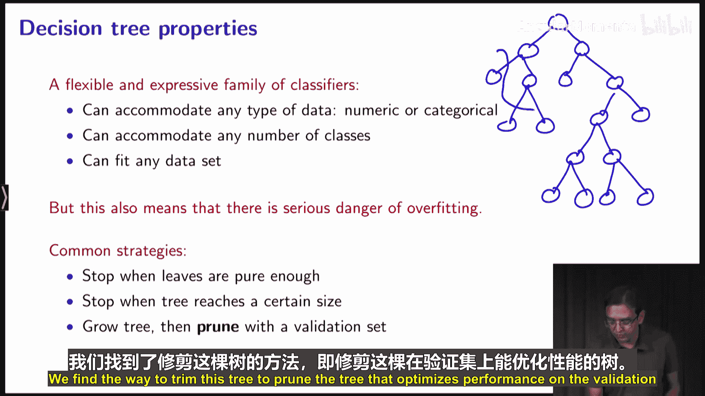

That optimizes performance on the validation set。So we try all possible prunings。

It turns out there are exponentially many of them。 However。

 we can find the best one in polynomial time using a dynamic programming algorithm Okay。

 and so that's also a perfectly reasonable way to fit a decision tree。😊。

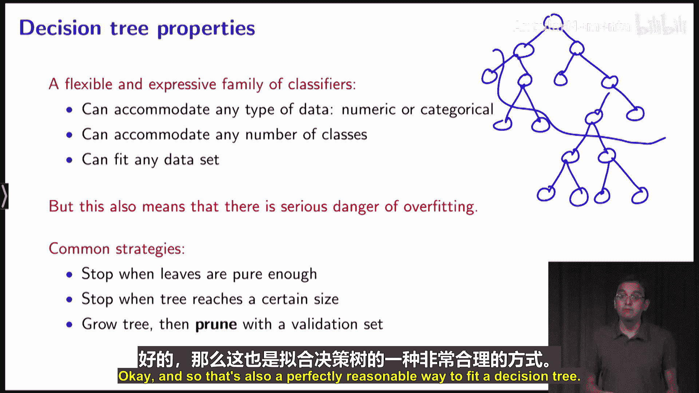

Okay， that's it for today。

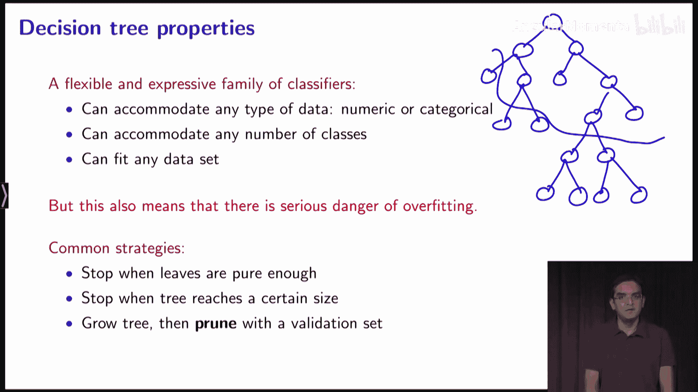

We've seen decision trees which are just a wonderfully simple and most of all。

 interpretable type of classifier， and in many applications。

 interpretability is really of central importance。😊，See you next time。

