# 机器学习基础：08-06-02：决策树 🌳

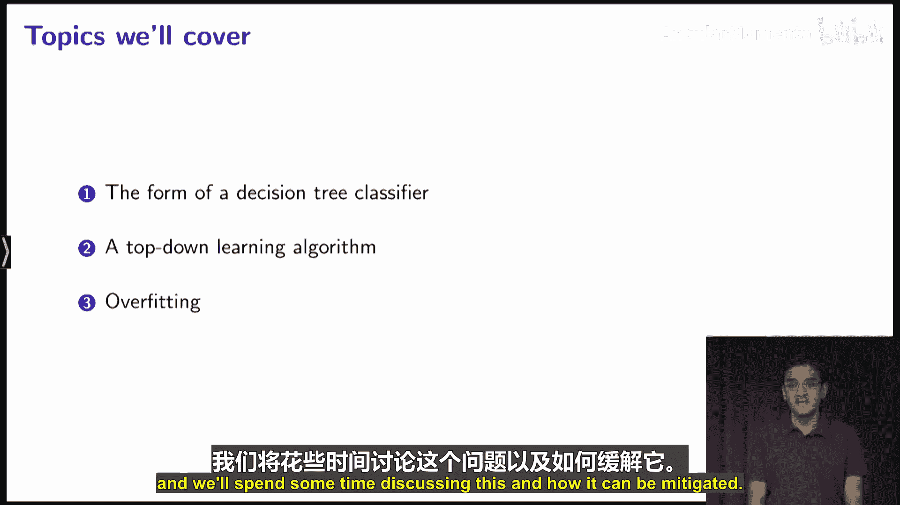

在本节课中，我们将要学习决策树。决策树是一种灵活且易于理解和使用的分类器。我们将从了解决策树的形式开始，然后探讨如何学习这些模型。一个主要问题是过拟合，我们将花时间讨论这个问题以及如何缓解它。

## 决策树的形式与示例

上一节我们介绍了课程概述，本节中我们来看看决策树的具体形式。决策树是一种灵活的、易于理解和使用的分类器。

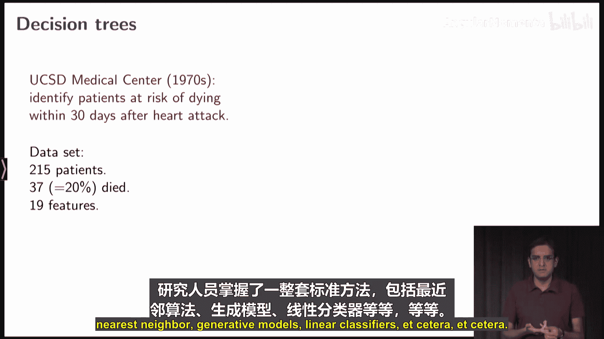

在20世纪70年代末，加州大学圣地亚哥分校医学中心的研究人员希望解决一个特定的预测问题。他们想知道哪些心脏病发作的患者可以安全出院。具体来说，他们想了解最近心脏病发作的患者在未来30天内是否有死亡风险，即是否为高风险患者。

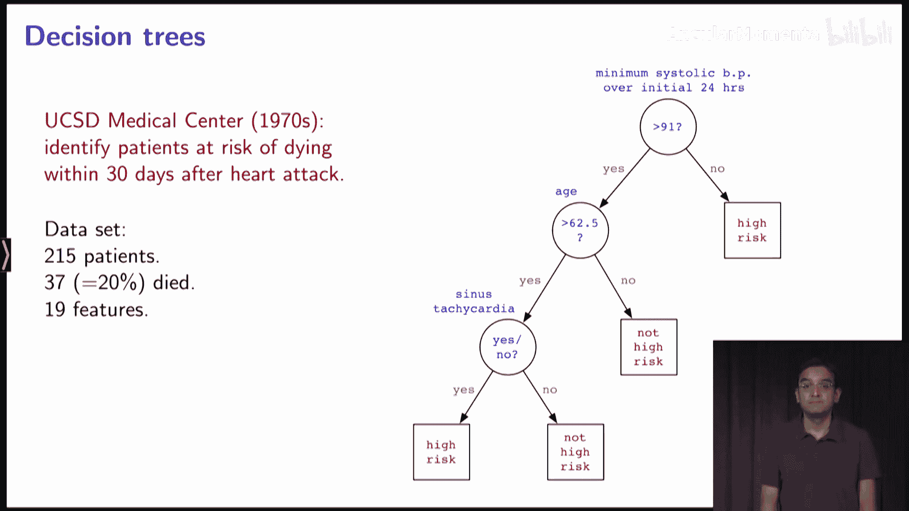

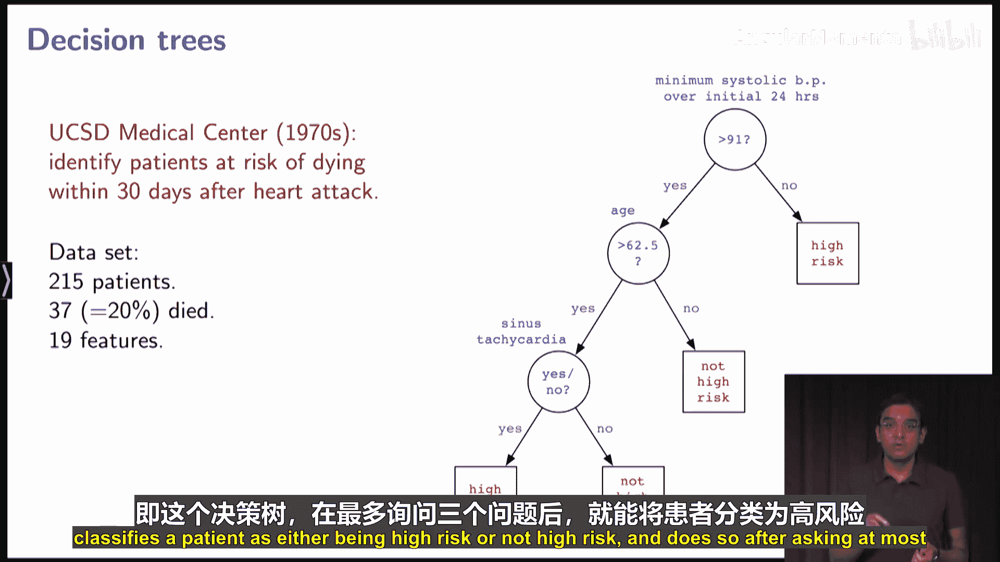

为了更好理解，他们收集了215名患者的数据，记录了每位患者住院期间的19个相关特征。在这些患者中，约20%（37人）在随后一个月内死亡。这是一个经典的二分类问题。研究人员可以使用许多标准方法，如最近邻、生成模型、线性分类器等。

但他们最想要的是一个易于解释和理解的模型，因此决定使用决策树。以下是他们找到的决策树。

这个决策树模型将患者分类为高风险或非高风险，最多只需问三个问题。

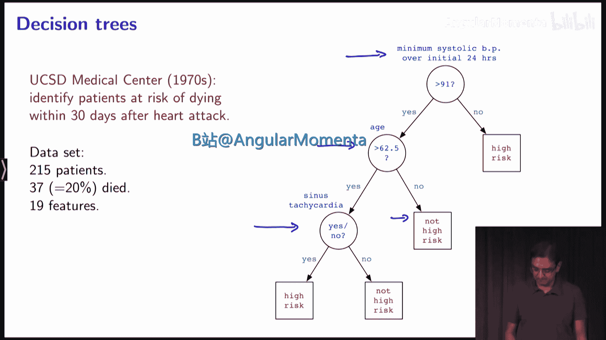

第一个问题是：查看患者过去24小时内的最低收缩压，是否超过91？如果没有，这是一个不好的迹象，血压低，患者为高风险。如果血压正常，则下一个问题是关于患者的年龄：是否超过62.5岁？如果没有，则将患者分类为非高风险。最后一个问题适用于血压正常且年长的患者：患者是否有异常心率？如果有，则分类为高风险；如果没有，则为非高风险。

这个模型非常易于理解，基于明确相关的特征。然而，即使是专家，也很难手动构建这样的模型。应该使用哪些特征？问题应该按什么顺序提出？具体的阈值（如62.5和91）是多少？这是机器学习的一个绝佳应用。

## 决策树的学习过程

上一节我们看了一个决策树的应用实例，本节中我们来看看决策树是如何被学习构建的。

这是一个二维数据集的玩具示例，有两个特征x1和x2，以及两个类别：红色圆圈和蓝色星星。决策树以自上而下的方式构建。最初，我们只有一个包含所有数据点的节点，其中有13个红点和15个蓝点。如果必须进行预测，我们会预测蓝色，但误差会很高，存在很大的不确定性。因此，我们希望分割这个节点。

以下是构建决策树的基本步骤：

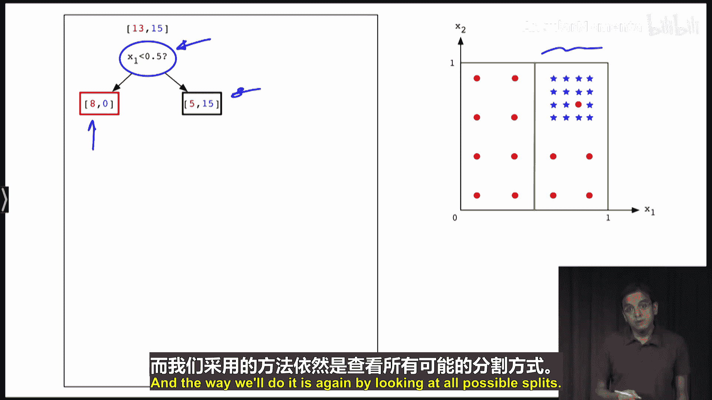

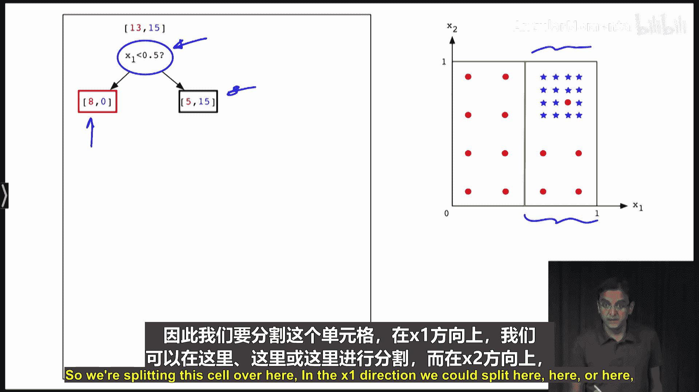

1.  **尝试所有可能的分割**：我们可以沿着x1或x2进行分割。沿着x1，我们可以在这里、这里或这里分割；沿着x2，我们可以在这里、这里或这里分割。我们尝试所有这些分割，看看哪一个能最大程度地减少不确定性或误差。
2.  **选择最佳分割**：有多种量化不确定性的方法，我们通常让软件包来处理。高层次的观点是，算法尝试所有可能的分割，并贪婪地选择最佳的一个。在这个例子中，它选择在x1上分割，问题是：x1是否小于0.5？
3.  **递归分割**：在左侧，我们得到8个全是红色的点，完美。在右侧，我们得到5个红点和15个蓝点。为了进一步减少误差，我们继续分割这个叶节点。我们再次尝试所有可能的分割，最佳分割出现在x2等于0.5处。
4.  **继续生长或停止**：我们可以继续分割，直到每个叶节点都是纯的（即只包含一个类别的点），或者根据某些标准停止。

在这个例子中，我们继续分割，直到每个叶节点都完全纯净，得到了最终的决策树及其诱导的数据空间划分。

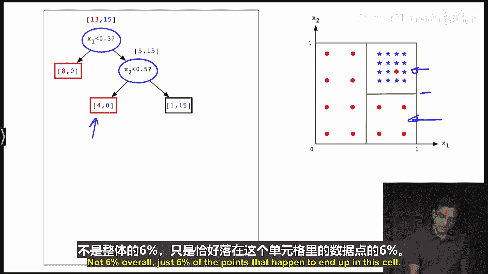

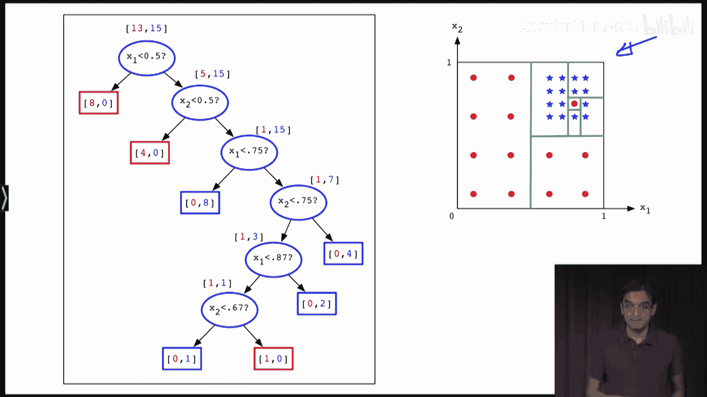

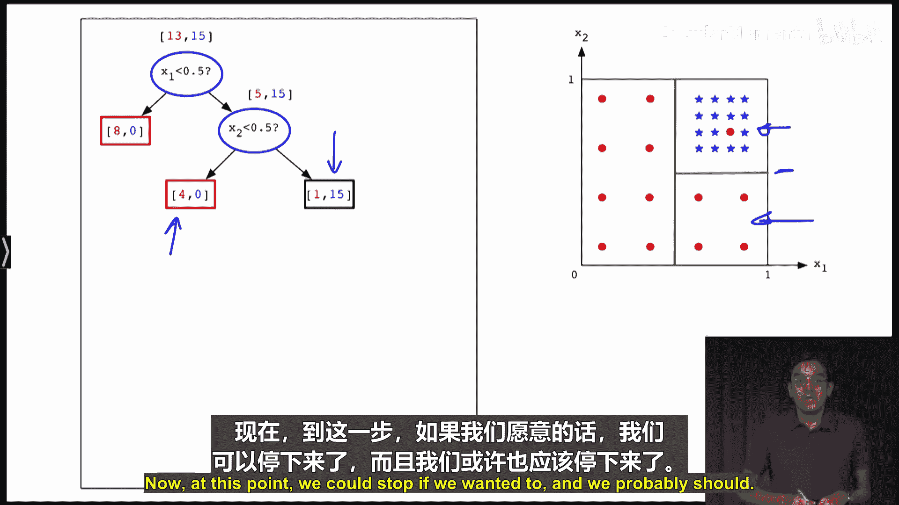

总结来说，我们通过一种贪婪的自上而下算法构建决策树。我们从所有数据点在一个节点开始，然后开始生长树。在任何给定点，我们已经生长了一些树，并有一堆叶节点。我们可以分割其中任何一个叶节点。我们将尝试所有可能的叶节点和所有可能的分割，并选择能最大程度减少误差或不确定性的那个。有多种量化方法，如基尼指数、熵等。

一个重要的问题是：我们何时停止生长树？我们什么时候完成？

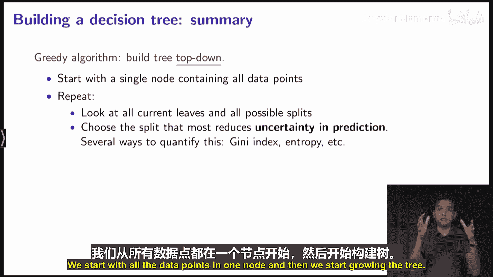

以下是几种可能的停止标准：

*   继续直到每个叶节点都是纯的（就像我们在例子中所做的那样）。
*   继续直到树变得太大（例如，达到一定深度或节点数）。
*   继续直到每个叶节点相对纯净（例如，95%纯净）。

这些实际上都是合理的停止标准。我们在例子中使用的是第一种，即继续直到每个叶节点都是纯的。但这样做存在严重的过拟合风险。

## 过拟合问题与缓解策略

上一节我们介绍了决策树的生长过程，本节中我们来看看一个关键问题：过拟合。

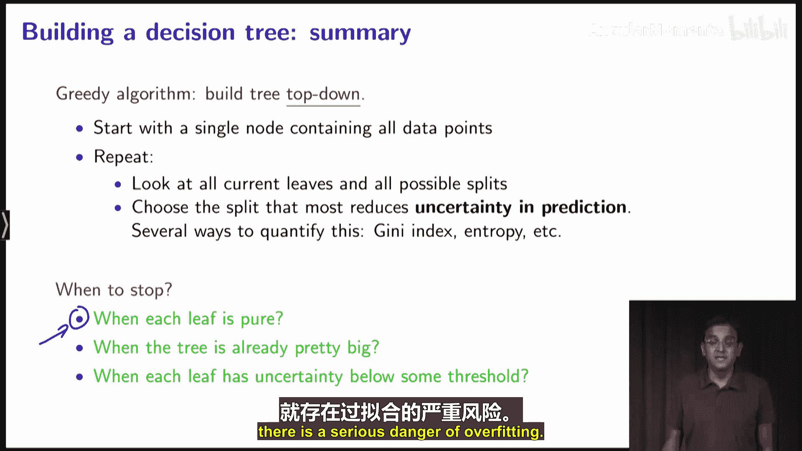

在我们的例子中，这是我们最终得到的树，其中每个单元都是纯的。而这是我们在此过程中遇到的中间树之一。哪一个更好？右边的最终树训练误差为零，在这方面很好。左边的树有一点训练误差，但非常少，而且更简单。在许多方面，它更好。在右边的树上，我们只是为了正确分类那一个额外的红点而付出了很大努力。这值得吗？可能不值得。那个点可能只是一个异常值。因此，右边的树很可能过拟合了数据。

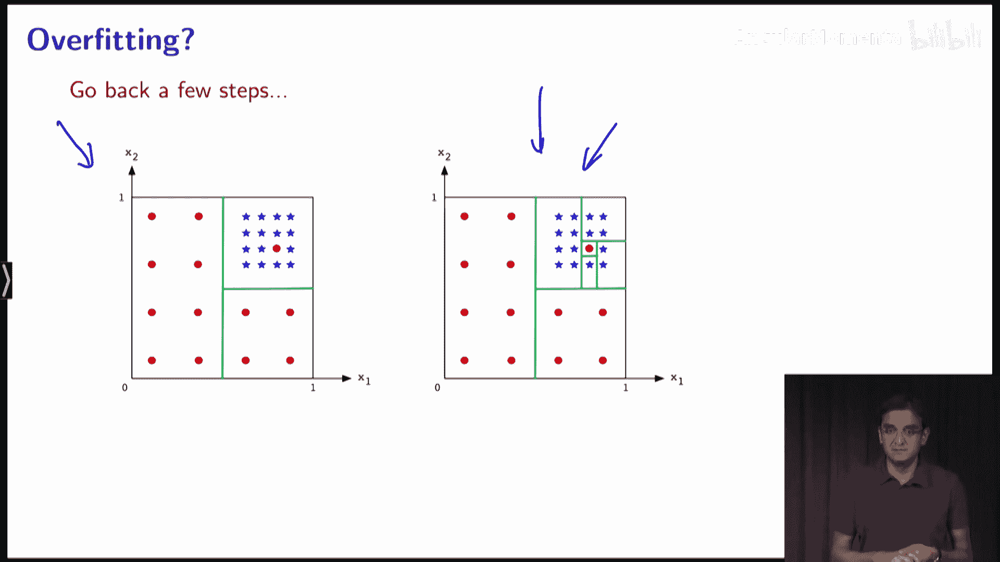

让我们具体谈谈这在决策树上下文中的含义。

当你生长决策树时，如果需要，你可以将训练误差降至0，你可以让每个点都在自己的叶节点（自己的单元）中。在下图中，X轴显示了树的生长过程，树中的节点数变得越来越大。随着树的生长，训练误差下降（Y轴显示误差）。但我们最终感兴趣的并不是训练误差，而是未来的性能，即未来数据上的误差（测试误差）。测试误差通常看起来像这样。

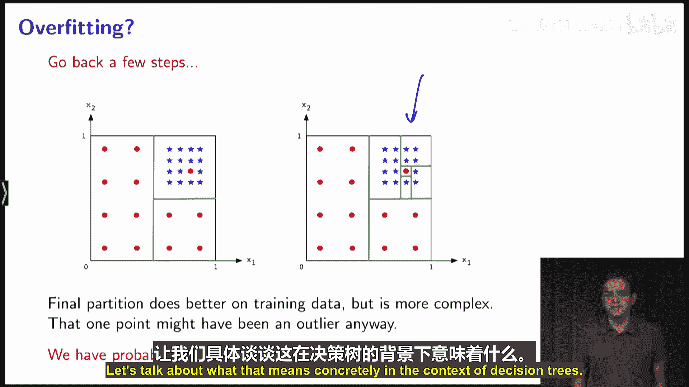

当我们最初生长树时，训练误差和测试误差都在下降，一切顺利。但随后到达一个点，训练误差继续下降，而测试误差开始上升。这就是我们开始过拟合数据的点。我们正在拟合数据中那些实际上只是抽样误差、只是噪声的方面，这些方面对未来预测没有帮助。

因此，我们理想的做法是在这里的某个地方停止树的生长过程。

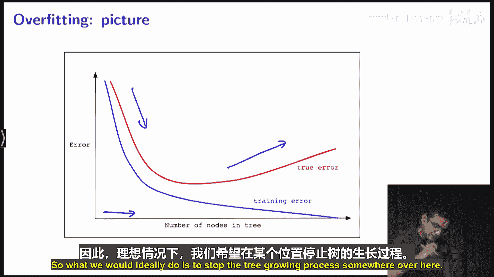

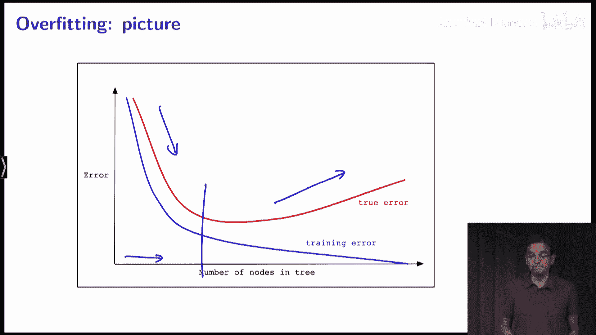

让我们从稍微不同的角度看待过拟合。假设底层真实的决策边界是这样的。

基于有限的数据点，我们无法得到这个真实的决策边界。如果我们用决策树完美地拟合这些数据点，我们最终可能会得到一个锯齿状的阶梯，像这样。它在精神上是正确的，具有与真实决策边界大致相同的形状，但这里的许多细节，这些小阶梯，实际上只是在拟合噪声，拟合数据中的偶然结构。它们真的只是抽样误差的反映，过多关注这种细节就是过拟合。

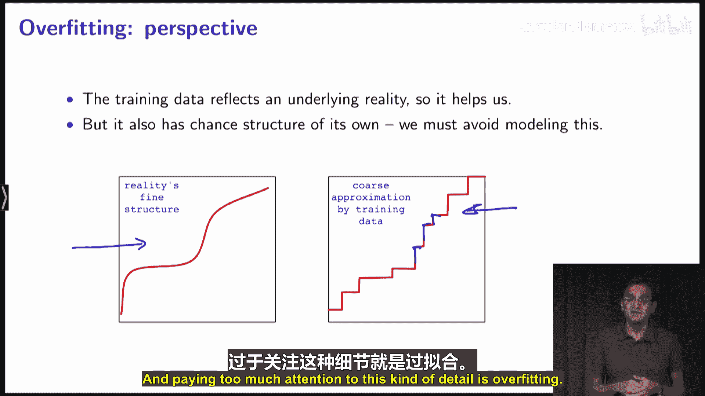

## 决策树的特性与总结

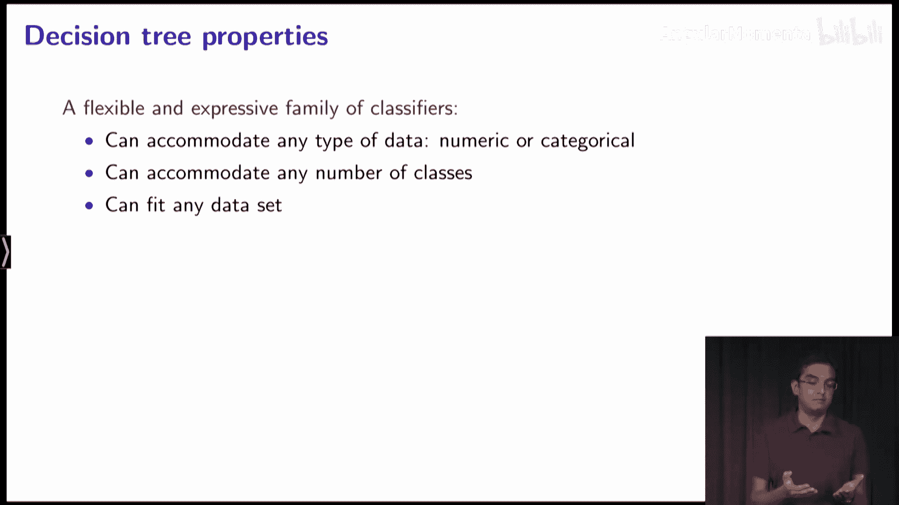

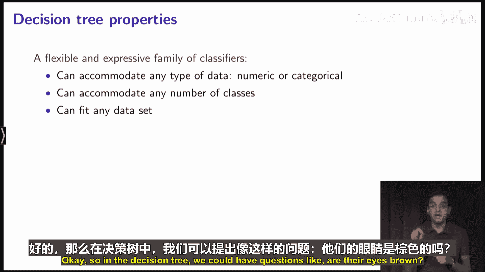

上一节我们讨论了过拟合，本节我们来总结一下决策树的特性。

决策树是非常灵活和富有表现力的分类器。它们可以容纳任何类型的数据。在我们的例子中，我们有数值数据，但它们也可以处理分类数据，例如，一个人的眼睛颜色是蓝色、黑色还是棕色。在决策树中，我们可以有诸如“他们的眼睛是棕色的吗？”这样的问题。决策树对此没有困难。

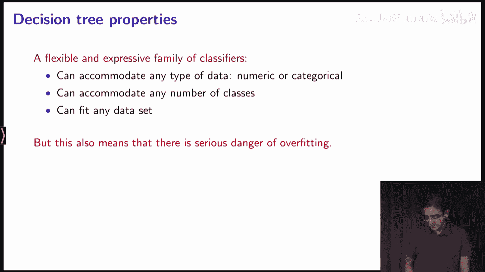

它们可以容纳任意数量的类别，本质上是多类的，你不需要做任何特殊处理。通过将树生长得足够大，它们可以拟合任何数据集，你可以将训练误差降至0。最重要的是，它们非常易于解释。所以它们是非常好的模型。

最大的缺点是它们容易过拟合。那么有哪些应对策略呢？

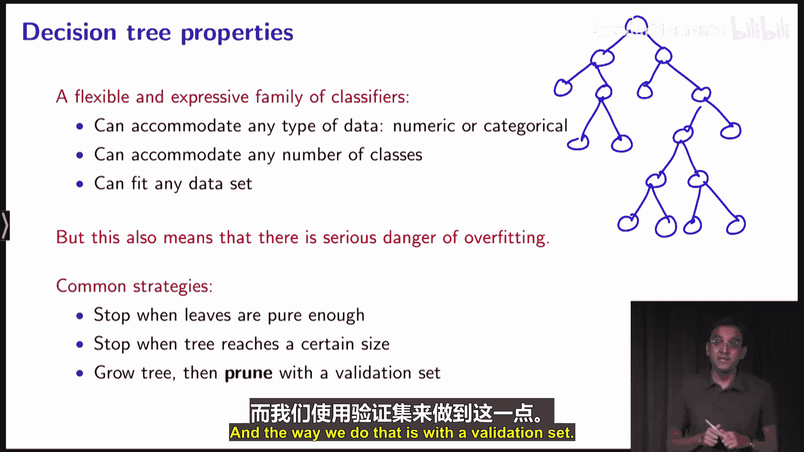

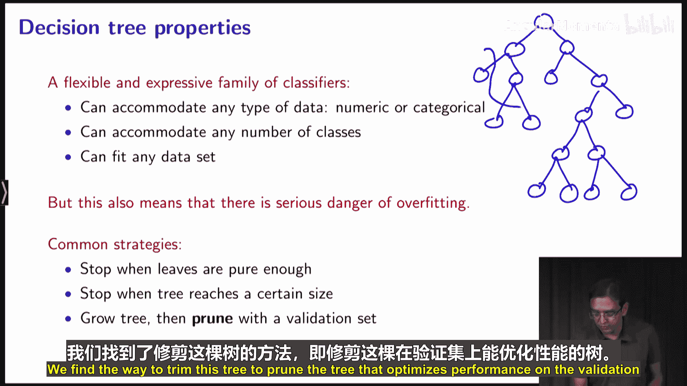

以下是处理过拟合的一些策略：

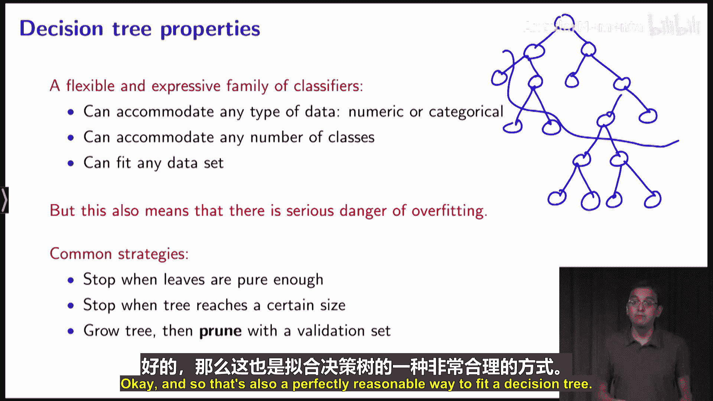

1.  **提前停止生长**：例如，当叶节点达到所需的纯度水平时，或者当树达到某个最大大小时。
2.  **后剪枝**：如果我们愿意，我们可以一直生长树直到所有叶节点都完全纯净，得到一个巨大的树，然后使用验证集对其进行剪枝。这意味着我们尝试所有可能的剪枝方式（虽然数量是指数级的），但我们可以使用动态规划算法在多项式时间内找到最佳的一个。这也是拟合决策树的一种完全合理的方法。

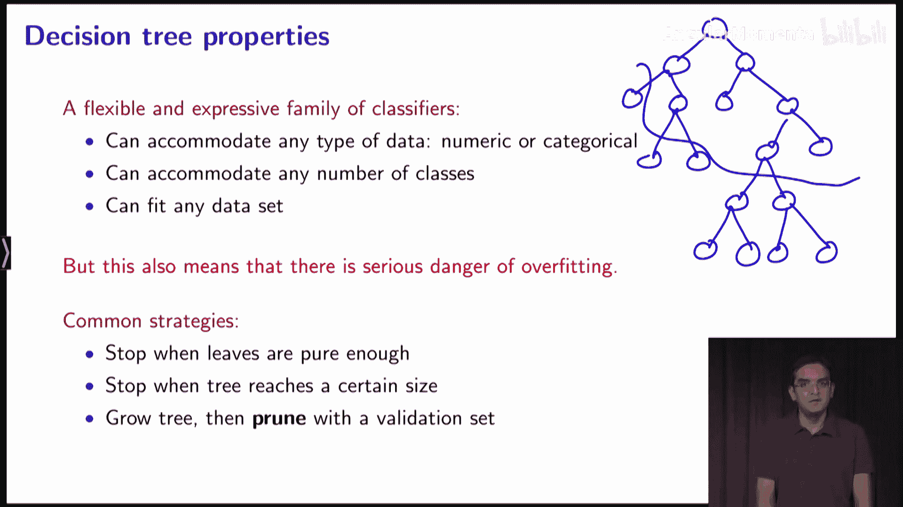

本节课我们一起学习了决策树，这是一种极其简单且最重要的是易于解释的分类器。在许多应用中，可解释性确实至关重要。