# 【加州大学圣地亚哥分校】机器学习基础  Machine Learning Fundamentals p42 08-07-02-提升法 -BV1TyFSziEZb_p42-

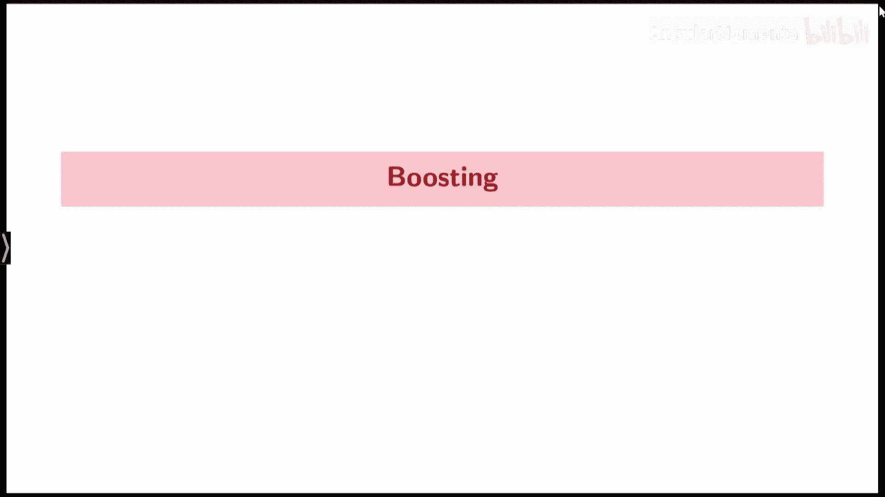

Today we look at a truly ingenious way of combining simple classifiers， it's called boosting。

So we'll start by introducing the notion of a weak learner。

And then we'll see how the deficiency of such a learner can be overcome by using boosting in particular by the lovely add a boost learning algorithm。

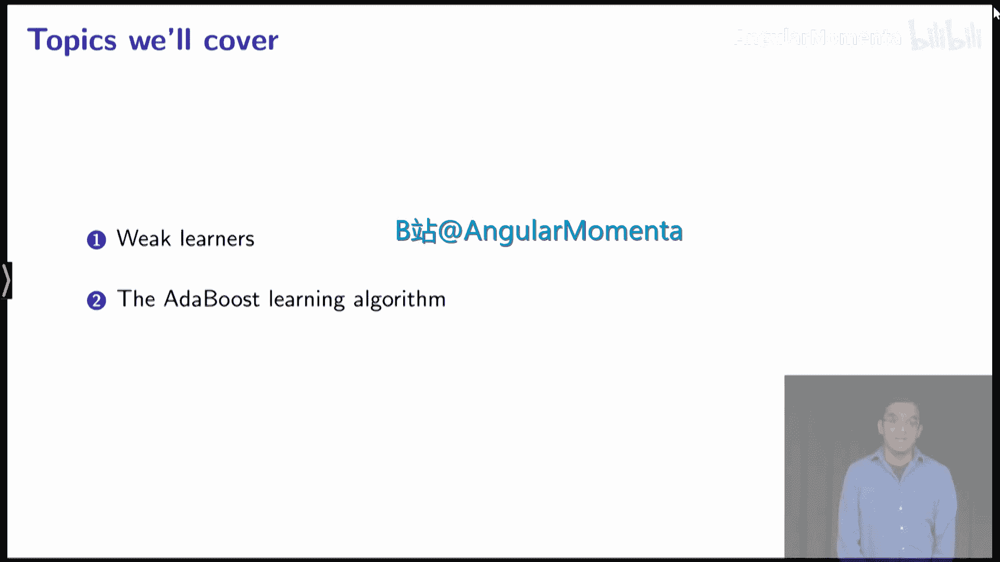

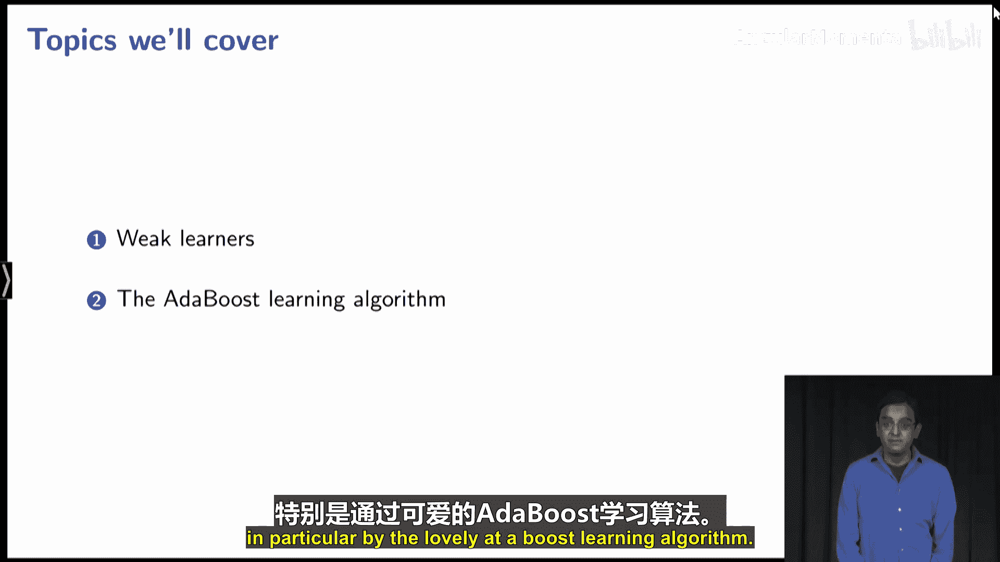

So a very familiar situation in machine learning。Is that it's often easy to get an accuracy of 60 or 70% on the data。

 or maybe 80%。

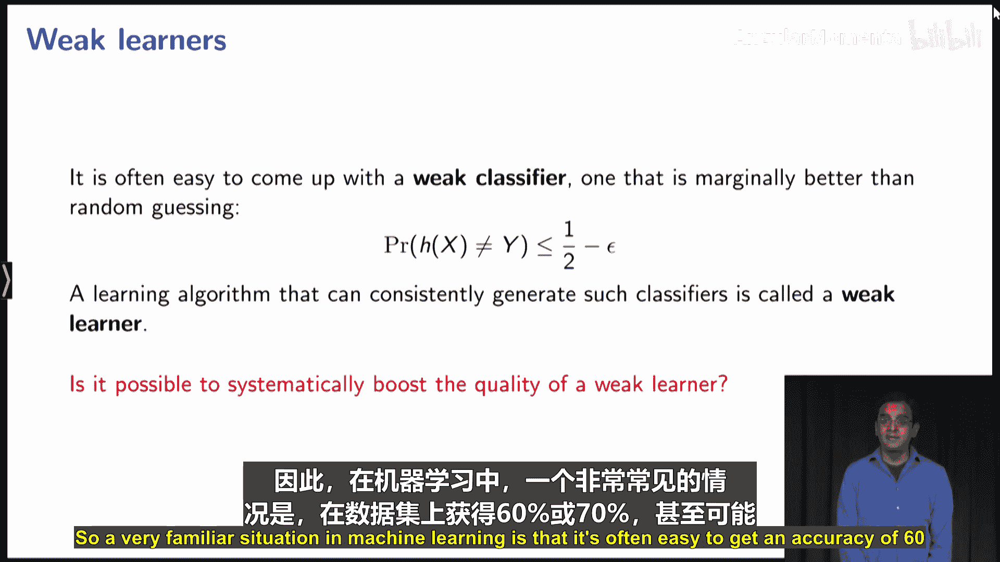

But subsequent gains take a lot of effort。So let's think about this a little bit more abstractly。

Let's say that a weak classifier。Is something that is better than random。

 so its error is less than 50%。But maybe not a whole lot better。For instance。

 its error might be 45% or 49%。And let's say they'd a weak learner。Is a learning algorithm？

That is able to repeatedly churn out we classifiers of this type。

Can we boost the performance of a weak learner？Can we somehow use a weak learner to produce classifiers of much higher quality？

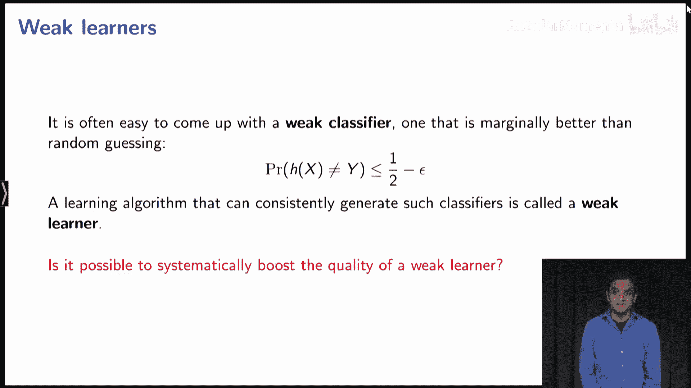

This is what ghostting does。So here's the basic idea。Let's say we have a data set， x1。

 y1 through x and Yn。And we have at our disposal some weak learner。

 okay we don't know exactly what it's doing， it's a black box classification algorithm。

 we feed it a data and it gives us back some weak classifier。

The only thing it guarantees is that this classifier is going to be better than random。

This is not all that reassuring。Can we somehow use this to get a classifier of high quality？

So here's how we'll do it。First off， we'll assume that this weak learner allows us to attach weights to data points okay so let me explain what this means。

 so we have our M data points。X1， Y 1。X2， Y 2。Alll the way to XMYM。

We'll assume that this learning algorithm， this black box we learner。

allows us to specify weights for these points， for example， to say that， oh。

 this has got a weight of1， this has got a weight of two， this has got a weight of1。

 this got a weight of three。So what a weight of two means is it's basically equivalent to having two copies of that data point。

It's as if there were two of them。Now we could achieve this effect by simply duplicating the data points。

But most learning algorithms are easily able to accommodate weights without explicitly making copies of points。

Okay。Okay。So here's how boosting works I we give all the points the same weight， okay。

 we say they all have weight one。And then we feed this data set to the weak learner。

It thinks about things for a little while， and then it keeps us back some we classify our H sub1。

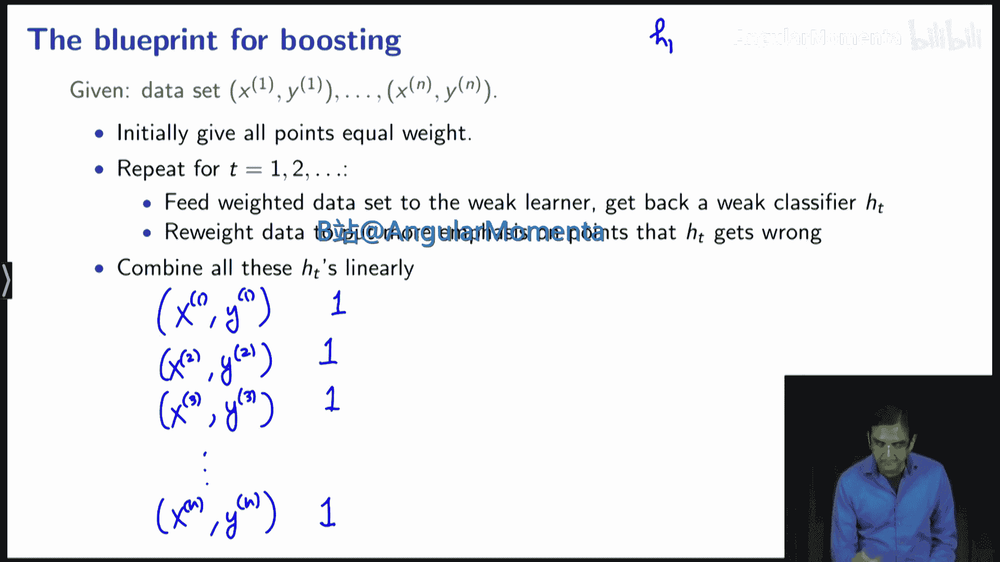

If we're lucky， this will be a really good classifier。

 but actually the only guarantee we had is that it'll be better than random。 Okay。

 so now we go through our data points and we see what H1 did well on and what it did badly on。

 So we look at the first data point and we say， oh， it did well on that。

 You know what we can reduce the weight on that point。 We're doing well on that point。 Okay。

 Then we look at the second data point。 Let's say H1 got it wrong。 Okay。

 then we increase the weight on that point。😊。

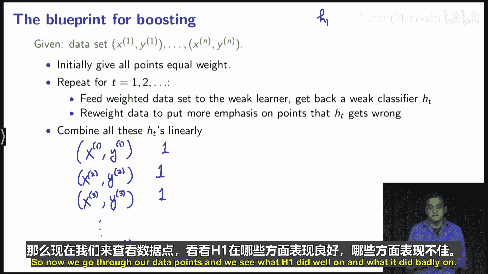

We need to focus on it a little bit more。The third data point。

 maybe we got that right so we can decrease the weight on that as well。

 and maybe the last point was wrong， so we increased the weight on that。And in this way。

 we get a reweighted data set。Now we begin a second round of boosting。

In which we feed this reweighted data to the weak learner。And it gives us back another rule。Now。

 the second time round， it cannot give us H1 again。Because H1 was okay on the first data。

 but is really bad on the reweighted data， so the weak learner has to give us something different。

 let's call it H2。And we keep going in this way， we keep getting a bunch of these weak classifiers。

 H1， H2， H3， and so on。And at some point we decide to stop。

And the final classifier we use is a combination of all of these， we just take a vote of all of them。

 a majority vote。😊，Now， actually， we also allow the different classifiers to have different weights。

 Okay， so we will also use。We also allow each classifier to have a slightly different weight。

 alphapha 1， alpha 2， alphapha 3， alpha 4， where roughly these weights correspond to how good the classifier is。

Okay。So the final classifier is a weighted majority vote。

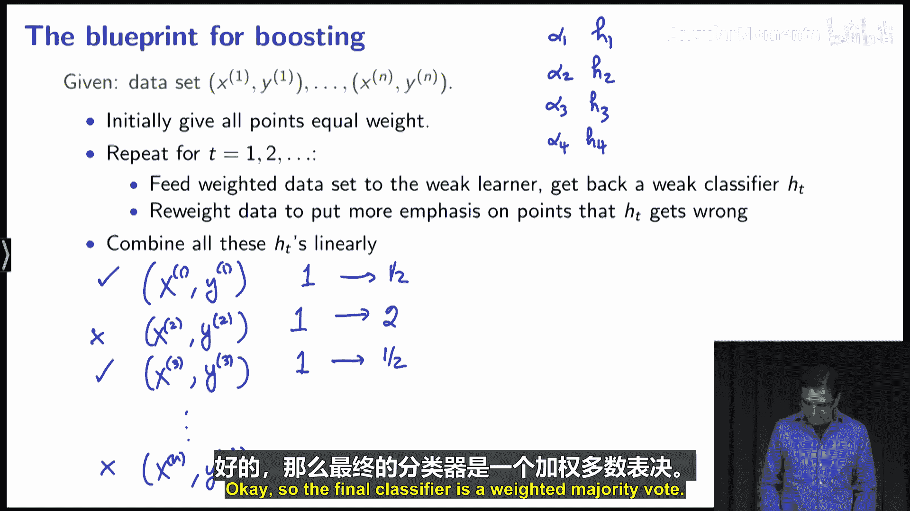

Okay， so let's look at the algorithm more concretely now， the adddamost algorithm。

 as you can see the whole thing fits on one slide。

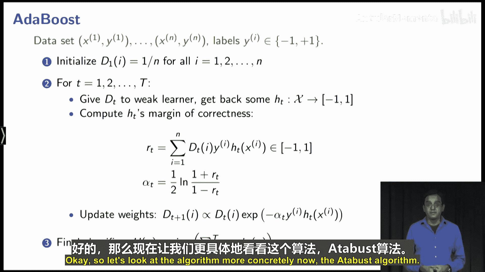

So we have a data set。And let's say that the labels are all minus1 or plus one。And at any given time。

 we're going to have a certain weighting of the data points。

 so the weighting at time T is what we will be calling D sub T。

Now the initial weighting is to assign all the points the same weight， a weight of  one。

 or if you want it to be normalized， a weight of one overM。Okay， so that's the initial set of weight。

And that we begin rounds of boosting。And on each round。

 we feed the weighted dataset set to the weak learn， and it gives us back some weak classifier。

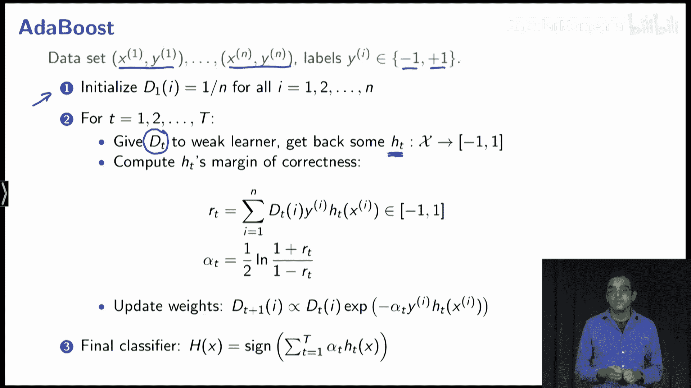

Now the first thing we do is to evaluate how good this weak classifier is to get a score for it。

 and that's what we're calling R subT over here。

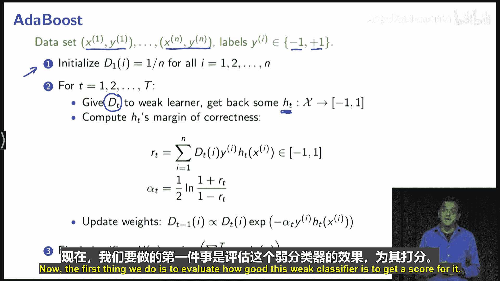

This core is a number between minus1 and plus one。Plus1 means that this classifier H subT gets everything completely right。

-1 means that it gets everything completely wrong and0 would be like a random classifier。 Okay。

 so let's see what this formula is exactly。 So these labels。

The label of the I point that's plus or minus1。And h sub t of Xi is the prediction of the weak classifier on the I point。

 so ideally we'd like it to be the same as the label， in which case y times ht of Xi would be plus1。

 but if it has the wrong label then that's minus1， and we take a weighted sum where the different points are weighted according to the weights d sub t at time t。

So this gives us a score for the classifier。We also get。

The weight of the classifier in the final majority vote in the final linear combination。

You don't need to worry too much about that specific formula。

 roughly classifierifies that are doing better， get a slightly higher weight。Now。

 what we do do importantly， is to change the weights on the data points。

If there's a data point on which the weak classifier HCT is correct， we reduce its weight。

And if there's a point on which H subT is wrong， we increase this weight。

 so as to focus more on that point。And in this way， we do rounds of boosting。

 and we get all these different classifiers H1。H2 pull the way to H sub T。

Along with weights for them， alpha 1， alphapha 2 through alphapha T。

The final classifier at the end of the day is the weighted majority of all these individual classifiers。

To predict the label of a point x， we evaluate this sum。Alpha T ht of x， and if it's positive。

 we predict plus 1， if it's negative， we predict minus1 Good quite simple。

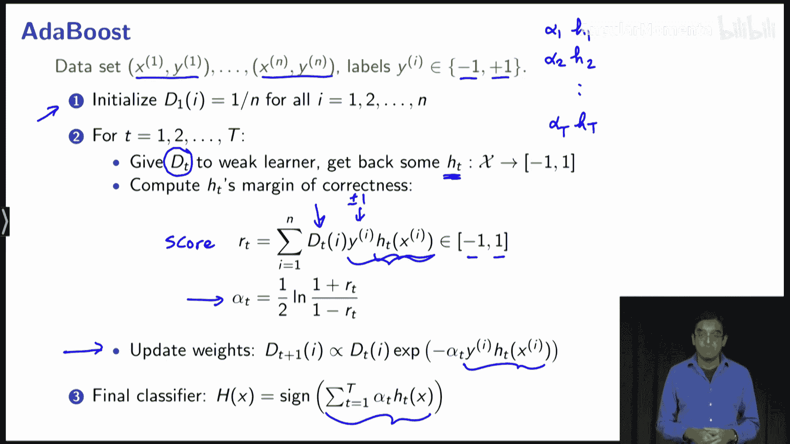

So let's see this at work。😊，This is a simple example that was designed by Yoov Fend and Rob Shapirri。

 the creators of Atdaus。Okay， so we have here a training set in two dimensions。

And there are 10 points， five of them are plus， five of them are minuss。

And we're going to build a classifier for this data set by using boosting。

And the weak classifiers generated by the weak learner in this case are simply going to be horizontal and vertical lines Okay。

 so things like this。Or this。So in other words， each week classifier first chooses a feature。

 either x1 or x2， and then chooses a threshold along that feature。

These are sometimes called decision stumps because they are just like decision trees with just one node。

 so the weak classifiers are going to be decision stumps。Okay， so let's see what boosting does。

 so initially we give all 10 points exactly the same weight and we feed this through the weak learn now。

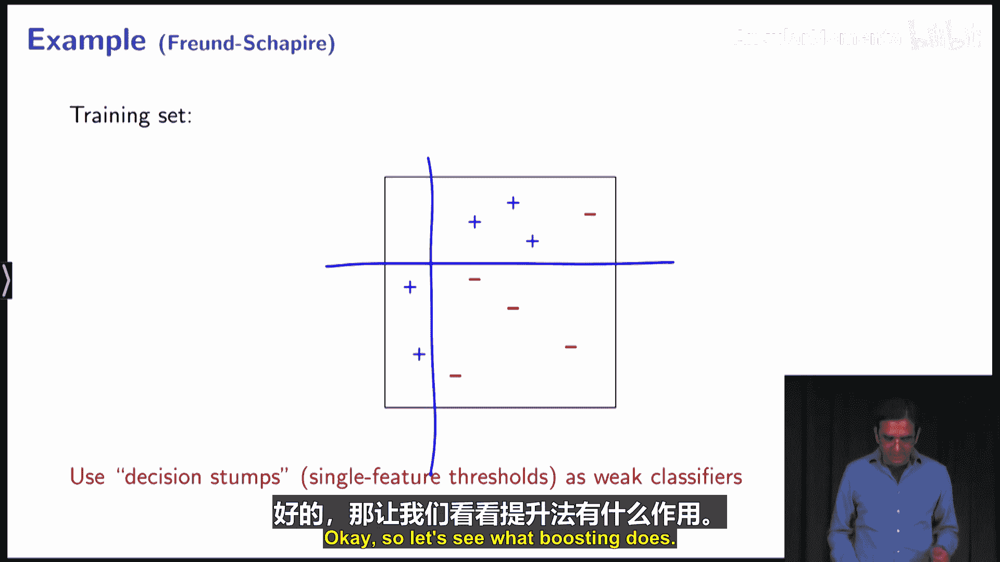

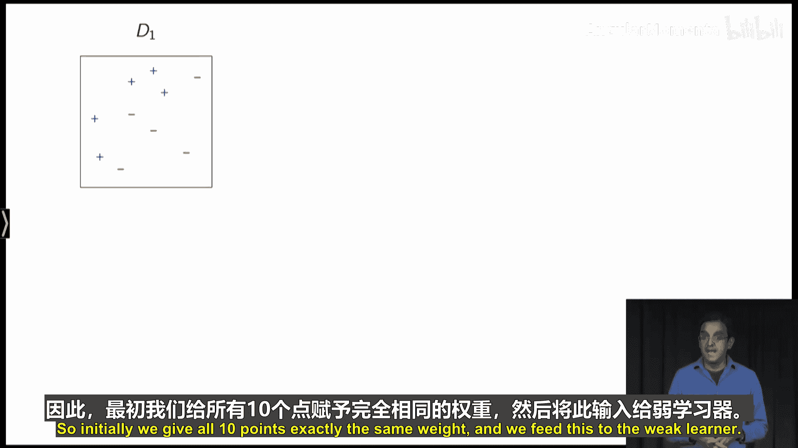

And it gives us back some we classifier， say something like this。Okay。

 so this classifier gets three of the points wrong。In other words， it has an error rate of 30%。

What it guarantees is that its error rate is going to be less than 50%， so this is just fine。

So we go ahead and we compute the score of this classifier。It's better than random。

 it has a positive score， and we also compute the final weight of this classifier in the final majority boat。

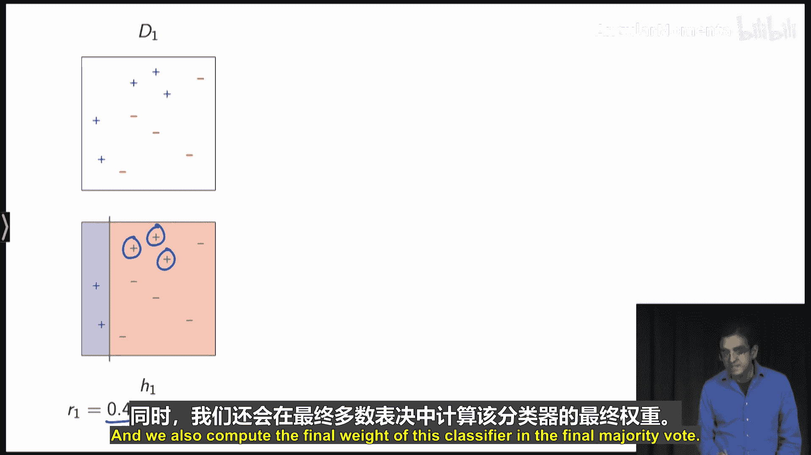

Okay。Importantly， we are now going to reweight the data points and we're going to place emphasis on these three points over here because these are the points we got wrong。

So we create the reweighted data D sub2 in which there's a high weight on these three points。

And now we feed this reweighted data to the weak error。At this point。

 the weak learner is not allowed to give us back H1 because H1 does really badly on this reweighted dataset set。

So the weakler has to give us back something different。And let's say that this is what it gives us。

Okay， so it gives us this new boundary also along the same feature， x1。

And this time it gets a different bunch of points wrong。

 the points it gets wrong this time are these three。And so for the next round of boosting。

 these are the points that we're going to need to up。So our next distribution。

 D sub 3 has a highway on these three points。And again we call the weak learn， and again。

 it gives us back some horizontal or vertical line。Let's see this is a line that Gi us。

And let's say that at this point we decide to stop okay。

 so a final classifier is going to be a weighted majority vote over these three simple rules。

Let's see what the final decision boundary looks like。

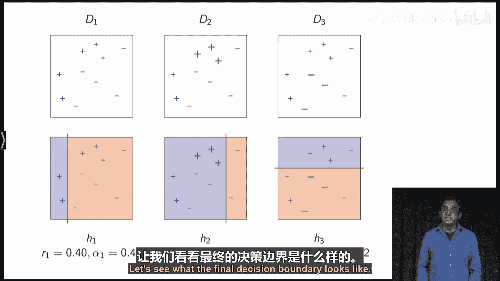

So we have our three decision stops。We have the weights on them。

Since we're going to take a weighted majority vote。

What is the decision boundary that results from combining these three decision steps？Well。

 these three stumps essentially carve the space into six regions。

 these six regions that you see over here， and we can assess the predictions separately for each of these regions。

 so for example let's look at this region right here。In that region， H1 predicts red minus。

H2 predicts blue， H3 predicts blue， and once you take the weights into account。

 the overall prediction is blue plus。Let's look at this region over here。In this region。

 everybody predicts red minus， so the final weighted majority vote is also minus。

Let's look at this region over here。In this region， H1 and H2 predict blue， H3 predicts red。

But taking the weights into account， age3 gets overruled and the final prediction is blue。

So interesting things to notice over here。Are that even though the base classifiers。

 these weak classifiers are very simple， they just thresholds along a single feature。

 the final decision boundary is something nonlinear。And moreover。

 it perfectly classifies the training set。It turns out that this is not an apparration。

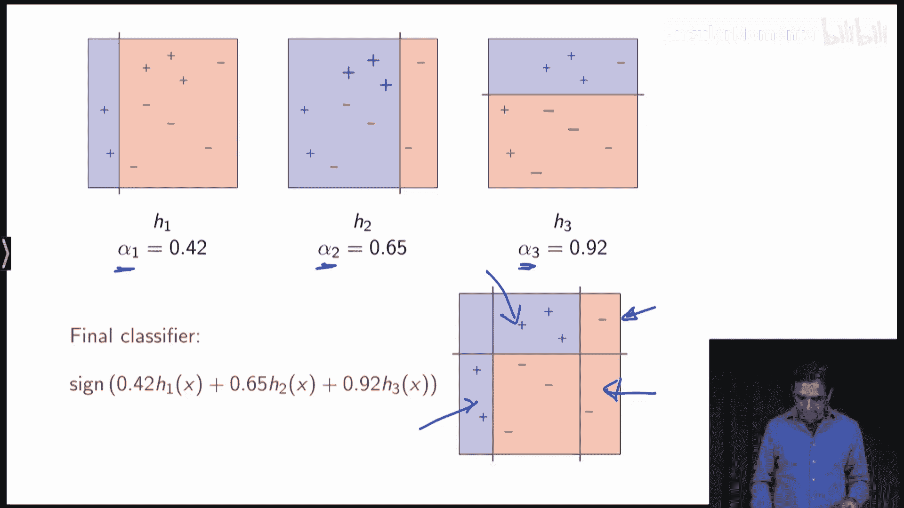

There is a very surprising property of add boost， it can be shown mathematically that it's guaranteed to decrease the training error rapidly。

Okay， so formally。Suppose that the weak learner always outputs weak classifiers H1， H2。

 H3 that are better than random， okay whose error is less than a half， say a half minus gamma。

Where gamma might be something small。Then after tea rounds of boosting。The final classifier。

 which is this weighted majority vote over here。Is guaranteed to have a training error that is exponentially small M。

That is to say that the training error goes very rapidly to zero。This is quite an amazing property。

I mean， the thing we started with was this black box weak learning algorithm。

That gives us classifierifies that are only guaranteed to be a little bit better than random。

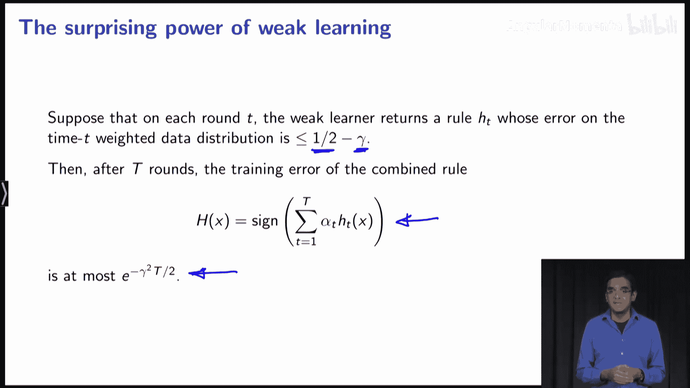

And somehow Boosting was able to ingeniously combine these into a classifier of arbitrarily high accuracy。

😊。

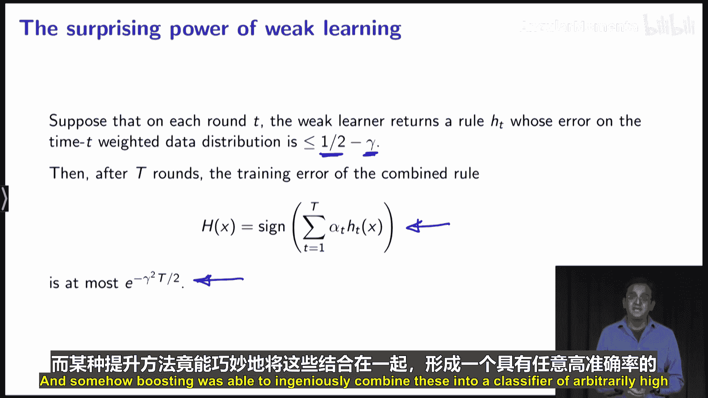

Now， in the example we sold。The weak classifiers。Were thresholds along a single feature。

Each of them looked something like this。Okay， you pick a feature like x4 and you pick a threshold like 5。

 and if x4 is greater than 5， you predict something， if it's less than5， you predict something else。

These are called decision Stumps， and the boosting process generated a whole bunch of decision stumps。

Each with some weight or the other， okay， so maybe the first stump has got a weight of 0。7。

 the second has a weight of 0。3。Thirdd has a weight of 3。2 and so on and so forth。

And the final prediction is a weighted vote over these decision stepss。Now， in experiments。

Boosted decision stumps often get compared to decision trees。

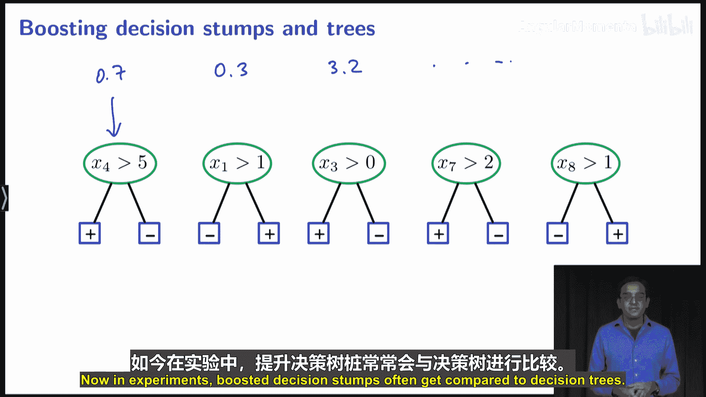

In fact， this is a fairly natural comparison because decision trees are also made up of decision stumps。

😊，This andです。And so on。It's just that in the decision tree。

 these stumps are combined in a different way they're organized hierarchically。😊。

Another popular option is to boost entire decision trees。

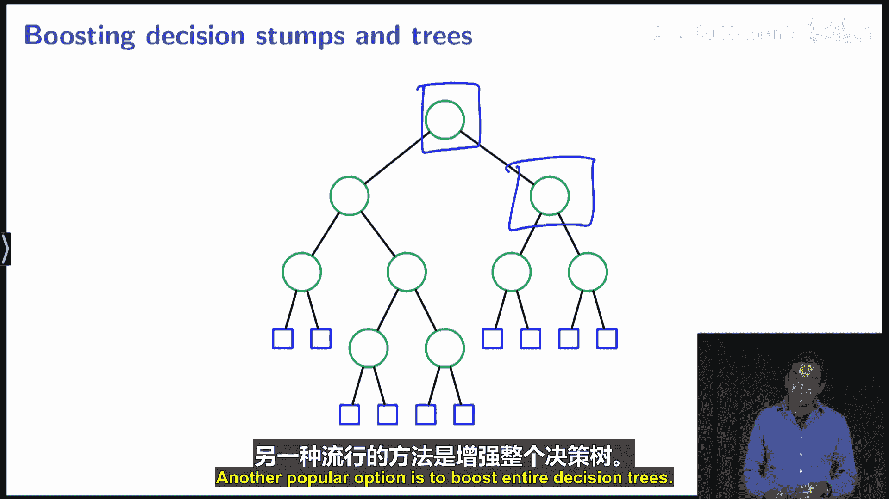

Okay， so here each week classifier。Is full decision trip。

And we use boosting to generate a whole collection of these trees， what is sometimes called a forest。

Next time we'll develop this notion of a forest further。

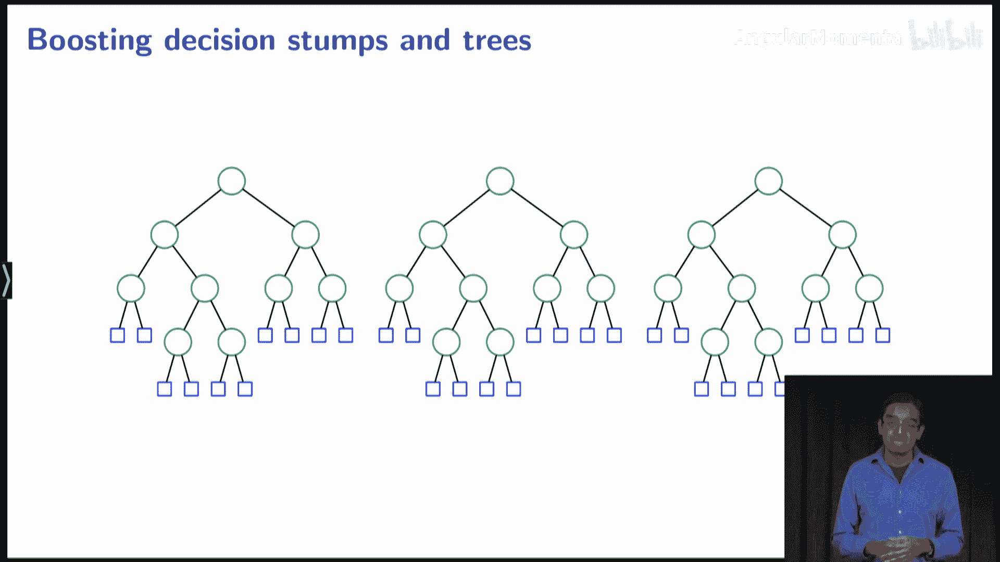

So that's all we'll have to say about boosting， that's a little sad because there actually is a whole lot more to say。

This main property of boosting， its ability to drive the training error down to zero is really very surprising and people from many different fields。

 game theory， computational complexity， statistics have been very interested by this and have tried to reinterpret these results in terms of their own fields。

For us， at the end of the day， Boing is a simple。Highly effective and high performing off the shelf classification system。

