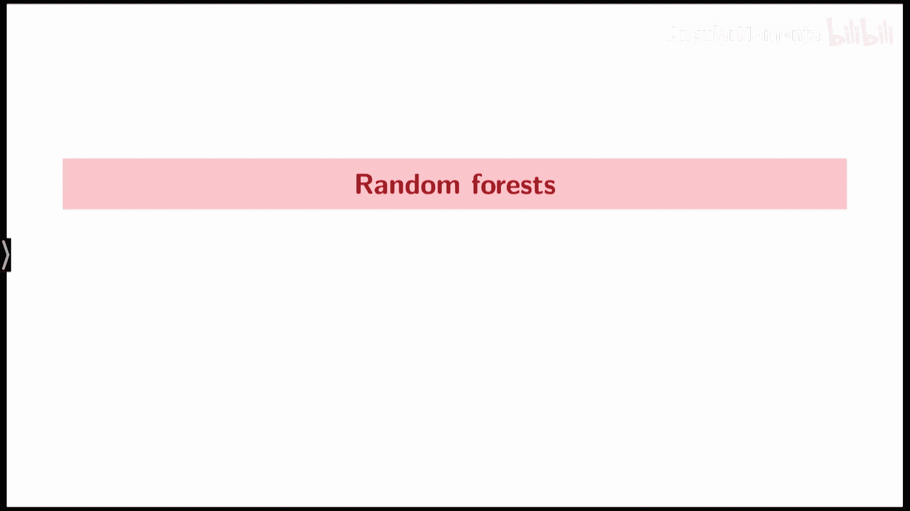
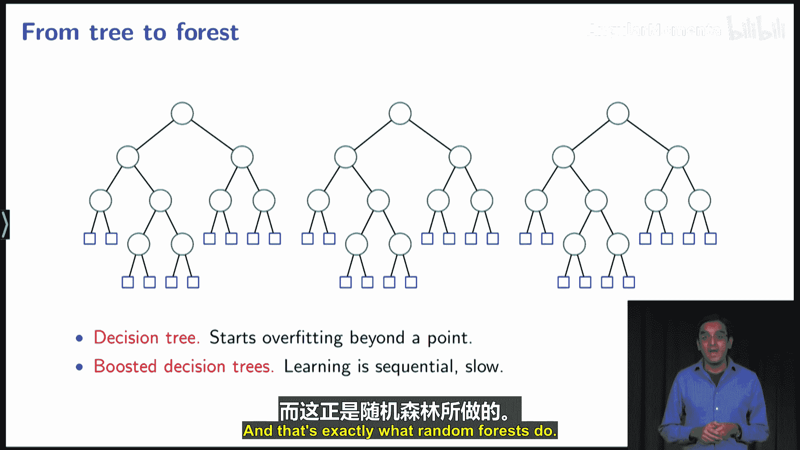
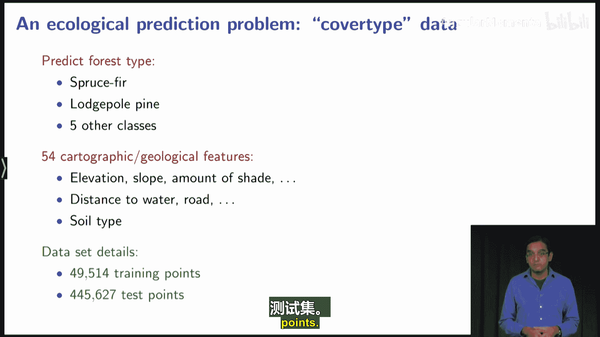
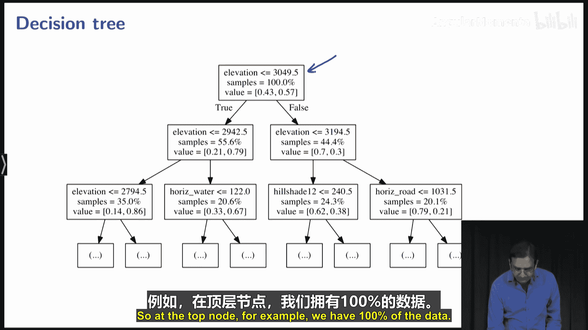
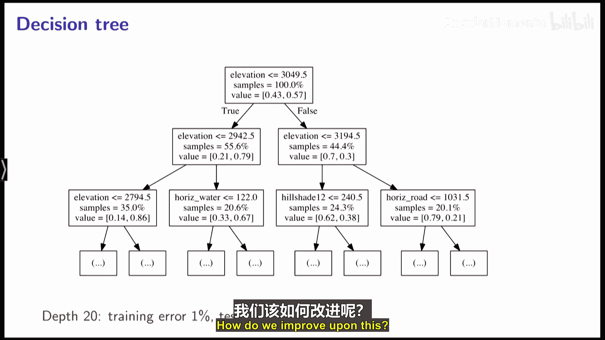
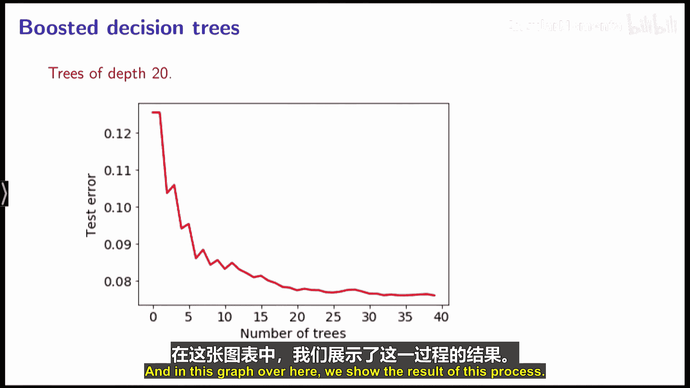
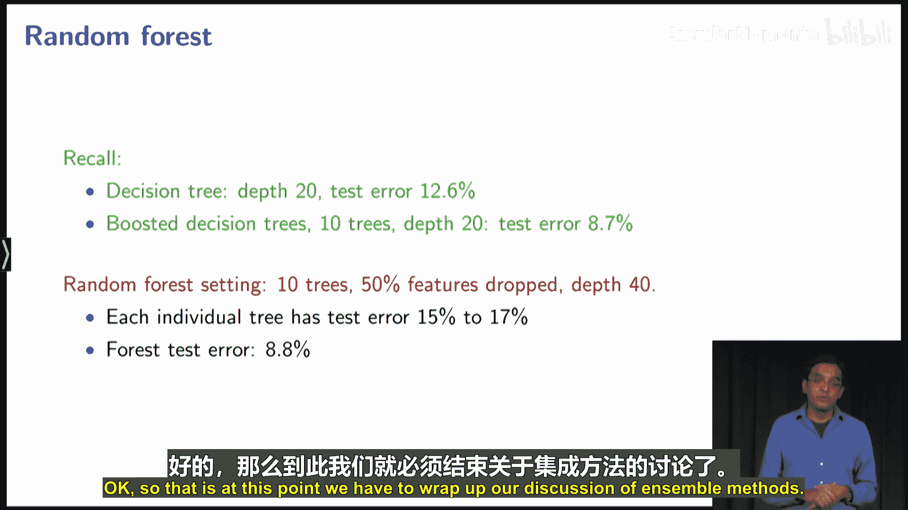

# 【加州大学圣地亚哥分校】机器学习基础  Machine Learning Fundamentals p43 08-08-02-随机森林 -BV1TyFSziEZb_p43-

Boosting is often called an ensemble method。Because it produces a collection or ensemble of classifiers。

Today we'll look at an alternative ensemble method that is hugely popular because of its extreme simplicity and its excellent performance in practice。

 it is called the randomom Forest。So we'll begin。By looking at ensembles of tree classifiers。

 which are sometimes also called forests。Then we'll see how a random forest is built。

 and finally we'll do an experiment that's going to pull together our discussion of decision trees。

 boosting and random forests。😊，So we've talked quite a bit about decision trees。

These are very appealing classifiers。They ask a few questions shown here by the circular node。

And that brings us down to a leaf where a prediction is made。Now， in principle。

 a decision tree can fit any data set。But in reality。

 one problem that they have is that once the tree starts growing too big。

 it starts overfitting the data。So as the tree gets too large。

 what happens is that the training area keeps going down。But the test error。

 which is what we actually care about。Starts going up。

And so the best performance is achieved by some tree of intermediate size。

So how can one improve upon this？One way to do this is to use boosting to create a whole bunch of trees。

Instead of just growing the tree further， which would make things worse。

 we start a fresh tree focusing on the mistakes made on the first tree。

And then once we're done with the second tree， we start a third decision tree focusing on the mistakes of the first two trees and so on。

So as we keep adding more and more trees。The training error goes down and very often the test error also goes down。

So this is a very appealing setup。And one inconvenience， however。

 is that this has to be done sequentially。We have to wait for that first decision tree to complete before we begin the second tree because that tells us how to reweight the data points。

And similarly， we have to wait for the second tree to finish before we start on the third tree。

All this can sometimes be quite slow。How nice it would be if instead we could just build all these trees in parallel。

What would it take to do that？Well， if we wanted to build a whole bunch of trees at the same time。

We would first and foremost have to somehow ensure that the trees ended up being quite different from each other。

There's no point in having multiple copies of the same tree。

So how do you make sure that these trees that you're building in parallel are all different from each other？

Well， one good way of doing that is to simply introduce randomization into the tree construction。

 and that's exactly what random forests do。

So let's look at how a random forest is built， so let's say we have a data set。Of endpoints。

 say in D dimensional space， let's call the data S。

And let's say that we want to build a collection of tea trees。We can do this in parallel if we like。

 okay so we're going to build T decision trees。And in building each tree。

 we are going to use two kinds of randomization。The first thing we're going to do is that instead of using the original data set S。

 we're going to resample the data。The way we do this。

Is that we're going to take as our set of endpoints。

And we are going to randomly sample N prime points。With replacement from S。Typically。

 n prime is taken to be n。Okay， so let's see what this means。

Let's say that we have a data set with five points in it。Say one， two， three， four， and five。

And let's say we want a resample dataset set of size 5 okay。

 so we first pick one of these points at random， let's say we end up with point number four。

Then we pick another point at random， Sa we end up with point number one。

Then we pick another point at random， let's say we end up with point4 again。

Then we pick another point at random， let's say we end up with 0。5。

And finally we take another point at random， let's say we get 0。4 again。

So the resample data set consists of 0。1。Point5 and three copies of 0。4。

So we will use this resample data to build a decision tree， and now in the tree construction itself。

 we'll introduce a second kind of randomness。😊，When we're building the tree at any given point。

 when we're in a node。We have to split that node。And in our case， we have D features。

 so we have to choose one of these D features along which display。In random forests。

 you're not allowed to use， you're not allowed to consider all the features。Instead。

 you pick K of these features at random。And you are forced to choose one of those K features。

Typically K is set to something like square root D or to a fixed fraction like d over2。Okay。

 so what this does is that it creates diversity within the trees。This creates a sort of robustness。

 these trees have to arrive at the correct answer， the correct label in a variety of different ways。

This is a very interesting kind of randomness， and in fact， when we study neural nets。

 we'll see that something similar。Is often done there called dropback。Anyway。

 using these two types of randomness， we get a collection of tea trees that are all quite different from each other。

Now when it's time to predict the label of a new point x， we just run them through all the trees。

 get each tree's vote， each tree's label， and take the majority vote。Okay。

 so let's see a simple example that brings together all of this and since we've been talking so much about trees。

 I thought it would be appropriate to look at an ecological example about forest types so this is the cover type data。

😊，And it contains data collected from various locations in US national forests。

So each data point is collected from a little patch of land， a 30 meter by 30 meter patch of land。

And。54 features are measured from that batch。 These are things like the elevation， the slope。

 the amount of shade， the distance to the road， the soil type，54 features of this kind。

And based on these features， the goal is to predict the forest type in this batch of land。

Now there's a total of seven types of forest， but in this particular data set there are two types that completely dominate the others。

 they are spruce fur and logical bulk pine， and so actually what we did is to just eliminate the other points for simplicity。

 and so essentially we have a binary classification problem。Now there's a huge amount of data。

And we divided this into a training set of about 50，000 points。And a test set of about 450。

000 points。

Okay。So the first step was to fit a decision tree to the data， and this is the top of the tree。 Okay。

 so let's look at some of these annotations。 So at the top node， for example。

We have 100% of the data。All the data goes through the top。And all this data。43%。Is from class one。

And 57% is from class2。The split of that node。Uses the question。

 is elevation less than or equal to 3049。5 feet？If the answer is yes， it goes to the left。

 if the answer is no， it goes to the right Okay， so on the left， we get 56% of the points。

And the remaining 44% of the points go to the right。On the left。

We have 21% of the points in Class one。And 79% of the points in class do。On the right。

 70% of the points are in class1 and 30% of the points are in class2。

So you can see that that top split does a pretty good job of reducing the uncertainty。

 We go from a 4357 balance to 2179 on one side and 7030 on the other side Okay so a significant reduction in uncertainty and this trend continues down the tree。

Now， as usual， once we keep growing the tree at some point it begins to overfi。

 and so what we did at this case was to stop growing the tree at a depth of 20。When we did that。

 we found that the training error was 1%。And the test error was about 12。6%。Okay。

 and it's really not possible to do too much better than this。Okay。

 so this is the performance of one decision tree， how do we improve upon this by using boosting to create a whole collection of decision trees？

And in this graph over here， we show the result of this process， okay， so we boosted decision trees。

We fixed the decision tree depth to 20， and we created a collection of a total of 40 trees。

Now this graph shows how the testera goes down as we add more and more trees。

So when we had just one tree over here。That was exactly the same treat we saw before。

 and so it has exactly the same testeric 12。6% up here。As we added more trees。

 the test error kept going down， initially it really plunged and then it tapered off to somewhere a little less than an 8% error rate。

So this is working well and for the purpose of comparison with random forests。

 we just picked a fixed number of trees， say10 trees， this point over here。Okay。

So let's see what happens when you build a random forest on this data so we decided to use 10 trees。

And now if you recall when you're building a random forest at each split。

 you don't allow yourself to use all possible features。

 okay you pick some fraction of them at random and then you restrict attention to just those features。

In our case， we set that fraction to 50% so when we are splitting a node。

 we choose 50% of the 54 features at random。And then we require a split to involve one of these selected features。

To compensate for this， we allowed the trees to be larger instead of depth 20。

 we allowed the depth to be 40。Okay， so we went ahead and we built 10 trees in this way。

And it turned out that if you look at any individual tree generated in the random forest。

The test error is between 15% and 17%。This is much worse than the error of the single decision tree。

 and it's because of all the constraints and the randomness in the construction of the tree。😊。

However， these1 trees were sufficiently different。That taking the majority vote of them resulted in a much better classifier。

 one whose test error was just 8。8%。Okay so this is much better than the single decision tree and is comparable to the boosted forest of 10 decision trees。

Okay， so that is at this point we have to wrap up our discussion of ensemble methods。

This last method we've seen， random forests。 These are really an ingenious combination of two things。

 the expressive power of decision trees。And ideas from randomized algorithms。At the end of the day。

 they're simple， easy to use， and high performing classification methods。

