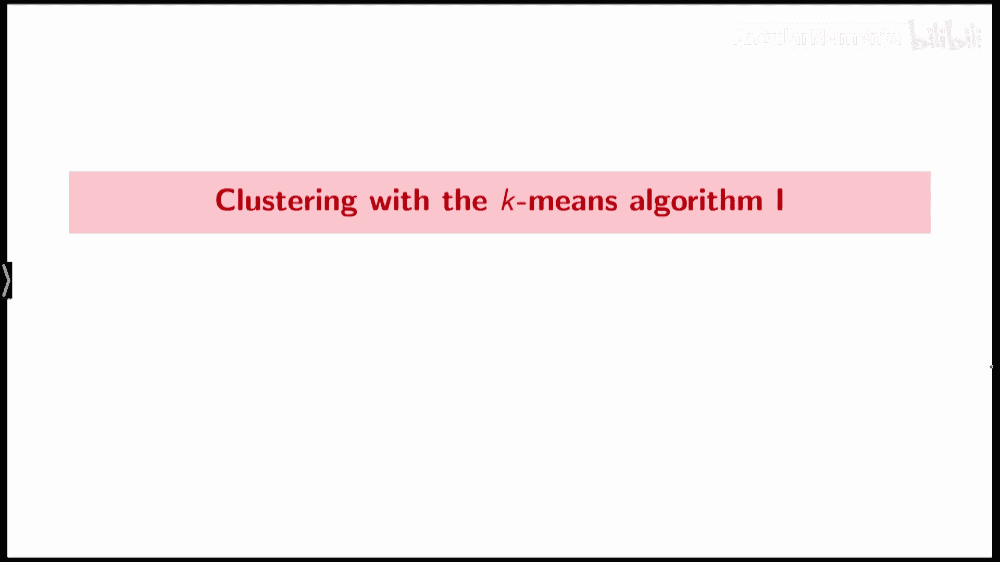
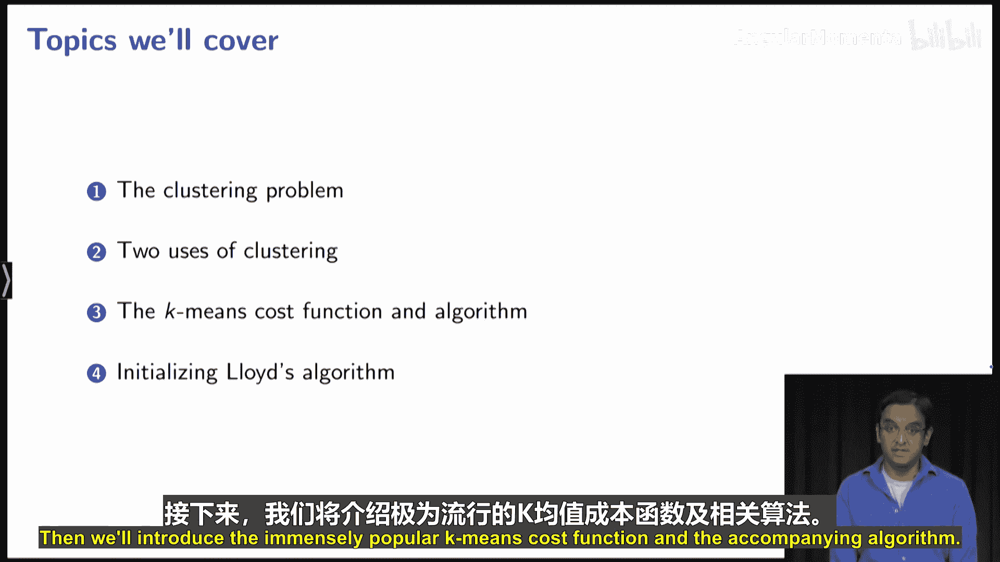
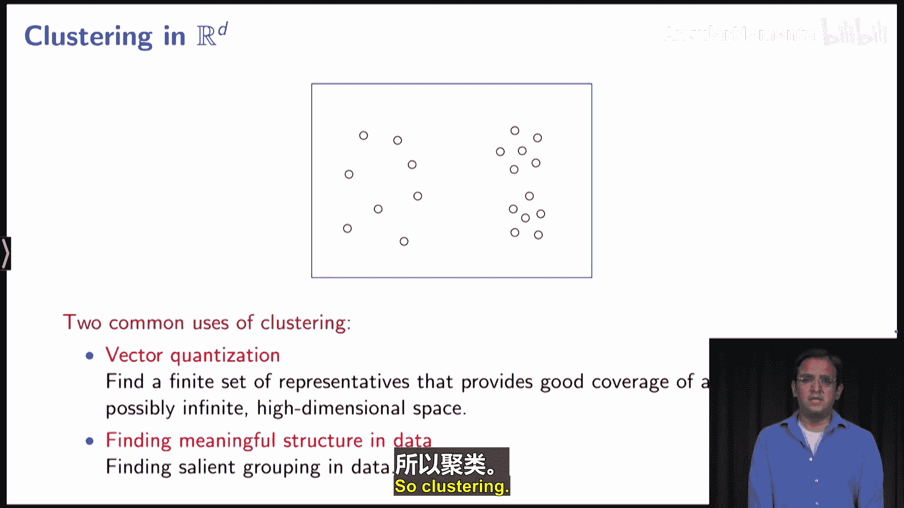
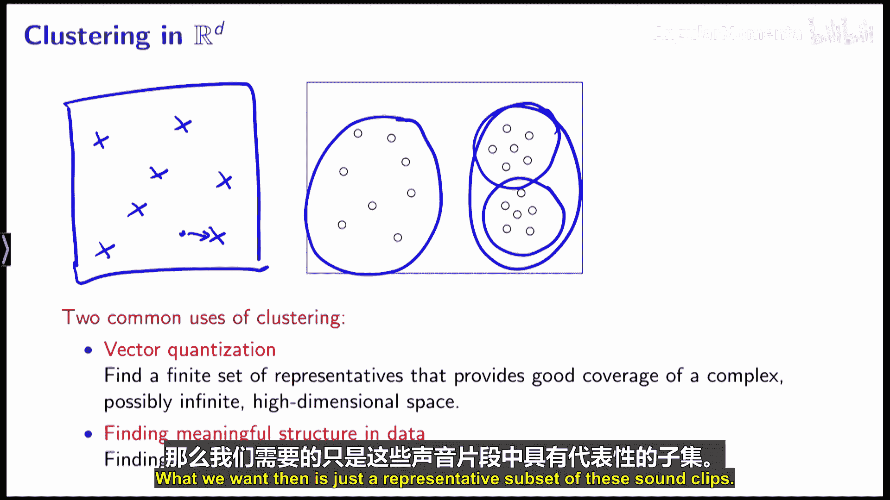
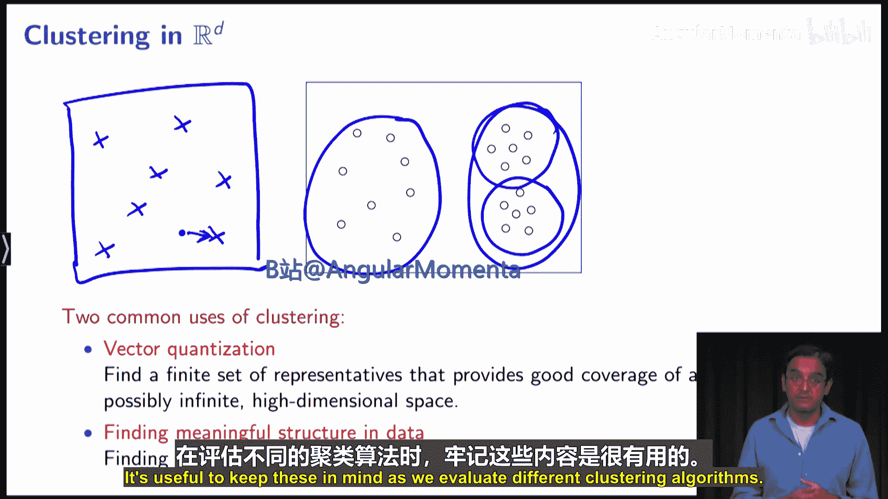
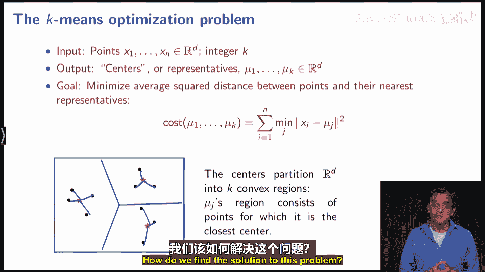
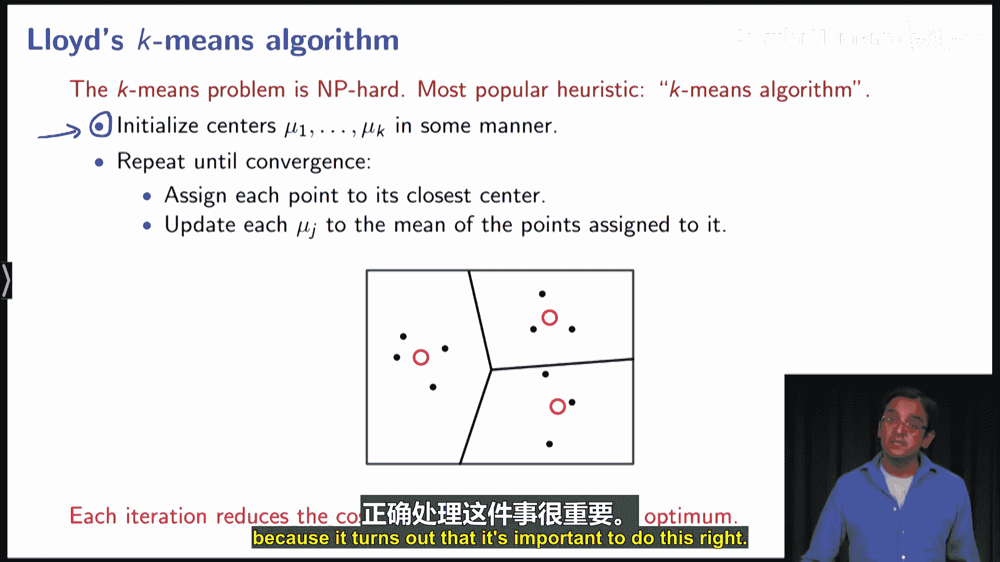
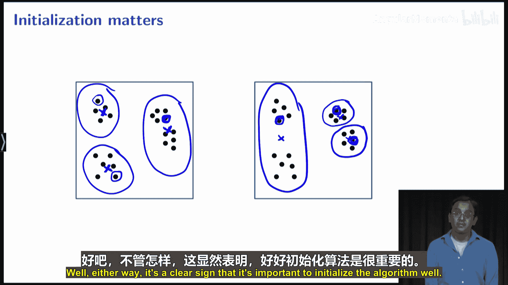
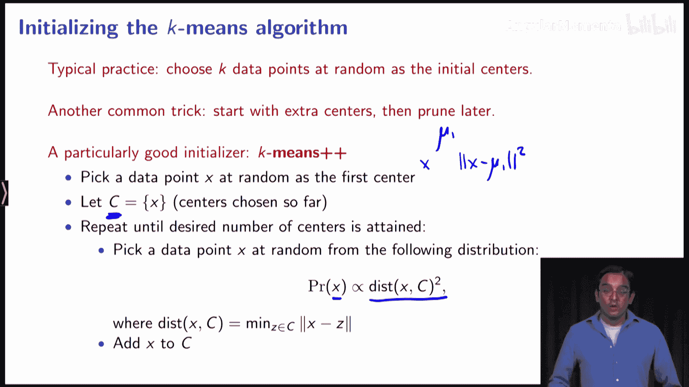

# 【加州大学圣地亚哥分校】机器学习基础  Machine Learning Fundamentals p45 09-02-02-使用k均值进行聚类 -BV1TyFSziEZb_p45-

Our first big topic in representation learning is going to be clustering。

So what we'll do today is to define what clustering is and then look at two rather distinct ways in which clustering gets used。

Then we'll introduce the immensely popular K means cost function and the accompanying algorithm。

So clustering。

In clustering， we are given a set of data points， say RD。And we are asked to cluster or group them。

Okay， in this data set， for example， how many clusters are there， well。

 maybe there's one over here and one over here。Or perhaps there's actually two on the right hand side。

 perhaps there's this。And this。Both options seem perfectly reasonable。

Now there are two rather different ways in which clustering tends to get used。

The first is what might be called vector quantization。So in this setting， there is some very large。

 perhaps infinite or continuous space。From which the data has been sampled。

 and the goal is to find a few representatives for that space。 Okay。

 so there's some very large space。The data has been obtained from that space。

 and the goal is to find a few representative points in that space。Subsequently。

 any point will simply be assigned to its closest representative。For instance。

 this could be the space of all 20 millisecond speech recordings， okay。

 so a continuous and very large space。What we want then is just a representative subset of these sound clips。

And whenever a new sound clip arrives， we'll simply replace it by its closest representative。

This is a compact way to encode a sound clip， it's a form of audio compression。Okay。

So if this is the way in which we are using clustering。

 what is a good way to measure the quality of the clustering， well it's quite naturally。

 actually we would measure it by the amount of distortion induced。

When you replace points by their closest representatives。嗯。

So that's the use of clustering for quantization， and we'll see an example of that later on。

The other big use of clustering is to find meaningful groups in data。Okay。

 to find natural clusters in a data set， and this is what would arise， for example。

 in exploratory data analysis。So for example， let's suppose that a supermarket is collecting data on its customers。

 who buys what， is there a way to cluster the customers？

That gives really creates natural groups of people。According to their purchase patterns。

 this could be very useful。 for example， if the supermarket is going to have a sale。

 it could make sure that there are discounts that are appealing to each cluster。

 or at least to each of the clusters that are large enough。So two distinct uses of clustering。

 it's useful to keep these in mind as we evaluate different clustering algorithms。

Now， clustering is an important problem and there are lots and lots of different clustering algorithms that people have come up with。

It turns out， however， that there's just a small number of algorithms that have been hugely popular and that are widely used。

The foremost amongst these is the K means algorithm， which is what we'll be talking about today。

And later， we'll get on to some of the other more popular algorithms such as EM。

 the mixtures of Gaussians， and some of the agglomerative hierarchical clustering algorithms。

So let's start with K means。So do you remember we talked about two uses of clustering and one of them was vector quantization？

So came means is something that really seems geared towards this objective。So in this problem。

 in the formulation of the optimization problem， what you are given is a set of endpoints in D dimensional space。

 these are the points to be clustered。And you're also given an integer K。

That's the number of clusters， the desired number of clusters。The output。Is a set of representatives。

 mu 1 through muk， a set of cluster centers， so these are just K points in D dimensional space。Okay。

What we're going to be doing essentially is thinking about replacing each point by its closest representative。

So the goal is to minimize the distortion that gets induced by doing so。Okay。

So the way we formalize this precisely is that we want a set of centers。

Such that the average distance from a point to its closest center。Yesスも。

So let's look at the cost function。So the cost associated with a specific set of centers me once from mu okay。

Is the summation over all the data points？So let's say we're looking at point x of I。

When we're dealing with point x sub I， we look at the closest center， the closest of the K centers。

 so we take them min over J。And the cost is the distance to that center squared。

So the charge for point x sub I is the distance to the closest center squared and we want to minimize the average charge or the total charge of this kind so it's a formulation that's very much geared towards vector quantization。

So here's an example data set with 10 points and let's say we want tweak clusters in it。

Where might we the cluster centers？Okay， so here's an example of where the cluster centers might go。

And if we place the centers there， what we're essentially saying is that each point in the plane is going to get sent to its closest center。

 so this is going to divide up the plane in the following way。

 any point in that region to the upper right will get sent to that center and so on and so forth okay。

So what is the K means cost in this case， the cost is the distance of this point to its center squared。

Plus this distance squared， plus this distanced， plus this squared plus this squared。

 plus this squared and so on and so forth。It's the sum of these 10 distances squared。

OkayNow more generally， we will be in RD and there'll be K centers。

We assign each point to its closest center and so this ends up carving D dimensionsal space into K regions。

It turns out that each of these regions will be a convex region and is often called avoorrenoid cell。

 so this is the k means optimization problem。嗯。This is just stating what we want from the centers。

 but now we need an algorithm， how do we actually find the centers that minimize this cost function。

 how do we find the solution to this problem？

So the bad news is that this problem is NP hard。Now what that means in a nutshell is that there's no efficient algorithm that's guaranteed to always yield the optimal solution。

So we have to look at heuristics。And the most popular heuristic。

 and also the most popular clustering algorithm of all time is Lloyd's algorithm。

 which is often or typically just called the Ka means algorithm。This is a very simple algorithm。

 it's given in its entirety over here。And it is a local search algorithm Now the goal here is to find case centers and what this algorithm does is to just initialize the case centers somehow so it has K points。

And then it just tweaks them a little bit to lower the cost。

 and then it tweaks them a little more to lower the cost and it keeps going in this way until it converges so it's a local search or a hill climbing algorithm。

So let's look at the specifics。So we start by initializing the centers in some way。

 the usual way to do this is to simply pick k of the data points at random and say those are going to be our initial centers。

Then we begin the main loop and this is the loop of iterative improvements。So on each iteration。

 we assign each point to its closest center， and then we move that center to the mean of all the points that have been assigned to it。

Okay， so let's see that in action， okay， so we have this data set over here。With 10 points in it。

We start by initializing the center somehow， let's say we just picked three of the points at random。

 let's say we have something like this Okay， so those are our initial centers mu1， mu2 and mu 3。Now。

We begin the main loop。And on the first iteration， we assign every point to its closest center。

So that means the space gets carved up somewhat like this， okay？

So let's look at the cluster on the left over here。

 there are four points over here and what we're going to do now is to move this center。

This one over here to the mean of those four points。 Okay， so we're going to move it over here。

That's definitely an improvement， right？Now let's look at this center up here。

It has just one point assigned to it， so it's not going to move。Now let's look at this one over here。

 we are going to move it to the mean of the points that have been assigned to it now in this case five points have been assigned to it and their mean is somewhere over here。

So that's where that center is going to move。Okay。So those are the new centers。

Those are on new centers and now we begin another round of K means， we begin the second iteration。

 so once again we assign each point to its closest center。So we end up with this。

 this is the way in which the space gets carved up into three regions。And once again。

 what we're going to do is we're going to replace each center by the mean of all the points that have been assigned to it。

Okay， so let's look at the cluster over here on the left。

Four points have been assigned to it and it's already the mean of those four points。

 so it's not going to change。let's look at this center over here。

Three points have been assigned to it， and so it'll move to the mean of those three points somewhere there。

Let's look at this center。Three points have been assigned to it and it'll move to their mean。

 which is somewhere here。Okay， so now the new centers。Look like that。

And now we begin the third iteration of k means okay， so once again。

 we assign each point to its closest center， so this is what we get。And once again。

 we replace each center by the mean of the points assigned to it。

 and now what happens is that nothing moves。 everything is already the mean of the points that were assigned to it and so the algorithm converges。

It's a very simple algorithm， what can we say about it。

 does it always find the optimal solution to the came means cause function， no it does not。

 we wouldn't expect it to， given that this is an NP hard problem。

But we can say some things about it okay so in particular with each successive iteration。

 the cost is guaranteed to go down so we keep producing the cost from iteration to iteration and eventually it stops in some sort of local optimum。

 is it the global optimum in general no？So it's a very simple algorithm， we've specified it fully。

 the one thing that we have left unspecified is the method of initialization。

And so I want to talk about this a little bit more because it turns out that it's important to do this right。

 and let's see why that's the case。

So let's look at a little examples， here's a data set with。I don't know， roughly。

16 points and what we're going to do is to initialize it two different ways and we'll look at the resulting K means clusterings Okay so let's start on the left let's say we want three clusters and that we're going to initialize just by picking three points at random so maybe the points we pick are。

This point over here。And this point over here。And this point over here， okay。

 so those are our three initial centers。So now we assign each point to its closest center and we end up getting clusters roughly of this kind。

And now we replace each center by the mean of the points that got assigned to it。

 so in this case it'll move over here somewhere。And in this case， it'll move over here somewhere。

And in this case， it'll move probably over here somewhere。So the crosses are the new centers okay。

 and so now we'll bring it begin a new iteration。What are the new clusters？

But to this point the clusters don't change okay， everything remains in the same cluster as it was before。

 and so those are the final centers as well。Okay， so the algorithm ends up with this clustering and this set of three centers。

So now let's pick another random initialization， so again we pick points at random。

 let's say we end up picking this as one of the initial centers。

And this is one of the initial centers and this is one of the initial centers。

 so those are our three initial centers， okay， let's see what happens now。

So which points get assigned to this center over here？These points over here。

 so that's one of the cluster tour。Which points get assigned to this center？These points over here。

 that's another one of the initial clusters and which points get assigned to that center。

 these points over here。So these are the three initial clusters and during the first round of K means。

 the means will move。This one over here。We'll get sent to the mean of all these points。

 which is somewhere here。This one will get sent to this point here。

 and this one will get sent fairly close to where it currently is， so the x's mark the new means。

And now once again， we see that the clusters will not change on the next iteration。

 and so the algorithm converges。Okay， so if you look at these pictures。

We had two different initializations and we got two very different answers at the end。

Which do you think is the better answer？Well， either way。

 it's a clear sign that it's important to initialize the algorithm well， Okay。

 and so let's look at some ways in which that's typically done。

So as I said， the most common practice by far， I believe。

 is to simply pick k of the data points at random and make those the initial centers。

Another common trick。Is to start with extra centers， so if you want 10 clusters。

 let's say you start with 20 centers， so you have extra centers and now you run Ks for a while。

And then you killed 10 of the centers， okay， N left which just 10 centers。

 and then you run came int convergence。So which centers do you kill？

The ones the ones you get rid of are the ones that have very few points assigned to them or the ones that are very close to other centers。

 okay so that's another common trick for running K means。

Now one very good method of initialization is to use what's called the K means plus plus algorithm。

 okay so let me tell you what this is。Sure。What happens over here is that the initial centers mu 1 through muK are picked one at a time okay so first we pick mu 1 by just picking a random data point okay so we have n data points。

 we pick one of them at random that's mu 1。That's our first center， okay？

Now we have to pick the second center。And again， we pick it at random。

 but this time we favor points that are far away from new one。

The way we do that is that we say that the probability of picking a point x is proportional to the distance from x to mu1 squared。

So if something's very far from mu 1， there's a higher probability of picking it。

 and if x is equal to mu 1， the probability is  zero， so it certainly will not make mu 1 again。

So in this way the second， this is the way in which the second center mu2 is picked。😊。

How do we pick the third center Well， again， we pick it random from the data set。

 but now we favor points that are far away from both mu 1 and mu2。

And we keep going in this way until we have all case centers， okay， so a little bit more formally。

During this process， at any given time， we've picked a bunch of centers C。

 how do we pick the next center， where we pick it random from the data set from our endpoints that we've been given。

And the probability that we pick a particular point x is proportional to the distance from x to the centers we have so far squared。

So it's a very simple initialization procedure， and it turns out to be quite effective。Well。

 that concludes our initial treatment of the Ka means algorithm。

Next time we'll go into a little bit more depth， we'll see a couple of uses of K means。

 and we'll also look at some variants that are geared towards massive data sets。

