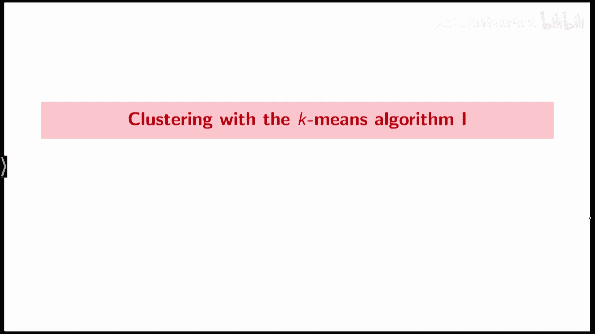
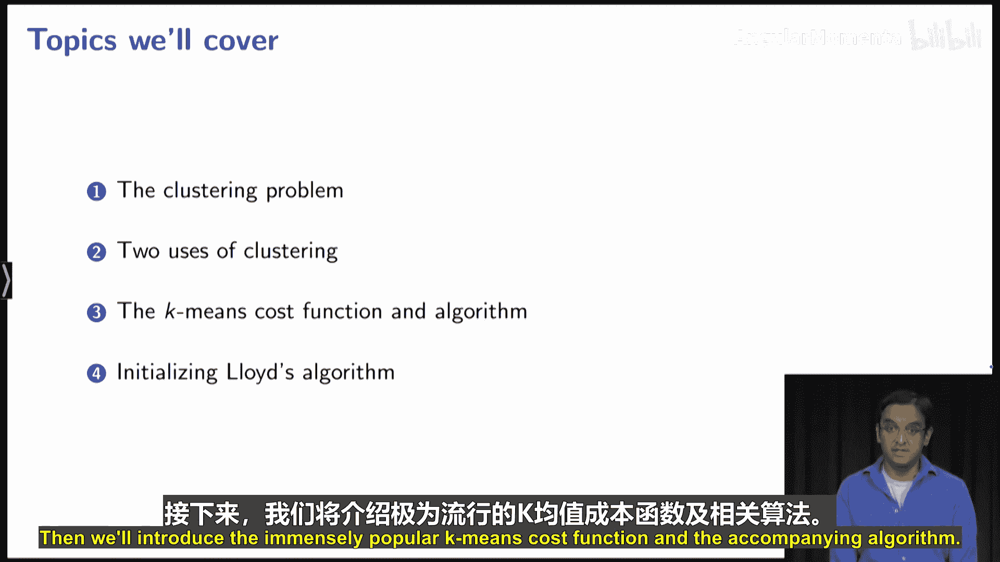
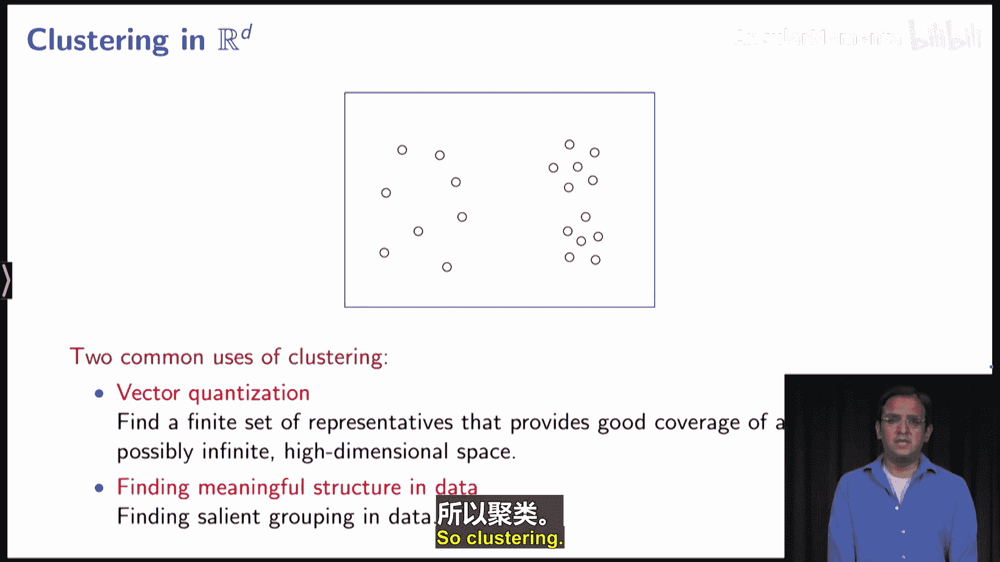
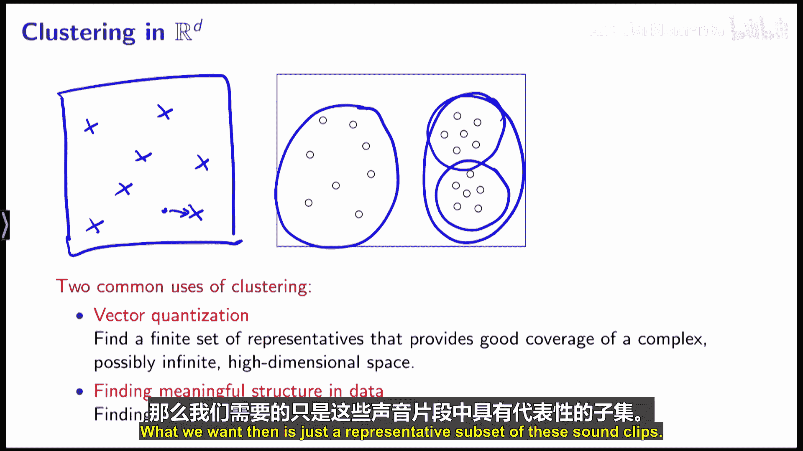
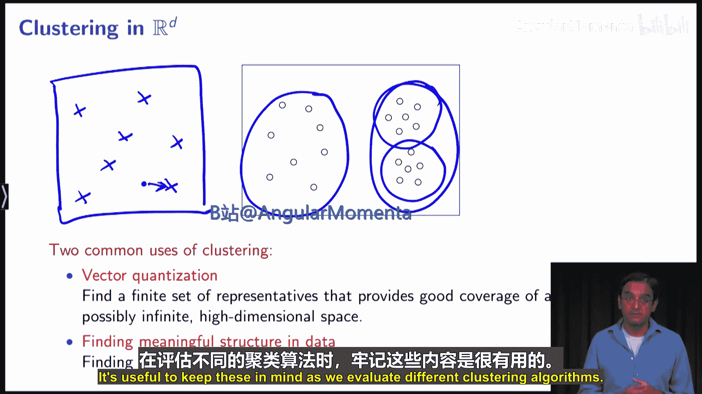
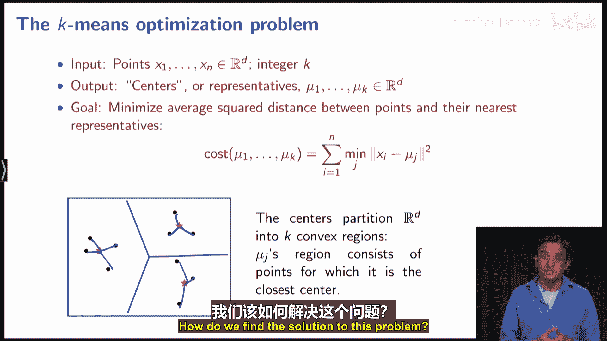
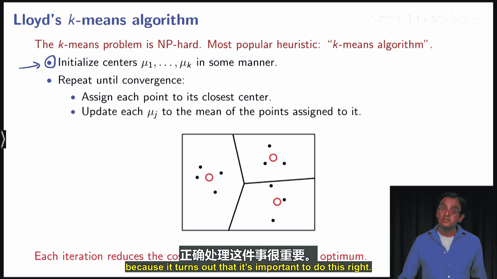
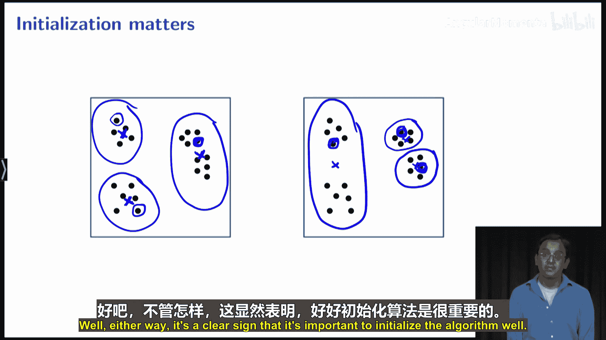
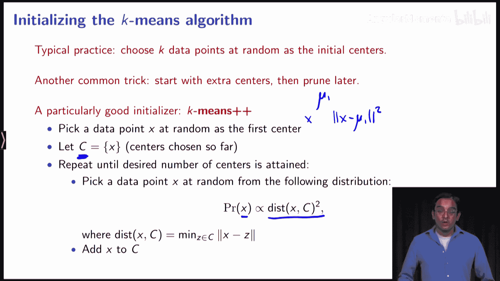

# 机器学习基础：09-02-02：使用K均值进行聚类 📊







在本节课中，我们将要学习表示学习中的第一个重要主题：聚类。我们将定义什么是聚类，并探讨其两种主要应用场景。随后，我们将介绍极其流行的K均值算法的成本函数及其对应的算法流程。

## 什么是聚类？🤔

在聚类任务中，我们被给定一组数据点，例如位于 **R^D** 空间中的点集。我们的任务是将它们进行聚类或分组。



例如，在这个数据集中，可能存在一个聚类在这里，另一个在那里。或者，在右侧可能实际上存在两个聚类：一个在这里，另一个在那里。这两种可能性看起来都完全合理。

## 聚类的两种主要用途 🎯

聚类主要有两种截然不同的应用方式。

第一种可以称为**向量量化**。在这种场景下，存在一个非常大（可能是无限或连续）的空间，数据是从这个空间中采样得到的。目标是找到该空间的少数几个代表点。



例如，这个空间可以是所有20毫秒语音录音的集合，这是一个连续且非常庞大的空间。我们想要的是这些声音片段的一个代表性子集。每当一个新的声音片段到来时，我们只需用其最接近的代表点来替换它。这是一种紧凑的编码声音片段的方式，是音频压缩的一种形式。

如果这是我们使用聚类的方式，那么衡量聚类质量的好方法是什么呢？很自然地，我们会通过用最接近的代表点替换原始点时所引入的**失真量**来衡量。

第二种主要用途是在数据中寻找**有意义的组**，即在数据集中发现自然的聚类。这通常出现在探索性数据分析中。

例如，假设一家超市正在收集其顾客的购买数据。是否存在一种对顾客进行聚类的方法，能够根据他们的购买模式创建出自然的人群分组？这可能非常有用。例如，如果超市要举行促销活动，它可以确保提供的折扣对每个足够大的聚类都具有吸引力。

这两种不同的聚类用途，在我们评估不同聚类算法时，需要牢记在心。

## 流行的聚类算法 🌟

聚类是一个重要问题，人们已经提出了大量不同的聚类算法。然而，事实证明，只有少数算法非常流行并被广泛使用。其中最重要的就是**K均值算法**，这也是我们今天要讨论的内容。后续我们还会学习其他一些流行算法，如EM算法（高斯混合模型）以及一些凝聚层次聚类算法。

## K均值算法介绍 🧮

还记得我们讨论过聚类的两种用途吗？其中一种是向量量化。K均值算法似乎正是为这个目标量身定制的。



在这个优化问题的表述中，给定的是D维空间中的一组点（即待聚类的点）和一个整数K（即期望的聚类数量）。输出是一组代表点（聚类中心）**μ_1** 到 **μ_K**，也就是D维空间中的K个点。

我们的目标本质上是考虑用每个点的最接近的代表点来替换它，从而最小化由此产生的失真。

更精确地形式化这个目标：我们希望找到一组中心点，使得**每个点到其最近中心的平均距离**最小。

让我们来看成本函数。与一组特定中心点 **μ_1, ..., μ_K** 相关的成本是：对所有数据点 **x_i** 求和。对于每个点 **x_i**，我们找到K个中心点中最近的那个（取最小值 **min_j**），成本就是到那个中心点的距离的平方。

**公式：**
`Cost(μ_1, ..., μ_K) = Σ_i min_j ||x_i - μ_j||^2`

因此，点 **x_i** 的“代价”是到最近中心点距离的平方。我们希望最小化这种代价的平均值或总和。这是一个非常针对向量量化的表述。

这是一个包含10个点的示例数据集，假设我们想要两个聚类。聚类中心可能放在哪里呢？这里有一个可能的放置位置。如果我们把中心放在那里，本质上就是说平面上的每个点都将被分配到其最近的中心。这将把平面划分成不同的区域。在这种情况下，K均值成本就是这10个点到各自中心距离的平方和。

更一般地，在 **R^D** 空间中，有K个中心。我们将每个点分配给其最近的中心，这最终将D维空间划分为K个区域。事实证明，每个这样的区域都将是一个凸区域，通常被称为**Voronoi单元**。这就是K均值优化问题。

## 寻找解决方案：Lloyd算法（K均值算法） 🔄

坏消息是，这个优化问题是NP难的。这意味着没有高效的算法能保证总是找到最优解。因此，我们必须寻找启发式方法。

最流行的启发式方法，也是有史以来最流行的聚类算法，就是**Lloyd算法**，通常直接被称为**K均值算法**。这是一个非常简单的算法，本质上是一个局部搜索或爬山算法。

算法的目标是找到K个中心点。它首先以某种方式初始化K个中心点（通常是从数据点中随机选取K个）。然后，它通过不断微调这些中心点来降低成本，直到收敛。



具体步骤如下：
1.  **初始化**：以某种方式初始化K个中心点（例如，随机选择K个数据点）。
2.  **主循环（迭代改进）**：
    *   **分配步骤**：将每个数据点分配给距离它最近的中心点。
    *   **更新步骤**：将每个中心点移动到所有分配给它的点的均值位置。

让我们看一个运行示例。我们有一个包含10个点的数据集。假设我们随机选取了三个点作为初始中心。然后开始主循环：
*   **第一次迭代**：将每个点分配给最近的中心，空间被划分。然后，将每个中心移动到分配给它的所有点的均值位置。这通常会改善中心点的位置。
*   **第二次迭代**：再次根据新的中心点进行分配，然后更新中心点位置。
*   持续迭代，直到中心点位置不再改变（或变化极小），算法收敛。

这是一个非常简单的算法。关于它，我们能说些什么呢？它总能找到K均值成本函数的最优解吗？不，不能。考虑到这是一个NP难问题，我们不会期望它做到。但我们可以肯定的是，在每一次连续的迭代中，成本都保证会下降。最终，算法会停止在某个局部最优解上（通常不是全局最优解）。

## 初始化的重要性 🎲

我们已经完整地描述了算法，但有一件事尚未明确指定：**初始化方法**。事实证明，正确初始化非常重要。

让我们看一个小例子。这里有一个大约16个点的数据集，我们尝试两种不同的初始化方式，并观察最终的K均值聚类结果。
*   **初始化一**：随机选取三个点作为初始中心。运行K均值后，得到一种聚类结果。
*   **初始化二**：随机选取另外三个点作为初始中心。运行K均值后，得到另一种截然不同的聚类结果。

哪种答案更好呢？无论如何，这清楚地表明，良好地初始化算法非常重要。



## 常见的初始化方法 📝

以下是几种常见的初始化方法：

1.  **随机选择**：迄今为止最常见的做法是简单地从数据点中随机选取K个点作为初始中心。
2.  **过采样后剪枝**：如果你想要10个聚类，可以从20个中心开始（过采样）。运行几轮K均值后，剔除掉10个中心（例如，剔除那些只有很少点分配给它，或者离其他中心非常近的中心），然后继续运行K均值直到收敛。
3.  **K-means++ 算法**：这是一种非常好的初始化方法。其核心思想是逐个选取初始中心点，并倾向于选择距离已选中心点较远的点。
    *   首先，随机选择一个数据点作为第一个中心 **μ_1**。
    *   然后选择第二个中心 **μ_2**：从数据集中随机选取，但选取点 **x** 的概率与其到 **μ_1** 的距离平方成正比（距离越远，被选中的概率越高）。
    *   选择第三个中心 **μ_3**：同样随机选取，但此时倾向于选择距离 **μ_1** 和 **μ_2** 都较远的点。
    *   以此类推，直到选出所有K个中心。

**代码描述（K-means++ 核心思想）：**
```python
# 伪代码描述 K-means++ 初始化
centers = []
# 1. 随机选择第一个中心
centers.append(random.choice(data_points))

for i in range(1, K):
    # 计算每个点到已选中心的最短距离平方
    distances = [min([distance(x, c)**2 for c in centers]) for x in data_points]
    # 根据距离平方作为权重，随机选择下一个中心
    probabilities = distances / sum(distances)
    next_center = random.choices(data_points, weights=probabilities)[0]
    centers.append(next_center)
```
K-means++ 初始化方法在实践中被证明非常有效。

## 总结 📚

本节课中，我们一起学习了聚类的基本概念及其两种主要应用：向量量化和发现数据中的自然分组。我们重点介绍了最流行的K均值算法，包括其针对向量量化设计的成本函数 **Σ_i min_j ||x_i - μ_j||^2**，以及Lloyd算法的具体步骤（分配和更新）。我们还探讨了初始化对K均值结果的重要影响，并介绍了几种初始化方法，特别是效果良好的K-means++算法。



下一节课，我们将更深入地探讨K均值，看几个实际应用案例，并了解一些针对海量数据集的K均值变体。