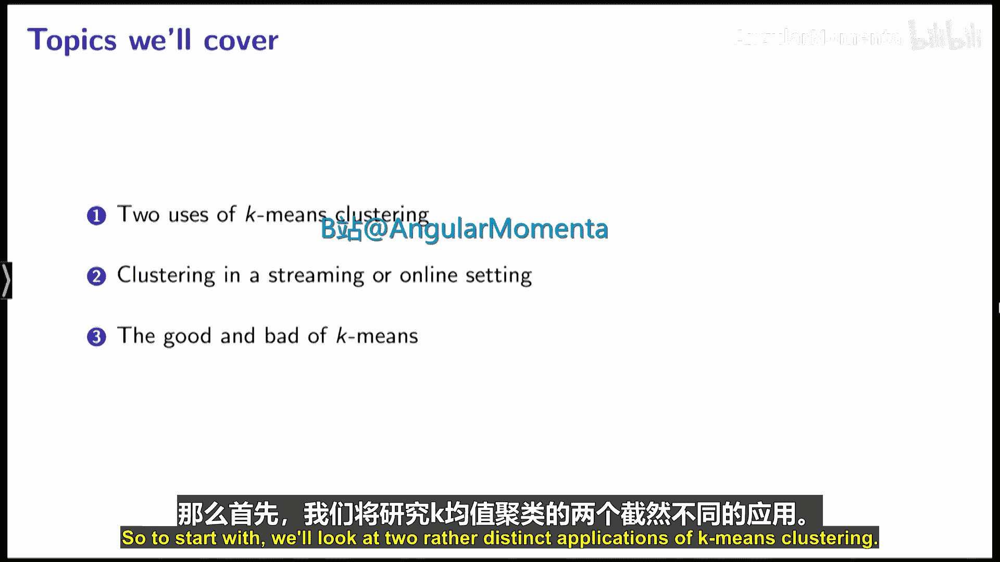
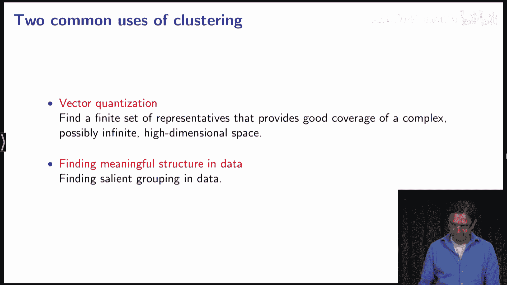
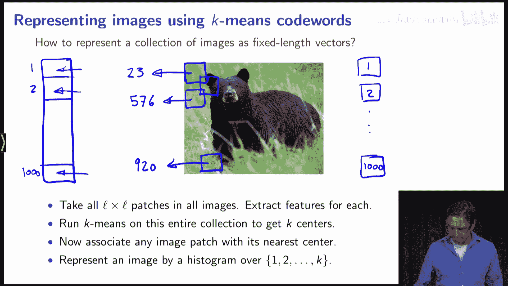
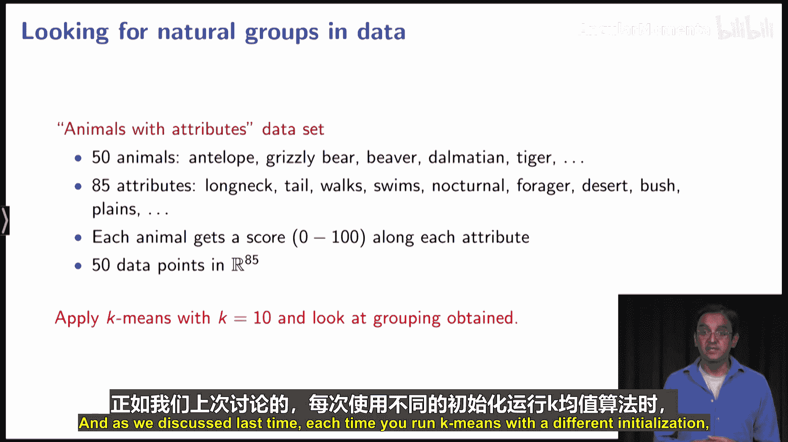
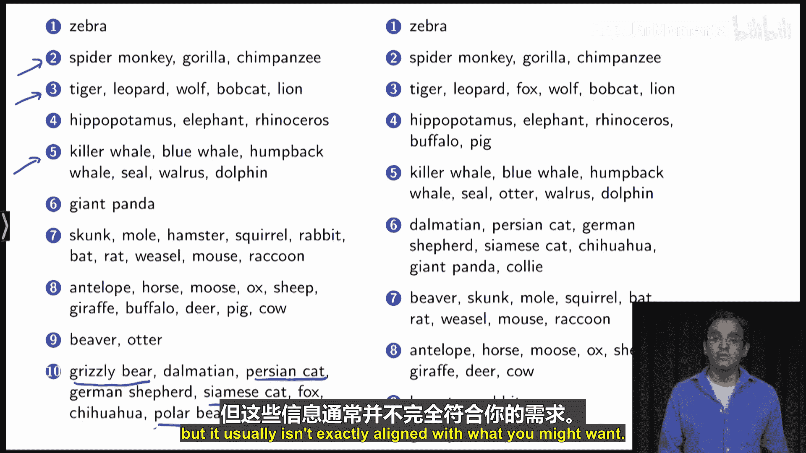
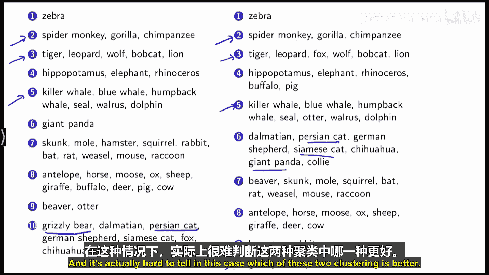
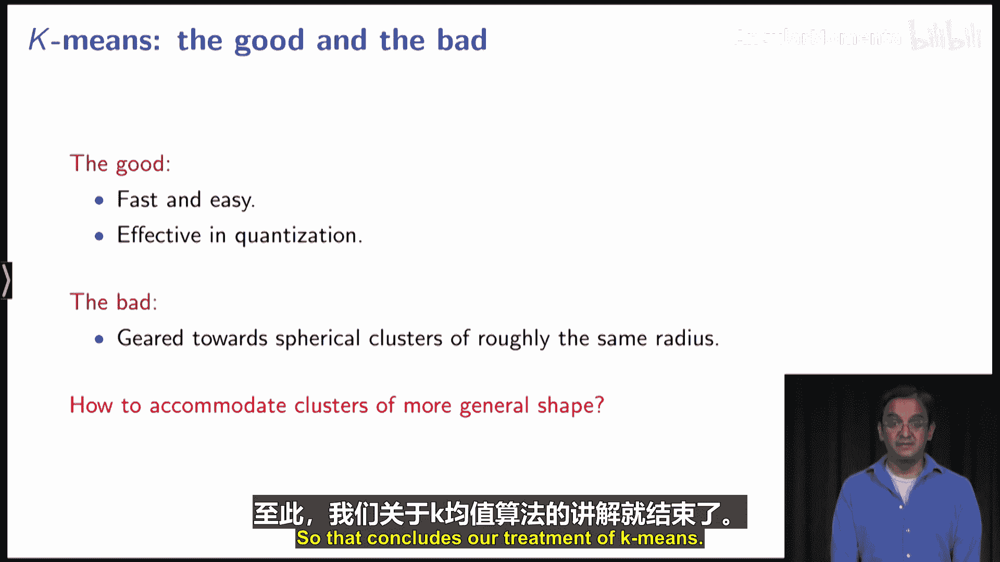

# 【加州大学圣地亚哥分校】机器学习基础  Machine Learning Fundamentals p46 09-03-02-基于k均值的聚类 -BV1TyFSziEZb_p46-

We will now continue with the K means clustering algorithm。So to start with。

 we look at two rather distinct applications of K means clustering。

We'll then look at a variant of the algorithm that's motivated by the realities of massive data sets。

And finally， we'll end with a little summary of the pros and cons of cameians。So if you recall。

 Lloyd's K means algorithm is a local search procedure。It initializes the case centers in some way。

And then enters this loop where it iteratively keeps improving them until it converges。

So what are some ways in which these clusterings might be used？Well。

 last time we spelled out two rather distinct uses of clustering。The first is vector quantization。

Where the goal is to take a large， continuous， infinite space。

And to find a small set of representatives for this space so as to minimize the distortion induced by this kind of discretization。

The second general way in which clustering is used is to find meaningful groups or natural clusters and data。

 so let's look at Kmin's applications of each of these two varieties starting with the first one。

So， here's a question。How。😮，Can we represent images。As vector is a fixed length， after all。

 images come in all shapes and sizes。How do we make them all the same length。

 how do we put them into vector form？Well， this is a problem for which the computer vision community has developed many different solutions。

At a very high level， however， many of these solutions have a somewhat similar flavor。

 and what I'll do is to describe one of them。That's based on Kaian's clustering。Okay。

 so how does it go， we'll take a picture， for example， this picture over here of a black bear。

And let's pull out a small patch from this picture， so let's fix a certain size， maybe 10 by 10。

 let's look at 10 by 10 patches， and here's an example of such a patch。There's a 10 by 10 patch。

And there's another 10 by 10 patch， and another such patch。And another batch， and so on。

So let's go ahead and pull out all such batches from this picture， okay。

 so we're going to get a lot of them。And then let's do this for every single picture we have。

So now we have a vast collection of these 10 by 10 patches。

Now each batch is of a fixed size and so we can represent it by a fixed length vector okay。

 so we have an enormous collection of these fixed length batches。

And we're going to apply K means clustering to them。Let's say we use K equals 1000 okay。

 so what that gives us， what K means gives us is that it takes this collection of patches。

 there might be hundreds of millions of them。And it finds a thousand representative patches。Now。

 how are we going to use these？To encode images， How are we going to use these to come up with a good representation for images。

 Well， let's go back to this bear picture over here。We have this way of pulling patches out of it。

 so let's look at this patch over here。And let's look at its closest representative， okay。

 now we used K meanss to come up with  a000 patches， one to1000， let's number them。

Let's look at this patch on the upper left over here and say。Which is the closest representative。 Oh。

 it's number 23， so we're going to represent this entire patch by just the number 23。

It's the way we compress that batch。 Okay， now we look at this other batch and we say。

 which is the closest representative。 Oh， it's number 576。

 So we represent it by simply the number 576。 Now we look at this other batch。

 and we say which is the closest among the00 representatives that Kame means gave us。 Oh。

 it's number 920。 So let's represent it by the number 920。

 and we do this for every patch in the image。 There's lots of these batches。And now。

 in order to get a vector， what we do is we simply write down。1 thousand numbers。

We get a thousand dimensional representation。And these are frequencies。For the first entry， we say。

How many times。What fraction of patches were assigned to representative number one？

What fraction of patches were assigned to representative number two？

What fraction of batches got assigned to a representative number of thousand？And so the entire image。

 this image of a bear， gets summarized by this 1000 dimensional vector of probabilities。

 these fractions add up to one。And representations of these kind have been found to be quite useful in many different vision applications。

Okay， now let's look at another kind of use of clustering to find natural groups in data。

So there's a data set here which you will get to play with as well calledAnimals with attributes。

 and this is information about 50 animals， antelopes， grizzly bears， dalmatians， and so on。

For each animal， it has 85 features， and these features capture things like where does the animal live in the desert or the rainforest or the ocean。

 What kind of food does the animal eat， the herbivore or carnivore， what is its physical appearance。

 does it have a long neck and so on。So the 85 features of this kind。

 and so each animal is essentially represented as an 85 dimensional vector， and we have 50 animals。

 so the data set consists of 50 points in 85 dimensional space。

And we can go ahead and apply Caens to it。So what I did is to do this with k equals 10。

 so I asked for 10 clusters。And as we discussed last time。

 each time you run K means with a different initialization， you potentially get a different answer。

 so what I did is to do this twice and you can see the results over here okay so let's look at the first run of ks on the left over here。

What are the clusters we get？Okay， so we get cluster number two over here。Spider monkey。

 gorilla and chimpanzee， that looks pretty good， okay， that makes sense。

Cluster number five over here， kilo whil， blue whale， humpback whale that looks pretty decent， okay。

 things that live in the water。Okay。What else do we have？Let's look at number three。Tiger。

 leopard wolf bobcat lion seems reasonable to me。Let's look at cluster number 10。 Okay。

 so number 10 looks a little weird， so it's got grizzly bear and polar bear。 Okay。

 I can see putting them together。But it also has Siamese cat and Persian cat in it。

And that doesn't seem right， okay， so that cluster looks a little bit dicey。

So some of the clusters are good， and they really seem to represent meaningful groups in the data。

And some of them are a little bit dicey， and to be honest。

 this is really the most common situation in clustering。You get quite a bit of valuable information。

 but it usually isn't exactly aligned with what you might want。

Okay，Now let's look at the second run of K means。A lot of the clusters are actually the same。

 so this cluster， cluster number two is the same one we got last time。Cluster number three。

Has changed a little bit。Fox is in there as well， okay？嗯。

Cluster number five is the same as last time。Oh cluster number 10 is better。

 now it's just grizzly bear and polar bear， so that's good。

So what happened to Siamese cat and Persian cat？Here they are and oh oh they got put in with giant panda okay so it's a similar story。

 some of these clusters are very good， some of them are a little bit dicey。

 it's a mixed bag and it's actually hard to tell in this case which of these two clusterings is better。

Okay。So very often we have to apply clustering to extremely large data sets。

 if you think back to our image example， for instance。

 from each picture we were extracting all 10 by 10 batches。

 and then we were doing this for all the pictures in the collection。

 so this could easily be a data set of hundreds of millions of points。Okay。

So in situations like this， when there is so much data that one can't even keep it in memory。

What does one do？And。People have developed some alternative models of computation that are intended to address these sort of scenarios specifically。

So one that's been a very successful model is what's called the streaming model of computation。

 so here there's a fixed data set。😊，But it's very， very large， way too large to fit into memory。

 so it's sitting on some disk somewhere。And all the computer is allowed to do。

 all you're allowed to do is to do one pass through that data or maybe two passes or three passes or maybe 10 passes。

 just a few passes through that data。So you keep seeing these points in order。

 the points come by in order， and you can't store all of them。

 you might be able to store a tiny fraction of them okay so if they are endpoints。

 maybe you can store square root end of them or something like that and as you see each point you might update the parameters of your model。

So the question is， can we do clustering in a setting like this？

An even more extreme model is the online model of computation。So in this case。

 there isn't even a fixed data set。What happens is that data is being collected continuously forever。

At any given point in time， a new data point arises。You aren't able to store it。

You only have a constant amount of memory， so you see the point。

 maybe update your model based on the information in that point and then the point goes away and you never ever get to see it again okay so the data literally just flies by once。

That's the online model of computation。So can we do K means in these sort of models because that would yield a version of the algorithm that's more suitable for very。

 very large data sets and actually they have in several versions of K means that are all this kind and I'll give you an example。

😊，So this is what is often called sequential k means。

And it fits into either the streaming or the online model。So you're seeing data points one at a time。

You want K centers， and so what you do is the way you initialize it is you initialize your case centers to just the first K points that you see。

And once you get those K points， you also initialize the counts associated with those centers to one。

Okay， so these are the counts associated with each of the centers。Now， new points keep arriving。

 possibly forever。And each time you get a new point x， you take this point and you say， well。

 which of my centers is it closest to？Let's say it's closest to center number Muj。Okay。

 let's say it's closest to center Muche， then we're going to update the count from Muche。

So we'll increment n sub J。And we will also tweak that center slightly。

We will tweak it so as to average in this point X。Okay。

So this is a very simple and lightweight version of k means。

 and there are in fact several other variants of k means that can also deal with massive data sets quite easily。

Okay。So what we've talked a lot about K meanss in large part because it is so popular and so widely used。

What are the pros and cons of this algorithm？So one big pro of the algorithm。

 one very good thing about it is that it's an extremely simple algorithm， and it runs fast。

If our goal is to do vector quantization， then the cost function for k means is really very sensible。

 it seems geared towards applications of that kind。What's bad about K meanss？Well。

 if we think about the other kind of application， where what we want is to discover natural clusters and data。

It turns out that K means is really geared towards a very specific type of cluster。

 it's geared towards finding clusters that are spherical and of roughly the same size。

It would be very nice if we could find other algorithms that are similarly simple。😊。

But allow more general cluster types， and that's something we'll be seeing fairly soon。Okay。

So that concludes our treatment of K means， we've spent a lot of time on it because it's a very important algorithm and what we'll do next is to move on to some of the other key clustering schemes。

