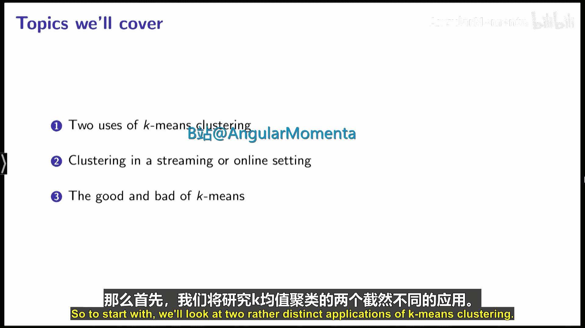
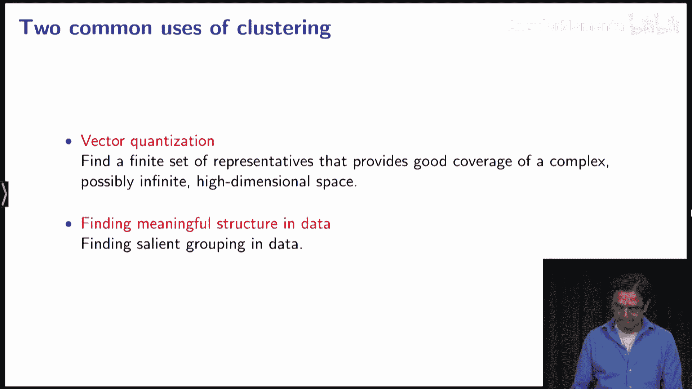
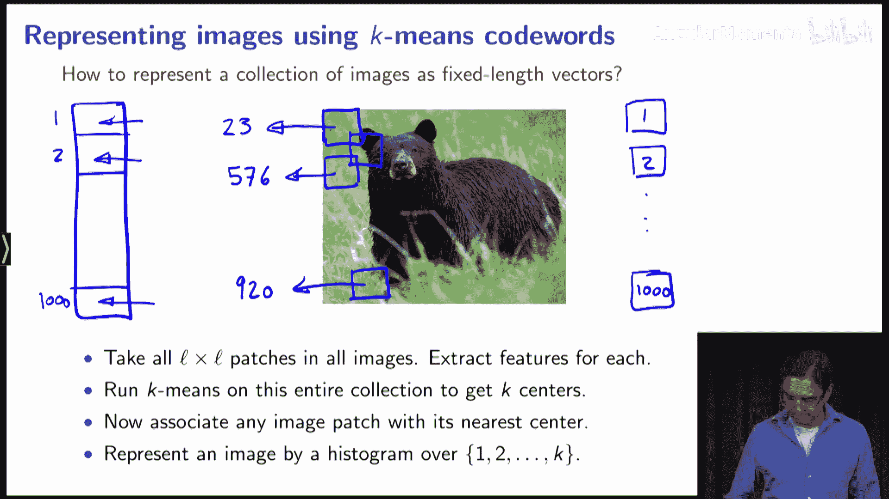
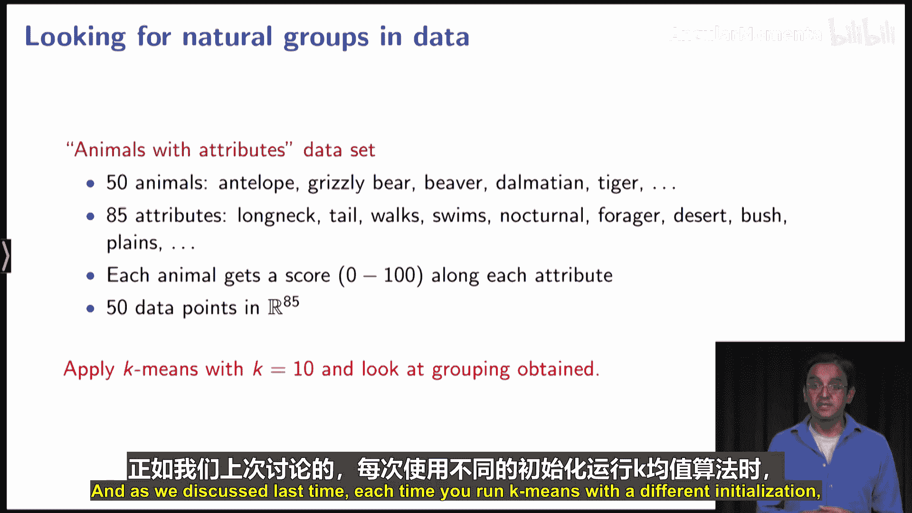
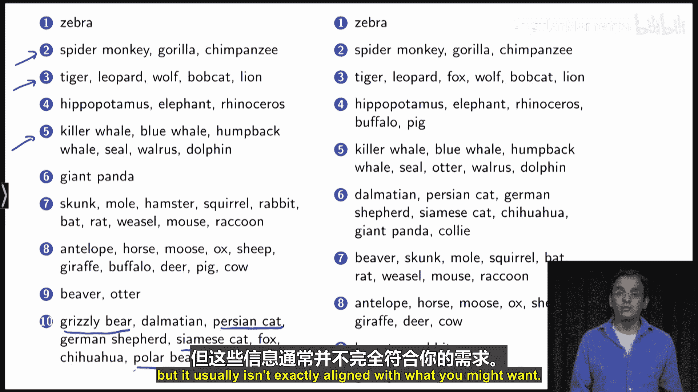
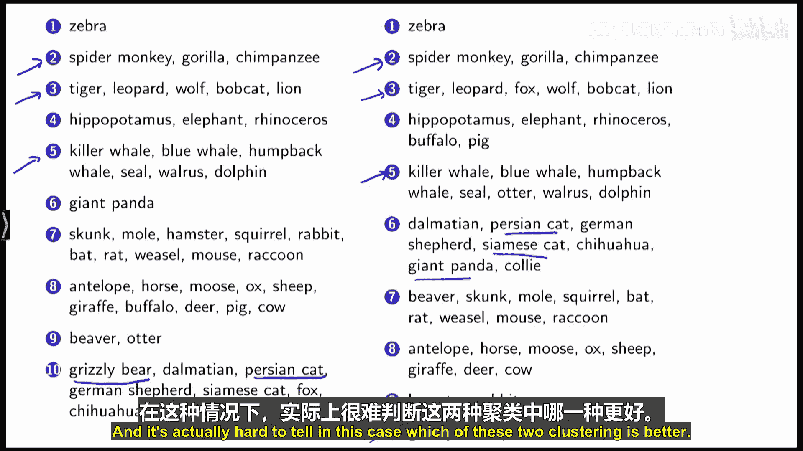
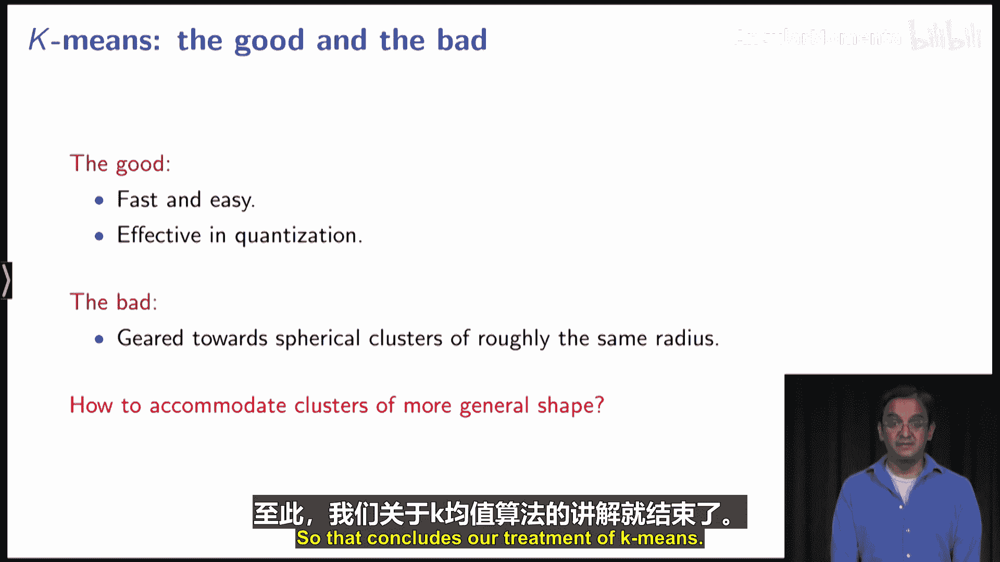

# 机器学习基础：09-03-02：基于K均值的聚类 📊

在本节课中，我们将继续学习K均值聚类算法。我们将探讨该算法的两种截然不同的应用场景，了解一种适用于海量数据集的算法变体，并总结K均值算法的优缺点。

---

上一节我们介绍了K均值算法的基本流程，本节中我们来看看它的具体应用。

K均值算法（Lloyd‘s K-means algorithm）是一种局部搜索过程。它首先以某种方式初始化K个中心点，然后进入一个循环，迭代地改进这些中心点直至收敛。

以下是K均值聚类的两种主要用途：

1.  **向量量化**：目标是在一个大的、连续的、甚至是无限的空间中，找到一小部分代表点，以最小化这种离散化带来的失真。
2.  **发现自然分组**：目标是在数据中发现有意义的组或“自然”的簇。

---

## 应用一：图像表示与向量量化 🖼️

首先，我们来看K均值在向量量化中的应用，具体以图像表示为例。

一个核心问题是：如何将尺寸各异的图像表示为固定长度的向量？计算机视觉领域提出了多种解决方案，其中许多方案思路相似。这里介绍一种基于K均值聚类的方法。

**方法步骤如下：**

1.  从每张图片中提取大量固定尺寸的小图像块（例如10x10像素）。
2.  将所有图片的所有图像块汇集起来，形成一个庞大的图像块集合。
3.  对这个集合应用K均值聚类。例如，设定K=1000，算法会从数百万个图像块中找出1000个最具代表性的图像块。
4.  对于一张新图片中的每一个图像块，找到这1000个代表中与之最接近的一个，并用该代表的编号来代表这个图像块。
5.  统计整张图片中，每个代表图像块出现的频率（即图片中有多少比例的图像块被分配给了某个代表）。
6.  最终，整张图片被表示为一个1000维的向量，每个维度代表一个特定图像块出现的概率，所有维度的值之和为1。

这种表示方法在许多视觉应用中都被证明非常有效。

---

## 应用二：发现数据中的自然分组 🐾

接下来，我们看看K均值在发现数据自然分组中的应用。这里使用一个名为“Animals with attributes”的数据集，它包含50种动物（如羚羊、灰熊、斑点狗等），每种动物用85个特征描述（如栖息地、食性、外貌等）。因此，数据集是85维空间中的50个点。

我们对这个数据集运行K均值聚类，设定K=10以寻找10个簇。由于K均值对初始化敏感，每次运行可能得到不同结果。以下是两次独立运行的结果示例：

**第一次运行结果：**
*   **簇2**：蜘蛛猴、大猩猩、黑猩猩（合理，灵长类动物）。
*   **簇5**：虎鲸、蓝鲸、座头鲸（合理，水生动物）。
*   **簇3**：老虎、豹、狼、山猫、狮子（合理，大型猫科/捕食者）。
*   **簇10**：灰熊、北极熊、暹罗猫、波斯猫（部分合理，但混入了猫，显得不协调）。

**第二次运行结果：**
*   许多簇与第一次相同（如簇2、簇5）。
*   **簇10**：灰熊、北极熊（更合理）。
*   暹罗猫和波斯猫这次与**大熊猫**分到了一组。

由此可见，K均值得到的结果是混合的：一些簇能很好地反映数据中有意义的自然分组，而另一些则可能不尽如人意。这在聚类分析中是非常常见的情况。

---

## 处理海量数据：在线/流式K均值 ⚡

在实际应用中，我们经常需要处理极其庞大的数据集（例如之前图像例子中数亿个图像块）。当数据量大到无法全部装入内存时，该怎么办？

计算领域发展出了适用于此类场景的模型，例如**流式计算模型**和**在线计算模型**。
*   **流式计算**：数据量巨大，存储在磁盘上。算法只能对数据进行少量几轮扫描，且只能存储其中一小部分。
*   **在线计算**：数据持续不断产生，每个数据点只出现一次，看过即消失，算法只能用有限的内存进行更新。

那么，能否在这些模型下进行K均值聚类呢？答案是肯定的。**序列化K均值**（Sequential K-means）就是一种适用于此类模型的变体。

**算法步骤如下：**

1.  **初始化**：将前K个到达的数据点直接作为初始的K个中心点 `μ1, μ2, ..., μK`，并将每个中心点对应的计数 `n1, n2, ..., nK` 设为1。
2.  **迭代更新**：对于之后到达的每一个新数据点 `x`：
    *   找到与 `x` 最近的中心点 `μj`。
    *   更新该中心点的计数：`nj = nj + 1`。
    *   更新该中心点的位置，将其向 `x` 方向略微移动（即用 `x` 来平均更新 `μj`）。更新公式可以表示为：
        `μj(new) = μj(old) + (1/nj) * (x - μj(old))`
        这等价于用所有已分配给该中心点的数据点重新计算均值，但无需存储所有历史数据。

这是一种非常轻量级的K均值变体，能够轻松应对海量数据流。

---

## K均值算法的优缺点总结 ⚖️

我们花了大量时间讨论K均值，因为它是一个非常重要且流行的算法。现在我们来总结一下它的优缺点。

**优点：**
*   **算法简单，运行速度快**。
*   对于**向量量化**这类应用，其成本函数（最小化点到其最近中心点的平方距离和）非常合理且直接。

**缺点：**
*   当目标是**发现数据中的自然簇**时，K均值倾向于寻找特定类型的簇：**球形**且**尺寸大致相同**的簇。对于其他形状（如带状、嵌套状）或尺寸差异大的簇，其效果可能不理想。

因此，我们希望能找到其他同样简单但能识别更通用簇类型的算法，这将是我们后续课程的内容。

---

本节课中，我们一起深入探讨了K均值聚类算法。我们学习了它的两种主要应用场景（向量量化和发现分组），了解了如何通过序列化变体应对海量数据，并分析了该算法的优势与局限。接下来，我们将继续学习其他关键的聚类方案。