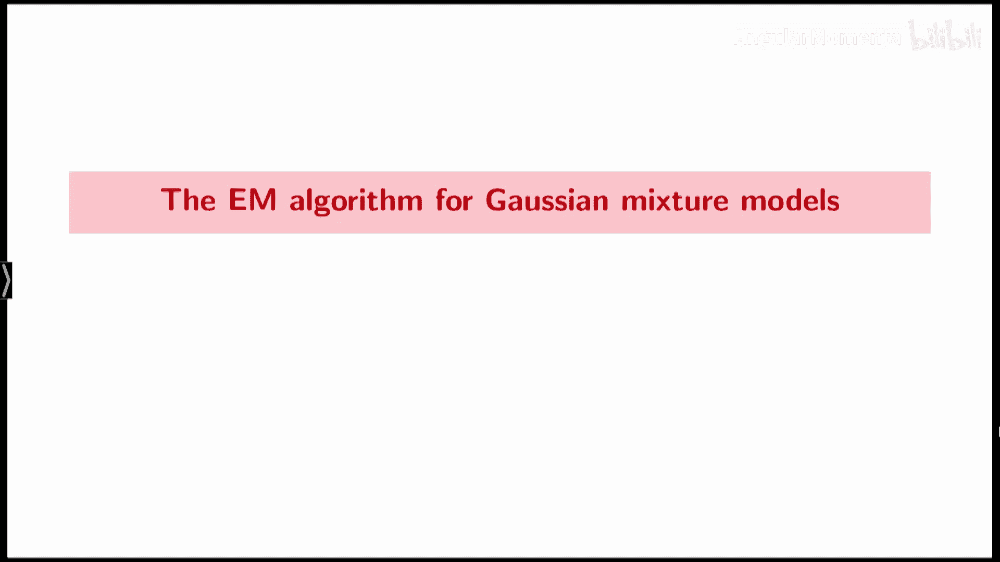
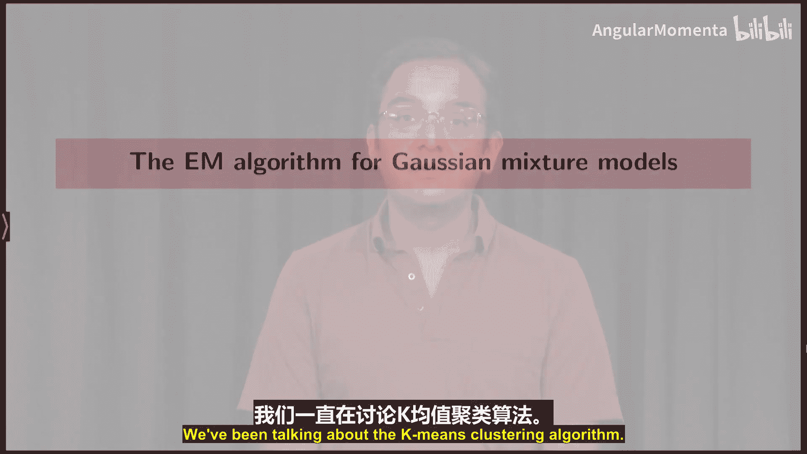
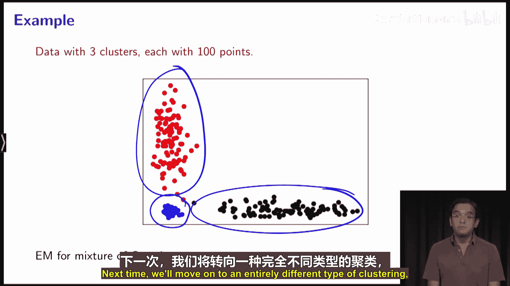

# 【加州大学圣地亚哥分校】机器学习基础  Machine Learning Fundamentals p47 09-04-02-基于高斯混合模型的聚类 -BV1TyFSziEZb_p47-

We've been talking about the K means clustering algorithm。

Today we'll look at a different algorithm that's also very popular called the EM algorithm。

 it is based on Gaussian distributions。So we'll begin by introducing Gaussian mixture models。

 which are generative models for data with clusters in it。

This will allow us to formalize an optimization problem for clustering。

And the usual way we solve this problem is via a nice simple local search algorithm called EM。

And' in with a few examples。So we've been talking a lot about K means。

 and we kept emphasizing its many advantages。Above all else。

 it's a wonderfully simple algorithm and thus very attractive to use。But it also has its flaws。

In particular， it works best when the clusters are roughly the same size and also have spherical shapes。

What we'll see today is an algorithm that is also very simple but can accommodate clusters of more general shapes and sizes。

嗯。So here's the general idea， we have a set of data points that we want to cluster like this for example。

 and we cluster them and then we fit a Gaussian to each cluster okay。

So we might get something like this， for example， with four clusters。Now， as we know。

 Gaussians can have arbitrary ellipsoidal shapes。And so we're also going to be able to accommodate clusters of this type。

嗯。So at the end of the process， we'll have these K clusters。

And each cluster will be specified by a Gaussian distribution， P1 through Pk。Now。

 indeed dimensional space。The Gaussian distribution for the Jde cluster， for example。

 will be specified by its mean mu sub J， which is going to be a vector in D dimensional space。

 so mu sub J is a d dimensional vector。And it'll also be specified by its covariance matrix。

 sigmas of J。Which will be a D by D matrix。So these will describe the Jaith cluster。

 the distribution of the Jade cluster， they'll specify a density for the rate jaith cluster。

We will also keep track of some mixing weights for each of the clusters。

 So these are the pi pis sub Js， and pis of J is simply the fraction of the data that comes from that cluster。

 In this example， for， for instance， all the clusters seem to have roughly the same weight。 So pi 1。

 pi 2， pi 3， pi 4 would all be roughly 0。25。嗯。So we have a density for each cluster。

And by combining these densities， we get an overall mixture of Gaussians。

 and this is a distribution over the entire space over all of our data。😊，The probability。

 the density it assigns to a specific point x。Is just by one。Times the probability at x。

 the density at x under distribution p1 plus phi 2 times the density under P2 plus phi 3 times the density under P3。

 and so on and so forth。Okay， so why is this well， the probability？Of any given point X。

It dependss on which cluster it's from。 So let's sum overall possible clusters and we'll say what is the probability of being in that cluster。

And then what is the probability of x given。That you're in that cluster。

And these are exactly the terms we see below， the probability of cluster J is pi sub J。

 and the probability of x under that cluster is p sub J of x。Okay。

So each cluster has an associated Gaussian distribution。

 and we combine these k components into an overall mixture of Gaussians。

So we take our data and we fit a mixture of Gaussians to it。How exactly do we do this？Well。

 let's say we have n data points， let's call it x1 through xn， these are points in Rd。

And at the end of the clustering process， we're going to have a mixture model。

 we are going to have a bunch of mixing weights， these proportions by 1 through pi k。

 and then we' are going to have k Gaussians， one Gaussian describing each cluster and for each Gaussian we're going to have its mean and its covariance matrix。

So this gives us a distribution over RD。 What is the probability of our entire data set under this distribution Okay。

 so what is the probability of our data。Of our end data points under this mixture distribution。Well。

 it's just the probability of point number1， x1 times the probability of point number two times the probability of point number3 and so on。

 So we have this giant product。This pi sign means product。

 so we're taking the product from I equals1 to n。Of the probability of the Ih data point of x sub I。

So we multiply these probabilities together and we get the probability of the overall data set。

Now each of these distributions， P1， P2 and so on is a Gaussian distribution and we've seen the formula for the Gaussian density if we just plug that formula in。

 we get this expression below。Okay。This is the likelihood of the data under the model by1 through P K。

B1 through Bk。And what we want to do is to find the distribution。

 we want to find the Gaussian mixture model that makes the data maximally likely。

We want to find the maximum likelihood mixture of Gaussians。

 we want to find the parameters pi J mu j sigma J， where J goes from1 to K that maximizes this expression over here。

一て。Now。Maximizing this is the same as maximizing the log of this thing Okay and it's kind of helpful to do that because if we take the log of this。

 then this initial product will get converted into a summation Okay that's going to be helpful so maximizing this thing is the same as maximizing its log and it's the same as minimizing the negative of the log。

 Okay， so maximizing something is the same as minimizing its negative。😊，So when we do all that。

 the loss function we end up with is called the negative log likelihood。😊，Okay。

 and this is the loss function。Okay。So we want to find a set of parameters， we want to find thighs。

Muse。And matrices sigma。For which this expression over here gets minimized。嗯。

So is this an easy thing to minimize？Well， it certainly looks like a bit of a mess。

 but maybe it's convex。 Who knows。Actually， it's not。 It's， it's not convex at all。

 Let's write that down。It's emphatically not convex。And in fact。

 if you look at the surface of this loss function， it has lots and lots of local opt， okay。

 so it's something that looks like this。And finding the global optimum。

 finding that minimum point over there is NP hard。 So we're not going to be able to do that in every situation。

 Instead， the solution strategy that we are going to use is to use a local search procedure。

 So this is a procedure that starts with some solution。

 That is to say some set of parameters by new and Sigma。Okay， maybe over here。

And then incrementally improves them， okay， makes it a little better and then makes it a little better。

And then ultimately ends up in a local optimum。Okay。So let's see the algorithm that does this。

This is called the EM algorithm where EM stands for expectation maximization。

Now actually EM is not just a single algorithm， it's an entire framework for making algorithms。

 and so there are EM algorithms for a variety of other problems in machine learning and statistics。

This， however， is probably the EM algorithm that's most well known。So let's see how it works。

 so it's a local search procedure so you start by initializing the parameters in some way Okay。

 so you choose some initial set of weights。😊，Let's say you just make them all 1 over k， okay？

And then you choose some initial Gaussian means。Let's say you just pickK of the data points at random。

And you choose some initial covariance matrices。 Let's say you just take the covariance of the entire data set and set the initial covariance matrices to those。

 Okay， so you start up with some initial parameters。And then you enter the main loop。

 the loop of iterative improvements，So at each given time， you have your current set of parameters。

 which is your just a guess， it's your current guess。😊，And now you want to improve them a little bit。

 okay。So this takes place in the form of two steps。The first step is to cluster the data。

Based on the current set of Gaussians，So let's see we have a particular point x sub I and we have to decide which cluster is's going to go to is it going to go to cluster 1。

 is it going to go to cluster2， is it going to go to cluster 3， iss it going to go to cluster4。

 how do we decide？Well， each cluster has an associated Godsian。

And so we can talk about the probability that that point is from cluster J。

And it's simply this expression over here。It's bi sub J。

 which is the prior probability of that cluster。Times the density of Xi under that particular Gaussian so roughly this corresponds to how close X subi is。

 how likely Xabi is under each individual Gaussian。Okay。

So let's say that the probability that exubs from cluster 1 is 0。1。

 the probability from cluster 2 is 0。6， the probability is from cluster 3 is 0。2。

 and the probability is from cluster 4 is whatever is left， which is 0。1。

So which cluster should we assign it to cluster two， correctly， correct？

What we're going to do is something a little more interesting。

 we are not going to definitively assign x to any one cluster。

 but rather we'll assign it to all the clusters but with different weights。

 So we'll say x sub I is assigned to cluster 1 with a weight of 0。1。

 and it's assigned to cluster 2 with a weight of 0。6。

 and it's assigned to cluster 3 with weight of 0。2 and to cluster 4 with a weight of 0。1。 Okay。

 so these are the weights W Yj。It's the weight with which point x sub I is assigned to cluster J。

 Okay so now we have a clustering of the data or more correctly， some sort of fractional clustering。

 This is often called a soft clustering Okay so we have this soft clustering of the data and on the basis of this。

 we want to update all the parameters。 So we want to say， okay。

 this is what the clusters look look like now now what is a good estimate of the mean of this cluster and the covariance and so on okay。

So let's start with the mixing weights。What proportion of the data comes from cluster J？Well。

 let's look at the proportion of 0。1 from cluster J plus the proportion of 0。2 from cluster J。

 plus the proportion of 0。3 from cluster to J， and just add these up and divide by N。

 Okay so that's our updated estimate for pi sub J。What should we said？To be the mean for cluster J。

 Okay， so the mean is supposed to be the average of all the points in cluster J。But if you remember。

 we have assigned every point to cluster J， but just with different weights。

 So we need to take a weighted average。 And that's what we have over here。 A weighted average。

 This stuff in the front here is just a normalizing factor。And as similar with the covariance matrix。

 we just take a weighted average。So that's one round of EM。

 and then we keep repeating this until convergence。That's it， a very simple algorithm。

So let's look at an example， here's a data set in 2D， a toy data。

And the intention is for it to have three clusters， okay， so one cluster down here。

 one cluster over here， one cluster over here， and each cluster has got 100 points associated with it Okay so let's start by running ks on this。

And see what happens。So we run K means and this is what it finds， so it finds one cluster like this。

One like this and one like this。Okay。Not exactly what we had in mind。And if you remember。

 K means is also a local search algorithm， which means that potentially each time you run it。

 it might produce a different answer okay so let's run it again。

So we'd run it a second time and indeed it gets a different answer， so this time it has this。

 this is one cluster， that's one cluster and that's one cluster。Different answer， Okay。

 let's run it again。Okay， this time it finds this， this is one cluster， this is one cluster。

 and this is one cluster。So why is it doing all these strange things。

 basically cameians can get a little bit confused if the clusters are of very different sizes。

 as is the case over here in different shapes。😊，Now let's see E at work。 So we run E。

 and this is what it does。 So it finds exactly the right clusters。 It finds the ones we had in mind。

猪。And again， it's a local search procedure so we can run it multiple times， but if you do that。

 you find that it fairly consistently finds the same clustering。Why is it able to do this。

 why is it able to accommodate these different shapes and sizes？Well。

 it's able to do that because it explicitly models the shape of each cluster by fitting a Gaussian into it。

Okay， so that is the EM algorithm in a nutshell。Next time we'll move on to an entirely different type of clustering。

 one that tries to find hierarchical structure in data。

