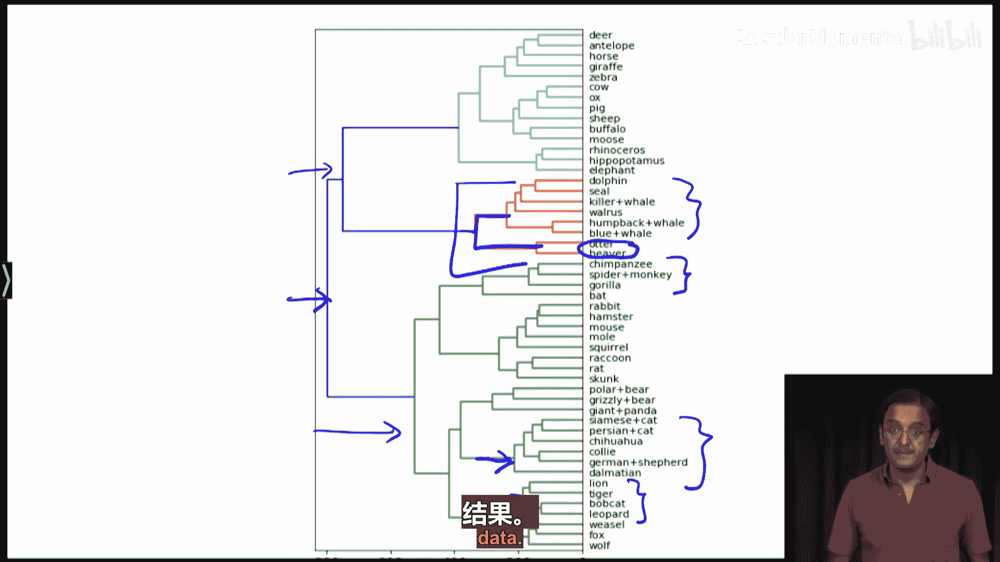
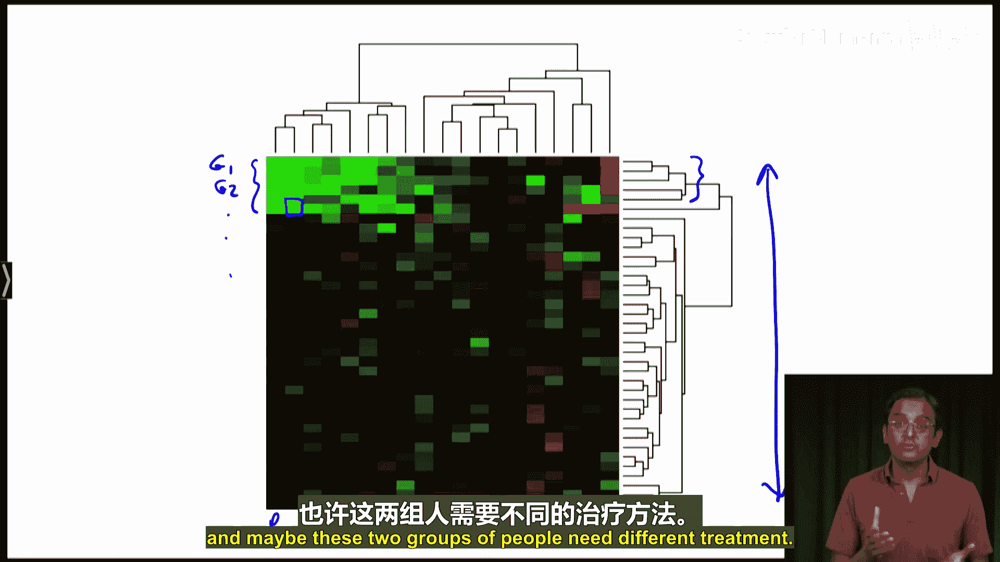
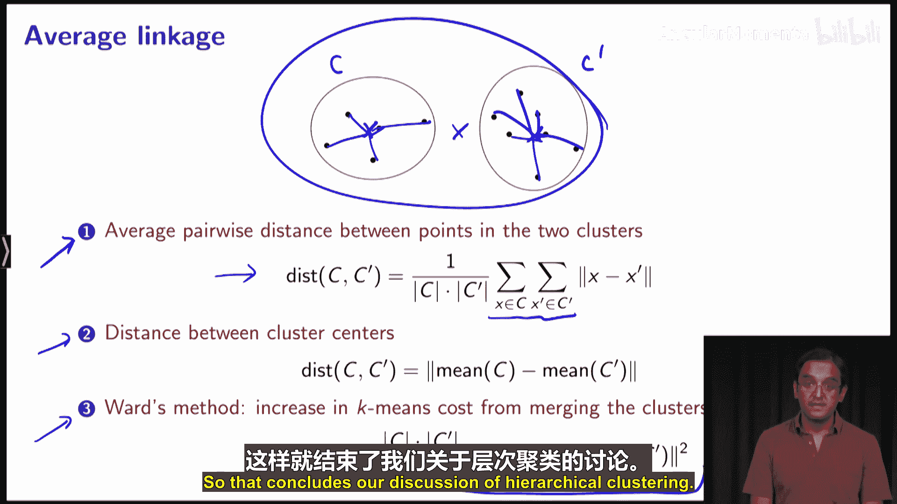

# 【加州大学圣地亚哥分校】机器学习基础  Machine Learning Fundamentals p48 09-05-02-层次聚类 -BV1TyFSziEZb_p48-

So far， we have talked primarily about two clustering algorithms， Ks and E M。

Both of these algorithms recover what might be called flat clusterings。

 that is to say the clusters they find are all at a single scale。

But when we introduced representation learning， we emphasized how the structure we are looking for often exists at multiple different scales。

Well， the multi scale version of clustering is what's called hierarchical clustering。

 and that's what we'll look at today。So we'll begin by introducing the notion of hierarchical clustering。

 and then we'll go on to look at some popular algorithms for finding clusterings of this kind。

Let's look back at this data set over here how many clusters are there？Well。

 there definitely seems to be a cluster on the left。And on the right is that one cluster。

 or perhaps two clusters。Okay。It's hard to tell。 And， in fact， there's no right answer。

 Both choices are perfectly legitimate。Driio data often has often behaves in this way。

 there's often cluster structure at multiple different levels。

 and a hierarchical clustering lets us capture all of these different levels simultaneously。😊。

The way a hierarchical clustering is usually depicted is as a tree。 So at the top。

 there's a single node。That is one cluster containing all the data points。In this case。

 it would split into two。Where you have the cluster on the left and the cluster on the right。

The cluster on the right splits into two again。Now the cluster on the left contains maybe eight data points。

So let me just draw them like this。嗯。And the clusters。

 the clusters on the right each have about six points， let's just draw them like this。

And the total number of leaves in this tree is then exactly the number of data points， which is 20。

Okay， so this tree captures an entire hierarchy of cluster structure in the data。

So let's look at a couple of examples Do you remember the animals with attributes data set？

So this was a data set in which we had information about 50 different animals and for each animal there were 85 features so an animal was represented by an 85 dimensional vector。

 50 animals， so 50 data points in R to the 85。So what I did here was to hierarchically cluster these data points by just using a standard algorithm called average linkage。

 we'll see the algorithm very soon， but in the meantime let's just look at the results。 Okay。

 so it returns a tree with 50 leaves，50 animals okay。

 and I've drawn the tree sideways so that I can spell out the animal names。 Okay。

 so let's look at some of these clusters。 So over here on the left。😊。

Is just one cluster containing all the animals， and then it gets split in two。

And then it gets split again and again。Let's take a little bit of a close up at some of these clusters。

 Okay， so let's look at this cluster over here， the red one。What do we have there。

 well we have dolphin seal， killer whale， walrus， humpback whale， blue whale， otter and beaver。

That seems pretty reasonable， animals that live in the sea or river or close to the river， okay？嗯。

The first split in that cluster isn is into these two groups。

 and we get this little cluster over here， which contains just otter and beaver。

And then we get a larger cluster over here that contains all the whales and dolphins。 Again。

 a very reasonable way to split that cluster。Okay， let's look at some of the other ones。

 so there's a really big green cluster， so let's look at some of the smaller clusters within it。

Over here we have a cluster of three animals。Chimpanzee， spider， monkey and gorilla primates。 Okay。

 very sensible。Over here， let's look at this。 look at。

 let's look at the cluster represented by this branch over here。 It contains Dalmatian。

 German shepherd， Collie Chihuahua， Persian cat， Siamese cat。Basically， domestic bets， okay。

 also reasonable。We have another cluster over here that contains。Lion， Dier， bobcat and leopard cats？

So this whole thing seems fairly reasonable， and we found it automatically just by running a hierarchical clustering algorithm on this animal data。

Now， one domain in which hierarchical clustering has been quite popular is gene expression analysis。

So what you see in this picture over here， let me describe what this is。

 so along the vertical direction we have different genes， let's just call them G1， gene1。

 gene2 and so on。And along the horizontal axis， we have different samples。

 which was say drawn from different patients， Okay， so maybe this is person one， person  two， etc。

Now each pixel， if you look at a given pixel over there。

That represents how strongly that gene was expressed in the sample from that particular person and the range is from bright green to bright red。

Now， in these cases， it's common to use lots of genes， thousands of genes。

 in which case the data becomes very high dimensional。

And a very nice way to understand it and simplify it is to apply hierarchical clustering。

 So what's shown here along the vertical axis。Is a hierarchical clustering of the genes and the way you obtain that is by simply thinking of each row as a data point so there's a data point for each gene。

 and then we just apply a hierarchical clustering algorithm again。

 like average linkage to these points and this is the tree that results so if you look at a cluster at the top。

 for example， let's look at this cluster， it consists of maybe five or six genes。And these are genes。

That tend to act together。 that are all either not highly expressed or highly expressed。

 They seem to behave as a unit。So this is a very nice way to understand the data。

 You start with a bewilderingly large number of genes。

 and then the hierarchical clustering finds you these gene clusters。

 these groups of genes that really act together as a unit and that reduces the number of different things that you have to think about。

😊，It's also common actually to cluster the patients and the way you do that is to take the same data set。

 the same matrix， and now think of each column as being a data point and then apply a hierarchical clustering to those。

And the reason this is done well， often the outcomes are quite interesting， for example。

 sometimes you think that all these people are suffering from the same disease。

But then when you hierarchically cluster these columns。

 you see that there are actually two rather distinct groups。

And this might be evidence that there are actually two subtypes of this disease。

 And maybe these two groups of people need different treatment。

So how does one do hierarchical clustering？So let's start by looking at the single linkage algorithm。

 which is perhaps the simplest of the hierarchical clustering methods。 It's not the best algorithm。

 though we will soon come to better alternatives。 It's just a useful one because it's rather simple to describe。

So how does it work， so let's say we have 10 data points， the 10 points you see over here。

Single linkage works in a bottom up fashion。 Okay， so we're going to start by thinking of these1 points as being individual clusters。

Basically at the bottom of the tree where we have our1 leaves， okay？

Then we're going to merge to a them， and then we're going to merge another two and so on。

 and in this way we build a tree in a bottom up fashion。So we have our 10 clusters over here。

And we begin by merging the two that are closest。 I think that's4 and 5。Okay。

 so we start by merging these。Now we have nine clusters， then we merge the next two that are closest。

 I think that's six and7。Now we have eight clusters。Then the next two that are closest。

 I guess that's three and two。Now we have seven clusters。Now， which ones do we merge？Okay。

 so the next closest edge， the next smallest edge， I think， is this one。

So we would actually merge these two clusters into a single cluster of four points。Okay。

 and so now the number of clusters we have at this stage is one， two， three， four， five， six。

 we have six clusters。Then we merge the next two closest points。What is the next closest edge。

 I think it's this one。So we're going to create this cluster over here。 and then we merge this one。

 and then we merge this。And then we merged the whole thing into one big cluster。Okay。Now。

 this doesn't exactly look like a tree， but it's clear that there's a hierarchical structure over here So it's easy to recover a tree from this。

 How do we do that？ Well， the first thing we merged was four and 5， so let's draw those four and5。

We merge those， then the next thing was six and7。 let's scroll those。Okay。

 and then we did two and three。Let's draw those。And then we。I think we added， oh。

 then we merged these two into a bigger cluster， and then we added one to them。

And then we did eight and nine。Okay， and and then we added 10 to it。

So the tree looks something like this。 Sometimes one assigns special significance to the heights of different points in the tree。

 but I'm not doing that over here， okay。So this is the final hierarchical clustering of the data as found by single linkage。

Now there's a whole variety of linkage methods for hierarchical clustering and they all have roughly the same flavor。

 to be honest single linkage is probably the worst of them okay？

So they all work in a bottom up fashion。So you start with each point in its own cluster。

 and then you merge the。The two closest points and then the next two closest and so on。

 and in this way you build up the create so at any given stage you have a bunch of clusters and you have to join the two clusters that are closest。

How do you measure the distance between two clusters that's the only degree of freedom that remains。

 and that particular choice makes all the difference Okay。

 so though there are a variety of different linkage methods and the way in which they differ is by the way in which they define the distance between two clusters at any given stage we compute these distances and we merge the pair of clusters that are closest that have the smallest distance。

So single linkage， if you give it two clusters， prime， so this is C prime。

 single linkage thinks of the distance between these two clusters as simply being the distance between the closest pair of points in those clusters。

It thinks that that as being the distance。Okay， so that's in essence。

 the smallest possible notion of distance between these two clusters。

Complete linkage is a different kind of linkage algorithm that is the other extreme。

 it defines the distance between two clusters as being the furthest pair between those two clusters。

 so it's between these two points。😊，If you think of different ways to define distance。

 this is probably the largest you could come up with and as you can imagine。

 complete linkage tends to produce clusters that are fairly tight that are fairly compact。

So these are two exal notions， single linkage defines a distance to be something rather small。

 complete linkage defines it to be the distance between the furthest bear points。

The most popular clustering methods， the most popular linkage methods。

Take a somewhat intermediate stance rather than look at the closest pair or the furthest pair。

 they look at the average distance between the two clusters and that's what's called average linkage。

Now， it turns out that there are actually several different ways in which you can define this average that are all quite reasonable。

 and these lead to different average linkage algorithms。😊。

So I know of different three different ways in which this commonly gets done。

 so let me tell you what they are so the first method。

Is to just look at all pairs of points in the two cluster。

 so take one point from here and one point from there。

 look at the distance between them and then average this over all pairs。

 so if there are endpoints on the left and n on the right there are n squared pairs that you're looking at and you're taking the average distance。

Okay， so that's the formula you see over here。You look at all pairs of points。

 one from the left and one from the right。A potentially simpler way to define the distance between two clusters is to say。

 let's just look at their centers。 Let's look at their means and let's just look at the distance between the means。

 So you look at the cluster on the left。 you say that's the mean。 Look at the cluster on the right。

 You say that's the mean。 Let's just measure the distance between the means。 That's it。

 That's going to be our notion of distance。 Okay， so that's also fairly popular。

There's a third option that's kind of interesting and this is usually called wards method for average linkage。

And what this does is it's also a kind of average notion。

 but what it says is that look at the increase in K means cost from merging these two clusters Okay。

 that's going to be the notion of distance。 So what exactly does that mean Well。

 if you look at this picture， there are two clusters， CncC prime。And if you look at the K means cost。

 what is the K means cost iss just the distance to the closest center right。

 so it would be this distance plus that distance plus that distance plus that distance plus that distance。

 and you have to square the distances。And then this plus this， plus this， plus this。

 plus this plus this， plus this， and you have to square the distances。

 so that's the starting came means cost。Now， when you merge these two clusters。

 then you're going to just have one cluster， you're going to just have a big cluster over here。

And you're going to have a new mean， which is going to be somewhere in the middle over here。

And so the new K means cause will just be the distance of all the points in C or C prime to that new mean added up。

 squared and added up。So you had the cost before and now you have the new cost which is going to be larger。

 what is the difference between those two costs？That's how we're going to define distance。

And it turns out that the difference is given exactly by this formula over here。

It simplifies to something like this and actually it looks a whole lot like option number two。

 The main difference is that it's the distance between the means。

 but this time you have a factor in front。That basically is some measure of the size of the clusters in terms of how many points are in the clusters。

 so it's kind of like option2， but it's saying， give more emphasis or prefer clusters that have fewer points in them。

So that concludes our discussion of hierarchical pstering。

What we'll do next time is to look at an entirely different form of representation learning projections。

