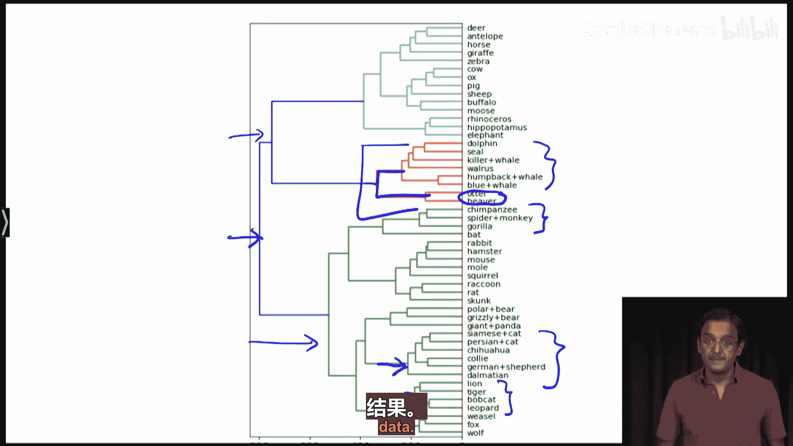
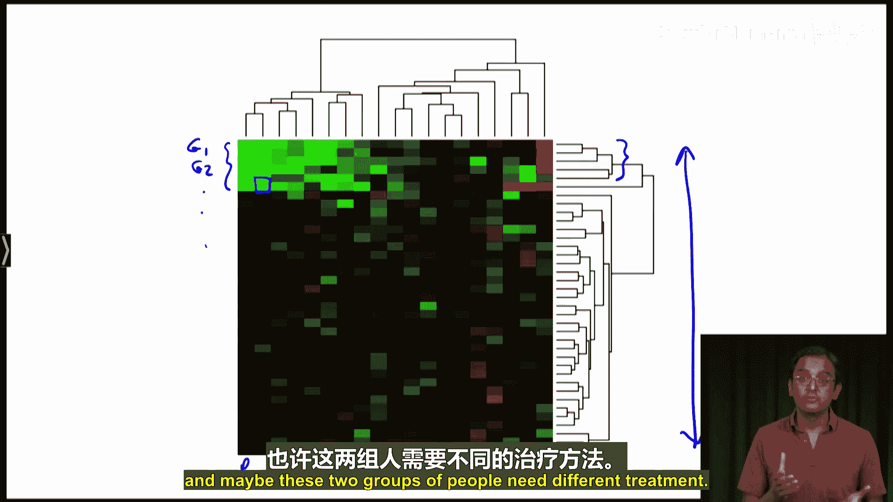
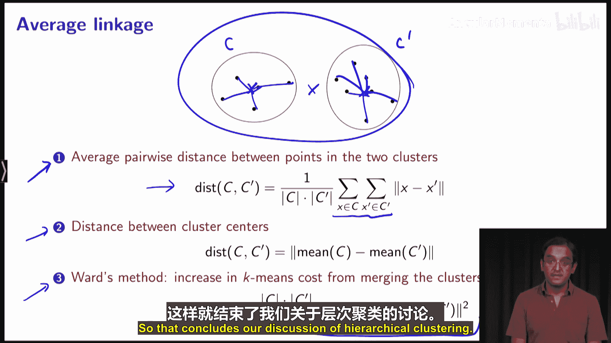

# 机器学习基础：09-05-02：层次聚类 🌳

在本节课中，我们将要学习层次聚类。这是一种能够同时捕捉数据中多个尺度结构的聚类方法。

## 概述

之前我们主要讨论了K均值和EM这两种聚类算法。它们都属于“扁平聚类”，即它们发现的簇都处于单一尺度。然而，当我们介绍表示学习时，我们强调了所寻找的结构通常存在于多个不同的尺度中。层次聚类正是聚类的多尺度版本，这就是我们今天要探讨的内容。

我们将首先介绍层次聚类的概念，然后继续了解几种寻找此类聚类的流行算法。

## 什么是层次聚类？

让我们回顾一下这个数据集。这里有多少个簇？左边显然有一个簇。右边是一个簇，还是两个簇？这很难判断。事实上，并没有唯一正确的答案，两种选择都完全合理。真实数据通常以这种方式呈现，经常在多个不同层次上存在簇结构，而层次聚类让我们能够同时捕捉所有这些不同的层次。

层次聚类通常被描绘成一棵树。在顶部，有一个单一的节点，这是一个包含所有数据点的簇。在本例中，它会分裂成两个簇：左边的簇和右边的簇。右边的簇会再次分裂成两个。现在，左边的簇可能包含八个数据点，右边的两个簇各包含大约六个点。这棵树中叶子的总数正好等于数据点的数量，即20个。因此，这棵树捕捉了数据中完整的簇结构层次。

## 层次聚类的例子

### 动物属性数据集

还记得“动物属性”数据集吗？这个数据集包含50种不同动物的信息，每种动物有85个特征，因此一个动物由一个85维向量表示。这里有50个数据点。

我使用了一种称为“平均链接”的标准算法对这些数据点进行了层次聚类。结果返回了一棵有50片叶子的树。让我们看看其中的一些簇。

例如，这里有一个红色的簇，包含海豚、海豹、虎鲸、海象、座头鲸、蓝鲸、水獭和海狸。这看起来相当合理，都是生活在海里、河里或靠近河流的动物。该簇的第一次分裂产生了两个子簇：一个是水獭和海狸的小簇，另一个是包含所有鲸鱼和海豚的较大簇，这也是非常合理的划分方式。

再看一个大的绿色簇，其中包含一个由黑猩猩、蜘蛛猴和大猩猩组成的子簇，都是灵长类动物，非常合理。另一个分支包含斑点狗、德国牧羊犬、柯利牧羊犬、吉娃娃、波斯猫和暹罗猫，基本上是家养宠物，也很合理。还有一个簇包含狮子、老虎、山猫和豹子等猫科动物。

整个结果看起来相当合理，并且我们只是通过对动物数据运行层次聚类算法就自动找到了它。

### 基因表达分析

层次聚类在基因表达分析领域也相当流行。在这个例子中，纵轴代表不同的基因，横轴代表不同的样本（例如来自不同的病人）。每个像素的颜色表示该基因在特定病人样本中的表达强度。

当涉及数千个基因时，数据会变得非常高维。理解和简化数据的一个好方法是应用层次聚类。图中纵轴显示的是基因的层次聚类结果，其获取方式是将每一行（代表一个基因）视为一个数据点，然后对它们应用层次聚类算法（如平均链接），得到这棵树。

例如，观察顶部的一个簇，它可能由五六个基因组成。这些基因倾向于协同作用，要么都低表达，要么都高表达，它们似乎作为一个单元在运作。这是理解数据的一种非常好的方式：从数量庞大的基因开始，层次聚类为你找到这些基因簇，即那些真正作为一个单元协同作用的基因组，这减少了你需要思考的不同事物的数量。

通常也会对病人进行聚类。做法是取相同的数据矩阵，将每一列视为一个数据点，然后对这些点应用层次聚类。这样做的原因在于，结果往往很有趣。例如，有时你认为所有病人都患有同一种疾病，但当你对这些列进行层次聚类时，你可能会发现实际上存在两个截然不同的群体。这可能表明这种疾病实际上存在两种亚型，也许这两组病人需要不同的治疗方法。

## 如何进行层次聚类？

### 单链接算法

让我们从单链接算法开始，它可能是层次聚类方法中最简单的一种。虽然它不是最好的算法（我们很快就会看到更好的替代方案），但因为它描述起来相当简单，所以很有用。

它是如何工作的？假设我们有10个数据点。单链接以自底向上的方式工作。我们首先将这10个点视为独立的簇，即树底部的叶子。然后我们合并最接近的两个点，接着合并下一对最接近的点，依此类推，以自底向上的方式构建树。

具体步骤如下：
1.  从10个簇开始。
2.  合并最接近的两个点（例如点4和点5），现在剩下9个簇。
3.  合并下一对最接近的点（例如点6和点7），剩下8个簇。
4.  继续此过程，每次合并当前阶段距离最近的两个簇，直到所有点合并为一个簇。

从合并历史中可以轻松恢复出树状结构。第一次合并的是点4和5，然后是点6和7，接着是点2和3，之后将点1加入由点2和3组成的簇，再合并点8和9，最后将点10加入。这样就形成了最终的层次聚类树。

### 不同的链接方法

存在多种链接方法用于层次聚类，它们的基本流程大致相同。它们都以自底向上的方式工作：从每个点作为自己的簇开始，然后合并最接近的两个簇，接着合并下一对最接近的簇，依此类推。在任何给定阶段，你都有一些簇，你需要连接距离最近的两个簇。

如何衡量两个簇之间的距离？这是唯一剩下的自由度，而这个特定的选择造成了所有差异。不同的链接方法正是通过定义两个簇之间距离的方式而有所不同。在每一阶段，我们计算这些距离，然后合并距离最小（即最接近）的那对簇。

以下是几种主要的链接方法：

*   **单链接**：定义两个簇 `C` 和 `C‘` 之间的距离为两个簇中最近点对之间的距离。公式上，可以表示为：
    `distance(C, C') = min_{x in C, y in C'} ||x - y||`
    这本质上是两个簇之间可能的最小距离概念。

*   **完全链接**：这是另一个极端。它定义两个簇之间的距离为两个簇中最远点对之间的距离。公式上，可以表示为：
    `distance(C, C') = max_{x in C, y in C'} ||x - y||`
    可以想象，完全链接倾向于产生相当紧密、相当紧凑的簇。

*   **平均链接**：这是最流行的链接方法之一，它采取了一种中间立场。它不只看最近对或最远对，而是看两个簇之间的平均距离。具体定义平均距离的方式有多种，都很合理，这导致了不同的平均链接算法。

以下是三种常见的定义方式：

1.  **所有点对平均**：查看两个簇中所有点对（一个来自左簇，一个来自右簇）的距离，然后取这些距离的平均值。如果左簇有 `m` 个点，右簇有 `n` 个点，则查看 `m * n` 对，并取平均距离。
    `distance(C, C') = (1/(|C|*|C'|)) * sum_{x in C} sum_{y in C'} ||x - y||`

2.  **质心距离**：只查看两个簇的质心（均值），然后测量质心之间的距离。公式为：
    `distance(C, C') = ||mean(C) - mean(C')||`

3.  **Ward方法**：这种方法也属于一种平均概念，但它关注的是合并两个簇所带来的K均值成本的增加。具体来说，计算合并前两个簇各自的K均值成本（点到其簇质心的平方距离和）与合并后新簇的K均值成本之间的差值，将这个差值作为距离。公式简化为类似质心距离的形式，但前面有一个与簇大小（包含的点数）相关的因子，这意味着它更倾向于合并点数较少的簇。
    `distance(C, C') = sqrt( (2*|C|*|C'|) / (|C|+|C'|) ) * ||mean(C) - mean(C')||`

## 总结

本节课中，我们一起学习了层次聚类。我们了解到层次聚类是一种能够揭示数据中多尺度结构的强大工具，它通过树状图来展示簇的嵌套关系。我们探讨了层次聚类的应用实例，如动物分类和基因表达分析。最后，我们详细介绍了实现层次聚类的几种链接算法，包括单链接、完全链接以及不同形式的平均链接（特别是Ward方法），理解了它们通过不同方式定义簇间距离来影响最终的聚类结果。

下次课，我们将探讨一种完全不同的表示学习形式：投影。