# 【加州大学圣地亚哥分校】机器学习基础  Machine Learning Fundamentals p49 10-01-02-线性投影 -BV1TyFSziEZb_p49-

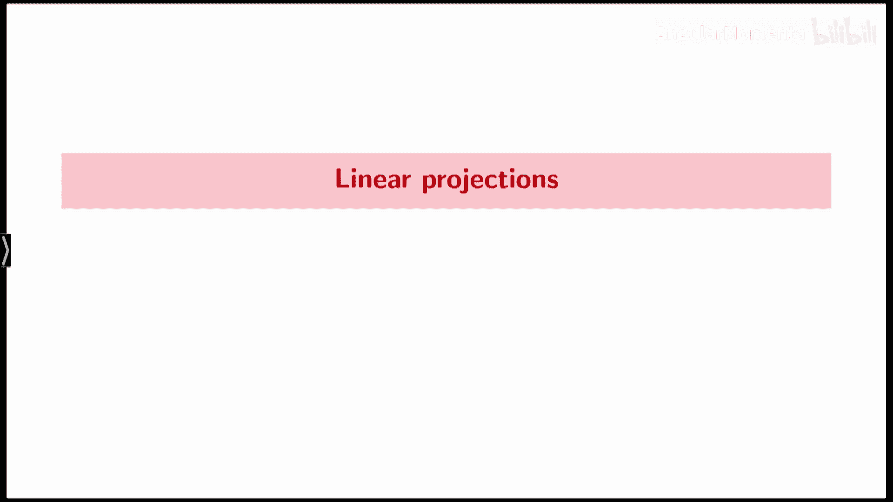

A very effective form of representation learning is linear projection。

Today we'll see what that means。So we'll begin with a little discussion about dimensionality reduction and then we'll look at two approaches。

 choosing informative coordinates versus choosing informative directions。

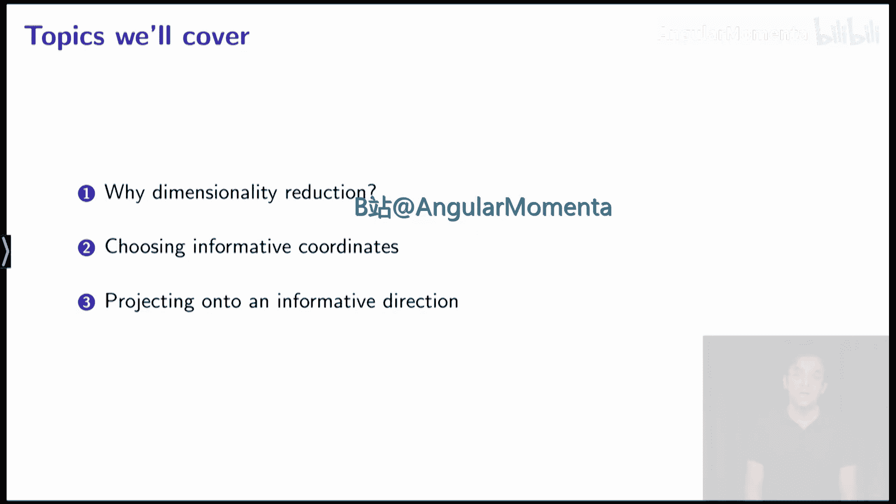

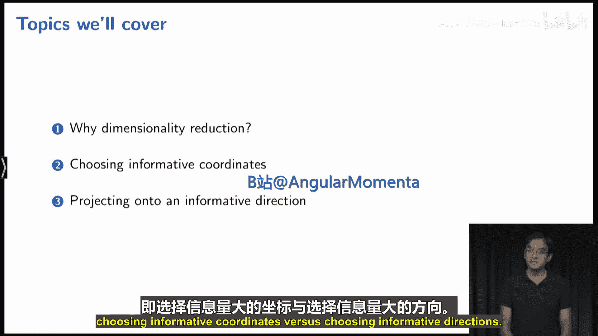

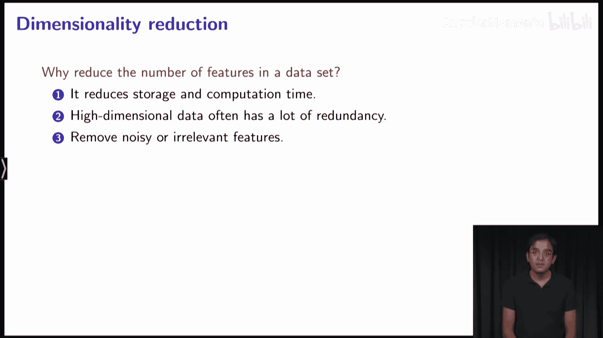

So when you are given a very high dimensional data set。A natural question to ask is。

 does the dimension really need to be this high？

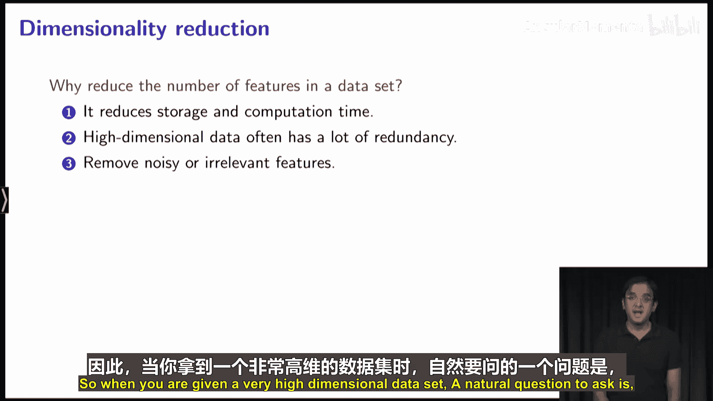

Or is there some way to reduce the dimension while retaining all of the information in the data or at any rate almost all of the information？

If we could reduce the dimension in this way。It would afford some benefits。So first of all。

 lower dimension would mean quicker computation and perhaps more importantly a smaller memory need。

Second， high dimensional data often has a lot of redundancy in it， so for instance。

 in gene expression analysis。There are often groups of genes that act together as a unit that are coexed。

Do we really need separate features for each of them or is it possible to combine them into a single group feature？

And third， dimensionality reduction is a great opportunity to jettison irrelevant or noisy features if you're looking over somebody's medical record to assess whether they are at risk for some disease。

 there's a lot of irrelevant information in their Social Security numbers， for example。

These should these are pure noise， and we should just get a rid of them。

So how would we do dimensionality reduction， So let's start with a simple example。

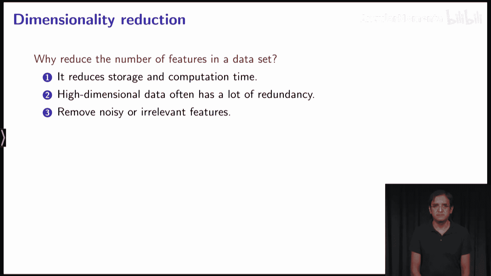

So this is a picture of a digit from the M data set， and if you recall these images are all 28 by 28。

 so it's 28 pixels across 28 pixels high。So it's a total of 784 pixels。

 which means that we can write them as a 784 dimensional vector。

 we first copyied down the first row of pixels in the second row and so on。

So does the dimension really have to be 784 or can we reduce it somehow。

 can we throw away some of these pixels？Well， we can definitely get rid of the corner pixels。

 so this corner here and that one and that one。These pixels have no information they're always off。

 basically。So we have now reduced the dimension from 784 to 780。 okay， it's a bit of a slow start。

But maybe we can keep going in this way okay， now before we get too excited。

 we should just take a step back and think about what we just did。

Why were we able to get rid of these pixels？Well， they always have the same value。

 which means that they don't vary at all。In other words， they have zero variants。😊。

So that gives us an idea if we're going to throw away more coordinates， more pixels。

 why don't we choose the ones with the lowest variance， the least informative pixels？

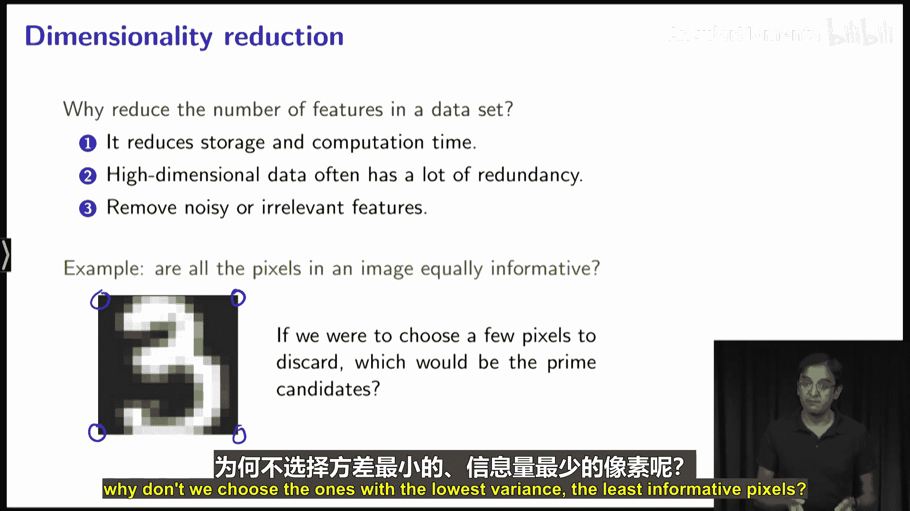

And this graph shows you what happens when you do that Okay， so let me explain。Now。

 if we look at all 784 coordinates， if we look at the full representation。

 the total variance in it is simply the variance of the first pixel plus the variance of the second pixel and so on。

 so the total variance is the variance of pixel number I where we sumi over all of the coordinates。

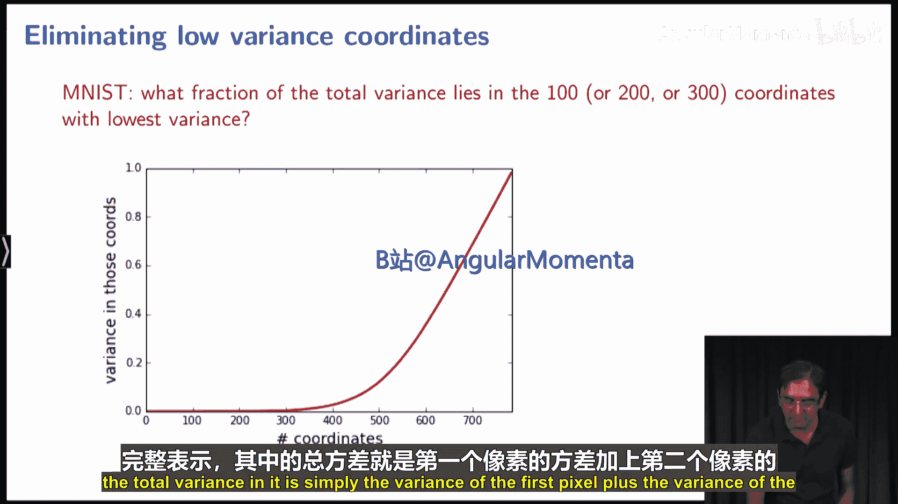

This is the total variance。And what this graph shows is how much of that variance you lose when you throw away some of the lowest variance coordinates。

 Okay， so let's say we throw away 600。Of the lowest variance coordinates。

 so we choose the 600 coordinates with the lowest variance， we throw them away。

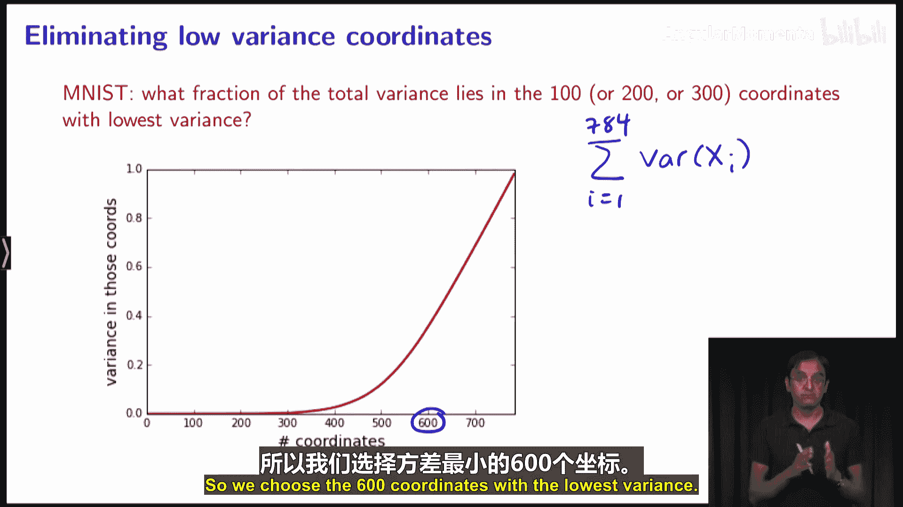

If we do that。We lose about 40%。Of the overall variance。Okay。

So one of the interesting things here is that we can throw away。

Three to 400 pixels and lose essentially no variance in the process。So this is great。

 we can reduce the dimension from about 800 down to about 400。

 we can have the dimension quite easily in this way。Now it'll turn out that we can actually do much。

 much better than this， we can in fact reduce the dimension not down to 400。

 but to something much more like 50 or maybe even less。But in order to do that。

 we need a slightly more general dip of projection。

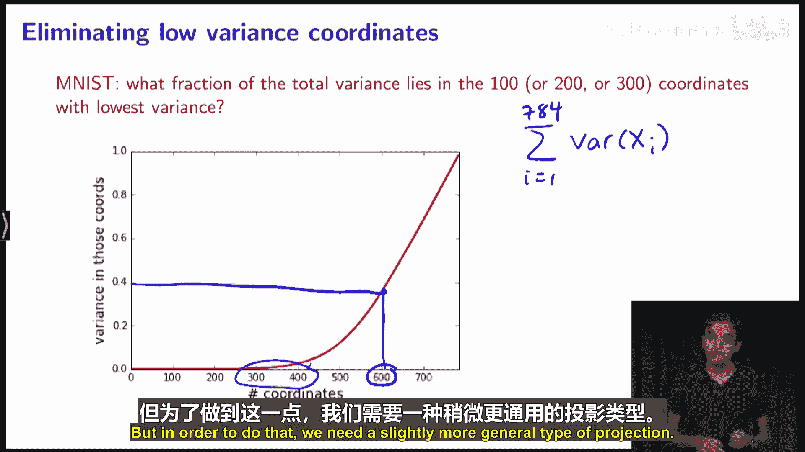

So in order to explain that， let's look at this 2D data set over here， so it has two features。

 x1 and x2， and there's quite a bit of variance along each of these two directions。

 so these are not directions that we would naturally be inclined to discard at all。

But if you look at this data， there is quite a lot of correlation between the two features。😊。

And so the question is， is there some way to exploit this correlation and somehow reduce them to just one number instead of two numbers okay and there is the thing to do is to project onto this direction。

 the one shown in red，😊。

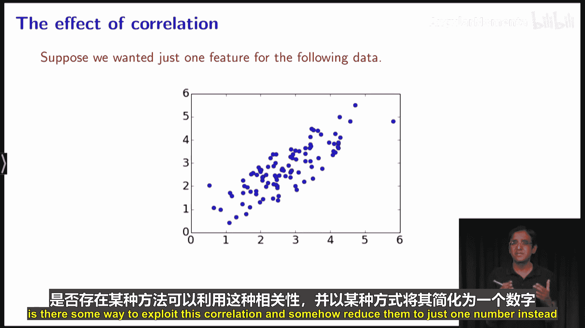

So what does it mean to do this kind of projection？Well， let's look at this point， for example。

What we will do is to project it onto the line， so we drop it onto the red line。

And we get this value over here， we replace that 2D point by this distance。So we get just one number。

Okay， well let's say we take this point， we will project it onto the line。

Projecting onto the line means finding the closest point on the line okay and what that means is that you have to hit the line at a right angle。

Hit the line at a right angle and you replace that two dimensional point by this length over here。

Okay。And in this way。The data set gets boiled out to one dimension。

 and since the points by and large life fairly close to this line。

 not a lot of information has been lost in the process。So what exactly is this line。

 what is this red direction？It turns out that this is the direction of maximum variance。Okay。

 what does that mean？

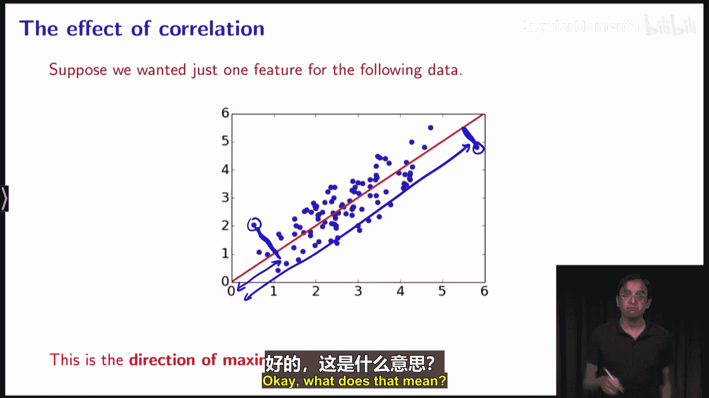

Well， let's talk a little bit about projections more generally so once we move away from just looking at coordinates。

 there are infinitely many directions we can project onto， we can project onto this direction。

 we can project onto this direction， and so on okay。So let's look at some of these。

 suppose we project onto this direction。The X1 direction。Okay， so then。

A point x1x2 simply gets mapped to its first coordinate x1。

What is the variance of the projected data， it's just the variance of x1。

Let's say we project onto this direction。That coordinate access， then x1 x2。

Gets mapped just to eggs too。What is the variance of the projected data。

 it's just the variance of x2。But there's no reason why we need to limit ourselves to coordinate projections。

 we can also project onto to another direction like this。

And if we project onto an arbitrary direction of this kind。

 then it'll turn out that x1x2 gets mapped。To some linear combination of x1 and x2。

 it gets mapped to a single number that's of this form， A X1 plus B x2。

 where A and B are some constants。

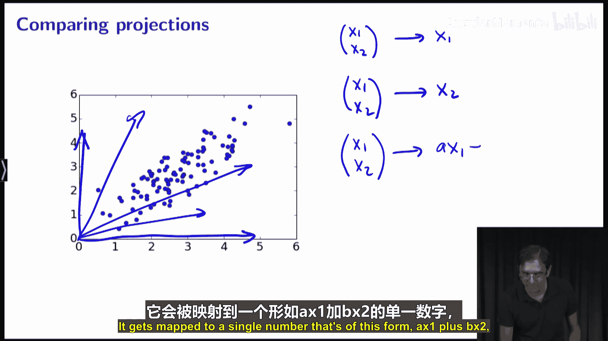

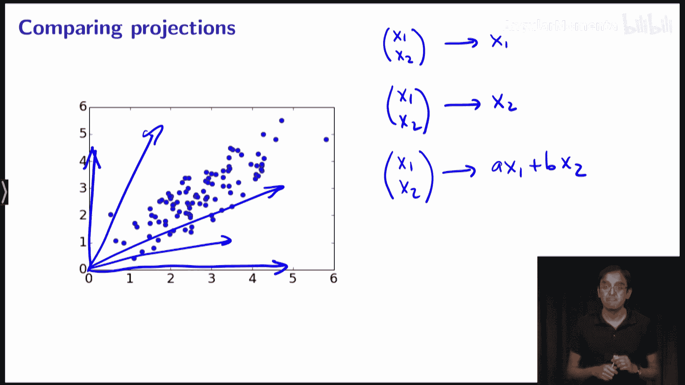

And again， we get a one dimensional value and we can talk about the variance of these numbers。

And what we want to find is the direction along which this projected data has the highest variance possible。

😊，Now。It will turn out that this is something we can solve quite easily， but before we get into that。

 we need to formalize what exactly a projection is mathematically。

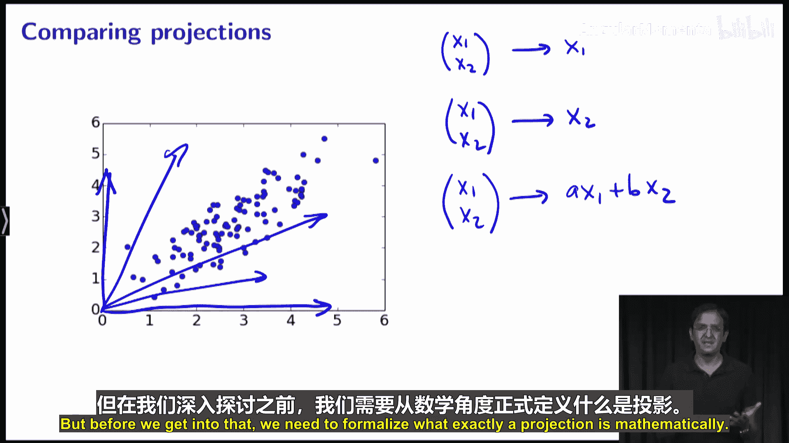

So we want to project onto some direction， so maybe a direction like this。

The length of that particular vector doesn't matter。

 So projecting onto this direction is the same as projecting onto this direction and is the same as projected on projecting onto that direction and so on。

 So for convenience， what we often do is to normalize to unit length。

 So when we when we're projecting onto a certain direction。

 we represent that direction by a unit vector， a vector of length 1。

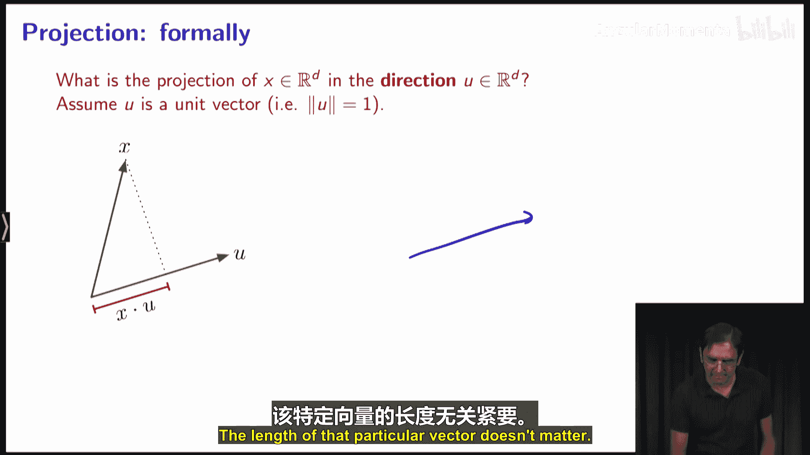

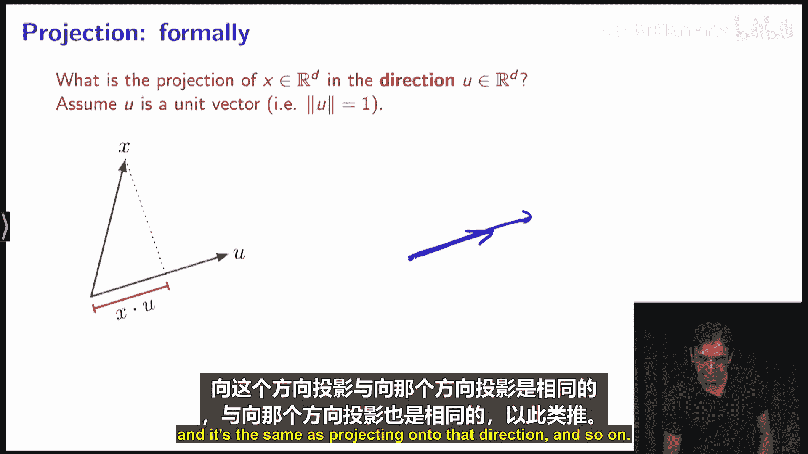

Okay， so for example， let's say we want to project onto the direction 3，4。Okay， so it's a direction。

 something like this。Is that a unit vector， Does it have length 1， Well。

 let's see what is the length of that it is。3 squared plus4 squared， which is 25。

 so it's5 The length is five， it's not a unit vector。So to make it into a unit vector。

 we just divide by the length， instead we use three fifths and4 fifths。

And that's the direction that we're going to project onto to， okay？So how does one do projections？

So now we have some direction U that we are projecting onto。

What is the projection of a point x onto that direction？It is simply the dot product between x and U。

 it's x dot u， which is the same as u dot x， which is the same as u transpose x。

 which is the same as x transpose u， that's all it is Okay， this length over here。

 which is the projection is just x dot U。Why is that Well， it's actually very simple to explain Okay。

 so let's look at this angle， let's call it theta。So what is the projection， the projection is。

 so if you remember trigonometry， the projection is the length of x。Times the cosine of that angle。

And when we were talking about dot products when we first talked about dot products。

 we saw that they actually give you the angle between two vectors Okay we saw a formula that said that cosine of theta is actually x dot U。

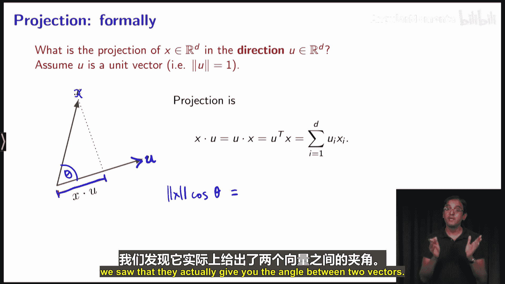

Divided by the length of x and divided by the length of U。Now U is a unit vector。

 so its length is one， and so do you see how it all works out？Okay。

So projections are just dot products。Let's see a couple of examples of this Okay。

 so here we have a vector x and we want to project it onto two different directions， so let's see。

In the first case， we want to project it onto the x1 axis， what is that that is 10。

It's the x1 direction。And to project it onto that direction， we just do a dot product。

Dot product with2，3， and we get two， the answer is2。Very simple and what we would have expected。

Now let's do the second one。One negative one we want to project onto that direction oh wait we need to make sure that it's a unit vector。

 what is its length well it's 1 plus one square so it's a square root of 2 in order to make it a unit vector we have to divide by its length。

 so we divide by square root of  two。Now we can take this and do the dot product with two， three。

And what do we get？We get 2-3 divided by square root 2， so minus1 over square root 2。

 The answer to this is minus1 over square root 2。And that's it。OkaySo that's it for today。

 weve formally introduced the notion of projection and found that all it is is dot product。

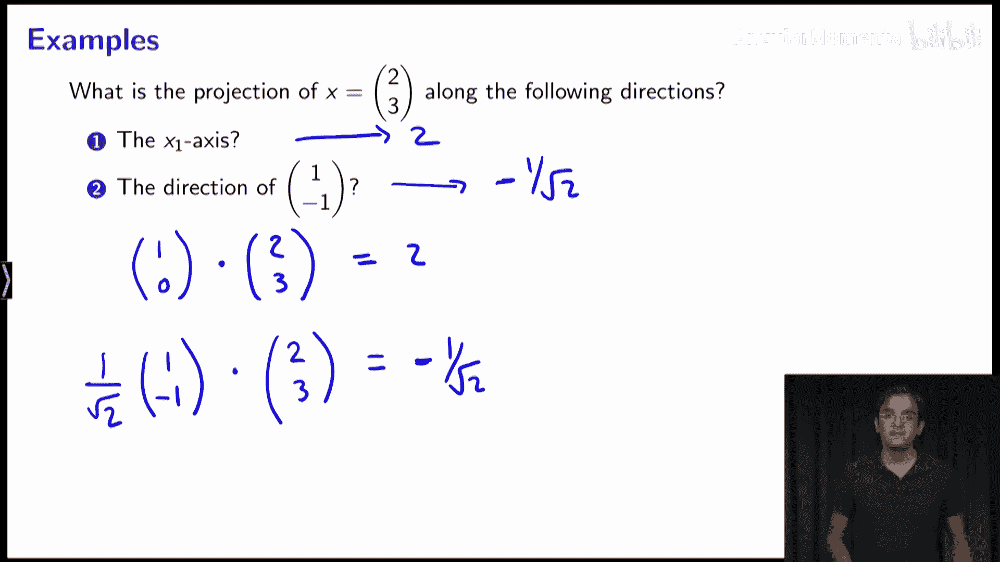

Next time we'll build upon this and we'll find the direction of maximum variance， see you then。

