# 【加州大学圣地亚哥分校】机器学习基础  Machine Learning Fundamentals p50 10-02-02-主成分分析_I -BV1TyFSziEZb_p50-

Last time we talked about what a projection means， what we'll do today is to find the direction of highest variances。

The best projection onto a single direction。

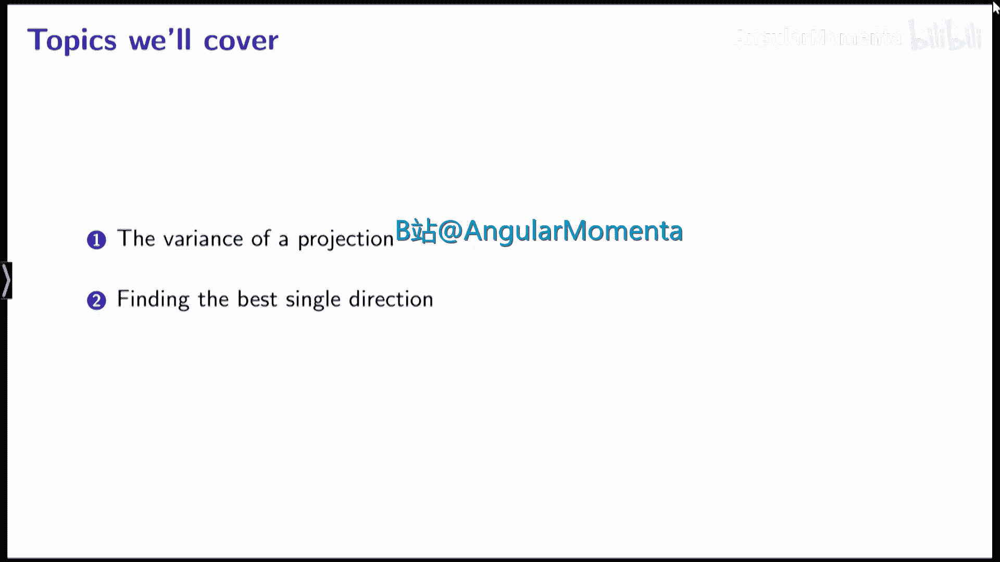

So we'll start by looking at the variance of a projection in any direction。

 and then we'll see how to find the best direction。

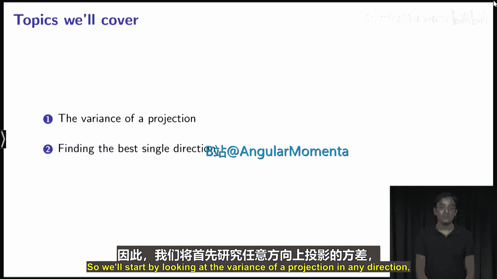

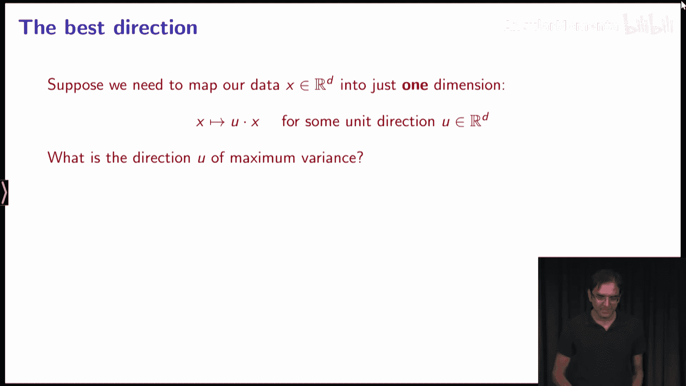

So suppose we have a data set in D dimensions and we want to map it down to just one dimension。

 we want to project it down into one dimension。So we find a unit vector U and the projection then is just the dot product。

 U dotX。We want to find the direction you for which this projected data has as much variance as possible。

 is in a sense， as informative as possible。😊，What is the direction of maximum variance？

How would we find that？Well I suppose we could try many different directions， we could say， okay。

 let's try to project onto this direction， we project everything on there。

 and we compute the variance of the projected points， then we try another direction。

 we project the points on there， compute their variance。

But there are infinitely many directions to choose from。

 so this would be really a hidden miss process。It turns out that there is a very simple formula that gives us the variance in any direction。

So here it is so we have this D dimensionional data X。Let's look at its covariance matrix Sigma。

Then the variance in any direction U is simply u transpose sigma U。 That's it。Okay， simple。

But it's also rather abstract， so let's look at a slightly more concrete setting。

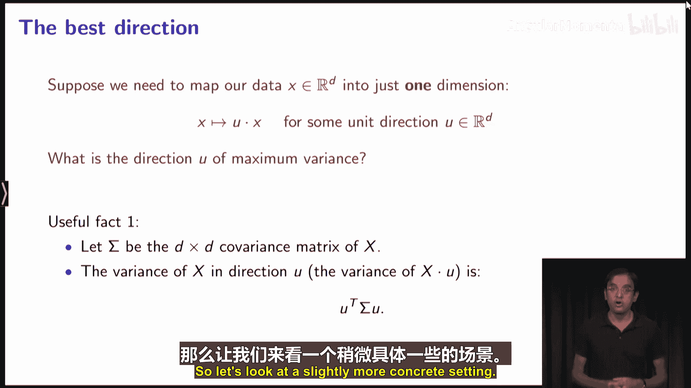

Okay， so here's a familiar data set， this is a two dimensional data set。

 and so it's covariance matrix is going to be a two by2 matrix。 Okay。

 so just to remind you in the covariance matrix， this number over here is the variance of the first feature。

 so that's the variance of x1。This is the variance of the second feature， so the variance of x2。

The off diagonal numbers are going to be the same since it's a symmetric matrix。

And what the oft diagonal number represents is the covariance of x1 and x2。

And it's a positive number representing the fact that there's a positive correlation between these two features。

 the data is sloped upwards。Okay。So what did our formula say。

 So we said that if we want to project onto a direction U。Then the variance in that direction。

The variance of x dot U is simply u transpose sigma U。Let's try this out Okay， so for example。

 let's say we want to project onto the x1 axis Okay， in that case。

 the vector we're projecting onto the the projection direction is 10。 That's the x1 direction。

And what is x transpose sigma， U， Well， x transpose is 10。 Sigma is 1。85。85，1。And 1，0。

This works out to one。Is that the variance of the projected data， Yes。

 it's the variance of x1 we already knew that。Let's try another direction。

Let's say we want to project onto the x2 direction， Okay， so 01。This time， you transpose。

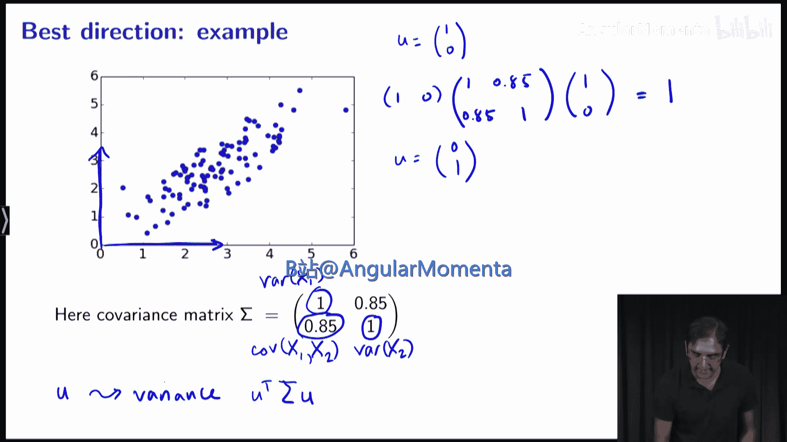

Sigma you。Is。0，1。1。85。851。

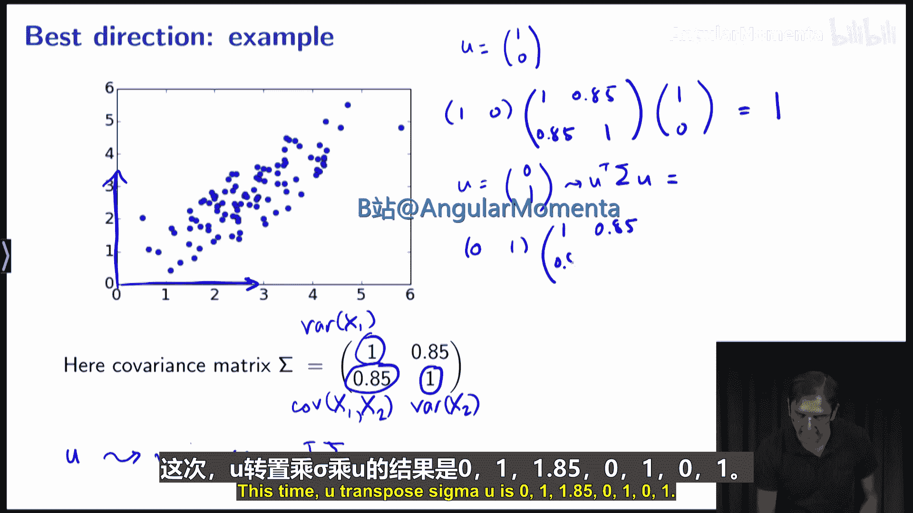

01， and this is again， one。Okay， so the projection in that direction is also one， which we also need。

Okay， so so far we haven't learned anything new。 let's try another direction。

 why don't we try this direction over here？The direction 1，1， okay。So now U is11。Oh wait。

 so it has to be a unit vector Okay， so what is the length of this thing，11。

 the length is square root 2。 So in order to make it a unit vector。

 we have to divide it by square root 2。 So let's put a one over square root two in front of it。

 Okay so this is the direction we want to project onto。What is the variance in that direction？

It's u transpose sigma U， which is， let's pull the square root twos out front so we get a half。1，1。

 sigma 1，1。

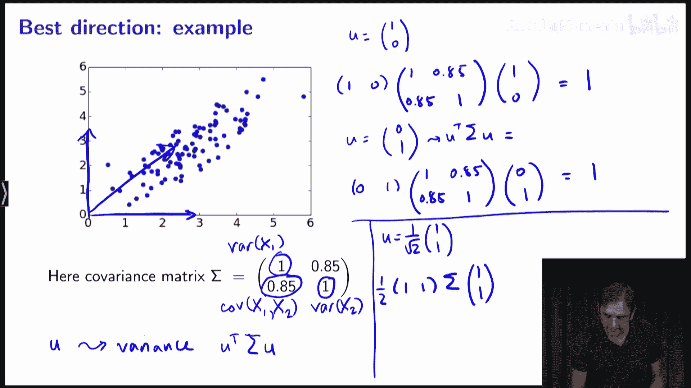

And what that is is just the sum of the entries of sigma divided by 2， which is 1。85。

So the variance in this direction， if we project onto this direction。

The projected data has a variance of 1。85。Much higher than either of the coordinate projections。

 So this is clearly a much better direction to project onto。 And in fact。

 this is the direction of highest variance。How can we be sure of that？

So let's go back to our slightly more abstract discussion and see how we know。

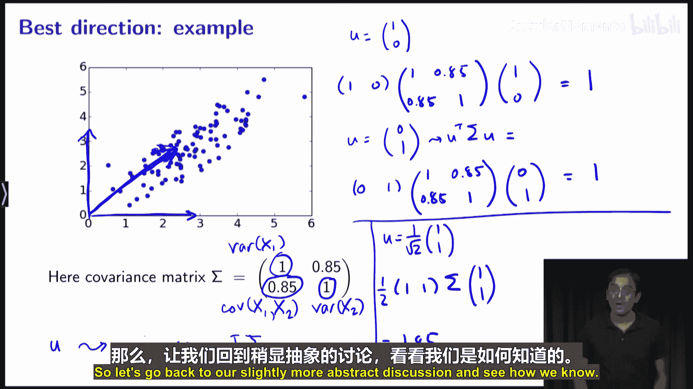

嗯。So we have this data in de dimensional space， we know that the variance in any direction u is u transpose sigma U。

What we want to do is to find the direction that maximizes this quantity U transpose sigma U。

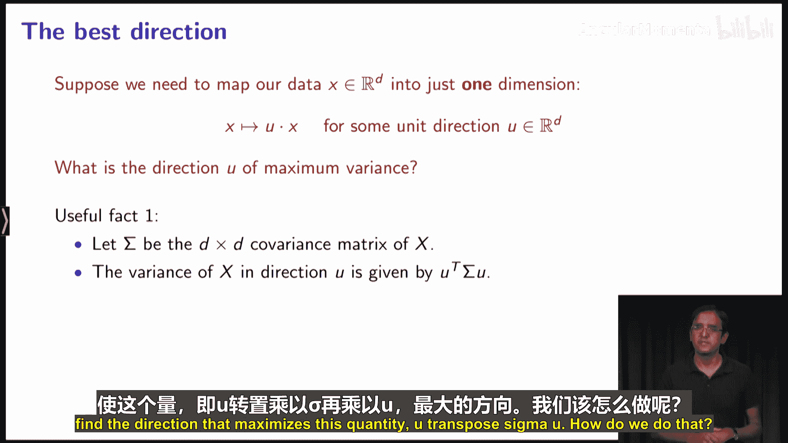

How do we do that？It turns out there's a very simple answer。That direction， the maximizing direction。

 is simply the first eigenvector of Sigma。 That's it。Okay， but what exactly is the eigenvector？Well。

 this is a very important concept that gets used a lot in machine learning。

 and so we will be covering it quite carefully soon。But for the time being。

 let me just say a few words about it。So sigma is not just any old matrix Okay， so first of all。

 it is a square matrix， it's D by D， it's symmetric。

We saw a little earlier that it's also positive semi deffinite， so it has a lot of nice properties。

And when a matrix has these kind of nice properties。

It has associated with it a set of these special directions， called eigenvectors。Along with a set of。

Numbers called eigenvalues， positive numbers that tell you the stretch of the matrix in each of those directions。

Okay， so this all sounds rather mysterious right now。

 and it will hopefully make sense in a week or so。But for the time being。

 the main thing to bear in mind is that these eigenvectors， these special directions。

 are easy to obtain。Python will do it for you， for example。

 you just feed in the covariance matrix and it gets you back these directions。

 and then you just have to pick the top eigenvector。And that is the direction of maximum variance。

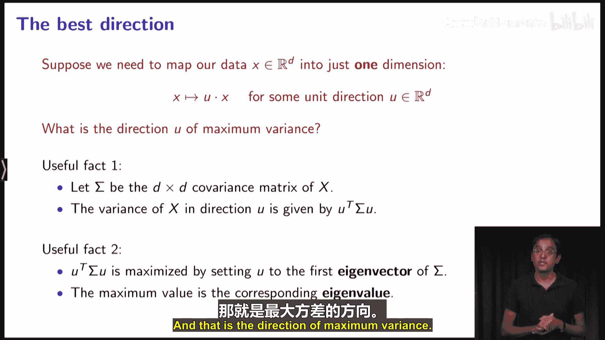

So going back to our example， the direction of maximum variance。

 the top eigenvector of the2 by two covariance matrix in this case is exactly the direction shown here in red。

And when we project the data onto this direction， it's often called the top principal component of the data。

 This is the simplest case of principal component analysis。嗯。So， that's it for now。

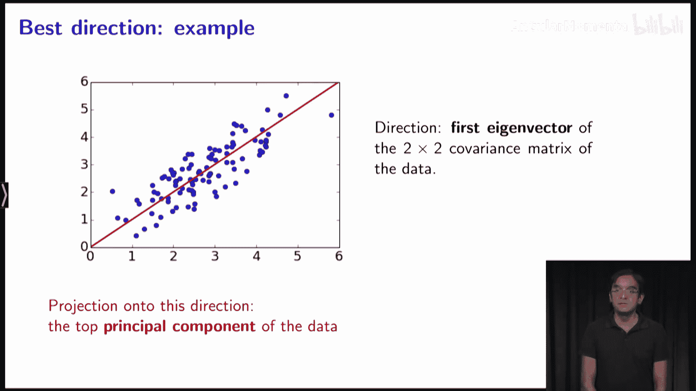

Today， we've seen how to find the best single direction on which to project data。

Next time we'll generalize this and see what if we want to project the K directions。

 what should we set them to？食宵点。